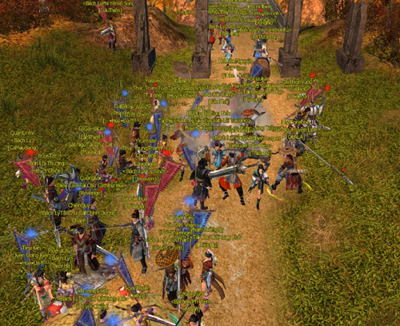
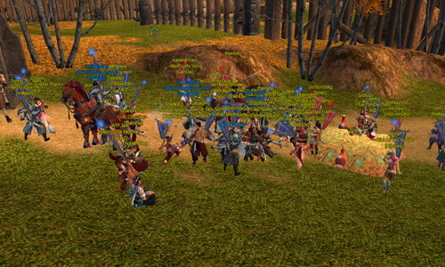
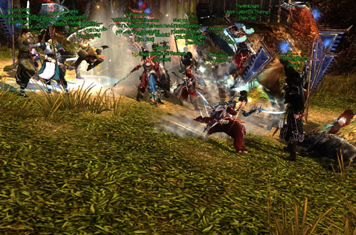
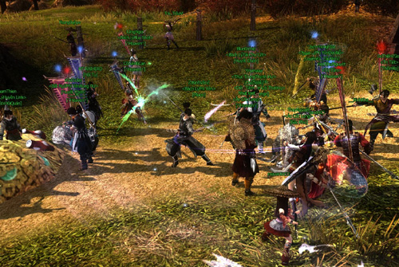
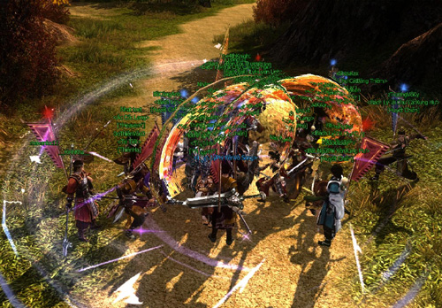
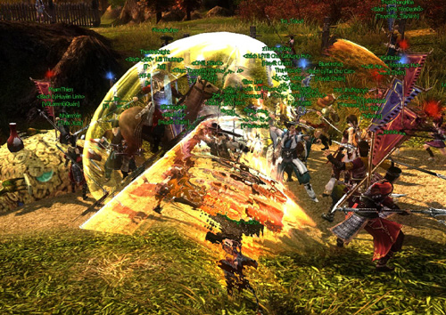
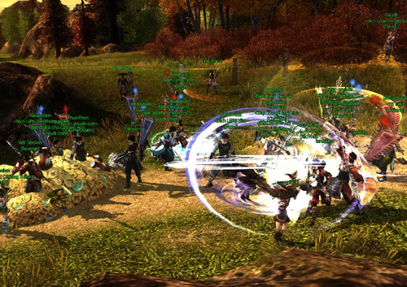

Dũng mãnh, nghĩa khí, trung thành tuyệt đối - là những từ nói về các anh hùng hào kiệt trong môn phái [Thiên Sách](../mon-phai/thien-sach.md), được mệnh danh là "Đông Đô Chi Lang", vang danh giang hồ.

Ngoài chuỗi nhiệm vụ phong phú, cũng giống như những môn phái khác với các **hoạt động hàng ngày** đòi hỏi tính đồng đội và kỹ năng điêu luyện, Thiên Sách được biết đến với một hoạt động không kém phần hấp dẫn: "**Thiên Sách - Bãi Săn**".

  
 ***Vị trí diễn ra sự kiện "Thiên Sách - Bãi Săn"***

Và vào **19h00 - 20h00 ngày 24/07/2013**, hoạt động hàng ngày **"Thiên Sách - Bãi Săn" đã diễn ra thật hấp dẫn** với sự xuất hiện của 2 phe Thiên Sách và Thần Sách, mục tiêu là triệt hạ linh thú thật nhanh để có thể sở hữu những phần thưởng giá trị.

Chính vì thế ngay từ khi sự kiện chưa diễn ra, một vùng trời cấm địa đã tấp nập môn đệ Thiên Sách và hảo hán từ trung nguyên tề tựu, ai ai cũng háo hức được thử sức, trải nghiệm tính năng mới ngay từ ngày đầu tiên.

  
 ***Hảo hán tề tựu trải nghiệm tính năng mới***

"Làm sao để vào pt?", "Huynh ơi giúp muội với!", "Ai giúp mình vào phe với", "Lại NPC nhận nhiệm vụ vào phe kìa các huynh ơi"...và rất nhiều lời đối thoại thú vị khác giữa các anh thư hào kiệt chính là những điều minh chứng rõ nhất cho sự tò mò với một tính năng hấp dẫn hàng ngày.

Không ai có thể biết rằng linh thú sẽ xuất hiện ra sao, mạnh như thế nào?... càng làm cho không khí trở nên náo nhiệt hơn, xen lẫn những "cái đầu lạnh" sẵn sàng xả thân...giết quái cứu Mộng Ly.

  
 ***"Lại NPC nhận nhiệm vụ vào phe kìa các huynh ơi"***

Và khi tất cả đang còn tìm NPC để nhận nhiệm vụ, hồi hộp chờ đón linh thú xuất hiện thì thời khắc quan trọng cũng điểm, nhưng tất cả đã phải ngỡ ngàng và được một phen "cười vỡ bụng" vì linh thú là những...chú heo.

Ngay lập tức không ai bảo ai, hàng loạt chiêu thức [cửu đại môn phái](../mon-phai/cuu-dai-mon-phai.md) liên tục xuất ứng làm rung chuyển một vùng trời nhằm làm cho những chú heo một phen "tơi bời".

Những quái heo tưởng chừng như "bé nhỏ" này lại sở hữu một lượng máu khá "bá đạo" mà chỉ khi đạt đến cấp độ 80 mới được "diện kiến", khiến cho các anh hùng hào kiệt đang tham gia ngỡ ngàng xen lẫn một cảm giác thú vị khi vừa được xuất chiêu liên tục, vừa được tận mắt thưởng ngoạn vô số những chiêu thức tuyệt mỹ của các môn phái khác.

  
  
 ***Heo nhỏ nhưng...có võ***

Anh hùng hào kiệt, dũng mãnh oai phong là thế...nhưng không ít nhân sĩ phải "toát mồ hôi" vì không thể nhanh chóng hạ quái thú, mấy ai có thể biết rằng khi nhận nhiệm vụ tại NPC, nhân sĩ sẽ có thể nhận được một tuyệt kỹ võ công ẩn thế bấy lâu, có thể "1 đao thấu trời" những chú heo ngay lập tức? Đó chính là nét thú vị mà tính năng đã mang lại, đòi hỏi sự trải nghiệm và tinh thần đồng môn thật sự.

  
 ***Quyết chiến hạ linh thú, tuyệt kỹ võ công xuất thế...***

  
  
 ***Để hoàn thành nhiệm vụ đòi hỏi sự đồng lòng rất cao...***

Và khi kết thúc hoạt động cũng là lúc những "quái heo" đã bị hạ thủ với sự đồng lòng của Thiên Sách và Thần Sách, hàng "đống vàng" trước mắt chính là những phần thưởng khích lệ vô cùng lớn dành cho những anh hùng hào kiệt đã oai phong lẫm liệt hạ...heo.

Ngày đầu tiên cũng là những trải nghiệm đầy thú vị với hoạt động săn bắt, hứa hẹn một trận so tài kịch liệt khác sẽ diễn ra vào ngày tiếp theo giữa Thiên Sách, Thần Sách và..."quái heo".

  
 ***Hàng loạt "đống vàng" khiến hào kiệt tứ phương thích thú...***

Xuất thế định anh kiệt, bước đường hành tẩu trong thế giới Võ Lâm 3 vẫn còn rất rộng lớn với nhiều tính năng cùng chuỗi nhiệm vụ phong phú. Cơ hội để có thể trải nghiệm và tham gia các tính năng chính là những phút giây không thể nào quên khi cùng bằng hữu chinh phục những thử thách đầy cam go.

Hãy cùng trải nghiệm những tính năng hàng ngày đầy hấp dẫn khác như **[Đường Môn](../mon-phai/duong-mon.md) - Đường Gia Đưa Dâu**, [Ngũ Độc](../mon-phai/ngu-doc.md) với Khúc Vân Giải Độc hoặc **[Thất Tú](../mon-phai/that-tu.md) với Đại Hội Tỷ Võ**, [Vạn Hoa](../mon-phai/van-hoa.md) với Cơ Giáp Đại Chiến, **[Tàng Kiếm](../mon-phai/tang-kiem.md) với Diệp Phàm Đón Dâu**... bảo đảm ly kỳ hấp dẫn.

Ngoài ra, còn nhận được trọn vẹn, đầy đủ phần thưởng khi nhân vật đạt đẳng cấp 80. Và phiên bản chính thức sẽ được ra mắt trong thời gian sắp tới, cấp 80 chỉ là chuyện nhỏ. Hãy cùng chờ xem!

Nguồn: VNG (bài viết và hình ảnh)
