## Hệ thống bang hội

- Hệ thống Bang hội

- Giao lưu Bang hội

Những hoạt động thân thuộc, dân dã như Đua Heo Con, Câu Cá, đấu Tú Cầu... diễn ra hàng ngày, hàng giờ sẽ đem lại cho Bang hội những giây phút thú vị cũng như thu thập được những điểm thưởng thú vị.

- Lập Bang

- Nhà ăn Bang hội

- Thi đấu Tú Cầu

- Đua Heo Con

- Câu Cá

- Phát lương Bang hội

- Vườn Rau

### Thành lập Bang hội

#### Điều kiện thành lập

- Nhân vật đạt cấp **30**.

- Đến NPC **Tiếp Dẫn Bang Hội**(Lạc Dương, Dương Châu, Trường An) để lập Bang hội.

- Phí thành lập: **30 Vàng**.

- Độ dài tên Bang hội không quá 08 ký tự.

- Sau khi lập, Bang hội có ít nhất 10 Bang chúng trong 03 ngày nếu không sẽ tự giải tán.

#### Quản lý Bang hội

- Sử dụng phím tắt **K** để mở giao diện quản lý Bang Hội.

- Tại giao diện có thể xem Tin Tức Bang Hội, Quyền Hạng Bang Hội, Bổng Lộc Bang Hội, Bang Hội Đồng Minh và các Hoạt Động Bang Hội.

- Quyền hạn Bang chủ: Có thể thiết lập quyền hạn cho thành viên trong Bang hội, xây dựng kiến trúc, phát bổng lộc và mở các hoạt động Bang Hội.

#### Lãnh địa Bang hội

- Sau khi lập Bang, Bang chủ có thể mua lãnh địa cho Bang Hội.

- Sử dụng **20.000**điểm quỹ Bang và **1.000**điểm phát triển hoặc **10.000**điểm quỹ Bang và **2.000**điểm phát triển để mua lãnh địa Bang hội.

- Các thành viên trong Bang có thể truyền tống đến **Lãnh Địa Bang Hội** để tham gia các hoạt động Bang Hội.

#### Thiên Công Thụ

- Để xây dựng lãnh địa Bang hội cần gặp NPC **Cao Cửu Vấn**.

- Đối thoại với Cao Cửu Vấn để tiến hành nâng cấp lãnh địa Bang.

- **Có 03 nhánh nâng cấp**:  **Thiên Công Thụ**: Xây dựng, nâng cấp lãnh thổ, kiến trúc chính, tăng số lượng nhân lực, tăng vị trí chức vụ, tăng nhiệm vụ và phần thưởng cống hiến bang, tăng tiền lương của Bang chủ và phó Bang chủ nộp vào quỹ…  **Điền Viên**: Tăng cấp các hoạt động trong lãnh địa Bang hội (câu cá, trồng cây…), mở Tiệm Bảo Vật.  **Nhánh Niết Bàn**: Tăng lợi ích từ các hoạt động (câu cá, trồng cây...) tăng kinh nghiệm nuôi thú con, tăng khả năng rớt vật phẩm khi đi bí cảnh...

- **Lưu ý**: Nhánh Niết Bàn sẽ được **cập nhật lại** (reset) hàng tuần, điểm phát triển và Vàng sử dụng để thăng cấp trong nhánh này sẽ mất đi.

### Hoạt động Bang hội

#### Nhà ăn Bang hội

- **Thời gian**: **08h00 - 10h00**,**12h00 - 14h00**,**18h00 - 20h00**.

- **Địa điểm**: Đại Sảnh Bang Hội.

- **Đẳng cấp yêu cầu**: Không giới hạn.

- **Tham gia**:  Đến Đại Sảnh Bang Hội để tham gia và nhấp vào bàn tiệc thưởng thức món ăn.  Sử dụng món ăn sẽ nhận được hiệu quả hỗ trợ khác nhau tùy loại thức ăn. Các món ăn ở Nhà Ăn Bang Hội có thể mang theo bên người. Đối thoại với **NPC Chúc Nghi Phong** trong Nhà Bếp Bang Hội có thể mang theo đồ ăn bằng cách trả phí **01 Vàng**. 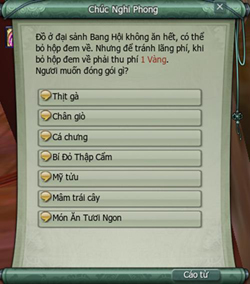 Mang theo tối đa **04 loại thức ăn**/nhân vật, sử dụng hết có thể mang thêm.  Nâng cấp **Đồ Tốt Giá Rẻ** ở Bang Hội Thiên Công Thụ sẽ tăng số món ăn. Thời gian duy trì của thức ăn mang theo là **218 ngày 14 giờ 43 phút**, sau khi nhận 12h thức ăn sẽ bị hỏng không thể sử dụng.

#### Hoạt động Tú Cầu

- **Thời gian**: Không giới hạn.

- **Đẳng cấp yêu cầu**: Không giới hạn.

- **Địa điểm**: Tại Lãnh Địa Bang Hội - Sân Tú Cầu Lưu Tinh Cản Nguyệt.

- **Hình thức:** Thi đấu **5 vs 5**, thời gian thi đấu do người chơi tùy chọn.

- **Tính điểm**: Đá Tú Cầu vào cầu môn của đối phương được **01 điểm**.

- **Phần thưởng**: **Không có phần thưởng**.

- **Báo danh**:  Báo danh tại 02 NPC tương ứng 02 đội: **Hàn Kiều Sinh** và **Hoàng Kiếm Tường**. Báo danh ở NPC nào sẽ thi đấu cho đội của NPC đó. 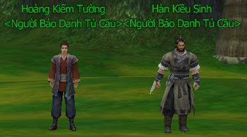 Đến NPC Hàn Kiều Sinh hoặc Hoàng Kiếm Tường, chọn "**Tham gia cuộc thi Tú Cầu**". Báo danh kết thúc khi mỗi bên đủ 05 thành viên. Trên người nhân vật sẽ có cờ xanh hoặc đỏ để phân biệt đội. 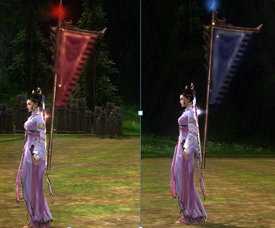 Sau khi báo danh, nhân vật sẽ nhận được đạo cụ chuyên dụng để thi đấu Tú Cầu:    **Đạo cụ** **Công dụng**       
 **Bóng Trắng** Đẩy Tú Cầu trước mặt văng xa 04 - 05 mét     
 **Bóng Đỏ** Đẩy Tú Cầu trước mặt văng xa 04 - 10 mét     
 **Bóng Lam** Đẩy Tú Cầu trước mặt văng xa 08 - 24 mét     
 **Hải Nạp Bách Xuyên** Khiến Tú Cầu trong phạm vi 10 mét xung quanh trở về bên cạnh     
 Kéo các đạo cụ xuống thanh phím tắt để dễ sử dụng

Lưu ý

- Nhân vật rời mạng hoặc trọng thương sẽ phải báo danh lại. Báo danh xong phải vào sân, nếu không **sau 01 phút sẽ bị hủy tư cách** thi đấu.

- Có thể đối thoại với Hoàng Kiếm Tường hoặc Hàn Kiều Sinh để thiết lập lại điểm và thi đấu với đội khác.

#### Đua Heo Con

- **Thời gian**: Do Bang chủ hoặc thành viên được cấp quyền mở. Không tốn phí, tối đa mở **01** lần/tuần.

- **Địa điểm**: Khu vực bên ngoài Lãnh Địa Bang Hội.

- **Đẳng cấp tham gia**: Đạt cấp 20 - 80.

- **Phần thưởng**: Vàng, cống hiến Bang, Giám Bản Ấn Văn, Điểm phát triển Bang hội.

- **Báo danh**: Đến NPC **Tam Thạch Thúc** để nhận **Cây Lùa Lợn**.

- **Tham gia**:  Hoạt động diễn ra trong **40 phút**. Đến Lãnh Địa Bang Hội để tìm lợn. Nhấp vào đối thoại để thu phục lợn. 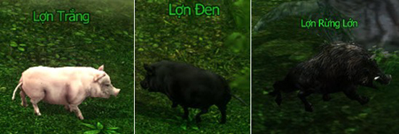 Sử dụng Cây Lùa Lợn để lùa lợn con về chỗ NPC Tam Thạch Thúc và nhận điểm.  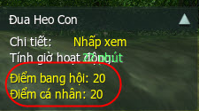 Mỗi lần dùng Cây Lùa Lợn sẽ tiêu hao sinh lực lợn con. Trên đường di chuyển có thể thu thập được **Rau Diếp**, sử dụng sẽ hồi phục **100 sinh lực** cho lợn con.

- **Lưu ý**: Người chơi khác không thể thu phục lợn con đã có chủ.

- **Phần thưởng**:     Loại lợn Điểm bang hội  Điểm cá nhân     Lợn trắng 10  10    Lợn đen 20 20   Lợn rừng lớn 30 30    Đến NPC Tam Thạch Thúc nhận thưởng. 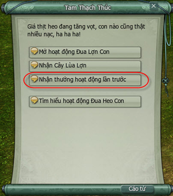 Nếu đạt trên **1.000** điểm sẽ được phần thưởng thêm, ngoài ra còn được Điểm tích lũy và Điểm phát triển Bang.

#### Câu Cá

- **Địa điểm**: Lãnh Địa Bang Hội - Hồ Xướng Văn.

- **Phân loại Câu Cá**:

| Phân loại | Ghi chú |
| --- | --- |
| **Câu Cá hằng ngày** | Không giới hạn thời gian. Yêu cầu: Cấp **20** trở lên. Tiêu hao Tinh lực. |
| **Câu Cá mỗi tối** | Thời gian: Từ **21h00** - **23h00**. Yêu cầu: Đẳng cấp từ**20 - 80** (cấp 80 được hưởng thêm lợi ích từ hoạt động). Tiêu hao Tinh lực. |
| **Câu Cá hoạt động** | Thời gian: Bang chủ tùy chọn, tối đa mở 01 lần/tuần. Yêu cầu: Cấp **20** trở lên. Tiêu hao Tinh lực. |

- **Tham gia**:

| Phân loại | Ghi chú |
| --- | --- |
| 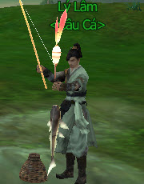 | Đối thoại với **NPC Lý Lâm** để mua Cần Câu và Mồi Câu  |
|  | Chọn một vị trí bất kỳ xung quanh Hồ Xướng Văn, nhấp chọn Cần Câu để thả câu. Khi hệ thống thông báo cá cắn câu, phải thu cần ngay nếu không sẽ bị mất cá. |

- **Sử dụng Cá**:

| Phân loại | Ghi chú |
| --- | --- |
| Cá thường | Đối thoại với **NPC Tiểu Đậu Đinh** để mua Bật Lửa Gỗ 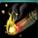 **Giá**: **01** Vàng. **Công dụng**: Sử dụng để đốt lửa trại trong Lãnh Địa Bang Hội. Đến Đống Rơm cạnh bờ Hồ Xướng Văn để đốt lửa trại. 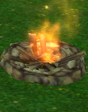 Chọn loại cá muốn nướng. Cá nướng có thể cho nhân vật sử dụng hoặc bán cho Thương Nhân. **Lưu ý**: Một số loại cá thường sau khi nướng sẽ thành món ăn có hiệu ứng đặc biệt. |
| Cá đặc biệt | Nhận nhiệm vụ tại NPC Lư Lư.  Nhân vật phải câu được loại cá theo yêu cầu nhiệm vụ và giao cho **NPC Tần Tam Kim** ở Nhà Ăn Bang Hội. Sau khi giao cá, quay lại Hồ Xướng Văn trả nhiêm vụ và nhận thưởng. **Lưu ý**: Trong thời gian Câu Cá do Bang chủ khai mở, nhân vật có thể dùng cá câu được đến đổi thưởng tại **NPC Lý Lâm**. |
| Cá hiếm | Đặc biệt có một số loại cá hiếm, khi câu được hãy thả nó xuống nước. |

- **Mở hoạt động Câu Cá**:  Đối thoại với **NPC Lý Lâm** chọn "Mở hoạt động Câu Cá tuần này".  Bang Chủ có thể tùy chọn cách mở hoạt động Câu Cá trong tuần. Lựa chọn tốn phí Điểm phát triển Bang thì lợi ích nhận được nhiều hơn. Hoạt động diễn ra trong 40 phút, tất cả thành viên trên **cấp 20** có thể tham gia.

- **Phần thưởng**: Bên cạnh các loại cá, khi câu sẽ có cơ hội nhận được phần thưởng:

| **Hình ảnh** | **Ghi chú** |
| --- | --- |
| ** Cửu Hoa Ngọc Lộ Tán** | Tăng tối đa 100 điểm Tu Vi |
| **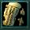 Kiếm Khách Hành - Tàn** | Thu thập 6 Kiếm Khách Hành - Tàn ghép thành Kiếm Khách Hành - Đoạn sẽ nhận được hiệu quả ngẫu nhiên |
| ** Rương Báu Thiếc** | Dùng Chìa Khóa Thiếc mở, tiêu hao 10 điểm Thể Lực. Tỉ lệ cao nhận được Bí Kíp, Thư Tịch, tài liệu hoặc Đá Ngũ Hành, Đá Ngũ Sắc |
| ** Rương Báu Đồng** | Dùng Chìa Khóa Đồng mở, tiêu hao 5 điểm Thể Lực. Có tỉ lệ nhận Bí Kíp, Thư Tịch, tài liệu hoặc Đá Ngũ Hành, Đá Ngũ Sắc |
| ** Hí Hổ Đồ - 1** | Sử dụng nhận được Hoan Lạc Hống tăng khí huyết tối đa 200 điểm trong 15 phút. |

#### Phát Lương Bang hội

- Do Bang chủ quyết định ngày phát, phát lương 01 lần/tuần.

- Thời gian nhận và phát lương: Từ **10h00** - **22h00** trong ngày.

- Bang chủ đến gặp NPC **Tổng Quản Bang Hội** chọn "Ta muốn phát lương".

- Nhận lương tại bàn thờ **Quan Nhị Gia**trong Lãnh Địa Bang Hội.

- Không giới hạn cấp độ nhận lương, tối đa nhận **50.000** Vàng/người/ngày.

- Lượng vàng dùng để phát lương phải**thấp hơn 80% ngân quỹ**.

#### Vườn Rau

**Địa điểm**: Lãnh Địa Bang Hội - Sơn Thủy Điền Viên.

**Phân loại**:

- **Trồng trọt hằng ngày**: Không giới hạn thời gian, cấp **20** trở lên, tiêu hao Thể Lực.

- **Vườn Rau Bảo Vệ Chiến**: Bang chủ tùy chọn thời gian, tối đa mở 01 lần/tuần, cấp **20** trở lên.

##### Hướng dẫn trồng vườn

- Đến NPC Quách Ngữ Thành mua hạt giống.

- Có thể mua thêm các loại hạt giống phong phú khác tại NPC Địch Tố Tố.

- Chọn thửa ruộng trong khu vực Sơn Thủy Điền Viên và bắt đầu gieo hạt.

- Khi độ phát triển đạt 100% có thể thu hoạch (trường hợp người khác thu hoạch giúp, thành phẩm sẽ được chuyển qua thư).

- Nộp thành phẩm cho NPC Quách Ngữ Thành nhận được điểm phát triển Bang và Vàng.

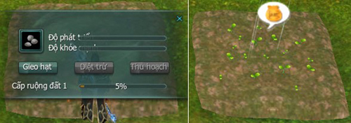

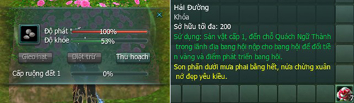

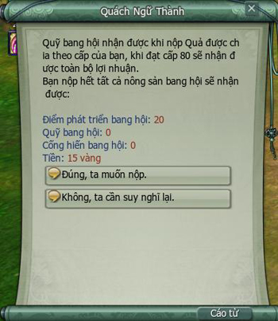

##### Hướng dẫn trồng chậu

- Đến **NPC Nam Kha** mua chậu hoa.

- Nhấp chọn vào chậu hoa, sau đó nhấp chọn vào hạt giống muốn trồng.

- Thể Lực sẽ tiêu hao tùy loại đẳng cấp hạt giống.

- Sau 30 phút có thể thu hoạch.

| **Đạo cụ** | **Công dụng** | Tính chất |
| --- | --- | --- |
|  **Vũ Lạc Ngọc Bàn** | **Giá**: **100** Vàng. **Công dụng**: Chậu hoa sản lượng thường. | Không trồng cùng lúc với chậu khác, yêu cầu đẳng cấp 20 trở lên. |
|  **Phong Thanh Ngọc Bàn** | **Giá**: **150** Vàng. **Công dụng**: Chậu hoa sản lượng x1,5. |  |
|  **Vân Chi Ngọc Bàn** | **Giá**: **300** Vàng. **Công dụng**: Chậu hoa sản lượng x2. |  |

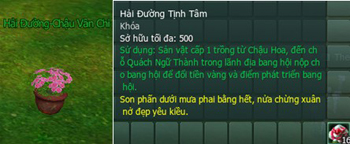

##### Vườn Rau Bảo Vệ Chiến

- Đến **NPC Thiệu Khanh Thành** chọn "Mở trận Vườn Rau Bảo Vệ Chiến".

- Có thể mở trực tiếp trên giao diện Hoạt Động Vườn Rau Bang Hội.

- Sau khi mở, hệ thống sẽ thông báo **Lợn Cửu Giới** xuất hiện.

- Lợn Cửu Giới sẽ xuất hiện tại Chúc Dung Sơn, nhân sĩ phải đánh bại nó trước khi nó tiến vào Sơn Thủy Điền Viên phá hoại Vườn Rau Bang Hội.

- Nhặt các vật phẩm xuất hiện trên đường đi của Lợn Cửu Giới để tấn công. Sau khi tiêu diệt Lợn Cửu Giới, tất cả thành viên trong Bang đều có thể nhặt được **Tử Vẫn**. Tối đa nhặt 01 lần/tuần.

- **Phần thưởng**:

| Vật phẩm |
| --- |
| Lục Lâm Hào Hiệp Cống - Nhật (sử dụng nhận 1.000 cống hiến Bang) |
| Giám Bản Ấn Văn |
| Đá Ngũ Hành (thuộc tính ngẫu nhiên) |

## Giao lưu bang hội

- Hệ thống Bang hội

- Giao lưu Bang hội

Sức mạnh của Bang hội không thể thiếu trên hành trình bôn tẩu hành hiệp. Tất cả sẽ cùng nhau đương đầu với các thế lực tàn bạo để làm nên lịch sử võ lâm. Có thể nói khi tham gia quyết chiến tại [Chiến trường](./chien-truong.md) Tuyết Nguyên Tranh Phong sẽ đem lại thật nhiều niềm vui cho quý nhân sĩ.

- Đồng minh

- Quyết chiến

- Tuyên chiến

### Đồng minh Bang hội

- **Điều kiện**: Các Bang hội liên minh phải cùng thuộc Hạo Khí Minh, Ác Nhân Cốc hoặc Hạo Khí Minh - Trung lập, Ác Nhân Cốc - Trung lập.

- **Liên minh**:  Trong giao diện Bang hội, chọn "Giao lưu Bang hội" rồi mục "Đồng minh Bang hội". Nhập tên Bang hội muốn liên minh. Liên minh sẽ thành lập khi Bang hội được mời chấp nhận. Sau khi liên minh 72 giờ sẽ có thể tham gia các hoạt động tuyên chiến và quyết chiến.

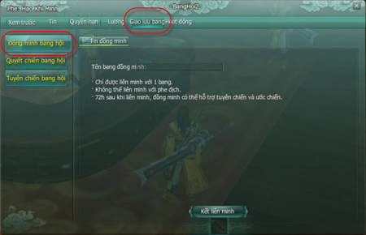

### Quyết chiến Bang hội

- **Điều kiện**:  Đồng minh không được tham gia. Có thể quyết chiến với tất cả Bang hội không hạn chế phe phái.

- **Gửi chiến thư**:  Trong giao diện Bang hội, chọn thẻ "Giao lưu Bang hội". Chọn mục "Quyết chiến Bang hội" → "Phát động quyết chiến". *Điền thông tin*: Tên Bang hội muốn quyết chiến, chọn ngày và thời điểm quyết chiến. *Lưu ý*: Quy mô tối đa 25 người/phe, yêu cầu tối thiểu 10 người mỗi phe để bắt đầu quyết chiến. *Phân loại*: **Tỷ thí** (tiêu hao 100 điểm phát triển Bang để phát động. **Quyết đấu** (tiêu hao 1.000 điểm phát triển và một lượng tiền quỹ Bang để phát động). Bang hội được mời quyết đấu chỉ cần chấp nhận nếu đồng ý. Sau khi 02 Bang đồng ý quyết chiến, đến thời gian có thể đối thoại với **Huyền Tự Ngũ Nhất** ở **Lãnh địa Bang hội** và **Khu vực Bang hội** các thành chính để báo danh vào chiến trường "Tuyết Nguyên Tranh Phong".

| Quỹ Bang tiêu hao | Thưởng Bang hội | Thưởng cá nhân |
| --- | --- | --- |
| 10.000 vàng | 2.000 điểm phát triển | 1.000 cống hiến |
| Quỹ Bang 15.000 vàng | 80 vàng |  |
| 100.000 vàng | 4.000 điểm phát triển | 1.000 cống hiến |
| Quỹ Bang 150.000 vàng | 800 vàng |  |
| 500.000 vàng | 6.000 điểm phát triển | 3.000 cống hiến |
| Quỹ Bang 750.000 vàng | 4.000 vàng |  |

### Tuyên chiến Bang hội

- **Điều kiện**:  Đồng minh có thể tham gia. Tuyên chiến tối đa 01 lần/ngày. Bang tham gia tuyên chiến phải thuộc **Hạo Khí Minh** hoặc **Ác Nhân Cốc**. Bang trung lập hoặc thành viên trung lập không được tham gia.

- **Tuyên chiến**:  Trong giao diện Bang hội, chọn "Giao lưu Bang hội". Chọn mục "Tuyên chiến Bang hội". *Điền thông tin:*Tên Bang hội và thời gian muốn tuyên chiến. *Điểm phát triển:*Số điểm tiêu hao khi tuyên chiến cùng phe: **50** điểm, khác phe: **100** điểm  **Chờ**: Là thời gian chờ đến lần tuyên chiến tiếp theo. Sau khi nhấn nút tuyên chiến thì sẽ bắt đầu chiến đấu.

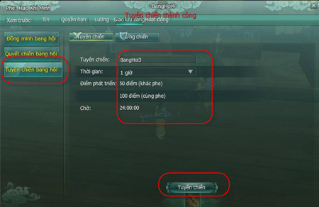

Lưu ý

- Bang được mời quyết chiến có thể chấp nhận hoặc không.

- Bang bị tuyên chiến sẽ không thể từ chối.

- Tuyên chiến sẽ diễn ra trên các khu vực tranh đoạt.

- Quyết chiến diễn ra trên chiến trường **Tuyết Nguyên Tranh Phong**.

### Chiến trường Tuyết Nguyên Tranh Phong

- **Báo danh**: Đến thời gian bắt đầu quyết chiến, người chơi đến **Khu vực Bang hội** tại 4 thành thị Trường An, Lạc Dương, Dương Châu và Thành Đô.

- Báo danh tại NPC **Huyền Tự Ngũ Nhất**.

- Đối thoại với NPC Huyền Tự Ngũ Nhất chọn **Xếp hàng báo danh**.

- Chọn Xếp hàng cá nhân.

Lưu ý

- Thành viên tham gia chiến trường phải được Bang chủ xét quyền.

- Thành viên Bang đồng minh phải tổ đội với thành viên Bang tham gia quyết chiến và chọn "Xếp hàng đội" để tham gia.

#### Bản đồ tham chiến

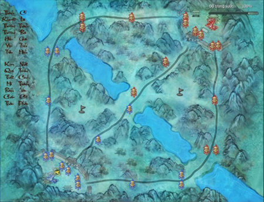

#### Mục tiêu

| Hình ảnh | Ghi chú |
| --- | --- |
| 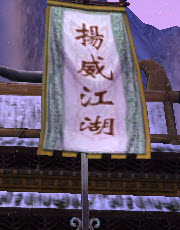 | Trong thời gian mặc định, phe hủy được **Cờ Chiến** trên **Điểm Tượng Đài** của đối phương trước tiên sẽ giành chiến thắng. |
|  | Nếu hết thời gian mà cả 2 phe đều không hủy được Cờ Chiến đối phương thì sẽ xét **tổng số tài nguyên thu thập**để phân thắng bại. |

#### Tài nguyên

Tài nguyên là căn cơ của Bang hội, tài nguyên thu được trong chiến trường có thể dùng để tạo Chiến Xa hoặc thăng cấp Tiễn Tháp.

- **Cách thu thập tài nguyên**:  Chiếm khu khai khoáng, cùng lúc chiếm được 02 khu sẽ tăng gấp đôi sản lượng tài nguyên. Mặc định tăng **15** tài nguyên/05 giây/khu khoáng chiếm được. Đánh bại thành viên Bang hội đối phương trong chiến trường tăng **40** điểm tài nguyên/thành viên. Người đầu tiên đánh bại đối phương sẽ được cộng thêm **150** điểm tài nguyên. Tiêu diệt vệ binh Bang hội đối phương và NPC Binh Sĩ trong rừng. Hủy diệt Tiễn Tháp, Chiến Xa và Cổng Thành nhận được **80** điểm tài nguyên.

- **Tạo chiến xa** (tạo tối đa 03 Chiến Xa trên chiến trường).  Đến gặp NPC Tham Tướng Quân Nhu để tạo Chiến Xa.  Tạo Chiến Xa trực tiếp trên bản đồ Sa Bàn. 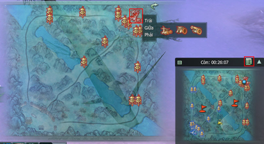

- **Thăng cấp Tiễn Tháp**:  Di chuyển đến Tiễn Tháp muốn thắng cấp và nhấp chọn vào Tiễn Tháp đó. 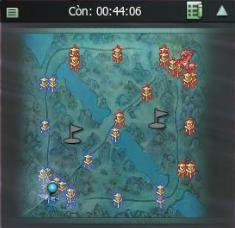 Có thể chọn cách tạo Tiễn Tháp trực tiếp trên bản đồ Sa bàn. 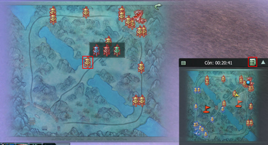

Nguồn: VNG (bài viết và hình ảnh)
