## Giới thiệu

- Giới thiệu

- Con Đường Tơ Lụa

- Cổ Tam Quốc

- Cửu Cung Kỳ Cốc

- Thần Nông Nhân

- Vân Hồ Thiên Trì

Chiến trường là nơi các cao thủ cùng nhau thỏa sức khai triển tài năng, bá đạo quần hùng, với các chiến trường đoạt Cờ [Lôi Đài](./loi-dai.md), chiếm cứ điểm, hộ tống Tiêu Xa,...

### Giới thiệu

- Từ 12h00 - 24h00 hàng ngày, đồng đạo có thể đến các thành thị: Trường An, Lạc Dương, Dương Châu, Thành Đô để báo danh tham gia chiến trường.

- Chiến trường bao gồm 05 loại bản đồ thi đấu (xuất hiện ngẫu nhiên):  Thần Nông Nhân. Cửu Cung Kỳ Cốc. Con Đường Tơ Lụa. Vân Hồ Thiên Trì.  Chiến Trường Cổ Tam Quốc.

- Chiến trường sẽ mở khi có đủ người tham gia và mọi hoạt động đang diễn ra tại chiến trường sẽ được thông báo tại bảng hoạt động.

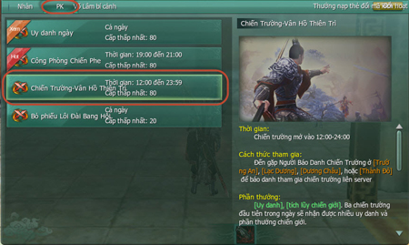

### Điều kiện tham gia

- Đẳng cấp từ 80 trở lên.

- Đã gia nhập phe phái **Hạo Khí Minh** hoặc **Ác Nhân Cốc**.

### Cách thức tham gia

- Có **02 hình thức tham gia** chiến trường:  Xếp hàng cá nhân. Xếp hàng tổ đội (đội trưởng báo danh tham gia).  

 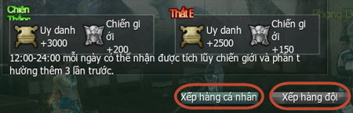

- Mỗi ngày, đồng đạo có thể tham gia chiến trường nhiều lần nhưng chỉ được nhận thưởng đầy đủ cho 03 lần đầu tham gia.

### Hình ảnh NPC và khu vực báo danh

#### NPC báo danh

| Phe Hạo Khí Minh | Phe Ác Nhân Cốc |
| --- | --- |
| 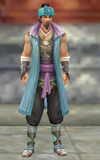 | 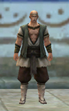 |
|  | 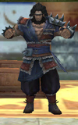 |
| 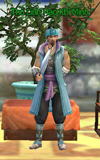 | 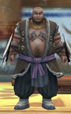 |
| 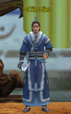 | 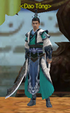 |

#### Khu vực báo danh

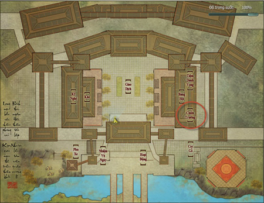  
 Khu vực báo danh chiến trường thành Trường An.

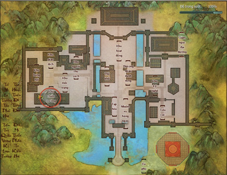  
 Khu vực báo danh chiến trường thành Lạc Dương.

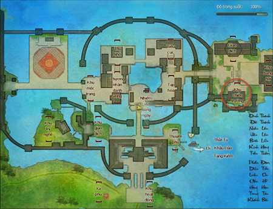  
 Khu vực báo danh chiến trường thành Dương Châu.

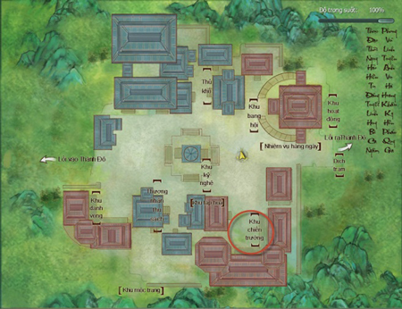  
 Khu vực báo danh chiến trường Thành Đô.

## Cửu Cung Kỳ Cốc

- Giới thiệu

- Con Đường Tơ Lụa

- Cổ Tam Quốc

- Cửu Cung Kỳ Cốc

- Thần Nông Nhân

- Vân Hồ Thiên Trì

Cửu Cung Kỳ Cốc là một vùng đất âm u tăm tối, bên trong có một phế tích bàn cờ vô cùng bí ẩn, đến nay vẫn chưa có ai di dời được bàn cờ khổng lồ đó. Về sau, Châu Mặc đã bỏ một số tiền cực lớn để mua mảnh đất này, dùng làm nơi cất giữ kỳ trân dị bảo ở khắp nơi mà y sưu tầm được.

Sau đó, Y Mã Mục lệnh lại cho thuộc hạ Ẩn Nguyên hội âm thầm phát tán tin đồn trong cốc có "Cửu Thiên Binh Giám" và vô số bảo vật quý hiếm, mặt khác phát thiệp anh hùng, mời các cao thủ của Hạo Khí Minh và Ác Nhân Cốc tể tựu về đây tầm bảo. Để đảm bảo công bằng, hai phe mỗi lần chỉ được 10 người xông vào cốc, những kẻ còn lại chỉ đứng bên ngoài quan sát.

Nhưng có một điều mà ai cũng biết, thư mời tầm bảo của Ẩn Nguyên Hội chỉ là tấm bình phong, sự thật là muốn hai phe đối đầu huyết chiến. Tạ Uyên và Vương Di Phong đều biết phe sở hửu "Cửu Thiên Binh Giám" và bảo vật trong cốc sẽ giành được thế thượng phong trong cuộc chiến dai dẳng này, phe thất thế bị gạnh tên khỏi giang hồ là chuyện sớm muộn…

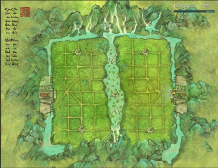

### Cách thức tham gia

Khi mỗi phe có đủ**12 người báo danh**, chiến trường Cửu Cung Kỳ Cốc sẽ được khai mở. Mỗi phe được tham gia **tối đa 25 người**.

#### Nguyên tắc chiến trường

- Trong thời gian **16 phút**, phe đạt được 1.000 điểm tích lũy trước hoặc có tổng số điểm tích lũy cao hơn khi chiến trường kết thúc sẽ dành chiến thắng. Nếu điểm tích lũy bằng nhau thì hai phe hòa.

- Thu thập Mảnh Võ Điển, mở rương quý, tiêu diệt người chơi phe đối phương để nhận điểm tích lũy.

- Khi tham gia chiến trường sẽ nhận được trạng thái hỗ trợ (buff).

#### Quy tắc tính điểm

- Nội dung Hình ảnh     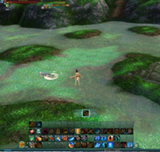 Đánh bại 01 đối thủ, nhận được 02 điểm tích lũy   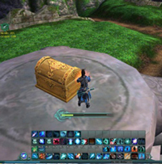 Mở rương quý đầu tiên nhận được 15 điểm tích lũy, mở rương kế tiếp sẽ nhận gấp đôi điểm tích lũy rương trước   Thu thập Mảnh Võ Điển, nhận được 05 điểm tích lũy

### Phần thưởng

- Tiền Vàng, điểm uy danh và điểm tích lũy chiến giới.

- Lưu ý: Tiền Vàng chỉ nhận được trong 03 lần đầu tiên tham gia.

Nguồn: VNG (bài viết và hình ảnh)
