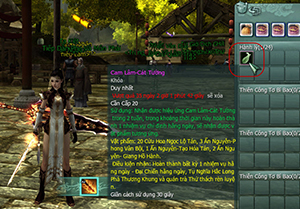
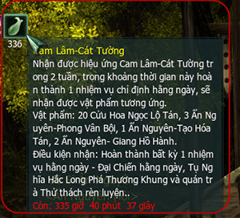
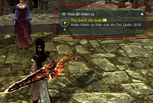
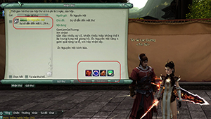

Khi tham gia sự kiện **Nhất Đại Tông Sư**, quý nhân sĩ sẽ nhận được vật phẩm thưởng có tên gọi **Cam Lâm Cát Tường** - **một vật phẩm hỗ trợ có tác dụng gia tăng phần thưởng từ các nhiệm vụ hàng ngày**. Tuy nhiên, với công dụng đặc biệt cũng như giới hạn tối đa chỉ được mang theo cùng lúc 1 vật phẩm trong hành trang, Cam Lâm Cát Tường đã gây đôi chút khó khăn cho các vị tân thủ khi lần đầu làm quen với quy trình nhận & sử dụng phần thưởng bằng hệ thống Tín Sứ.

Vì lẽ đó, để hỗ trợ quý nhân sĩ thêm thuận tiện khi tham gia sự kiện, Võ Lâm 3 thân gửi đến chư vị bản **hướng dẫn cách sử dụng Cam Lâm Cát Tường**. Chi tiết:

### Thông tin vật phẩm

- **Tên vật phẩm**: Cam Lâm Cát Tường.

- **Công dụng**:  Sau khi sử dụng sẽ nhận được hiệu ứng Cam Lâm - Cát Tường trong 2 tuần. Nhân vật có hiệu ứng Cam Lâm - Cát Tường sau khi hoàn thành 1 nhiệm vụ chỉ định hàng ngày sẽ nhận được phần thưởng: **20 Cửu Hoa Ngọc Lộ Hoàn, 3 Ẩn Nguyên - Phong Vân Bội, 1 Ẩn Nguyên - Tạo Hóa Tán, 2 Ẩn Nguyên - Giang Hồ Hành**. Nhiệm vụ chỉ định gồm Nhiệm vụ Bí Cảnh ngày, Tụ Nghĩa Hắc Long Phá Thương Khung, Quán Trà Thành Chính.

- **Giới hạn**: Mang theo cùng lúc tối đa 1 vật phẩm/nhân vật.

- **Lưu ý**:  Phần thưởng sẽ được gửi qua thư và nhận tại Tín Sứ. Khi hoàn thành điều kiện nhận thưởng thì hiệu ứng sẽ biến mất. Sử dụng tối đa 3 vật phẩm/ngày/nhân vật, giãn cách sử dụng 30 giây.

### Hướng dẫn nhận & sử dụng

| Hình ảnh | Ghi chú |
| --- | --- |
|  | **Bước 1: Nhận vật phẩm**. Sau khi nhập Code thưởng từ Nhất Đại Tông Sư, có thể đến Tín Sứ nhận Cam Lâm Cát Tường. Vì chỉ được mang theo cùng lúc tối đa 1 vật phẩm nên để nhận cái thứ 2 cần sử dụng Cam Lâm Cát Tường trong hành trang. |
|  | **Bước 2: Sử dụng Cam Lâm Cát Tường.** Sử dụng Cam Lâm Cát Tường sẽ nhận được hiệu ứng, hiển thị bên góc trái màn hình bên dưới thông tin nhân vật. |
|  | **Bước 3: Hoàn thành nhiệm vụ chỉ định hàng ngày**. Nhận nhiệm vụ chỉ định hàng ngày bất kỳ. Ví dụ: Nhiệm vụ thử thách rèn luyện của Bà Chủ Quán Trà - Triệu Quân Duệ. Hoàn thành nhiệm vụ sẽ xuất hiện thông báo nhận được vật phẩm thưởng tại Tín Sứ, hiệu ứng Cam Lâm Cát Tường cũng biến mất. |
|  | **Bước 4: Đến Tín Sứ nhận thưởng**. Đến Tín Sứ kiểm tra hòm thư để nhận vật phẩm thưởng. Có thể tiếp tục nhận vật phẩm Cam Lâm Cát Tường và thực hiện lại các bước trên. Tối đa sử dụng 3 vật phẩm/ngày. |

Hy vọng thông tin này sẽ giúp ích cho quý nhân sĩ và góp phần hỗ trợ hành trình bôn tẩu võ lâm của chư vị thêm thuận tiện.

Nguồn: VNG (bài viết và hình ảnh)
