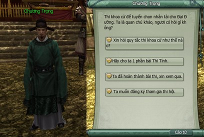
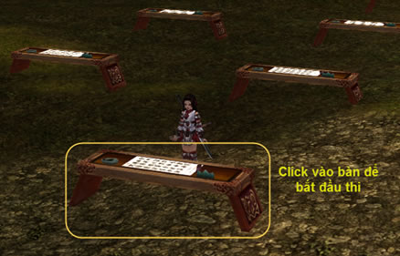
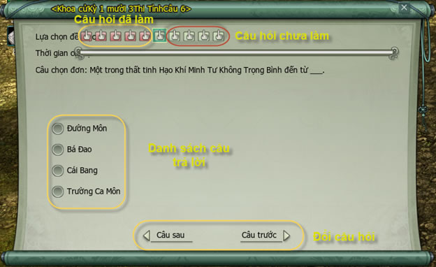
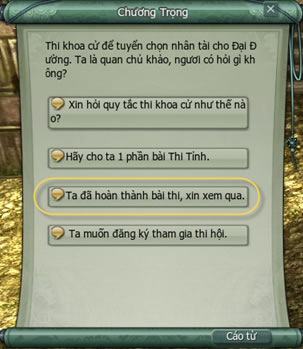
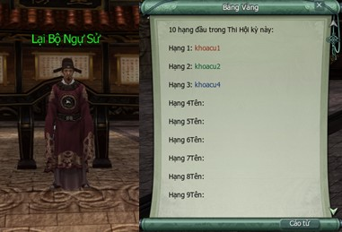
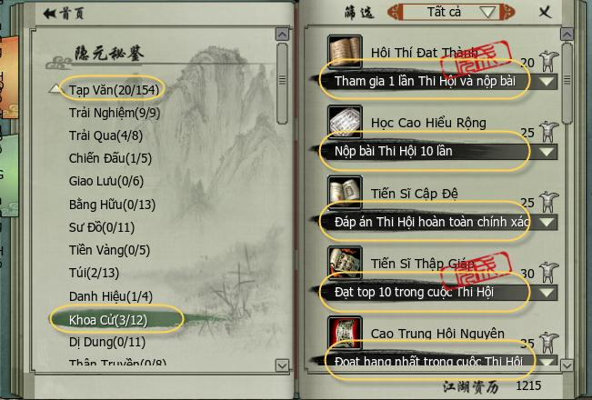

Bên cạnh việc rèn luyện lực lượng để bảo vệ lãnh thổ, Võ Lâm 3 còn có hệ thống khoa cử bao gồm "Thi Tỉnh" và "Thi Hội" nhằm tuyển chọn nhân tài phục vụ sơn hà xã tắc. Vì vậy, nền văn hóa nghệ thuật phát triển rực rỡ.

| Nội dung | Thi Tỉnh | Thi Hội |
| --- | --- | --- |
| Thời gian | **19h00 thứ Ba – 24h00 thứ Sáu** | **20h00 thứ Bảy – 24h00 Chủ Nhật** |
| Địa điểm | Tại 03 thành thị lớn | Tại 03 thành thị lớn |
| Điều kiện | Nhân sĩ đang hành tẩu võ lâm | Đạt trên 60 điểm tại Thi Tỉnh, đẳng cấp trên 20 |
| Nội dung | 20 đề thi | Không giới hạn phạm vi đề thi |

**Thi Tỉnh|  Thi Hội**

### Thi Tỉnh

| Hình ảnh | Các bước di chuyển |  |
| --- | --- | --- |
|  | Không hạn chế số người tham gia, đạt cấp độ 10 có thể tham gia khoa cử. Trước thi 01 giờ, đến đối thoại Quan Chủ Khảo tại 03 thành thị lớn để nhận giấy thi. |  |
|  | Chọn bàn thi là có thể tiến hành trả lời, cho phép nhiều người cùng sử dụng 1 bàn thi. |  |
|  | Giao diện hệ thống mở ra các đề thi khác. Có thể di chuyển qua lại giữa các câu hỏi, có thể thay đổi đáp án. |  |
|  | Nếu hoàn thành bài thi trước có thể nộp bài cho Quan Chủ Khảo. Kết thúc giờ thi, tất cả các sĩ tử đều phải nộp bài kể cả trường hợp chưa hoàn thành bài thi. Quá thời hạn, bài thi không thể nộp, đồng đạo cũng không thể nhận thành tích, phần thưởng và tư cách Thi Hội. |  |
| **Phần thưởng**: Điều kiện Phần thưởng Ghi chú Đạt điểm cao  01 Thanh Đồng Bảo Rương Lựa chọn ngẫu nhiên mở ra Mật tịch, nguyên liệu, thư tịch  01 Hàn Lâm Ngọc Thiêm - Nguyệt Nâng cao thế lực Danh vọng nào đó 300 điểm, có thể lựa chọn 1 trong 9 môn phái, 03 thành lớn, trong 13 thế lực giang hồ và tiêu cục liên minh) Đạt điểm tối đa  02 Thanh Đồng Bảo Rương Lựa chọn ngẫu nhiên mở ra Mật tịch, nguyên liệu, thư tịch  02 Hàn Lâm Ngọc Thiêm - Nguyệt Nâng cao thế lực Danh vọng nào đó 300 điểm, có thể lựa chọn 1 trong 9 môn phái, 03 thành lớn, trong 13 thế lực giang hồ và tiêu cục liên minh) |  |  |
| Điều kiện | Phần thưởng | Ghi chú |
| Đạt điểm cao |  01 Thanh Đồng Bảo Rương | Lựa chọn ngẫu nhiên mở ra Mật tịch, nguyên liệu, thư tịch |
|  01 Hàn Lâm Ngọc Thiêm - Nguyệt | Nâng cao thế lực Danh vọng nào đó 300 điểm, có thể lựa chọn 1 trong 9 môn phái, 03 thành lớn, trong 13 thế lực giang hồ và tiêu cục liên minh) |  |
| Đạt điểm tối đa |  02 Thanh Đồng Bảo Rương | Lựa chọn ngẫu nhiên mở ra Mật tịch, nguyên liệu, thư tịch |
|  02 Hàn Lâm Ngọc Thiêm - Nguyệt | Nâng cao thế lực Danh vọng nào đó 300 điểm, có thể lựa chọn 1 trong 9 môn phái, 03 thành lớn, trong 13 thế lực giang hồ và tiêu cục liên minh) |  |

### Thi Hội

| Hình ảnh | Mô tả |  |
| --- | --- | --- |
|  | Hoàn thành Thi Tỉnh, đồng đạo nhận Hội Thi Hành Văn, mang vật phẩm này đến Quan Chủ Khảo đổi lấy Hội Khí Khảo Quyển (Tờ Giấy Thi) để tham dự Thi Hội. Chọn bàn thi. Phải trả lời hết câu hỏi mới nộp bài, nếu hết giờ mà chưa trả lời xong có thể nộp bài nhưng sẽ không ghi nhận thành tích, phần thưởng. Chủ đề trong Thi Hội khó hơn Thi Tỉnh. |  |
|  | 12h00 ngày Chủ nhật, đến Sử Bộ Ngự Sử (Cung điện Lạc Dương tại Quảng trường Thi Hội ở Lạc Dương). Căn cứ vào đáp án chính xác, thời gian nộp bài sớm nhất, bảng vàng sẽ ghi danh 10 nhân vật có thành tích cao nhất ở kỳ Thi Hội. Sau 18h00 ngày thứ Hai nếu 10 người này không đến Sử Bộ Ngự Sử để nhận thưởng thì sẽ mất phần thưởng. |  |
|  | Xem thành tích đạt được trong Ẩn Nguyên Bí Giám (phím tắt: Y), mục **"tạp văn"** -> **"khoa cử"**. |  |
| **Phần thưởng**: Điều kiện Phần thưởng Ghi chú Từ 60 - 79 điểm  01 Tinh Chế Bảo Rương Tinh Chế Bảo Rương  01 Hàn Lâm Ngọc Thiêm - Nhật Nâng cao thế lực Danh vọng 600 điểm, có thể lựa chọn 1 trong 9 phái, 03 thành lớn, trong 13 thế lực giang hồ và tiêu cục liên minh) Từ 80 - 99 điểm  02 Tinh Chế Bảo Rương Tinh Chế Bảo Rương  01 Hàn Lâm Ngọc Thiêm - Nhật Nâng cao thế lực Danh vọng 600 điểm, có thể lựa chọn 1 trong 9 phái, 03 thành lớn, trong 13 thế lực giang hồ và tiêu cục liên minh) Đạt điểm tối đa  03 Tinh Chế Bảo Rương Tinh Chế Bảo Rương  03 Hàn Lâm Ngọc Thiêm - Nhật Nâng cao thế lực Danh vọng 600 điểm, có thể lựa chọn 1 trong 9 phái, 03 thành lớn, trong 13 thế lực giang hồ và tiêu cục liên minh) 10 người xuất sắc nhất  03 Tinh Chế Bảo Rương Tinh Chế Bảo Rương  03 Hàn Lâm Ngọc Thiêm - Nhật Nâng cao thế lực Danh vọng 600 điểm, có thể lựa chọn 1 trong 9 phái, 03 thành lớn, trong 13 thế lực giang hồ và tiêu cục liên minh) Danh hiệu Tú Tài (đến Quan Chủ Khảo ở Lạc Dương để nhận thưởng). |  |  |
| Điều kiện | Phần thưởng | Ghi chú |
| Từ 60 - 79 điểm |  01 Tinh Chế Bảo Rương | Tinh Chế Bảo Rương |
|  01 Hàn Lâm Ngọc Thiêm - Nhật | Nâng cao thế lực Danh vọng 600 điểm, có thể lựa chọn 1 trong 9 phái, 03 thành lớn, trong 13 thế lực giang hồ và tiêu cục liên minh) |  |
| Từ 80 - 99 điểm |  02 Tinh Chế Bảo Rương | Tinh Chế Bảo Rương |
|  01 Hàn Lâm Ngọc Thiêm - Nhật | Nâng cao thế lực Danh vọng 600 điểm, có thể lựa chọn 1 trong 9 phái, 03 thành lớn, trong 13 thế lực giang hồ và tiêu cục liên minh) |  |
| Đạt điểm tối đa |  03 Tinh Chế Bảo Rương | Tinh Chế Bảo Rương |
|  03 Hàn Lâm Ngọc Thiêm - Nhật | Nâng cao thế lực Danh vọng 600 điểm, có thể lựa chọn 1 trong 9 phái, 03 thành lớn, trong 13 thế lực giang hồ và tiêu cục liên minh) |  |
| 10 người xuất sắc nhất |  03 Tinh Chế Bảo Rương | Tinh Chế Bảo Rương |
|  03 Hàn Lâm Ngọc Thiêm - Nhật | Nâng cao thế lực Danh vọng 600 điểm, có thể lựa chọn 1 trong 9 phái, 03 thành lớn, trong 13 thế lực giang hồ và tiêu cục liên minh) |  |
| Danh hiệu Tú Tài (đến Quan Chủ Khảo ở Lạc Dương để nhận thưởng). |  |  |

Nguồn: VNG (bài viết và hình ảnh)
