## Khái quát

- Khái quát Kinh Mạch

- Kinh Mạch Trấn Phái

Hệ thống Kinh mạch trong Võ Lâm 3 lấy 04 vị huyệt Nhậm, Đốc, Đới, Xung trong Kỳ Kinh Bát Mạch làm cơ bản. Thông qua việc đả thông các huyệt vị trong kinh mạch, người chơi có thể khai phá sức mạnh tiềm ẩn, tăng cường khả năng lĩnh ngộ võ học. Trong đó, Kỳ huyệt là huyệt mạch đặc biệt có được sau khi đả thông tất cả các huyệt mạch trên người, mang lại hiệu quả tối đa.

- Thu thập tu vi

- Truyền công

- Tẩy kinh mạch

### Khái quát

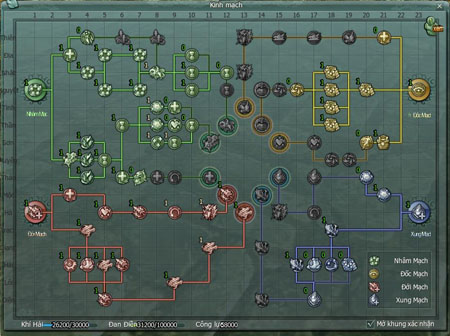 *Nhấn phím N để mở giao diện Kinh mạch*  **Nhâm mạch**: Tăng thuộc tính sức mạnh cơ bản và năng lực trị liệu, bao gồm tốc độ di chuyển, rút ngắn giãn cách thời gian thi triển khinh công, tăng hiệu quả trị liệu.  **Đốc mạch**: Tăng khả năng hỗ trợ nhân vật, bao gồm tăng cao hiệu quả được trị liệu, điểm khí huyết, điểm hóa kinh, điểm ngự kinh, điểm xuất chiêu, điểm giải chiêu, tăng ngoại công phòng ngự, nội công phòng ngự, tỷ lệ né tránh, giảm sát thương nội lực, giảm tỷ lệ bị đẩy lùi, đánh ngã.  **Đới mạch**: Tăng năng lực ngoại công nhân vật, bao gồm tăng điểm máu, sát thương ngoại công, điểm chính xác ngoại công, điểm né tránh… **Xung mạch**: Tăng năng lực nội công nhân vật, bao gồm tăng điểm nội lực, tăng sát thương nội công, nâng cao điểm chính xác nội công, giảm bị nội công đẩy lùi, đánh ngã …

### Lĩnh ngộ chiêu thức giang hồ

Nhấn phím P để mở giao diện Kinh mạch, có các loại chiêu thức:

- **Khí hải**: Thông qua nhiều phương thức khác nhau để tích lũy điểm tu luyện trong Khí hải, dùng để đả thông kinh mạch. Điểm tu luyện trong Khí hải giới hạn tích lũy là 30.000, nếu đã đạt giới hạn, dù có tu luyện tiếp cũng không thể nhận thêm.

- **Đan điền**: Tu luyện của 01 nhân vật được dự trữ trong Đan điền. Giới hạn dự trữ là 100.000 điểm, khi đã đạt giới hạn sẽ không thể tiếp tục đả thông kinh mạch.

*Điểm tu luyện trong Khí Hải và Đan Điền*

### Thu thập tu vi

- **Trạng thái ban đầu**: 01 giờ tăng 25 điểm tu vi, 01 ngày có thể gia tăng 400 điểm tu vi. Đồng đạo có thể thông qua đả thông kinh mạch huyệt vị để gia tăng điểm tu vi nhận được trong mỗi giờ.

- **Thông qua hoàn thành nhiệm vụ**: Nhận Cửu Hoa Ngọc Lộ Tán, sử dụng để nhận được 100 điểm tu vi.

- **Chế tạo bằng [kỹ năng sống](./ky-nang-song.md)**: Học cách chế Nạp Nguyên Đơn tại Y Thuật Sư cao cấp và sử dụng để đổi điểm tu luyện.

Lưu ý

Nạp Nguyên Đơn là vật phẩm không khóa, mỗi ngày chỉ được sử dụng nhiều nhất 50 viên.

### Truyền công

Nhân vật có nội công cao có thể thông qua truyền công chuyển điểm tu luyện cho nhân vật khác, giúp họ có thể nhanh chóng nhận được hiệu quả từ hệ thống Kinh mạch. Nhân vật cần học kỹ năng Truyền Công tại Thầy dạy võ của môn phái và tiến hành tổ đội để truyền công. Mỗi 20 giờ mới được truyền công hoặc nhận truyền công 01 lần.

- Khi công lực của người truyền công cao hơn người được truyền công thì người truyền công sẽ nhận được một lượng tu vi thưởng nhất định.

- Đả thông kinh mạch **Nhâm Sùng - Mạch Cốt** giúp tăng lượng tu vi nhận được, tối đa 3.600 tu vi.

- Khi công lực người truyền công thấp hơn người được truyền, thì người truyền công sẽ bị tổn thất 400 tu vi.

### Tẩy kinh đới mạch

- Dùng ít ngân lượng để tiến hành tẩy kinh đới mạch tại Chưởng môn. Tẩy kinh đới mạch được chia thành 2 loại: tẩy kinh mạch cơ bản và tẩy kỳ huyệt. Tẩy kinh mạch sẽ không bị tổn thất tu vi.

- Sau khi tẩy kinh mạch cơ bản, kỳ huyệt sẽ được lưu giữ lại, không cần đả thông các huyệt vị trên lạc mạch vẫn có thể trực tiếp điểm kỳ huyệt.

- Sau khi tẩy kỳ huyệt, tất cả các huyệt vị kỳ huyệt sẽ trở về 0, cần đả thông các huyệt vị trên lạc mạch mới có thể điểm kỳ huyệt.

## Kinh mạch trấn phái

- Khái quát Kinh Mạch

- Kinh Mạch Trấn Phái

Các bậc tiền bối trên giang hồ tương truyền rằng, trong mỗi đại môn phái có tiếng tăm, đều ẩn chứa những bí mật võ học mà người trong phái khó mà biết được. Đại Hùng Bảo Điển của [Thiếu Lâm](../mon-phai/thieu-lam.md) Tử trong đó có cất giấu "Tầng Chiết Kinh" Vô Thượng Chí Bảo, cũng có người nói rằng trong bụng 1 con Tiên Hạt phía ngoài [Thuần Dương](../mon-phai/thuan-duong.md) Cung Đại Điển có cất giấu cuốn "Khống Hạt Công" nội công thủ pháp tuyệt đỉnh của Thuần Dương, mà vũ điệu [Thất Tú](../mon-phai/that-tu.md) thực tế là tuyệt kỹ kiếm vũ vô cùng lợi hại.

Không biết bao nhiêu người đã từng quan tâm đến những Tiên Hạt này trên Hoa Sơn, cũng không biết bao nhiêu người từ những vũ điệu của cô gái Thất Tú lĩnh hội được thần công, những truyền thuyết này cũng chưa được chứng thực qua, nhưng có 1 võ lâm bí cảnh mà đệ tử cấp cao của mỗi một đại môn phái đều biết được, đó chính là bí mật của Kinh Mạch Trấn Phái.

Kinh Mạch Trấn Phái, khi nội công cao thâm, luyện đến cảnh giới tinh túy, họ sẽ khai sáng ra thuật vận dụng nội lực và cảnh giới kỹ pháp, đả thông những cái này được gọi là con đường "Bí mất cuối cùng môn phái", mỗi 1 đệ tử lĩnh hội Kinh Mạch Trấn Phái phần lớn đều là các tài năng nòng cốt của môn phái đó, tu vi tinh thâm, trí tuệ xuất chúng, khi so sánh với những võ nghệ không chính thống, thì sẽ cho họ thấy được sức mạnh của võ học kinh mạch.

### Nhận Kinh Mạch Trấn Phái

- Khi đạt đến cấp 16 thì có thể nhận được điểm số Kinh Mạch Trấn Phái.

- Nhân vật chỉ có thể mở Kinh Mạch Trấn Phái môn phái của mình (không thể mở Kinh Mạch Trấn Phái của môn phái thứ 2).

- Tăng đến cấp 16, có thể nhận 1 điểm Kinh Mạch Trấn Phái, sau đó cứ 2 cấp có thể nhận được 1 điểm Kinh Mạch Trấn Phái .

- Đạt đến cấp 80, tổng cộng có 33 điểm Kinh Mạch Trấn Phái.

### Quy tắc nhận điểm Kinh Mạch Trấn Phái

- Kinh Mạch Trấn Phái của 1 môn phái có 2 hệ. Ví dụ: [Thiên Sách](../mon-phai/thien-sach.md) có hệ Trảm Tuyệt và hệ Phong Hồn.  
  

- Nhân vật chỉ nên chọn 1 hệ trong Kinh Mạch Trấn Phái tiến hành tăng điểm, chỉ cần tăng hệ này đến 26 điểm, mới có thể tăng điểm cho hệ thứ 2.

- Mỗi 1 hệ trong Kinh Mạch Trấn Phái đều có 6 tầng, mỗi 1 tầng đều phải đạt đến 1 yêu cầu nhất định mới có thể mở ra.

- Mỗi Kinh Mạch Trấn Phái có thể tăng điểm không giống nhau, chư vị đại hiệp căn cứ theo nhu cầu của mình tiến hành tăng điểm.

- **Lưu ý:**Khi tăng điểm cho Kinh Mạch Trấn Phái, cần phải chọn "học" mới có hiệu ứng.   Trước khi không chọn "học", nhân vật có thể sử dụng chuột phải nhấp Kinh Mạch Trấn Phái đã tăng điểm, để hủy Kinh Mạch Trấn Phái đó.   Trước khi chưa có chọn "học", chọn"thiết lập lại" có thể xóa toàn bộ điểm tăng Kinh Mạch Trấn Phái .  Trước khi "học" thành công Kinh Mạch Trấn Phái. Nhân vật có thể dùng y thuật kỹ năng sống chế tác "Thư Cân Ích Khí Đơn" thiết lập lại Kinh Mạch Trấn Phái.

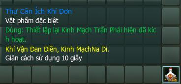*Vật phẩm Thư Cân Ích Khí Đơn*

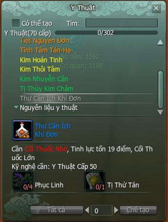*Giao diện chế tạo Thư Cân Ích Khí Đơn*

### Giao diện Kinh Mạch Trấn Phái các môn phái

#### Thiên Sách

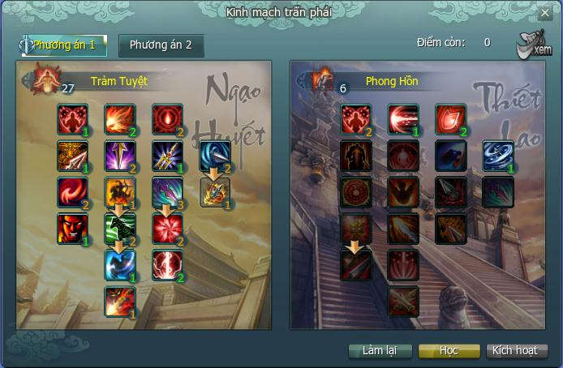

#### Thiếu Lâm

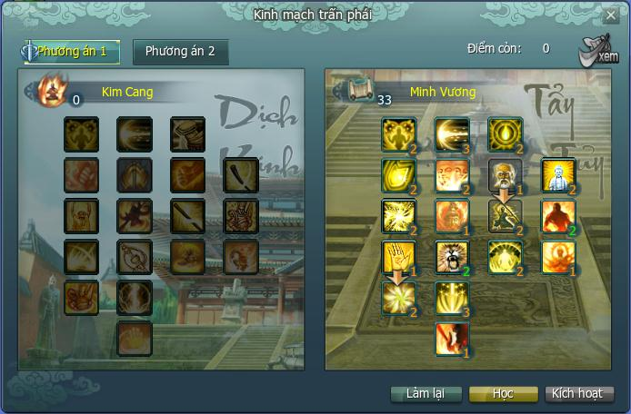

#### Vạn Hoa

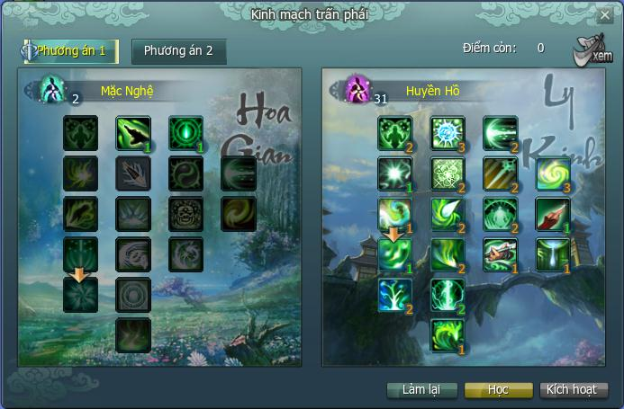

#### Thuần Dương

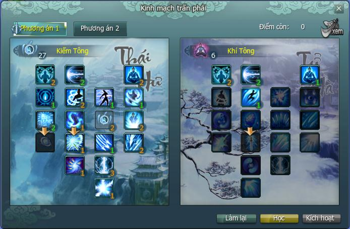

#### Thất Tú

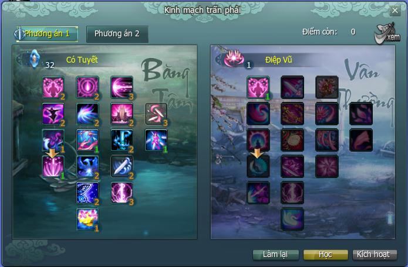

#### Tàng Kiếm

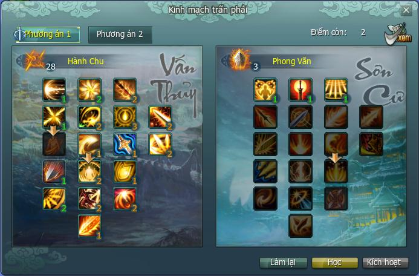

#### Ngũ Độc

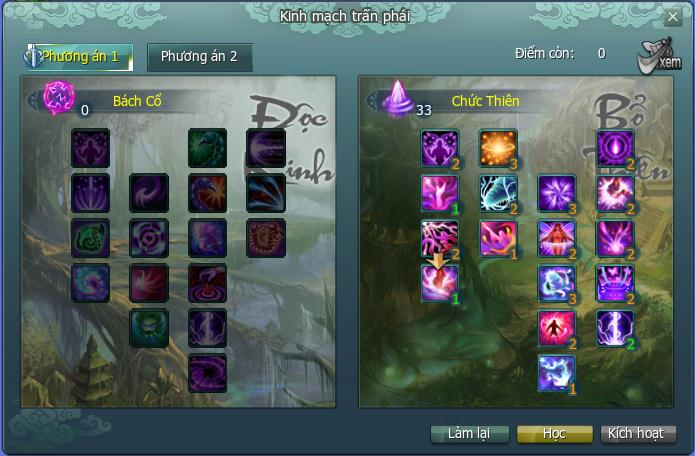

#### Đường Môn

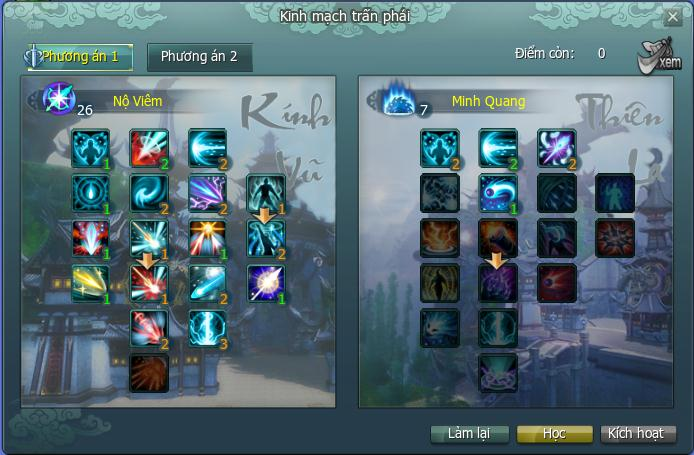

#### Minh Giáo

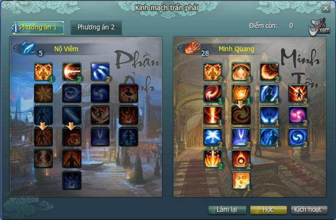

Nguồn: VNG (bài viết và hình ảnh)
