## Giới thiệu

- Giới thiệu

- Thu Thập

- Chế Tạo

- Thông Dụng

Kỹ nghệ là yếu tố cần thiết và rất quan trọng trong quá trình hành hiệp giang hồ của mỗi hiệp khách. Hệ thống kỹ nghệ được trang bị đầy đủ sẽ giúp đồng đạo dễ dàng trượng nghĩa và tạo được thanh thế trong giang hồ.

- **Lưu ý**:  Nhấn phím I để mở giao diện kỹ nghệ. Học kỹ nghệ sẽ phải trả một số phí nhất định, đồng đạo cần cân nhắc kỹ lưỡng trước khi lĩnh hội kỹ năng phù hợp với nhân vật.

- **Các nhóm kỹ nghệ**:

| Kỹ nghệ | Chi tiết hoạt động |
| --- | --- |
| Thu Thập | Đào Vàng, Thần Nông, Bào Đinh Thuật |
| Chế Tạo | Nấu Nướng, May Vá, Đúc, Y Thuật |
| Thông Dụng | Tháo Trang Bị, Đào Báu Vật, Thuần Dưỡng |
| Sơ cấp: Cấp 0 - 30. Trung cấp: Cấp 30 - 50 (yêu cầu: Sơ cấp phải đạt cấp 25 để nâng cấp kỹ năng). Cao cấp: Cấp 50 - 70 (yêu cầu: Trung cấp đạt cấp 45 để nâng cấp kỹ năng). Ngoài ra, khi một kỹ nghệ Thu Thập/Chế Tạo đạt cấp 70 có thể nâng cấp kỹ năng đó lên cấp đại sư (cấp 80). Tuy nhiên, mỗi loại kỹ nghệ chỉ được phép nâng cấp một kỹ năng. |  |

- **Địa điểm học kỹ nghệ**:  **Bản đồ môn phái**: Mỗi bản đồ môn phái đều có thể học được một vài kỹ nghệ cần thiết, tuy nhiên không thể học đầy đủ tất cả kỹ năng. **Bản đồ thành thị**: Tại khu kỹ nghệ của mỗi thành thị đều có thầy dạy kỹ năng tương ứng với các cấp sơ, trung, cao. Khi đạt cấp độ yêu cầu, đồng đạo có thể đến để học kỹ nghệ cấp cao hơn.

- **Quên kỹ nghệ**: Đến gặp NPC **Điền Thành Bại** để học lại kỹ nghệ từ đầu.

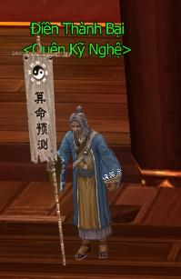

## Kỹ năng thông dụng

- Giới thiệu

- Thu Thập

- Chế Tạo

- Thông Dụng

Mở bản đồ môn phái và thành thị, sau đó nhấn phím I để mở giao diện kỹ nghệ Thông Dụng bao gồm: Tháo Trang Bị, Đào Báu Vật, Thuần Dưỡng. Học kỹ nghệ này có tính phí. Nếu quên kỹ nghệ thì đến gặp NPC Điền Thành Bại để học lại từ đầu (xem thêm thông tin tại mục Giới thiệu).

**Tháo Trang Bị |Đào Báu Vật | Thuần Dưỡng**

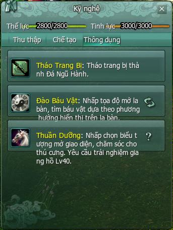

### Tháo Trang Bị

- Kỹ năng được dùng để tách trang bị thành đá ngũ hành và các loại đá hỗ trợ khác. Thường sử dụng khi người chơi có nhiều trang bị cùng loại và muốn nâng cấp một trang bị lên tinh luyện cao hơn.

- Cách tháo trang bị:  Đưa trang bị cần tháo vào túi. Mở giao diện kỹ nghệ, nhấp vào nút tháo trang bị. 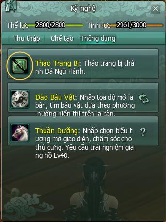 Kéo chuột đến trang bị cần tháo và tiến hành tháo trang bị. 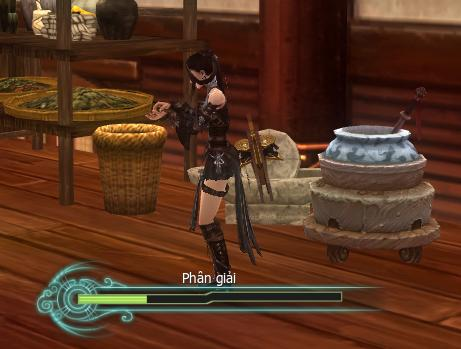

- **Phần thưởng**: Các loại bảo thạch nâng cấp vũ khí.

### Đào Báu Vật

- Dùng để tham gia hoạt động Truy tìm kho báu, có cơ hội nhận được nhiều vật phẩm quý hiếm giá trị liên thành.

- Đạo cụ yêu cầu: Xẻng đào báu vật, có 02 loại:  Xẻng Thất Xảo 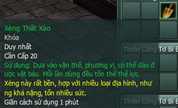 Xẻng Linh Lung 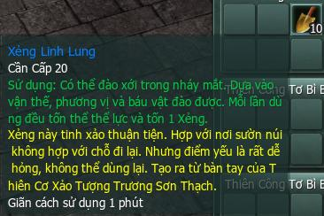

- Mô tả La Bàn:  **Khu mặt La Bàn**: Hiển thị kim đồng hồ, phương hướng bản thân và thông tin gợi ý tìm kho báu. Kim chỉ nam tối đa hiển thị 02 loại: màu xanh lá tìm kho báu cá nhân, xanh dương tìm kho báu đồng đội.  *Giao diện La Bàn cá nhân và tổ đội* Nút tìm báu: Sử dụng sẽ kích hoạt tính năng tìm kho báu của La Bàn. Tồn tại 160 giây, sau khi sử dụng mặt La Bàn sẽ hiển thị kim chỉ nam tìm kho báu tương ứng. 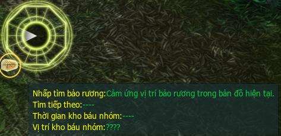 Kim chỉ kho báu đồng đội: Kích hoạt trạng thái tìm kho báu trong khi tổ đội sẽ xuất hiện kim chỉ nam màu xanh dương, thành viên của tổ đội đều có thể đào kho báu. Điểm chôn kho báu tổ đội có giới hạn thời gian, hết giờ sẽ biến mất. 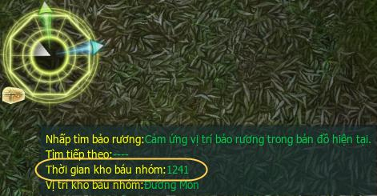

- **Khu vực đào báu vật**:  Môn phái: [Vạn Hoa](../mon-phai/van-hoa.md), [Thiếu Lâm](../mon-phai/thieu-lam.md), [Thuần Dương](../mon-phai/thuan-duong.md), [Thiên Sách](../mon-phai/thien-sach.md), [Thất Tú](../mon-phai/that-tu.md), [Tàng Kiếm](../mon-phai/tang-kiem.md) Sơn Trang, [Ngũ Độc](../mon-phai/ngu-doc.md), [Đường Môn](../mon-phai/duong-mon.md), [Minh Giáo](../mon-phai/minh-giao.md). Khu luyện công: Lạc Đạo, Khấu Đảo, Phong Hoa Cốc, Kim Thủy Trấn, Thành Đô, Bạch Long Khẩu, Đầm Hắc Long.

- **Hướng dẫn đào báu vật**:

| **Hình ảnh** | **Ghi chú** |
| --- | --- |
| 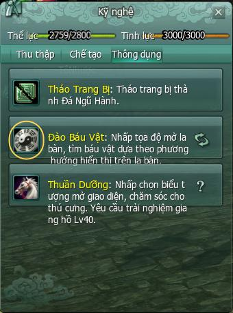 | Bấm phím tắt I mở giao diện **Kỹ Năng Sống**mục **Thông Dụng,** chọn biểu tượng La Bàn để mở giao diện La Bàn lên. |
| 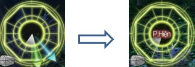 | Tìm kiếm kho báu theo hướng La Bàn chỉ định (chú ý khi kim la bàn xoay liên tục có nghĩa là đã gần đến kho báu). |
|  | Dùng xẻng đã chuẩn bị để đào kho báu. Nếu sử dụng **Xẻng Thất Xảo** sẽ mất thời gian chờ, sử dụng **Xẻng Linh Lung** sẽ đào được kho báu ngay. |
| 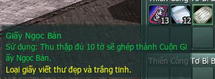 *Phần thưởng đào kho báu* | Kho báu đào được bao gồm các vật phẩm giấy và mực để nâng cấp kỹ năng sống. |

### Thuần Dưỡng

- **Bắt ngựa**:  Điều kiện: Nhân vật đạt cấp 40 và có dây bắt ngựa. Day bắt ngựa có thể mua tại NPC bán ngựa tại các thành thị. 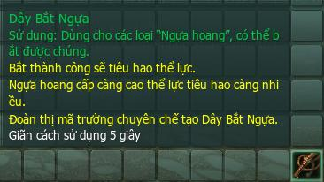 *Dây bắt ngựa* 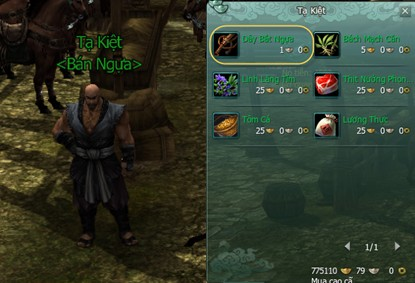 *NPC Bán ngựa và giao diện mua dây bắt ngựa* Địa điểm:  Trang trại trên núi Thương Sơn Nhĩ Hải và Trang Trại Lạc Nhật ở Lãnh Địa [Bang Hội](./bang-hoi.md). Đối với ngựa cấp cao, sẽ hiển thị thông báo tìm ngựa Cửu Châu, tùy duyên bắt được. 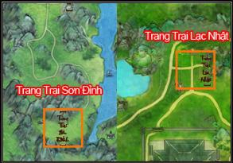 *NPC Bán ngựa và giao diện mua dây bắt ngựa*   Cách bắt ngựa: Mỗi loại ngựa yêu cầu thể lực và tỷ lệ thành công khác nhau. Khi gặp ngựa hoang, chọn ngựa cần bắt và nhấp vào **dây bắt ngựa**. 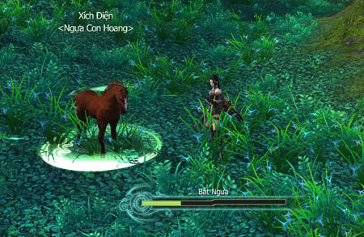

- **Nuôi ngựa**:  Cho ăn: Cần cho ngựa ăn khi trạng thái no giảm xuống. Mua thức ăn tại NPC bán ngựa và kéo vào khung thức ăn trong giao diện thuần dưỡng để cho ngựa ăn.  Tương tác: Nhấn vào biểu tượng hình ngựa ở giao diện thuần dưỡng để triệu hồi ngựa con và thực hiện các tương tác. 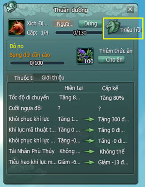

- Thực hiện tương tác có thể giúp kinh nghiệm của ngựa con tăng lên nhanh chóng.

- Khi ngựa trưởng thành, đồng đạo có thể sử dụng để tiếp tục hành trình bôn tẩu.

## Kỹ năng thu thập

- Giới thiệu

- Thu Thập

- Chế Tạo

- Thông Dụng

Mở bản đồ môn phái và thành thị, sau đó nhấn phím I để mở giao diện kỹ nghệ Thu Thập bao gồm: Đào Vàng, Thần Nông, Bào Đinh Thuật. Học kỹ nghệ này có tính phí. Nếu quên kỹ nghệ thì đến gặp NPC Điền Thành Bại để học lại từ đầu (xem thêm thông tin tại mục Giới thiệu).

**Đào Vàng | Thần Nông | Bào Đinh Thuật**

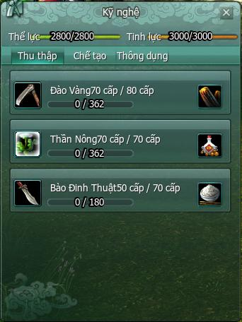

### Đào Vàng

- Loại kỹ năng tiêu hao thể lực, dùng cuốc để khai thác khoáng thạch. Khoáng thạch sử dụng để làm nguyên liệu cho kỹ năng Đúc.

- Học kỹ năng: Một số môn phái như **Đường Môn** có thể học kỹ năng đào vàng tại bản đồ của mình ở **Thầy dạy đào vàng.**Ngoài ra, đồng đạo có thể học kỹ năng này tại khu vực **Kỹ Nghệ**ở 3 thành thị lớn **Lạc Dương, Dương Châu, Trường An**.

- Tiến hành đào vàng: Có thể khai khoáng tại bất kỳ nơi nào. Khi đến gần quặng trên bản đồ sẽ xuất hiện biểu tượng, nếu cấp độ kỹ năng đạt yêu cầu có thể thu thập.

- **Phần thưởng**:  Độ thuần thục: Khai khoáng thành công tăng độ thuần thục kỹ năng, kỹ năng đào vàng đạt đủ mức thành thục yêu cầu sẽ tăng cấp. 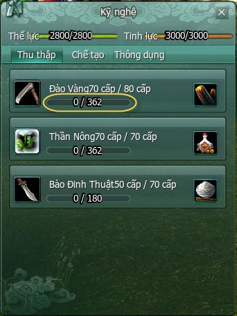 Khoáng thạch: Dùng làm nguyên liệu đúc các trang bị, khoáng thạch phẩm chất càng cao thì sẽ đúc được vật phẩm có điểm trang bị cao. 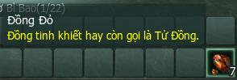 *Khoáng thạch đào được*

### Thần Nông

- Loại kỹ năng tiêu hao thể lực, dùng xẻng để thu thập dược thảo. Dược thảo được sử dụng làm nguyên liệu cho kỹ năng y thuật.

- Học kỹ năng: Một số môn phái như **Vạn Hoa** có thể học kỹ năng thần nông tại bản đồ của mình ở **Thầy dạy thần nông.**Ngoài ra, đồng đạo có thể học kỹ năng này tại khu vực **Kỹ Nghệ**ở 3 thành thị lớn **Lạc Dương, Dương Châu, Trường An**.

- Thu thập dược thảo: Tương tự đào vàng, khi đến gần dược thảo trên bản đồ sẽ xuất hiện biểu tượng, nếu cấp độ kỹ năng đạt yêu cầu có thể thu thập.

- **Phần thưởng**:  Độ thuần thục: Thu thập dược thảo thành công tăng độ thuần thục kỹ năng, kỹ năng thần nông đạt đủ mức thành thục yêu cầu sẽ tăng cấp. 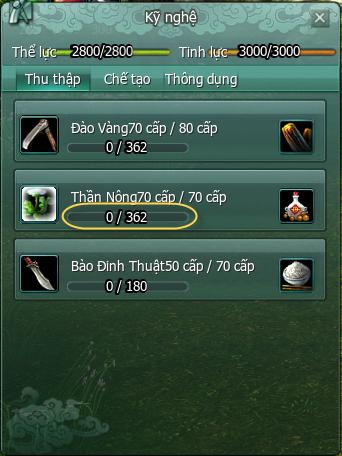 Dược thảo: Dùng làm nguyên liệu điều chế thuốc, dược thảo phẩm chất càng cao thì sẽ điều chế được nhiều vị thuốc quý. 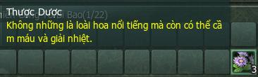 *Dược thảo thu thập được*

### Bào Đinh Thuật

- Loại kỹ năng tiêu hao thể lực, dùng dao nhỏ để tách da và thịt của động vật. Da thuộc có thể dùng làm nguyên liệu may vá hoặc đúc, còn xương thịt và huyết có thể dùng làm nguyên liệu chế biến thực phẩm.

- Học kỹ năng: Một số môn phái như **Thuần Dương** có thể học kỹ năng bào đinh thuật tại bản đồ của mình ở **Thầy bào đinh thuật.**Ngoài ra, đồng đạo có thể học kỹ năng này tại khu vực **Kỹ Nghệ**ở 3 thành thị lớn **Lạc Dương, Dương Châu, Trường An**.

- Tiến hành bào đinh: Sau khi tiêu diệt một động vật bất kỳ, đồng đạo có thể thuộc da trên xác động vật đó.

- **Phần thưởng**:  Độ thuần thục: Mỗi lần thuộc da thành công tăng độ thuần thục kỹ năng, kỹ năng thuộc da đạt đủ mức thành thục yêu cầu sẽ tăng cấp. 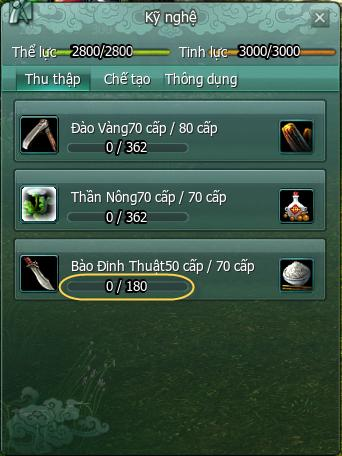 Da và nội tạng động vật: Da dùng làm nguyên liệu cho may vá, nội tạng dùng để làm nguyên liệu cho nấu nướng. 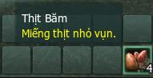 *Vật phẩm thu thập được*

## Kỹ năng chế tạo

- Giới thiệu

- Thu Thập

- Chế Tạo

- Thông Dụng

Mở bản đồ môn phái và thành thị, sau đó nhấn phím I để mở giao diện kỹ nghệ Chế Tạo bao gồm: Nấu Nướng, May Vá, Đúc, Y Thuật. Học kỹ nghệ này có tính phí. Nếu quên kỹ nghệ thì đến gặp NPC Điền Thành Bại để học lại từ đầu (xem thêm thông tin tại mục Giới thiệu).

**Nấu Nướng** |**May Vá** | **Đúc** | **Y Thuật**

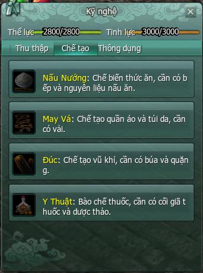

### Nấu Nướng

- Loại kỹ năng tiêu hao tinh lực, chế biến các món ăn dinh dưỡng, tăng [thuộc tính nhân vật](../tan-thu/thuoc-tinh-nhan-vat.md) trong thời gian nhất định.

- Học kỹ năng: Một số môn phái như **Thuần Dương** có thể học kỹ năng bào đinh thuật tại bản đồ của mình ở **Thầy nấu nướng.**Ngoài ra, đồng đạo có thể học kỹ năng này tại khu vực **Kỹ Nghệ**ở 3 thành thị lớn **Lạc Dương, Dương Châu, Trường An**.

- Có thể học cách nấu ăn tương ứng với cấp độ nấu nướng. Mỗi lần học một công thức sẽ tiêu phí lượng tiền vàng nhất định.

- Chế biến món ăn:  Đạo cụ yêu cầu: Cần có chảo và đứng cạnh bếp để tiến hành nấu nướng. Nguyên liệu yêu cầu: Mỗi loại thức ăn cần một lượng nguyên liệu khác nhau, nguyên liệu chưa đủ sẽ bị mờ đi. 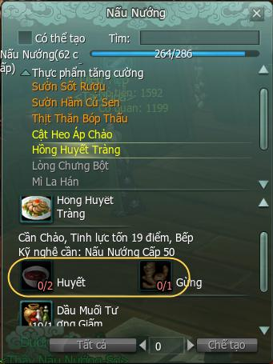 *Giao diện nấu ăn*  Nguyên liệu có thể nhận từ 03 cách: Mua tại NPC bán nguyên liệu, thu thập từ xác động vật (bào đinh thuật), chế biến từ các nguyên liệu đơn giản. Nấu nướng: Sau khi thu thập đủ nguyên liệu, nhân vật phải đứng cạnh bếp và nhấp nút **chế tạo** để nhận được món ăn. 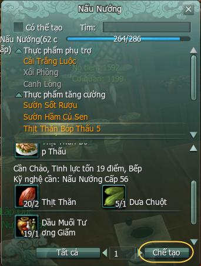 *Khi thu thập đủ nguyên liệu, nút chế tạo sẽ sáng lên* 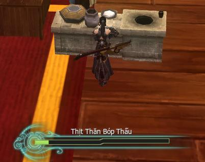 *Giao diện nấu nướng*

- **Phần thưởng**:  Độ thuần thục: Mỗi lần nấu nướng thành công tăng độ thuần thục kỹ năng, kỹ năng nấu nướng đạt đủ mức thành thục yêu cầu sẽ tăng cấp. 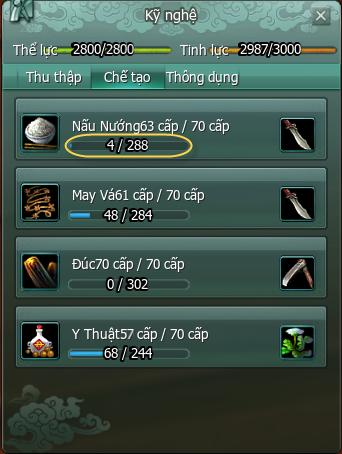 Các món ăn: Sử dụng món ăn sẽ làm tăng thuộc tính như: hỗ trợ (hồi phục máu hoặc nội lực), đặc thù (không cần rời trò chơi có thể hồi phục tinh lực và thể lực) và chiến đấu (tăng nguyên khí, lực đạo, ngoại công, nội công công kích và phòng ngự, hiệu quả). 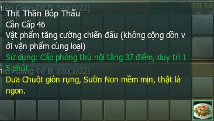 *Công dụng của món ăn nấu được*

### May Vá

- Loại kỹ năng tiêu hao tinh lực, chế tạo các loại trang bị và gói hành trang, túi quà tặng.

- Học kỹ năng: Một số môn phái như **Thất Tú** có thể học kỹ năng may vá tại bản đồ của mình ở **Thầy may vá.**Ngoài ra, đồng đạo có thể học kỹ năng này tại khu vực **Kỹ Nghệ**ở 3 thành thị lớn **Lạc Dương, Dương Châu, Trường An**.

- Có thể học công thức tương ứng với cấp độ may vá. Mỗi lần học một công thức sẽ tiêu phí lượng tiền vàng nhất định. Ngoài ra còn có thể học phương pháp **In Nhuộm** và **Thêu Dệt** (kỹ năng may vá cấp cao).

- Tiến hành may vá:  Đạo cụ yêu cầu: Cần có kim thêu. Nguyên liệu yêu cầu: Mỗi loại trang bị cần một lượng nguyên liệu khác nhau, nguyên liệu chưa đủ sẽ bị mờ đi. 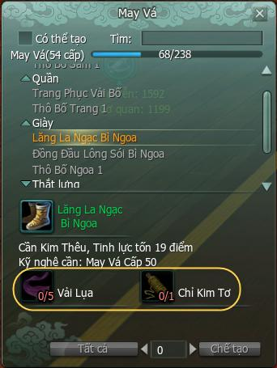 *Yêu cầu nguyên liệu* Nguyên liệu có thể nhận từ 02 cách: Mua tại NPC bán nguyên liệu, thu thập từ việc đánh quái (vải bố, vải lụa...). May vá: Sau khi thu thập đủ nguyên liệu, mở giao diện may vá và nhấn nút **chế tạo** để may vá trang bị. 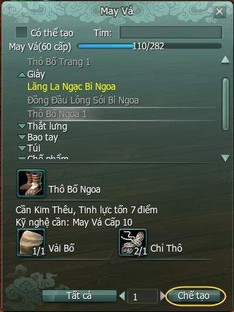 *Khi thu thập đủ nguyên liệu, nút chế tạo sẽ sáng lên* 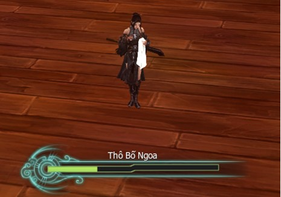 *Giao diện may vá*

- **Phần thưởng**:  Độ thuần thục: Mỗi lần may vá thành công tăng độ thuần thục kỹ năng, kỹ năng may vá đạt đủ mức thành thục yêu cầu sẽ tăng cấp. 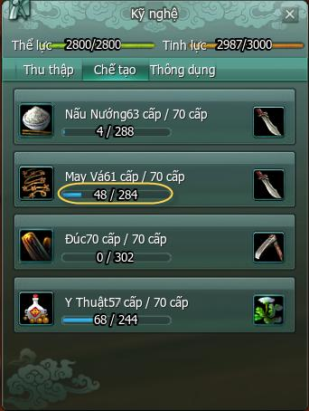 Các trang bị, gói hành trang và túi quà tặng. 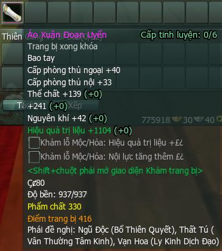 *Một trang bị có được từ may vá*

### Đúc

- Loại kỹ năng tiêu hao tinh lực, chế tạo các loại vũ khí.

- Học kỹ năng: Một số môn phái như **Thiên Sách** có thể học kỹ năng đúc tại bản đồ của mình ở **Thầy đúc.**Ngoài ra, đồng đạo có thể học kỹ năng này tại khu vực **Kỹ Nghệ**ở 3 thành thị lớn **Lạc Dương, Dương Châu, Trường An**.

- Có thể học công thức tương ứng với cấp độ rèn đúc của mình. Mỗi lần học một công thức sẽ tiêu phí lượng tiền vàng nhất định.

- Tiến hành đúc:  Đạo cụ yêu cầu: Cần có búa và đứng gần bệ đúc. Nguyên liệu yêu cầu: Mỗi loại vật phẩm cần một lượng nguyên liệu khác nhau, nguyên liệu chưa đủ sẽ bị mờ đi. 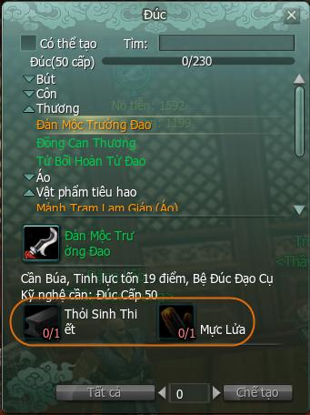 *Yêu cầu nguyên liệu* Nguyên liệu có thể nhận từ 03 cách: Mua tại NPC bán nguyên liệu, khai tháng quặng mỏ dọc đường, chế biến từ các nguyên liệu đơn giản. Đúc: Sau khi thu thập đủ nguyên liệu, đứng gần bệ đúc và mở giao diện đúc nhấn nút **chế tạo**. 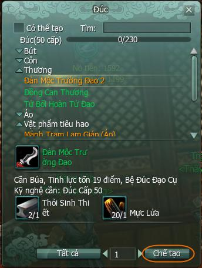 *Khi thu thập đủ nguyên liệu, nút chế tạo sẽ sáng lên* 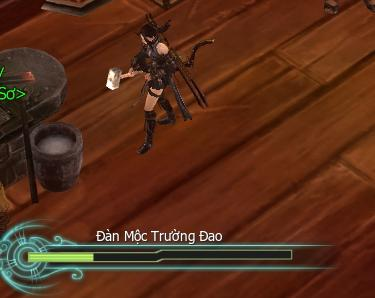 *Giao diện rèn đúc*

- **Phần thưởng**:  Độ thuần thục: Mỗi lần rèn đúc thành công tăng độ thuần thục kỹ năng, kỹ năng đúc đạt đủ mức thành thục yêu cầu sẽ tăng cấp.  Các trang bị vũ khí và chìa khóa để mở bảo rương. 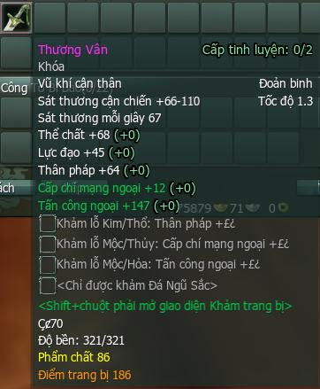 *Một trang bị có được từ rèn đúc*

### Y Thuật

- Loại kỹ năng tiêu hao tinh lực, điều chế các loại dược phẩm.

- Học kỹ năng: Một số môn phái như **Vạn Hoa** có thể học kỹ năng đúc tại bản đồ của mình ở **Thầy y thuật.**Ngoài ra, đồng đạo có thể học kỹ năng này tại khu vực **Kỹ Nghệ**ở 3 thành thị lớn **Lạc Dương, Dương Châu, Trường An**.

- Có thể học công thức điều chế thuốc tương ứng với cấp độ y thuật của mình. Mỗi lần học một công thức sẽ tiêu phí lượng tiền vàng nhất định.

- Điều chế thuốc:  Đạo cụ yêu cầu: Cần có cối thuốc nhỏ và đứng gần cuối thuốc lớn. Nguyên liệu yêu cầu: Mỗi loại thuốc cần một lượng nguyên liệu khác nhau, nguyên liệu chưa đủ sẽ bị mờ đi. 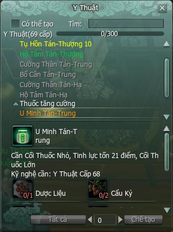 *Giao diện bào chế thuốc của nhân vật* Nguyên liệu có thể nhận từ 02 cách: Mua tại NPC bán nguyên liệu, hái dược thảo dọc đường (kỹ năng thần nông). Điều chế thuốc: Sau khi thu thập đủ nguyên liệu, đứng gần bệ đúc và mở giao diện đúc nhấn nút **chế tạo**. 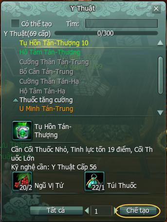 *Khi thu thập đủ nguyên liệu, nút chế tạo sẽ sáng lên* 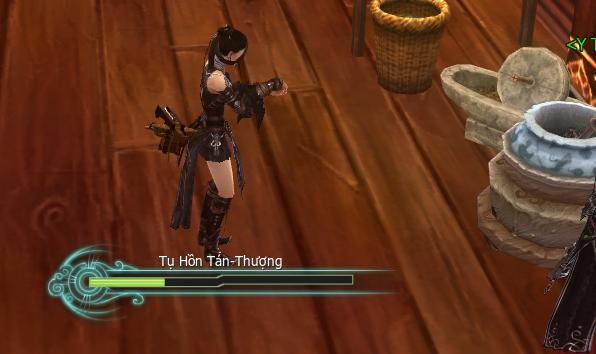 *Giao diện điều chế*

- **Phần thưởng**:  Độ thuần thục: Mỗi lần điều chế thành công tăng độ thuần thục kỹ năng, kỹ năng y thuật đủ mức thành thục yêu cầu sẽ tăng cấp. 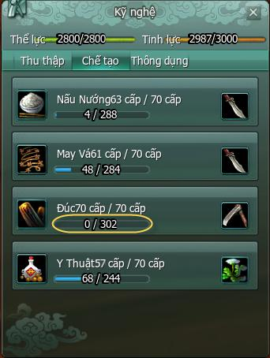 Các loại dược liệu hồi phục, hỗ trợ, tăng cường hoặc đặc thù. 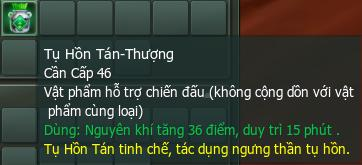 *Một dược liệu có được sau khi điều chế*

Nguồn: VNG (bài viết và hình ảnh)
