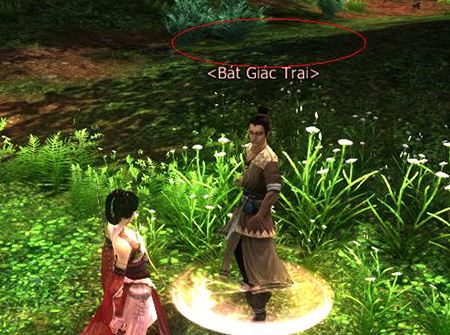

Sau khi Danh Kiếm Đại Hội được cập nhật, Võ Lâm 3 đã nhận được thông tin phản hồi từ nhân sĩ võ lâm về **một số nhân vật không rõ tính danh** đột ngột xuất hiện, gây náo động tứ phương. Thật ra, đây chính là những NPC đã nổi danh giang hồ từ lâu, tuy nhiên **do họ tên quá dài nên gặp phải lỗi hiển thị**, nhất thời trở thành những con người vô danh vô tánh, phiêu bạt khắp nơi.

  
 ***Những NPC vô danh bỗng nhiên xuất hiện***

Võ Lâm 3 chân thành cáo lỗi cùng chư vị về sự bất tiện này. Hiện tại, đội ngũ kỹ thuật đang tiến hành kiểm tra và sẽ cố gắng khắc phục tình trạng này trong thời gian sớm nhất, trả lại tên gọi cho các NPC và góp phần giúp quý nhân sĩ an tâm bôn tẩu.

Thân chúc quý nhân sĩ sẽ tìm được nhiều niềm vui và có những giờ phút thư giãn, giải trí thú vị tuyệt vời cùng thế giới kiếm hiệp tình duyên rộng lớn của Võ Lâm 3.

Nguồn: VNG (bài viết và hình ảnh)
