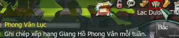
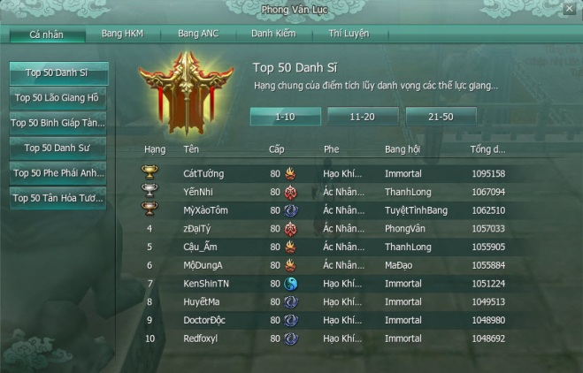
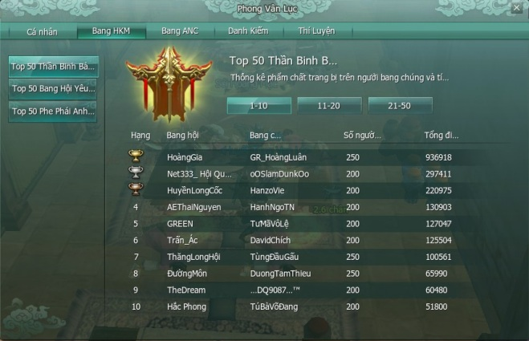
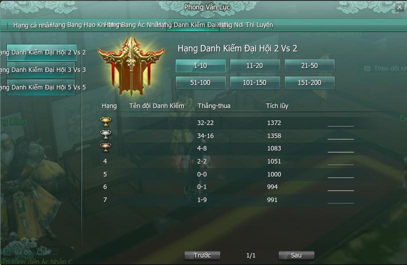
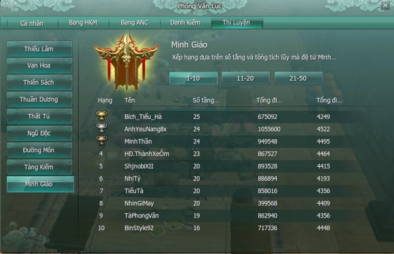

Trong quá trình hành tẩu giang hồ, chắc hẳn sẽ có rất nhiều anh hùng hào kiệt với vô vàn kỳ tích cùng những [thành tựu](./thanh-tuu.md) trên nhiều lĩnh vực được lập nên. Chính vì thế, bảng xếp hạng **Phong Vân Lục** được **cập nhật vào thứ Hai hàng tuần** chính là nơi những vị anh hùng ấy vang danh thiên hạ như hạng Cá nhân, hạng [Bang hội](./bang-hoi.md) Hạo Khí Minh, Ác Nhân Cốc,...

### Cách xem bảng xếp hạng Phong Vân Lục

  
 *Nhấp chọn vùng khoanh đỏ phía trên góc phải*

### Hệ thống bảng xếp hạng Phong Vân Lục

#### Hạng Cá nhân

- Hạng Cá nhân dùng để vinh danh 50 nhân vật đứng đầu trong từng lĩnh vực như danh vọng giang hồ, tích lũy chiến giới, ẩn nguyên bí giám, phẩm chất trang bị, [sư đồ](./su-do.md).

- Thông tin hiển thị gồm: Hạng hiện tại, tên nhân vật, cấp độ, phái, phe, Bang hội và số điểm tương ứng cho lĩnh vực đó.

   
 ***Bảng xếp hạng Cá nhân***

| Chi tiết | Ghi chú |
| --- | --- |
| Top 50 Danh Sĩ | Tổng điểm tích lũy danh vọng các thế lực giang hồ |
| Top 50 Lão Giang Hồ | Tích lũy tổng kinh nghiệm giang hồ được nhận thông qua Ẩn Nguyên Bí Giám |
| Top 50 Binh Giáp Tàng Gia | Điểm trang bị của nhân vật thông qua phẩm chất và vị trí của trang bị |
| Top 50 Danh Sư | Tổng điểm sư đồ khi bản thân làm sư phụ, bao gồm số điểm đã chuyển thành cống hiến bang |
| Top 50 Phe Phái Anh Hùng | Tổng điểm chiến giới cá nhân trong tuần |
| Top 50 Tân Hỏa Tương Truyền | Tổng giá bán (được tính theo tiệm cống hiến giang hồ) của trang bị mà sư phụ cho đệ tử trong 1 tuần |

#### Hạng Bang hội Hạo Khí Minh/Ác Nhân Cốc

- Hạng Bang hội Hạo Khí Minh/Ác Nhân Cốc dùng để vinh danh 50 Bang đứng đầu trong từng lĩnh vực như trang bị, sư đồ và tích lũy chiến giới.

- Thông tin hiển thị gồm: Hạng hiện tại, tên Bang hội, tên Bang chủ và số điểm tương ứng cho lĩnh vực đó.

   
 ***Bảng xếp hạng Bang hội Hạo Khí Minh/Ác Nhân Cốc***

| Chi tiết | Ghi chú |
| --- | --- |
| Top 50 Thần Binh Bảo Giáp | Tổng phẩm chất trang bị trên người Bang chúng và tính thành điểm tích lũy xếp hạng. |
| Top 50 Bang Hội Yêu Thương | Tổng điểm sư đồ của tất cả sư phụ trong bang, bao gồm điểm đã đổi thành cống hiến bang. |
| Top 50 Phe Anh Hùng | Tổng điểm tích lũy chiến giới tuần của tất cả thành viên đã gia nhập phe của bang. |

#### Hạng Danh Kiếm Đại Hội

- Đại Hội Danh Kiếm là nơi tập trung những anh tài khiêu chiến với nhau bằng hình thức tổ đội 2 vs 2, 3 vs 3, 5 vs 5. Từ đó đạt được vinh dự và thể hiện bản thân trong giang hồ.

- Bảng xếp hạng Danh Kiếm Đại Hội gồm tên 200 tổ đội đứng đầu mỗi hình thức tổ đội, với các thông tin như hạng hiện tại, tên đội danh kiếm, thắng – thua và số điểm tích lũy.

   
 ***Bảng xếp hạng Danh Kiếm Đại Hội***

#### Hạng Nơi Thí Luyện

- [Nơi Thí Luyện](../nhiem-vu/hoat-dong-hang-ngay.md#nơi-thí-luyện) là nơi thể hiển bản lĩnh của nhân vật một mình vượt qua các tầng ải khó khăn và để chinh phục giới hạn của mình.

- Bảng xếp hạng Nơi Thí Luyện thể hiện 50 nhân vật đứng đầu mỗi môn phái, có số tầng vượt ải và tích lũy trong quá trình vượt ải cao nhất với các thông tin như hạng hiện tại, tên nhân vật, số tầng đã vượt, tổng điểm vượt ải và tổng điểm trang bị của từng phái.

   
 ***Bảng xếp hạng Nơi Thí Luyện***

Nguồn: VNG (bài viết và hình ảnh)
