## Hệ thống sư đồ

- Hệ thống Sư Đồ

- Phần thưởng Sư Đồ

Khi nhân vật đạt đẳng cấp 70 là có thể thu nhận đệ tử. Ngoài việc hỗ trợ cùng nhau trong quá trình bôn tẩu, hệ thống Sư Đồ còn mang đến thật nhiều lợi ích khác cho sư phụ và đồ đệ.

- Nhận đồ đệ

- Nhận sư phụ

- Giao diện Sư Đồ

- Nhiệm vụ Sư Đồ

- Triệu hồi sư phụ

- Hủy quan hệ Sư Đồ

### Giao diện Sư Đồ

- Nhấn phím “U” hoặc nhấp chọn biểu tượng Ẩn Nguyên Bí Giám Sư Đồ ở góc trái.

- Gồm 04 mục: Sư môn, Đệ tử, Tìm sư, Tìm đệ.

- Tại mục **Sư môn** sẽ hiển thị thông tin của sư phụ và huynh tỷ, đệ muội trong môn phái. Căn cứ thời gian bái sư sẽ chia làm Đại sư phụ, Nhị sư phụ và Tam sư phụ. Căn cứ thời gian [gia nhập môn phái](../tan-thu/huong-dan-gia-nhap-mon-phai-khi-dat-cap-16.md) sẽ phân chia làm Đại sư huynh/tỷ...

- Ở mục **Đệ tử**, sư phụ có thể kiểm tra đẳng cấp, giới tính, thông tin [bang hội](./bang-hoi.md) của đồ đệ. Nhấp chọn một đệ tử bất kỳ để mời tổ đội, kết bạn, chat riêng hoặc đoạn tuyệt sư đồ... qua nút ở góc dưới giao diện.

### Nhận đồ đệ

- **Điều kiện**: Nhân vật có đẳng cấp từ 70 trở lên.

| Hình ảnh | Mô tả |
| --- | --- |
| 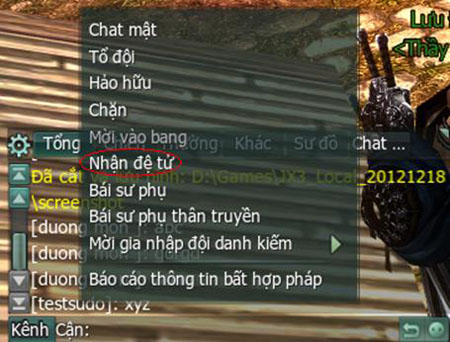 | **Bước 1**: Trên kênh thế giới, nhấn chuột phải vào tên nhân vật để nhận đồ đệ. |
| 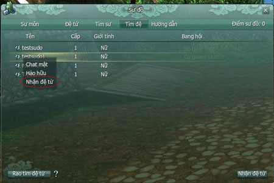 | **Bước 2**: Trong giao diện Sư Đồ, các nhân vật mới tham gia sẽ ngẫu nhiên hiển thị ở một vị trí bất kỳ. |
| 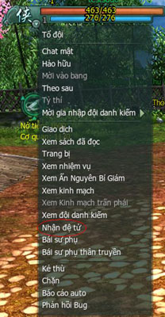 | **Bước 3**: Nhấp chuột phải vào Ẩn Nguyên Bí Giám tiến hành nhận đồ đệ. Hệ thống sẽ gửi một thông báo yêu cầu nhận Đệ tử. Nếu đối phương đồng ý, thao tác nhận Đệ tử thành công. |
| 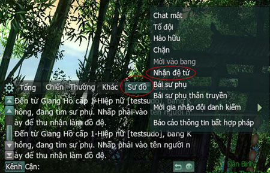 | **Bước 4** Trong kênh sư đồ, các nhân vật chưa bái sư khi đăng nhập sẽ có thông báo của hệ thống. Đồng đạo có thể thông qua kênh này để nhận Đệ tử. Không tìm được đồ đệ, đồng đạo mở giao diện Sư Đồ và gửi thông tin nhận đồ đệ. Hệ thống sẽ hiển thông tin phía trên giao diện Sư Đồ. |

### Nhận sư phụ

- **Điều kiện**: Nhân vật có đẳng cấp từ 01 - 69.

- Nhân vật có thể bái sư thông qua nhiều cách khác nhau:

| Hình ảnh | Mô tả |
| --- | --- |
| 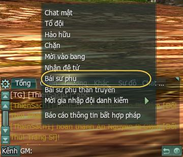 | **Cách 1**: Thông qua tán gẫu trên kênh thế giới tìm sư phụ. |
| 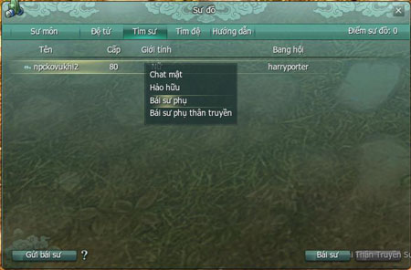 | **Cách 2**: Nhấn phím "U" mở giao diện sư đồ. Chọn dòng "Tìm Sư phụ", nhấp chuột sẽ hiện ra danh sách những sư phụ đang muốn nhận đồ đệ. Đồng đạo có thể chọn 1 - 3 người để bái sư. Tối đa bái sư cùng lúc 03 người. |
| 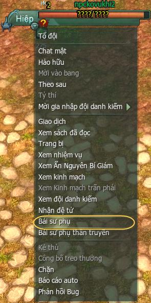 | **Cách 3**: Nhấp phải chuột vào biểu tượng trên đầu của nhân vật khác, hệ thống sẽ gởi lời mời bái sư (đối phương đồng ý bái sư thành công). Đạt đẳng cấp 70, đồng đạo sẽ xuất sư và có thể thu nhận đồ đệ cho mình. Để xuất sư, đồng đạo cần hoàn thành nhiệm vụ xuất sư (nhận tại Chưởng môn). Sau khi xuất sư sẽ không còn nhận được điểm Sư Đồ. |

### Nhiệm vụ Sư Đồ

| Nhiệm vụ | Cấp độ nhận | Phần thưởng |
| --- | --- | --- |
| Nho Hiệp Quảng Tụ Kính Sư Đường *(tại NPC Xa Phu Tân Thủ Trấn)* | 10 | - |
| Kính Sư Đường Tiền Kết Anh Hùng *(tại NPC Vương Xương Linh)* | Đào Lý Chi Nhẫn (2 chọn 1) |  |
| Phủ Thủ Tác Truy Tạ Sư Ân *(tại NPC Chưởng Môn Phái)* | 15 | Ngựa Đào lý |
| Phù Cầm Thoải Tấu Bạc Hoan Nhạn *(tại NPC Chưởng Môn Phái)* | 20 | Vòng Đào Lý (2 chọn 1) |
| Sư Đồ Đồng Tâm Nghênh Khiêu Chiến *(tại NPC Kỷ Thiên Hạ)* | 30 | - |
| Nghĩa Bạc Vân Thiên Giải Sầu Muộn *(tại NPC Kỷ Thiên Hạ)* |  |  |
| Độ Tận Kiếp Ba Sư Phụ Tại *(tại NPC Kỷ Thiên Hạ)* | Bội Đào Lý (2 chọn 1) |  |
| Múa Rìu Qua Mắt Thợ *(tại NPC Kỷ Thiên Hạ)* | 40 | Liên Đào Lý (2 chọn 1) |
| Đại Ân Cảm Tạ Sư Phụ *(tại NPC Chưởng Môn Phái)* | 50 | - |
| Nhất Văn Nhất Võ Truyền Sư Đạo *(tại NPC Vương Xương Linh)* |  |  |
| Xuất Sư Hiệp Nghĩa Giang Hồ *(tại NPC Kỷ Thiên Hạ)* |  |  |
| Xuất Sư Tình Nghĩa Bất Tận *(tại NPC Kỷ Thiên Hạ)* | Niệm sư phụ (Đạo cụ ô thú vị) |  |

### Triệu hồi sư phụ

- Trong quá trình bôn tẩu gặp khó khăn, cần sự hỗ trợ của sư phụ, đồng đạo có thể nhờ giúp đỡ thông qua tính năng "triệu hồi sư phụ" (tiêu hao 20 điểm sinh lực/lần).

- Sư phụ đồng ý, đồng đạo sẽ hoàn tất thao tác triệu hồi.

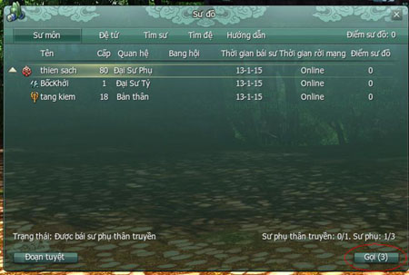

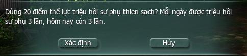

### Quan hệ Sư Đồ

#### Hủy quan hệ Sư Đồ

- Cả 02 không đăng nhập trong vòng 03 tháng, hệ thống sẽ tự hủy quan hệ Sư Đồ.

- Cả 02 từng đăng nhập cùng lúc trong tuần, sư phụ đơn phương hủy quan hệ Sư Đồ, hệ thống sẽ thông báo đến đệ tử. Nếu đệ tử xác nhận thì sau 04 ngày quan hệ sẽ bị hủy và sư phụ sẽ không thể nhận điểm Sư Đồ.

- Trong 01 tuần, sư phụ có lúc đăng nhập nhưng đồ đệ thì không, sư phụ được quyền hủy bỏ quan hệ Sư Đồ ngay lập tức, đồng thời nhận được 50% điểm Sư Đồ đã tích lũy.

- Trong 1 tuần, sư phụ có lúc đăng nhập và đồ đệ muốn hủy bỏ quan hệ Sư Đồ, hệ thống sẽ hiện yêu cầu xác nhận. Khi sư phụ xác nhận, 03 ngày sau mới có thể chính thức hủy bỏ và hệ thống sẽ quy đổi 60% điểm Sư Đồ tích lũy được thành vật phẩm gửi cho sư phụ

- Trong 01 tuần sư phụ không đăng nhập, đồ đệ có thể lập tức hủy bỏ quan hệ Sư Đồ và hệ thống sẽ quy đổi 60% điểm Sư Đồ tích lũy được thành vật phẩm gửi cho sư phụ. Thư chỉ tồn tại trong 30 ngày.

#### Hủy bỏ thao tác Hủy quan hệ Sư Đồ

- Sau khi đồ đệ hoặc sư phụ chọn lệnh "hủy quan hệ Sư Đồ", nếu muốn hủy lệnh, đồng đạo chỉ cần chọn "hủy đoạn tuyệt" trên giao diện Sư Đồ.

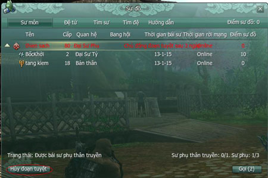  
 *Giao diện hủy bỏ lệnh "hủy quan hệ Sư Đồ"*

## Sư phụ thân truyền

Để hỗ trợ chư vị hiểu rõ hơn về sư đồ thân truyền cũng như nhanh chóng tìm được cho mình vị minh sư/cao đồ như ý muốn, Võ Lâm 3 thân gửi đến chư vị bảng **hướng dẫn chi tiết về hệ thống sư đồ thân truyền**. Chi tiết:

### Phần thưởng

#### Quyền lợi của đệ tử

- Mỗi đệ tử chỉ có thể nhận được một sư phụ thân truyền. Vì vậy đệ tử có quyền yêu cầu sư phụ giúp đỡ mình mọi hoạt động trong game.

- Đệ tử có thể yêu cầu sự hỗ trợ từ sư phụ các vấn đề như luyện cấp, tham gia phó bản tìm kiếm trang bị, tham gia các hoạt động đánh Boss và nhiệm vụ trong game.

- Nếu trong quá trình quan hệ thân truyền, sư phụ không hỗ trợ đệ tử. Đệ tử có quyền hủy quan hệ thân truyền với sư phụ đó và tìm một sư phụ khác.

- Sư phụ bị đệ tử hủy quan hệ thân truyền sẽ không nhận được phần thưởng khi đệ tử tham gia hoạt động.

#### Quyền lợi của sư phụ

- Trong tuần, khi đệ tử thân truyền hoàn thành nhiệm vụ phó bản ngày, Tụ Nghĩa Hắc Long Phá Thương Khung, Quán Trà Thành Chính thì 1 thư phần thưởng sẽ được gửi đến cho sư phụ.

- Mỗi đệ tử thân truyền chỉ có thể tặng 3 lần phần thưởng cho sư phụ trong một tuần và sẽ nhận lại được vào tuần sau.

- Đệ tử thân truyền đầu tiên sẽ được gọi là **đại đệ tử**.

- Đệ tử thân truyền thứ 2 gọi là **nhị đệ tử**.

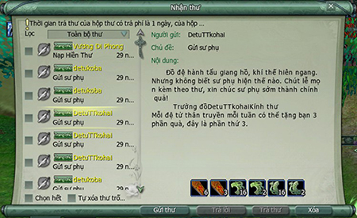  
 **Phần thưởng của đại đệ tử khi hoàn thành 1 lần nhiệm vụ**

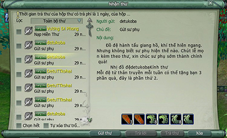  
 **Phần thưởng của nhị đệ tử khi hoàn thành 1 lần nhiệm vụ**

- Danh sách phần thưởng tối đa trong tuần sư phụ nhận được từ hai đệ tử thân truyền:

| **Tên vật phẩm** | **Số lượng** | **Tổng điểm** | **Công dụng** |
| --- | --- | --- | --- |
|  Chiến Hồn Bội | 9 | 4.500 | Tăng 500 Uy Danh |
|  Hào Hiệp Cống | 9 | 4.500 | Tăng 500 Cống Hiến Bang |
|  Bùa Hào Hiệp | 72 | 36.000 | Tăng giới hạn Cống Hiến Bang tuần 500 điểm |
|  Khuông Nghĩa Lệnh | 12 | 480 | Tăng 40 Điểm Nghĩa Hiệp |
|  Bùa Khuông Nghĩa | 27 | 3.375 | Tăng giới hạn Nghĩa Hiệp tuần 125 điểm |
|  Bùa Chiến Hồn | 72 | 36.000 | Tăng giới hạn uy danh tuần |

### Lưu ý liên quan

- Mỗi nhân vật chỉ được một lần chuyển từ sư phụ thân truyền trở lại thành đệ tử thân truyền. Cần cân nhắc khi chuyển trạng thái.

- Tối đa nhận được 3 phần thưởng/đệ tử thân truyền/tuần.

- Sư phụ có thể nhận tối đa 2 đệ tử thân truyền. Mỗi đệ tử chỉ nhận 1 sư phụ thân truyền.

- Sau khi nhận sư phụ/đệ tử thân truyền phải đợi 7 ngày (tính từ lúc bắt đầu kết bái sư đồ thân truyền) để có thể nhận được phần thưởng.

- Cần thời gian 3 ngày để hủy quan hệ sư đồ thân truyền.

- Mỗi tài khoản chỉ có 1 nhân vật được nhận đệ tử thân truyền.

### Nhận sư phụ/đệ tử chân truyền

- Sư phụ đạt cấp 80 trở lên có thể đến 3 thành chính Trường An - Lạc Dương - Dương Châu, vào Kính Sư Đường gặp NPC Vương Xương Linh để nhận tư cách làm sư phụ thân truyền.

- Đệ tử có thể bái nhận những nhân sĩ có tư cách làm sư phụ thân truyền để trở thành đệ tử thân truyền.

| Hình ảnh | Ghi chú |
| --- | --- |
| 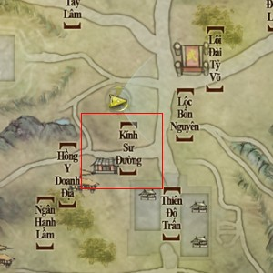 Trường An - Kính Sư Đường | Kính Sư Đường tại 3 thành chính. |
| 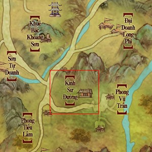 Lạc Dương - Kính Sư Đường |  |
| 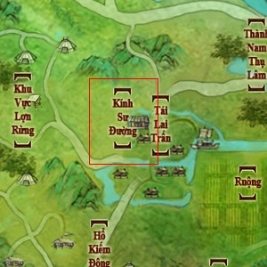 Dương Châu - Kính Sư Đường |  |
| 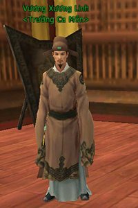 | **Sư phụ** Sư phụ đối thoại với NPC Vương Xương Linh. |
| 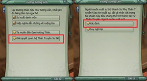 | Chọn xác định trở thành Sư Phụ Thân Truyền. |
| 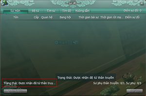 | Giao diện khi sư phụ đạt được tư cách sư phụ thân truyền. |
| 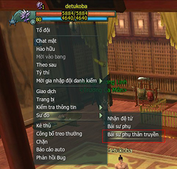 | **Đệ tử** Đệ tử nhấp vào người sư phụ và chọn thao tác **Bái sư phụ thân truyền.** Sư phụ đồng ý thì cả 2 chính thức trở thành sư đồ thân truyền. |
| 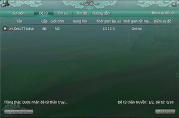 | Đệ tử thân truyền có dấu hiệu hình ngôi sao trước tên trong giao diện sư đồ. |

Nguồn: VNG (bài viết và hình ảnh)
