## Thần Binh Truyền Kỳ 1: Vũ khí tối thượng

**Thần Binh** - vũ khí tối thượng tại Võ Lâm 3, trong thời gian gần đây đã gây chấn động quần hùng võ lâm với sự xuất hiện của những vũ khí bí mật có phẩm chất rất cao, có thể khiến thiên hạ trở nên đại loạn.

[Video](http://www.youtube.com/embed/K-FZ4i46Q-Q)

Tuy nhiên, để có thể nắm trong tay và hiểu được huyền cơ của các loại vũ khí bí mật này là điều không dễ, các cao thủ phải xây dựng cho mình những món đồ căn bản để có thể chinh phục các phó bản - ẩn giấu những vật phẩm tạo nên Thần Binh, một cách dễ dàng.

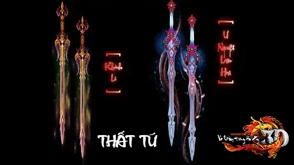

Chuỗi bài **Thần Binh Truyền Kỳ**theo từng giai đoạn sẽ giới thiệu và hướng dẫn cho các anh hùng hào kiệt từ những điều căn bản bình thường nhất để có thể dễ dàng cùng hảo hữu và [Bang hội](./bang-hoi.md) mình chinh phục các phó bản và sở hữu Thần Binh. Sau đây là nội dung**kỳ 1**:

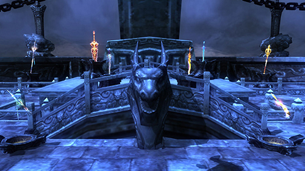
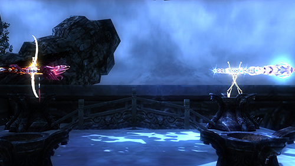
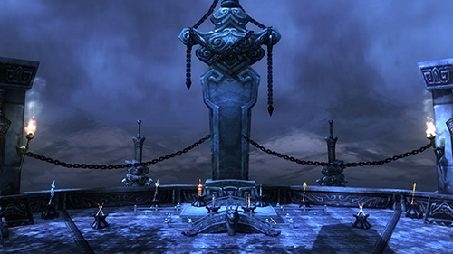
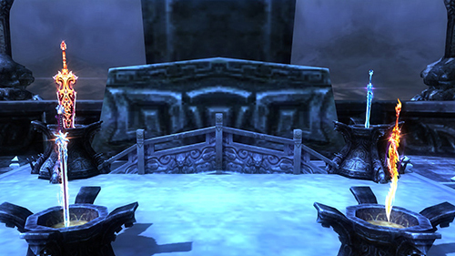
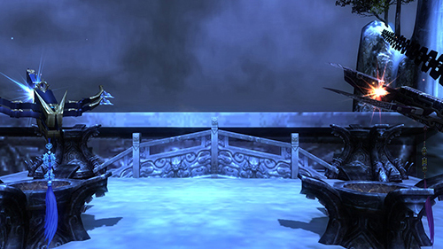
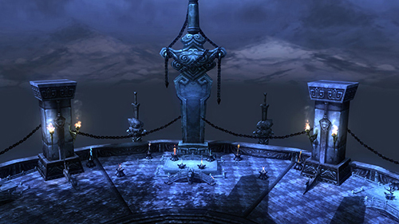
- Mục tiêu

- Nhiệm vụ

- Đổi trang bị

### Mục tiêu giai đoạn 1

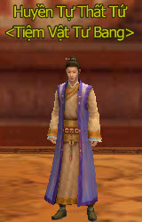

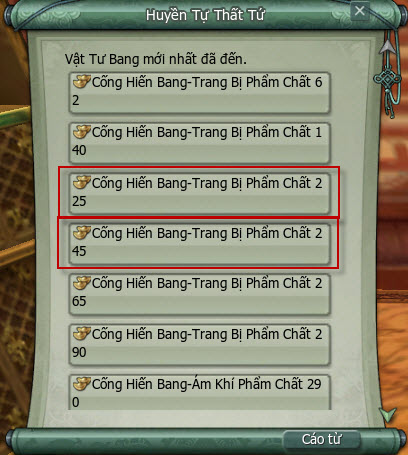

- Điểm cống hiên Bang cần để có đủ 1 bộ trang bị trên người: **113.700**.  **5 trang bị 225:** 35.100 điểm cống hiến Bang. **3 món 245:** 78.600 điểm cống hiến Bang.

- **Lưu ý:** Trên đây chỉ sử dụng 1 vài trang bị cần thiết sử dụng, nhân sĩ nên tham gia các hoạt động khác để lấy được các trang bị còn thiếu như mua trang bị [chiến trường](./chien-truong.md) bằng Uy Danh cho **vũ khí tầm xa** và **nhẫn**, hỗ trợ rất nhiêu khi chinh phục phó bản.

### Hoàn thành nhiệm vụ

#### Quán trà thành chính

- Nhiệm vụ hàng ngày rất cần thiết.

- **Thời gian hoàn thành:** Từ 15 - 20 phút.

- **Phần thưởng:** Vàng, 3.500 điểm cống hiến Bang, điểm nghĩa hiệp, **Đá Huyền Long**.

- **Đá Huyền Long:**Vật phẩm cần thiết để nâng cấp phẩm chất cho vũ khí Thần Binh.

- Xem thêm nhiệm vụ quán trà.

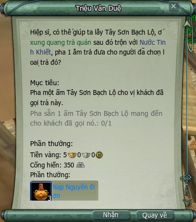

#### Mỹ nhân đồ

- Nhiệm vụ vẽ tranh các nhân vật của các phái.

- **Thời gian hoàn thành:** Từ 3 - 30 phút.

- **Vật phẩm cần thiết:** Giấy trắng tinh xảo.

- **Phần thưởng:** 2.500 điểm cống hiến Bang (5 lần vẽ tranh, có thể vẽ chính mình), rương Ngoại Phủ Bạch Đế Thành, Kim Ngọc Trát - [Mỹ Nhân Đồ](../nhiem-vu/hoat-dong-hang-ngay.md#hoạt-động-mỹ-nhân-đồ) (tăng 100 điểm danh vọng tùy theo lựa chọn của nhân vật).

- Xem thêm nhiệm vụ mỹ nhân đồ.

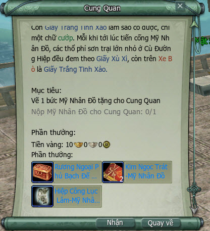

#### Gia nhập Bang hội

- Lần đầu gia nhập Bang hội sẽ nhận được Ẩn Nguyên Hội, nhận được **10.000** điểm cống hiến Bang.

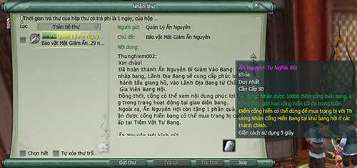

#### Câu cá Bang hội (1 lần/tuần)

- Nhận nhiệm vụ tại **Lư Lư** trong lãnh địa Bang hội.

- **Phần thưởng:** Vàng, 3.500 điểm cống hiến Bang, vật phẩm khác.

- Xem thêm nhiệm vụ câu cá Bang hội.

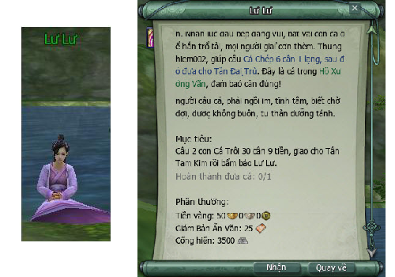

### Đổi trang bị

- Hoàn thành các nhiệm vụ trong ngày đầu tiên sẽ nhận được: **19.500** cống hiến Bang.

- Tiếp tục nhiệm vụ quán trà và mỹ nhân đồ trong 7 ngày: **55.500** cống hiến Bang/tuần đầu (số điểm ít nhất có thể đạt được nếu hoàn thành tất cả nhiệm vụ trên).

- Đổi trang bị tại **NPC Huyền Tự Thất Tứ**: 5 trang bị phẩm chất 225 với 35.100 điểm.

- Số điểm còn lại: Tiếp tục tích lũy điểm để có thể đổi 3 trang bị còn lại phẩm chất 245.

- Khuyến khích đổi theo thứ tự: Vũ khí, nón, thắt lưng, quần, dây chuyền, áo, giày, bao tay.

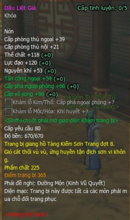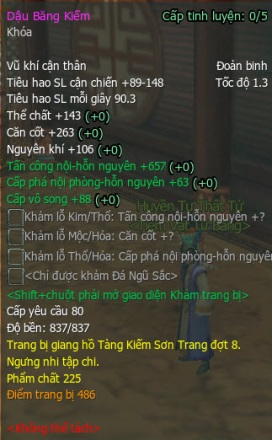

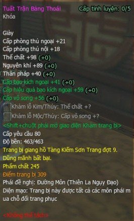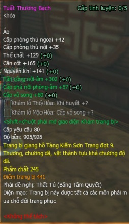   
 **Một số thuộc tính trang bị phẩm chất 255 và 245**

Với một số hướng dẫn cơ bản trên, quý nhân sĩ thực hiện các nhiệm vụ trên khoảng **30 phút/ngày** thì chậm nhất chưa đến 10 ngày đã có thể sở hữu bộ trang bị tương đối.

Ngoài ra để có thể nhanh chóng sở hữu bộ trang bị, nhân sĩ có thể tham gia các hoạt động khác để có thể nhận được cống hiến Bang như: Tính năng Lật Bài, tham gia hoạt động môn phái hàng ngày, [nơi thí luyện](../nhiem-vu/hoat-dong-hang-ngay.md#nơi-thí-luyện), [lệnh truy nã ẩn nguyên](../nhiem-vu/hoat-dong-hang-ngay.md#lệnh-truy-nã-ẩn-nguyên) hội…

**Thần Binh Truyền Kỳ - kỳ 2** với hướng dẫn cách nhận được trang bị **phẩm chất 255** nhanh chóng từ quá trình vượt phó bản một cách "siêu tốc". Thân mời quý nhân sĩ đón theo dõi.

## Thần Binh Truyền Kỳ 2: Con đường của cường giả

Thần Binh Truyền Kỳ - kỳ 1 đã giới thiệu đến quý nhân sĩ về vũ khí Thần Binh cũng như những cách cơ bản nhất để có thể dễ dàng sở hữu vũ khí "khủng" này. Tuy nhiên, đó chỉ là những điều cơ bản để có được những bộ trang bị tương đối và tham gia các phó bản tại Võ Lâm 3.

Cũng như trên hành trình để trở thành ngôi vị chí tôn vang danh thiên hạ, các anh thư hào kiệt muốn sở hữu những bộ trang bị, vũ khí Thần Binh đạt phẩm chất cao đều phải tích cực trui rèn kỹ năng hàng ngày để có thể chinh phục các phó bản từ thấp đến cao - nơi chứa đựng các bí ẩn và những trang bị khiến quần hùng phải dậy sóng.

"Phó bản là gì?"...câu hỏi chứa ẩn nhiều hoài bão của những bậc anh hùng. Hoài bão chinh phục mọi khó khăn thử thách, hoài bão sở hữu những vũ khí tối thượng chốn giang hồ...**Thần Binh Truyền Kỳ - kỳ 2** sẽ bật mí những bí ẩn đó!

- Mục tiêu

- Phó bản là gì?

### Mục tiêu giai đoạn 2

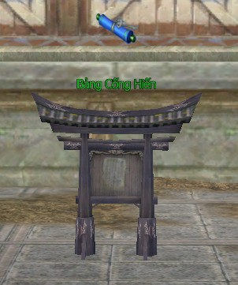

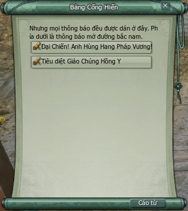

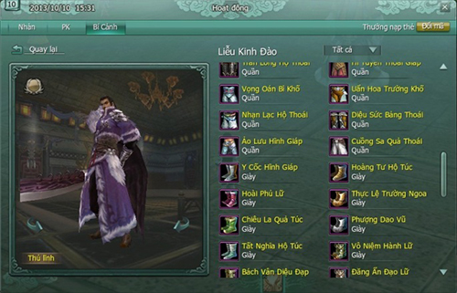

### Phó bản là gì?

#### Nhiệm vụ hàng ngày tại Bảng Cống Hiến

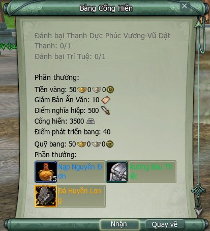

- **Lưu ý:** Giai đoạn này nhân vật chỉ cần tham gia Quán Trà Thành Chính, Mỹ Nhân Đồ, nhiệm vụ phó bản hàng ngày đã có thể nhận được **9.500** Cống Hiến Bang và **740** điểm nghĩa hiệp trong 1 ngày. Trong 1 tuần sẽ dễ dàng đạt tối đa **55.000** Cống Hiến Bang.

#### Những nẻo đường tà

[Video](http://www.youtube.com/embed/r0cSXfdrOf8)

 **[Vô Lượng Cung](../pho-ban/pho-ban-5-nguoi.md#vô-lượng-cung) - Anh Hùng**

[Video](http://www.youtube.com/embed/6ltWIhj9hhk)

 **[Hang Pháp Vương](../pho-ban/pho-ban-5-nguoi.md#hang-pháp-vương) - Anh Hùng**

[Video](http://www.youtube.com/embed/3P7JQtHtMLU)

 **[Độc Thần Điện](../pho-ban/pho-ban-5-nguoi.md#độc-thần-điện) - Anh Hùng**

[Video](http://www.youtube.com/embed/LGdVD6KU57c)

 **[Tịch Diệt Sảnh](../pho-ban/pho-ban-5-nguoi.md#tịch-diệt-sảnh) - Anh Hùng**

- Phó bản [Đường Môn Mật Thất](../pho-ban/pho-ban-5-nguoi.md#đường-môn-mật-thất) là một phó bản tương đối khó, nếu chưa có kinh nghiệm vượt phó bản có thể bỏ qua.

#### Trang bị 255 từ phó bản

- Trong các trang bị xuất hiện trong phó bản anh hùng thì vũ khí là một trong những vật phẩm cần thiết nhất mà nhân sĩ cần đạt được.

- Không chỉ có các chỉ số rất tốt so với các trang bị có phẩm chất cùng loại, mà còn có hiệu ứng đặc biết mà không có loại vũ khí nào có thể có được ngoài Thần Binh.

- Ngoài vũ khí, các trang bị của các phái cũng xuất hiện ở các phó bản anh hùng 80.

- Điều kiện tiên quyết là nhân sĩ có thể dễ dàng tái lập lại phó bản chỉ với **50 thể lực** để đi lại và tạo cho mình thêm cơ hội để đi tìm trang bị.

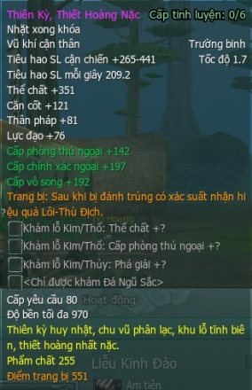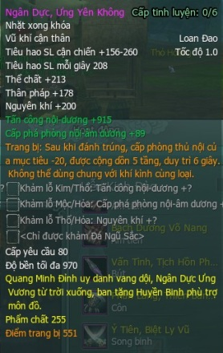

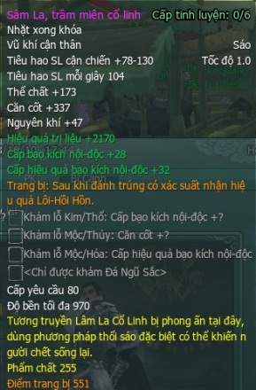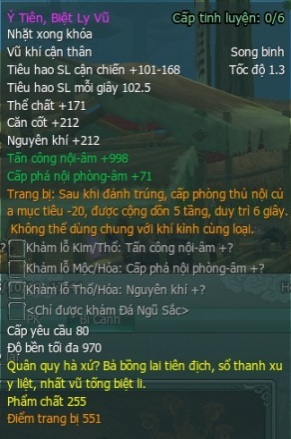

**Thần Binh Truyền Kỳ - kỳ 3** sẽ thật sự là một thử thách với các nhân sĩ cùng phó bản khó nhất - **[Quang Minh Mật Đạo](../pho-ban/pho-ban-5-nguoi.md#quang-minh-mật-đạo)**, hoàn tất giai đoạn 3 sẽ giúp cho các anh hùng hào kiệt tiến đến gần ngưỡng cửa sở hữu thần binh.

Ngoài ra, giai đoạn 3 sẽ yêu cầu khá nhiều điểm từ những hoạt động giai đoạn 1 và 2, hãy tích cực tham gia chinh phục những thử thách khó khăn nhất để nhanh chóng sở hữu Thần Binh.

## Thần Binh Truyền Kỳ 3: Quyết chiến Quang Minh

Sau khi tham khảo **Thần Binh Truyền Kỳ** - kỳ 1 và kỳ 2, chắc hẳn chư vị nhân sĩ đã bắt đầu thử sức và làm quen với các nhiệm vụ Quán Trà Thành Chính, Mỹ Nhân Trong Tranh, nhiệm vụ bí cảnh ngày... Đó là những nhiệm vụ cần thiết giúp quý nhân sĩ sở hữu một bộ trang bị PvE (trang bị có tăng thuộc tính Vô Song) phẩm chất 255 để tham gia các phó bản anh hùng 5 người cấp cao.

Và tại **Thần Binh Truyền Kỳ - kỳ 3**, chư vị sẽ tiếp tục trải nghiệm thách thức cao nhất của tổ đội 5 người anh hùng: **Phó bản Quang Minh Mật Đạo** với các phần thưởng trang bị phẩm chất 280 vô cùng quý giá.

- Phó bản Quang Minh

- Mục tiêu giai đoạn 3

### Quyết chiến Quang Minh

Biến cố tại Đại Quang Minh Tự đã qua nhiều năm, quan hệ giữa [Minh Giáo](../mon-phai/minh-giao.md) và các môn phái Trung Nguyên dần êm dịu. Nhằm duy trì mối quan hệ tốt đẹp và chuẩn bị cho Minh Giáo về lại Trung Nguyên, giáo chủ Minh Giáo Lục Nguy Lâu quyết định phái một số đệ tử tư chất tốt xuống núi về Trung Nguyên.

Đường đến Trung Nguyên gian nan hiểm nguy, Lục Nguy Lâu hạ lệnh, đệ tử nào vượt qua Càn Khôn Đại Na Di Ngũ Hành Trận Pháp, mới có tư cách xuống núi.

[Video](http://www.youtube.com/embed/NJ1erbIgjT4?rel=0)

 **"Đệ tử nào vượt qua Càn Khôn Đại Na Di Ngũ Hành Trận Pháp..."**

Càn Khôn Đại Na Di Ngũ Hành Trận Pháp, tức Quang Minh Mật Đạo, do 5 Đại Chưởng Kỳ Sứ của Minh Giáo Ngũ Hành Kỳ trấn thủ gồm Lưu Kim Kỳ, Tinh Mộc Kỳ, Hồng Thủy Kỳ, Diệu Hóa Kỳ và Phương Thổ Kỳ biến hóa khôn lường, rất khó vượt qua!

### Mục tiêu giai đoạn 3

[Video](http://www.youtube.com/embed/hGB3GU7EWdU?rel=0)

#### Điểm nghĩa hiệp

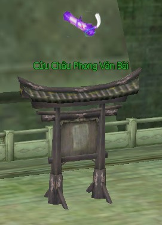  
 **Nhận nhiệm vụ tại Cửu Châu Phong Vân Bội**

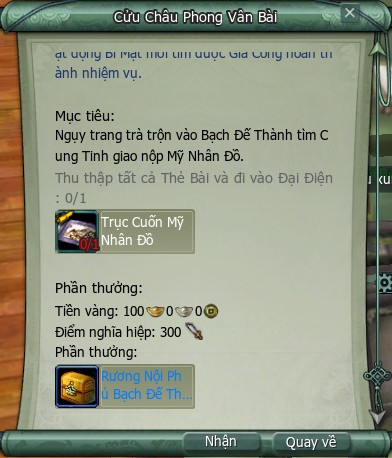  
 **Phần thưởng nhiệm vụ**

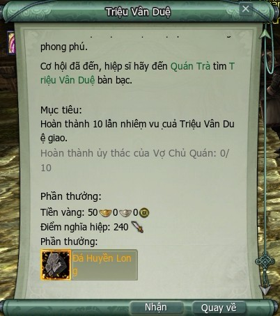

#### Trang bị cần đạt được

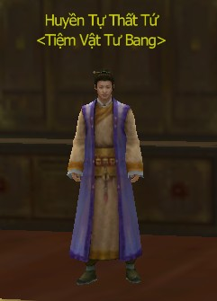

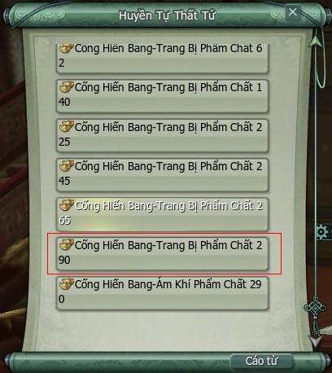

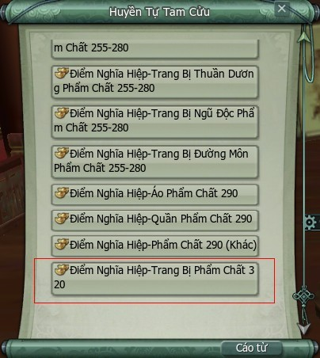

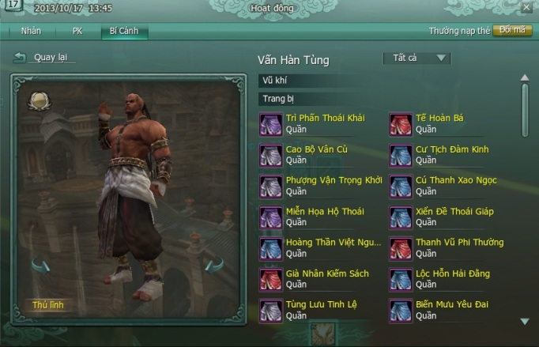

#### Nâng cấp trang bị

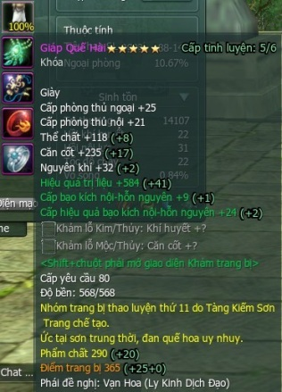

- **Một số đặc trưng của Tinh Luyện và Khảm Nạm:**  Tinh Luyện và Khảm Nạm là hai tính năng nâng cấp đẳng cấp và kích hoạt thuộc tính ẩn của trang bị. Để Tinh Luyện cần phải có Đá Ngũ Hành, có 5 loại Đá Ngũ Hành (Kim, Mộc, Thủy, Hỏa, Thổ). Để Khảm Nạm cần phải có Đá Ngũ Sắc, có rất nhiều loại Đá Ngũ Sắc khác nhau và mỗi loại sẽ tương ứng nâng cấp một thuộc tinh của trang bị. Đá Ngũ Hành, Đá Ngũ Sắc có được thông qua nhiệm vụ và các hoạt động trong Võ Lâm 3. Nhân sĩ có thể mua Đá Ngũ Hành cấp 1 tại **Thương Nhân Đá Ngũ Hành** ở các thành thị lớn.

**Thần Binh Truyền Kỳ - kỳ 4**với những điều thú vị sẽ sớm ra mắt quý nhân sĩ trong thời gian sắp tới, thân mời quý nhân sĩ cùng đón theo dõi.

## Thần Binh 280

Thế giới Võ Lâm 3 luôn chứa đựng những vũ khí thần bí khiến các cao tăng ẩn sĩ khắp nơi ngày đêm thao thức lo sợ. Biết bao ai oán chốn giang hồ khiến thiên hạ trở nên đại loạn, chính vì thế không ít các anh hùng hào kiệt tứ phương đã thân chinh truy tìm các **vũ khí Thần Binh**, quyết không để rơi vào tay bọn man di sơn tặc.

Sắp tới đây, chốn giang hồ toàn cõi Võ Lâm 3 sẽ được chứng kiến sự xuất hiện của những vật phẩm có thể chế tạo nên những **vũ khí Thần Binh** với phẩm chất lên tới 280 người người khiếp sợ, đây là trang bị đạt ngưỡng cực phẩm tại Võ Lâm 3.

Tương truyền rằng, để có thể chế tạo ra loại trang bị Thần Binh, các anh hùng hào kiệt phải ra sức truy tìm **Kim Ô Vẫn Thiết** và **Hóa Ngọc Huyền Tinh** - những vật phẩm đang được ẩn giấu tại các phó bản cao cấp sắp được ra mắt như [Hồi Ức Trì Quốc Thiên Vương](../pho-ban/pho-ban-10-nguoi.md#hồi-ức-trì-quốc-thiên-vương), Hội Chiến [Đường Môn](../mon-phai/duong-mon.md), [Hoàng Cung Nam Chiếu](../pho-ban/hoang-cung-nam-chieu.md), [Chúc Long Điện](../pho-ban/pho-ban-10-nguoi.md#chúc-long-điện).

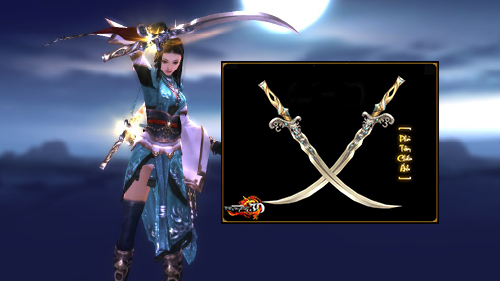
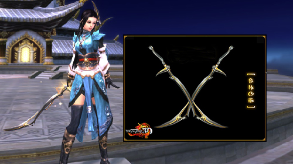
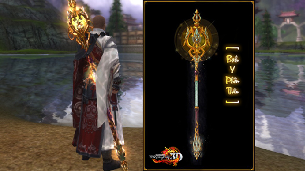
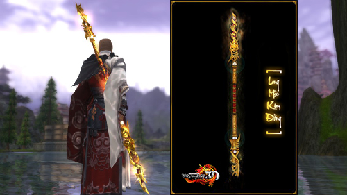
Và ngày **10/10/2013**, phó bản **Hồi Ức Trì Quốc Thiên Vương** sẽ **chính thức được khai mở** để quần hùng võ lâm có thể cùng nhau chinh phục và sở hữu **Kim Ô Vẫn Thiết**, 1 trong 2 vật phẩm quan trọng để có thể tôi luyện vũ khí trở nên thiên hạ vô địch, quần hùng kính nể.

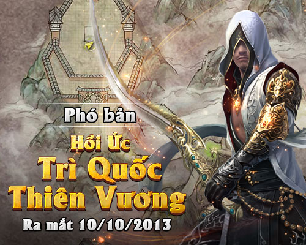

- Điều kiện tham gia

- Boss

- Phần thưởng

### Bản đồ & điều kiện tham gia

- **Đẳng cấp nhân vật**: Cấp **80** trở lên.

- **Yêu cầu**: Tổ đội 25 người.

- **Lối vào phó bản**: Đối thoại với NPC Trừng Chính tại [Thiếu Lâm](../mon-phai/thieu-lam.md).

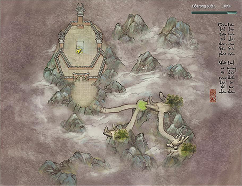

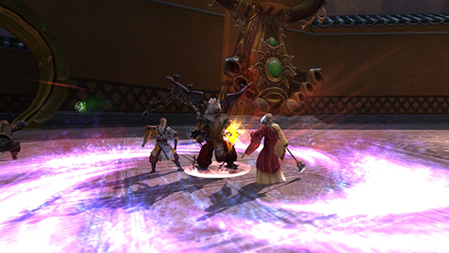  
 ***Gian truân vững bước giang hồ...***  

 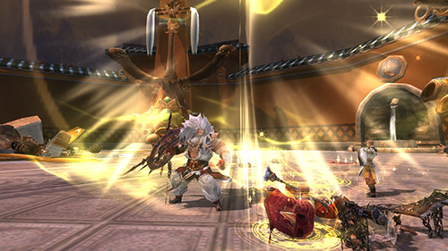

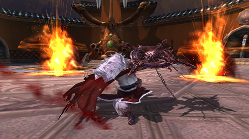  
 ***Thần Binh xuất thế đại loạn giang sơn...***

### Boss

| **Hình ảnh** | **Ghi chú** |
| --- | --- |
| ** Đề Đa La Tra** | Cơ quan mộc giáp "Đông Phương Trì Quốc Thiên" Đề Đa La Tra là kiệt tác của Tăng Nhất Hành Quỷ Phủ Thần Công, được tặng cho Thiếu Lâm để trấn thủ vô số bí kíp võ công trong Động Đạt Ma. Phụ trách giam cầm Pháp Vương "Huyết Nhãn Long Vương" Tiêu Sa - người có võ công cao nhất Minh Giáo trước đây. **Đẳng cấp**: **82** **Sinh lực**: **16.130.000** |
| **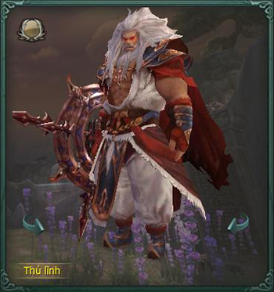 Tiêu Sa** | Tiêu Sa là đệ tử phái Hồng Trần, trước là Minh Giáo Huyết Nhãn Long Vương, hắn căm ghét sư đệ Vương Di Phong, cho rằng người này giành hết mọi thứ của mình. Võ lâm Trung Nguyên nhận biết việc ác của Huyết Nhãn Long Vương, liên thủ tiêu diệt. Cuối cùng Tiêu Sa bại dưới trướng Như Lai Nghìn Tay của Thiếu Lâm lão phương trượng, bị giam ở Động Đạt Ma. **Đẳng cấp**: 82 **Sinh lực**:**27.560.000** |

### Phần thưởng

#### Trang bị

- **Vũ khí:**Vũ khí tầm xa Ám Tiễn và trang bị phẩm chất 295.  

 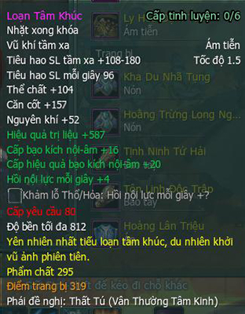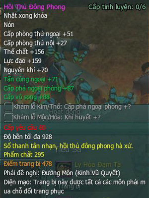 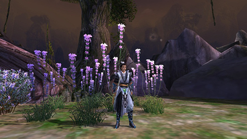

#### Vật phẩm khác

| **Hình ảnh** | **Vật phẩm** |
| --- | --- |
| **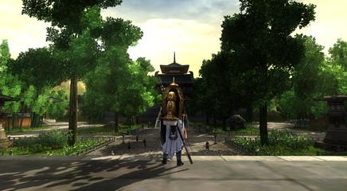** | **** **Nhân Hoa Sinh** (trang sức vai) |
| **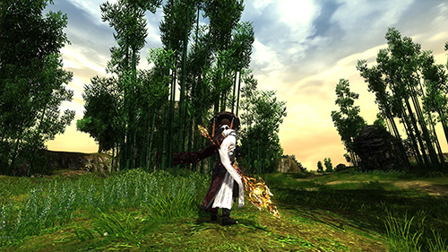Nguyên liệu chế tạo Thần Binh 80 phẩm chất 280** | **** **Ô Kim Vân Thiết** |
| 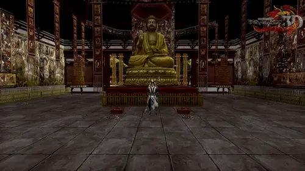**Nhiệm vụ kiếm vũ khí đặc biệt Thiếu Lâm** | **** **Thiên Ngọc Châu** |
| **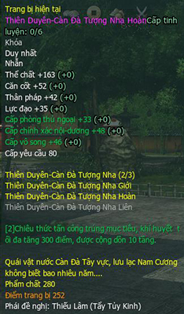** **Vật phẩm đổi Nhẫn môn phái phẩm chất 280** | **** **Thiên Duyên Giới** |

Hệ thống Phó Bản phong phú và đặc sắc của Võ Lâm 3 vẫn đang rộng mở đón chờ các anh hùng hào kiệt khắp chốn chinh phục. Quý nhân sĩ hãy tham gia ngay hôm nay để không bỏ lỡ cơ hội trở thành một nhân vật truyền kỳ chốn võ lâm.

## Vũ khí đặc biệt

Xưa nay cổ nhân vẫn tương truyền câu nói "Hồng phấn tặng giai nhân, bảo kiếm phối anh hùng" với ngụ ý đề cao vai trò của binh khí. Có thể nói, binh khí chính là người bằng hữu, người bạn đồng hành thân thiết đối với bậc anh hùng hào kiệt khi bôn tẩu.

Tại thế giới Võ Lâm 3, bên cạnh những thần vật danh chấn thiên hạ, vạn người ao ước được nêu trong chuỗi bài viết Thần Binh Truyền Kỳ, vẫn còn rất nhiều thần binh lợi khí đang được ẩn giấu, chờ người khai phá.

[Video](http://www.youtube.com/embed/fvSyZt0Iawg?rel=0)

 ***Vũ khí [Thuần Dương](../mon-phai/thuan-duong.md) - Đằng Không đạp cô vân, Họa Ảnh đoạn lãnh nguyệt***

Và một trong số các loại lợi khí uy lực mạnh mẽ đã được nhân sĩ võ lâm biết đến chính là những **vũ khí đặc biệt của môn phái**. Điểm nổi bật của các vũ khí này là khả năng **giúp người sở hữu thi triển những tuyệt kỹ đặc biệt mang uy lực vô song, diệu dụng thần kỳ**.

Để quý nhân sĩ nắm rõ hơn về các loại vũ khí đặc biệt của môn phái, Võ Lâm 3 thân mời chư vị cùng tham khảo bài tổng hợp thông tin như sau:

### Thiếu Lâm

| Hình ảnh | Thông tin |
| --- | --- |
|  | **Tên vũ khí**: **Kim Cang**. **Phẩm chất**: **295**. **Phim minh họa**: [Tại đây](http://www.youtube.com/watch?v=lqAs6IoAbkE). **Nguồn gốc**: Gỗ Bồ Đề thân Kim Cang hồn, rất bền. **Phó bản liên quan**: Hồi Ức Trì Quốc Thiên Vương Anh Hùng - 25 người. Chúc Long Điện Anh Hùng - 25 người. **Vật phẩm nhiệm vụ**: Thiên Ngọc Châu, Đại Hắc Thiên Nộ. |

### Minh Giáo

| Hình ảnh | Thông tin |
| --- | --- |
|  | **Tên vũ khí**: **Viên Nguyệt Song Giác**. **Phẩm chất**: **340**. **Phim minh họa**: [Tại đây](http://www.youtube.com/watch?v=wnVIF2FHqzk). **Nguồn gốc**: Vũ khí cung phụng trong Bái Hỏa Giáo, từng bị Long Vương cướp đi, đặt trong Minh Giáo nhiều năm. Đao có ma tính uy lực rất mạnh, nếu không đủ uy lực sẽ bị phản lại. **Phó bản liên quan**: Hoàng Cung Nam Chiếu Anh Hùng - 25 người. **Vật phẩm nhiệm vụ**: Khóa Minh Nguyệt, Phá Thự Quang. |

### Thuần Dương

| Hình ảnh& thông tin |  |
| --- | --- |
|  **Đằng Không** |  **Họa Ảnh** |
| **Tên vũ khí**:**Đằng Không**. **Phẩm chất**: **340**. **Phim minh họa**: [Tại đây](http://www.youtube.com/watch?v=fvSyZt0Iawg). **Nguồn gốc**: Bảo kiếm của Chuyên Húc thời thượng cổ. Chuôi kiếm khắc: Bạch hạc thư sí vọng thiên tinh, ngô tâm đằng không đạp cô vân. **Phó bản liên quan**: Hoàng Cung Nam Chiếu Anh Hùng - 25 người. **Vật phẩm nhiệm vụ**: Bao Kiếm Ngọc Nam Vương, Bùa Trấn Kiếm. | **Tên vũ khí**:**Họa Ảnh**. **Phẩm chất**: **340**. **Phim minh họa**: [Tại đây](http://www.youtube.com/watch?v=fvSyZt0Iawg). **Nguồn gốc**: Bảo kiếm của Chuyên Húc thời thượng cổ. Chuôi kiếm khắc: Phi hoa lạc mộ sinh tàn khuyết, ngọa châu họa ảnh đoạn lãnh nguyệt. **Phó bản liên quan**: Hoàng Cung Nam Chiếu Anh Hùng - 25 người. **Vật phẩm nhiệm vụ**: Hiên Long Án Nhật, Thiên Đạo Cửu Thế. |

### Ngũ Độc

| Hình ảnh | Thông tin |
| --- | --- |
|  | **Tên vũ khí**: **Hạt Tâm Vong Tình**. **Phẩm chất**: **295**. **Phim minh họa**: [Tại đây](http://www.youtube.com/watch?v=GS84eD3KhDY). **Nguồn gốc**: Tương truyền là thánh vật của [Ngũ Độc](../mon-phai/ngu-doc.md) lịch đại Linh Hạt Sứ, hấp thu linh lực của Thánh Hạt. **Phó bản liên quan**: Chúc Long Điện Anh Hùng - 25 người. **Vật phẩm nhiệm vụ**: Song Xà Ủng Hạt Ngọc, Đoạn Tràng Khúc Mộc. |

### Đường Môn

| Hình ảnh& thông tin |  |
| --- | --- |
|  **Bão Phác Thú Thiên** |  **Bát Tương Liên Châu** |
| **Tên vũ khí**:**Bão Phác Thú Thiên**. **Phẩm chất**: **295**. **Phim minh họa**: [Tại đây](http://www.youtube.com/watch?v=X3p8bwlvUdY). **Nguồn gốc**: Thần binh trấn môn do Đường Hoài Nghĩa chế tạo, mỗi binh khí một bên Vạn Tiễn Xuyên Tâm, 1 bên Độc Nỏ Tuần Hoàn, uy lực kinh thiên chấn địa, do chính Đường Ngạo Thiên cất giữ. **Phó bản liên quan:** Chúc Long Điện Anh Hùng - 25 người. **Vật phẩm nhiệm vụ**: Quỷ Hạch. | **Tên vũ khí**:**Bát Tương Liên Châu**. **Phẩm chất**: **295**. **Phim minh họa**: [Tại đây](http://www.youtube.com/watch?v=g7Eq2dkA6lU). **Nguồn gốc**: Thần binh trấn môn do Đường Hoài Nghĩa chế tạo, mỗi binh khí một bên Vạn Tiễn Xuyên Tâm, 1 bên Độc Nỏ Tuần Hoàn , uy lực kinh thiên chấn địa , do chính Đường Ngạo Thiên cất giữ. **Phó bản liên quan**: Hội Chiến Đường Môn Anh Hùng - 25 người. **Vật phẩm nhiệm vụ**: Ảnh Nhẫn. |

### Tàng Kiếm

| Hình ảnh | Thông tin |
| --- | --- |
|  | **Tên vũ khí**: **Lam Trần Kim Xà**. **Phẩm chất**: **265**. **Phim minh họa**: [Tại đây](http://www.youtube.com/watch?v=VI2TSSHT8VE). **Nguồn gốc**: Thần Vật do Diệp Nha rèn nên, trên thân kiếm có hấp thụ uy lực cực độc của Mãnh Kim Xà thần vật Ngũ Độc. **Phó bản liên quan**: **Động Địch Hoa**. **Địch Hoa Thánh Điện Anh Hùng - 25 người**. **Vật phẩm nhiệm vụ**: Mảnh Kim Xà, Trảm Ngạc Cự Kiếm. |

### Thất Tú

| Hình ảnh | Thông tin |
| --- | --- |
|  | **Tên vũ khí**: **Huyết Ảnh Thiên Vũ Cơ**. **Phẩm chất**: **265**. **Phim minh họa**: [Tại đây](http://www.youtube.com/watch?v=VoeO-jJ8JII). **Nguồn gốc**: Đạo cụ múa của Vũ Thần, sau khi chế tạo phải hiến tế linh hồn thiếu nữ, vì thế mà hình ảnh người thiếu nữ đó luôn hiện thân mỗi lần Điệu Vũ được khơi dậy. **Phó bản liên quan**: Địch Hoa Thánh Điện Anh Hùng - 25 người. **Vật phẩm nhiệm vụ**: Thiên Điền Nữ, Thâm Hồng Đoạn Tội Vũ Giả. |

### Vạn Hoa

| Hình ảnh | Thông tin |
| --- | --- |
|  | **Tên vũ khí**: **Tuyết Phượng Băng Vương Sáo**. **Phẩm chất**: **265**. **Phim minh họa**: [Tại đây](http://www.youtube.com/watch?v=wWxkRka8Btk). **Nguồn gốc**: Sáo Tuyết được Vương Di Phong mô phỏng lại Bạch Lộ Sương Hoàng Sáo của Phương Càn năm xưa, Sáo Tuyết gắn liền cùng với kỷ niệm bi thương của Cốc Chủ Ác Nhân Cốc cùng người thiếu phụ say đắm 1 thời bên nhau nơi Phong Hoa Cốc. **Phó bản liên quan**: Địch Hoa Thánh Điện Anh Hùng - 25 người. **Vật phẩm nhiệm vụ**: Bạch Long Châu, Bạch Lộ Sương Hoàng Sáo. |

### Thiên Sách

| Hình ảnh | Thông tin |
| --- | --- |
|  | **Tên vũ khí**: **Viêm Thương Trùng Lê**. **Phẩm chất**: **265**. **Phim minh họa**: [Tại đây](http://www.youtube.com/watch?v=slTM42uiFO0). **Nguồn gốc**: Binh Khí Gia Truyền của Tướng Quân Nam Chiếu. Tương truyền bên trong chứa anh hồn của dũng sĩ Nam Chiếu, khi giương thương sẽ triệu hồi anh hồn để chủ nhân cưỡi xông pha sa trường. **Phó bản liên quan**: Hoàng Cung Nam Chiếu Anh Hùng - 25 người. **Vật phẩm nhiệm vụ**: Lệnh Bài Hỏa Chính, Giao Dực Hổ Kích. |

Thân chúc quý nhân sĩ sẽ tìm được vũ khí thích hợp nhất cho mình để nâng cao võ lực, sớm ngày vang danh thiên hạ tại Võ Lâm 3.

## Vũ khí 6 nòng của Đường Môn

*Thục Trung Đường Môn chợt dậy sóng  
 Anh hùng hiệp lực diệt sài lang.*

Từ khi Đường Giản mất tích bí ẩn, Đường Môn bị tổn thất nặng ở Phong Hoa Cốc, đến nay vẫn ẩn cư ở đất Thục bồi dưỡng thực lực. Nào ngờ đất bằng dậy sóng, Uông Mãng năm xưa truy tìm Đường Giản ở Đạo Hương Thôn, nay dẫn đại quân đuổi đến Đường Môn, mượn danh nghĩa điều tra trọng phạm triều đình, phong tỏa Đường Gia, mục đích chính là chiếm đoạt tuyệt học võ công của Đường Giản. Đường Môn đã lui về giữ nơi trọng yếu như lầu chính và Thần Cơ Sơn nhằm bảo toàn lực lượng, đồng thời hỏa tốc cầu viện Hạo Khí Minh.

[Video](http://www.youtube.com/embed/g7Eq2dkA6lU)

 ***Đường Môn xuất hiện vũ khí "6 nòng"?***

Minh Chủ Hạo Khí Minh Tạ Uyên đã phái Mục Huyền Anh và Nguyệt Lộng Ngấn đi điều tra, họ tình cờ gặp Ảnh, người đang chấp hành nhiệm vụ bí mật ở Thành Đô. Ảnh cho rằng chuyện ở Đường Môn rất mờ ám, nên âm thầm đi theo.

Nào ngờ khi đến Đường Gia Tập, họ phát hiện nơi đây đã bị kẻ thù cũ của Đường Môn khống chế, chúng muốn mượn gió bẻ măng. Các thế lực đã tụ họp ở Đường Gia Bảo, không thể tránh khỏi một trận đại chiến mang tên...**Hội Chiến Đường Môn** từ ngày **10/10/2013**.

- Điều kiện tham gia

- Boss

- Phần thưởng

### Bản đồ & điều kiện tham gia

- **Đẳng cấp nhân vật**: Cấp **80** trở lên.

- **Yêu cầu**: Tổ đội 25 người.

- **Lối vào phó bản**: Thành Đô.

### Boss

| **Hình ảnh** | **Ghi chú** |
| --- | --- |
| ** Thủ Bị Lang Quang Nha** | Trong Lang Nha Quân Trận, Trường Cung sát thương địch, Thuẫn Binh phòng thủ, Thương Binh dùng thương tấn công. Thuẫn Binh thành "Sơn Trận", phòng thủ mọi sát thương. Thương Binh kết "Độc Long", tấn công nhanh kẻ địch bước vào vòng vây. Cung Binh hình thành Bài Xạ 3 đoạn chỉnh tề, gọi là "Tiễn Lam". **Đẳng cấp**: **83** **Sinh lực**: **10.000.000** |
| ** Uông Mãng** | Uông Mãng là Tướng Quân Phiến Quân Tuyên Uy, lấy danh nghĩa điều tra tội phạm triều đình, đưa Lang Nha Quân Trận tiến vào Đường Môn, ngăn Đường Môn nổi loạn. Sau khi Nguyệt Lộng Ngấn đến Đường Gia Tập, Mao Mao nhìn thấy đã nhận ra Phiến Quân Đầu Mục Uông Mãng năm xưa tàn sát Đạo Hương Thôn, cuộc đại chiến sắp nổ ra! **Đẳng cấp**: 83 **Sinh lực**:**27.000.000** |

### Phần thưởng

#### Trang bị

- **Vũ khí:**Vũ khí tầm xa Ám Tiễn và trang bị phẩm chất 295.  

 

[Video](http://www.youtube.com/embed/X3p8bwlvUdY)

 ***Bão Phác Thú Thiên (phẩm chất 295) - xoáy như chưa bao giờ được xoáy...***

#### Vật phẩm khác

| **Hình ảnh** | **Vật phẩm** |
| --- | --- |
| **** | **** **Dạ Thoại - Bạch Lộ**(trang sức vai) |
| **Nguyên liệu chế tạo Thần Binh 80 phẩm chất 280** | **** **Ô Kim Vân Thiết** |
| **Nhiệm vụ kiếm vũ khí đặc biệt Đường Môn** | **** **Ảnh Nhẫn** |
| **** **Vật phẩm đổi dây chuyền môn phái phẩm chất 280** | **** **Thuyên Duyên Hạng Liên** |

## Chúc Long Điện của Ngũ Độc

Trong Nam Cương Đầm Hắc Long của Trùng Độc Mật Bố, tàng ẩn cung **Chúc Long Điện** là thánh địa tối thượng trong long giáo đồ Thiên Nhất Giáo, là nơi họ gửi gắm niềm tin, là nguồn sáng duy nhất dẫn dắt họ bước đi trong đêm tối.

[Video](http://www.youtube.com/embed/GS84eD3KhDY)

 ***Hạt Tâm Vong Tình - vũ khí bí mật của Ngũ Độc...***

Giáo chủ Ô Mông Quý nhờ vào **Chúc Long Điện**, nhanh chóng phát triển Thiên Nhất Giáo và bắt đầu thu thập di thể tráng sĩ cao thủ ở các nơi, chế tạo thành Con Rối Hung Hãn. Nhưng Ngũ Độc Giáo dưới sự chỉ đạo của Khúc Vân đã được sự ủng hộ của võ lâm Trung Nguyên, nếu muốn muôn đời trường tồn, giữ ưu thế tuyệt đối, phải xây dựng trên di thể của Ngũ Tiên Giáo và Võ Lâm Nhân.

- Điều kiện tham gia

- Boss

- Phần thưởng

### Bản đồ & điều kiện tham gia

- **Đẳng cấp nhân vật**: Cấp **80** trở lên.

- **Yêu cầu**: Tổ đội 25 người.

- **Lối vào phó bản**: Phía Tây bản đồ Đầm Hắc Long.

### Boss

| **Hình ảnh** | **Ghi chú** |
| --- | --- |
| ** Hồ Thát** | Thử Vương Bạch Mi Hồ Thát kết hợp cùng chuột bạch mi tạo ra võ công đào hang tung hoành khắp nơi. Thanh Dực Bức Vương Vũ Duật Thanh tạo ra võ dơi lập nhìu kỳ công. Họ tuân mệnh Huyết Nhãn Long Vương Tiêu Sa, liên thủ hình thành phòng tuyến đầu tiên của Chúc Long Điện. **Đẳng cấp**: **81** **Sinh lực Hồ Thát**: **5.460.000** **Sinh Lực Vũ Dực Thanh**: **5.800.000** |
| ** Vũ Dực Thanh** |  |
| ** Sách Địch Nhĩ** | Ô Mông Quý không ngại dùng linh dược do Ngũ Độc chế tạo kỳ công để Sách Địch Nhĩ luyện thể, giúp hắn nhanh chóng trở thành cao thủ võ công tuyệt đỉnh và được Thiên Nhất Giáo gọi là "Thánh Đồng". Trong Chúc Long Điện, Sách Địch Nhĩ phụ trách canh giữ [Thất Tú](../mon-phai/that-tu.md) Phường Chủ - Diệp Chỉ Thanh nhưng nảy sinh tình cảm với nàng. **Đẳng cấp**: **81** **Sinh lực**: **11.790.000** |
| ** Lục Tâm** | Lục Tâm vốn là hộ vệ cung đình Đại Đường, nhưng vì đắc tội với hoàng tộc nên bị thích chữ lên mặt, xung làm lính biên cương Nam Chiếu đại tướng quân. Lục Tâm biết Thiếu Lâm phương Trượng Huyền Chính bị Nam Chiếu Vương Bắt, chủ động xin canh giữ với ý định làm nhục Đại Đường hoàng thất. **Đẳng cấp**: **82** **Sinh lực**: **8.520.000** |
| ** Nam Lôi Thần** | Sát Lục Giả là Cơ Giáp do Tư Đồ Nhất Nhất dày công chế tạo, được Tư Đồ Nhất Nhất dùng để giam [Vạn Hoa](../mon-phai/van-hoa.md) Cốc Chủ, chứng minh mình là Cơ Quan Đại Tông Sư hơn hẳn Vạn Hoa [Kỹ Nghệ](./ky-nang-song.md). **Đẳng cấp**: **81** **Sinh lực**: **11.930.000** |
| ** Thiên Thu Tử** | "Tinh Túc Lão Tiên" Thiên Thu Tử thử chế Sơn Hà Xã Tắc Đồ thành sa bàn tại Chúc Long Điện. Khi biết Vạn Hoa Cốc Chủ Đông Phương Vũ Hiên được đưa đến đây, hắn chủ động xin Ô Mông Quý được canh giữ ông, còn đưa Cổ Hàn Tuyền đến để ức chế công lực cao thâm của ông. **Đẳng cấp**: **82** **Sinh lực**: **9.830.000** |
| ** Thiên Thù Lão Yêu** | Thiên Thù Lão Yêu có vai vế cao nhất trong Thiên Nhất Giáo, thủ đoạn tàn độc, kẻ nào dám làm phật ý sẽ bị chuốc rượu say rồi đem cho nhện ăn. Lần này do Thuần Dương Chưởng Môn Lý Vong Sinh nội lực thâm hậu, khinh công siêu quần nên Ô Mông Quý giao cho Thiên Thù Lão Yêu canh giữ. **Đẳng cấp**: **81** **Sinh lực**: **2.630.000** |
| ** Ô Mông Quý** | Ô Mông Quý dựa vào Chúc Long Điện bắt đầu thu thập thi thể tráng sĩ cao thủ để chế tạo Con Rối Chiến Đấu, ý đồ phát triển Thiên Nhất Giáo và chống lại Ngũ Độc Giáo được Võ Lâm Trung Nguyên ủng hộ. Hắn muốn đánh bại Khúc Vân hòng đoạt lại Ngũ Độc Giáo thánh địa. **Đẳng cấp**: **82** **Sinh lực**: **12.150.000** |

### Phần thưởng

#### Trang bị

- **Vũ khí:**Các loại vũ khí và trang bị của tất cả các phái phẩm chất 295.  

 

#### Vật phẩm khác

| **Hình ảnh** | **Vật phẩm** |
| --- | --- |
| **** |  **Đạp Viêm Ô Truy** (phẩm chất 15) **** **** **Trang sức ngựa**(+6% tốc độ) |
| **Nguyên liệu chế tạo Thần Binh 80 phẩm chất 280** | **** **Ô Kim Vân Thiết** |
| **Nguyên liệu chế tạo Thần Binh 80 phẩm chất 280** | **** **Hóa Ngọc Huyền Tinh** |
| **** **Vật phẩm nhiệm vụ kiếm vũ khí đặc biệt Ngũ Độc** | **** **Song Xà Ủng Hạt Ngọc** |
| **** **Tăng 10 phẩm chất cho bộ trang bị Chúc Thiên** | **** **Chúc Thiên - Tinh Chế** |
| **** **Vật phẩm đổi trang bị Yêu Trụy môn phái phẩm chất 295 có hiệu ứng đặc biệt** | **** **Nam Chiếu Vương Mật Tín** |

Ngoài ra, sau khi cập nhật nội dung phó bản mới, nhiệm vụ **Long Điện Tàng Bảo Ngọc** tại phó bản **Chúc Long Điện** sẽ tạm thời được đóng lại.

Nguồn: VNG (bài viết và hình ảnh)
