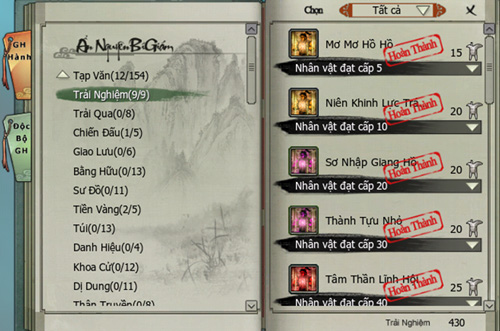
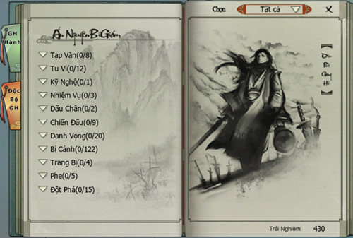
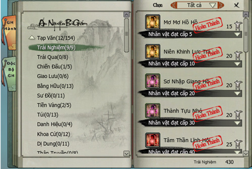
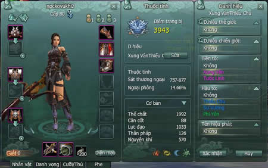

Hệ thống Thành Tựu sẽ giúp các nhân sĩ võ lâm khẳng định được vị thế của mình trong giang hồ. Khi đồng đạo chinh phục thành công các thử thách hoặc hoàn thành nhiệm vụ... sẽ được hệ thống ghi nhận lại thành tích.

### Giang Hồ Hành

*Danh sách nhiệm vụ thành tựu Giang Hồ Hành*

### Giang Hồ Kỳ Nhân

Xếp hạng dành cho các nhân sĩ dẫn đầu trong cùng máy chủ.

*Danh sách nhiệm vụ thành tựu Giang Hồ Kỳ Nhân*

### Hướng dẫn

- Khi nhân vật hoàn thành một Thành Tựu bất kỳ, hệ thống sẽ hiển thị thông báo:

- Nhấn phím "Y" hoặc chọn biểu tượng như hình dưới để mở giao diện Ẩn Nguyên Bí Giám:

- Chọn một Thành Tựu bất kỳ, nội dung chi tiết của Thành Tựu sẽ được hiển thị bên phải.

- Thành Tựu đã hoàn thành sẽ được đóng dấu đỏ "Hoàn thành":

### Danh hiệu giang hồ

- Được hiển thị trên đầu của nhân vật.

- Danh hiệu bao gồm: "Tiền tố", "Hậu tố", "Tên hiệu môn phái" và được tự chọn.

*Danh hiệu giang hồ của nhân vật*

Nguồn: VNG (bài viết và hình ảnh)
