Nằm trong chuỗi hoạt động chào mừng bản cập nhật Danh Kiếm Đại Hội, sự kiện**Vòng Quay May Mắn** mang đến cho nhân sĩ võ lâm cơ hội sở hữu nhiều phần thưởng hấp dẫn ngoài game như **iPad Air 4G 16GB**,**Card màn hình VGA Asus HD7790 và VGA Asus HD6570,**... cùng các phần thưởng vật phẩm giá trị liên thành như **Thụy Thố A Cam**, **Mặt Nạ Màu**, **Tẩy Tủy Đơn**...

Và trong số các phần thưởng này, có lẽ **Thụy Thố A Cam** chính là vật phẩm đặc biệt nhất nhờ khả năng đa dụng của mình. Ngoài việc là một thú nuôi ngộ nghĩnh và vui nhộn, Thụy Thố A Cam còn có thể **giúp chủ nhân sửa chữa trang bị** cũng như ẩn giấu rất nhiều cơ quan, đạo cụ thú vị khác.

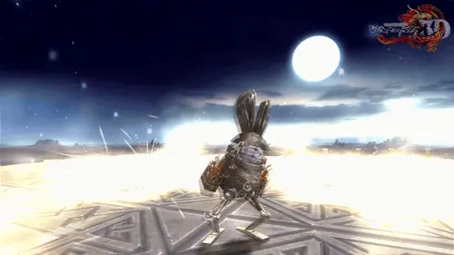  
 Thụy Thố A Cam - Thú nuôi ngộ nghĩnh sở hữu nhiều công dụng

Để quý nhân sĩ hiểu thêm về chú thú nuôi thần bí này, Võ Lâm 3 thân gửi đến chư vị bảng **hướng dẫn sử dụng Thụy Thố A Cam** như sau:

### Hướng dẫn sử dụng Thụy Thố A Cam

| Hình ảnh | Ghi chú |
| --- | --- |
| 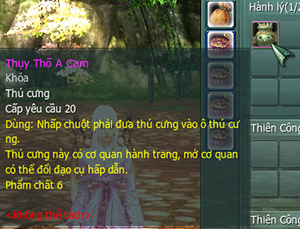 | Nhấp chuột phải đưa Thụy Thố A Cam vào ô thú nuôi. |
| 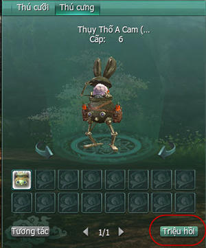 | Thụy Thố A Cam sẽ xuất hiện ở giao diện thú nuôi và có thể tiến hành triệu hồi. |
| 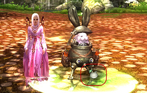 | Sau khi triệu hồi, có thể chuột phải vào Thụy Thố A Cam để hiện bảng đối thoại. |
| 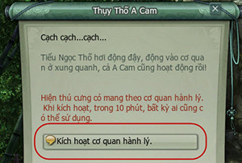 | Chọn **"Kích hoạt cơ quan hành lý**" và "**Xác nhận kích hoạt**". |
| 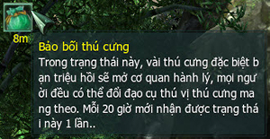 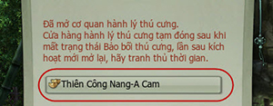 | Sau khi kích hoạt sẽ nhận được hiệu ứng "**Bảo Bối Thú Cưng**" trong 10 phút. **Mỗi 20 giờ có thể nhận hiệu ứng 1 lần**. Lúc này, nhân vật có thể nhấp chuột phải vào Thụy Thố A Cam để mở giao diện cửa hàng Thiên Công Nang - A Cam. |
| 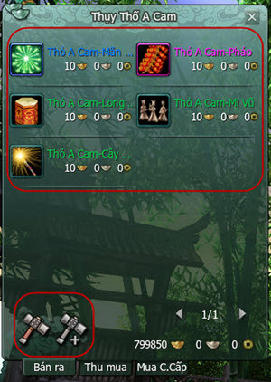 | Thiên Công Nang - A Cam là một cửa hàng bán các **vật phẩm đặc biệt** của Thụy Thố A Cam. Ngoài ra, tại đây nhân sĩ có thể tiến hành **sửa chữa trang bị** - **một chức năng cực kỳ quan trọng và cần thiết khi tham gia vượt phó bản**. |

### Cửa hàng Thiên Công Nang - A Cam

- Các vật phẩm được bán trong cửa hàng Thiên Công Nang - A Cam chỉ có thể sử dụng với Tưởng Thố A Cam hoặc Thụy Thố A Cam.

- Hình ảnh minh họa sử dụng vật phẩm.

| Hình ảnh | Ghi chú |
| --- | --- |
|  | ****Thỏ A Cam - Mãn Thiên Tinh |
|  | 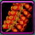 Thỏ A Cam - Pháo |
| 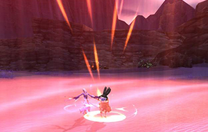 |  Thỏ A Cam - Long Phượng Trình Tường |
| 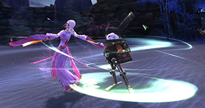 | 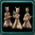 Thỏ A Cam - Mị Vũ |
|  |  Thỏ A Cam - Cây Pháo Sáng |

Hy vọng thông tin này sẽ giúp ích cho quý nhân sĩ và góp phần hỗ trợ hành trình bôn tẩu võ lâm của chư vị thêm thuận tiện.

Nguồn: VNG (bài viết và hình ảnh)
