## Doanh trại

Hệ thống doanh trại chỉ dành cho nhân sĩ tham gia phe phái Hạo Khí Minh và Ác Nhân Cốc. Tham gia doanh trại, nhân sĩ sẽ tăng thêm phần Sỹ khí và Danh vọng cũng như các thanh thế khác trong giang hồ.

- Sỹ khí

- Uy danh

- Nhiệm vụ doanh trại

### Gia nhập/Rời doanh trại

| Hình ảnh | Ghi chú |
| --- | --- |
| 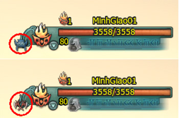 *Biểu tượng của doanh trại [bang hội](./bang-hoi.md)* | **Đối tượng**: Nhân sĩ của các môn hộ, không thuộc doanh trại bang hội đối lập và trung lập. Sau khi gia nhập doanh trại, nhân vật sẽ mang biểu tượng của doanh trại và nhận được Uy danh nhất định. **Rời doanh trạ**i: Nhân sĩ mất hết Uy danh cũng như hiệu quả vật phẩm, trang bị đạt được từ doanh trại bang hội. Doanh trại bang hội trở về trạng thái trung lập. |

### Sỹ khí

- **Kiểm tra giao diện Sỹ khí**: Nhấn phím C mở giao diện [thuộc tính nhân vật](../tan-thu/thuoc-tinh-nhan-vat.md), kiểm tra giao diện doanh trại, Sỹ khí và Uy danh.

- **Quy tắc Sỹ khí**: Nếu Sỹ khí doanh trại quá giới hạn, nhân sĩ không thể gia nhập doanh trại này. Mức ảnh hưởng của Sỹ khí theo các cấp độ sau:

| Mức ảnh hưởng | Lợi ích tiền Vàng hàng ngày | Tốc độ nhận được Danh vọng | Tốc độ nhận được Uy danh | Trừng phạt Uy danh sau khi chết | Số điểm khu vực Hạo Khí Minh | Số điểm khu vực Ác Nhân Cốc |
| --- | --- | --- | --- | --- | --- | --- |
| Bại bắc | Bình thường | Bình thường | Bình thường | Giảm 100% | 1.500 | -8.000 |
| Hội bại | Giảm 50% | 1.700 | -6.000 |  |  |  |
| Bất địch | Giảm 25% | 1.900 | -4.500 |  |  |  |
| Thất lợi | Bình thường | 2.100 | -3.500 |  |  |  |
| Thụ tỏa | 2.300 | -3.000 |  |  |  |  |
| Tranh đoạt | 2.500 | -2.500 |  |  |  |  |
| Lĩnh tiên | Tăng 10% | Tăng 6% | Tăng 4% | Bình thường | 3.000 | -2.300 |
| Tiểu thắng | Tăng 20% | Tăng 12% | Tăng 8% | 3.500 | -2.100 |  |
| Áp chế | Tăng 30% | Tăng 18% | Tăng 12% | 4.500 | -1.900 |  |
| Kích hội | Tăng 40% | Tăng 24% | Tăng 16% | 6.000 | -1.700 |  |
| Toàn thắng | Tăng 50% | Tăng 30% | Tăng 20% | 8.000 | -1.500 |  |

Lưu ý

- Lợi ích tiền Vàng hàng ngày là tất cả nhiệm vụ hằng ngày, bao gồm doanh trại, nhiệm vụ thành thị và nhiệm vụ thế lực.

- Tốc độ nhận Danh vọng là chỉ việc đánh quái nhận được tốc độ Danh vọng.

- Tốc độ nhận Uy danh là chỉ tất cả con đường nhận được Uy danh.

- Trừng phạt Uy danh: Sau khi bị tiêu diệt thì Uy danh của đồng đạo bị tổn thất.

### Nhận Uy danh và Sỹ khí

- Kích sát phe đối lập để nâng cao Uy danh.

- Thông qua Thần Nông Yên trong [chiến trường](./chien-truong.md) doanh trại, đồng thời nâng cao Uy danh và dũng khí của doanh trại mình.

- Thông qua kích sát doanh trại đầu lĩnh của đối thủ.

- Thông qua kích sát cứ điểm tinh anh ngoài doanh trại, chiếm đoạt cứ điểm hồi sinh để nâng cao chiến thuật của chiến trường doanh trại.

- Thông qua nhiệm vụ hằng ngày, có các cấp độ nhiệm vụ như sau:

| Hình thức | Nội dung | Số điểm Sỹ khí doanh trại | Chú thích |
| --- | --- | --- | --- |
| Kích sát NPC chỉ định | Đầu lĩnh doanh trại | 8.000 điểm | Tạ Uyên, Vương Di Phong. |
| Doanh trại hoạch tâm | 4.000 điểm | Hào Khí Thất Tinh, Thập Ác Ác Nhân Cốc. |  |
| Cứ điểm tinh anh | 2.500 điểm | Cứ điểm doanh trại NPC cấp 73 |  |
| Tinh anh thủ vệ | 05 điểm | Thủ Vệ tinh Anh và Cứ điểm trong doanh trại cấp 70 trở lên. |  |
| Thắng lợi chiến trường | Thần Nông Nhân | 100 điểm | Mỗi trận thắng được + 100 điểm Sỹ khí, cá nhân nhận được Uy danh. |
| Nhiệm vụ hàng ngày | Nhiệm vụ cá nhân hàng ngày | 01 điểm/01 lần | Nhiệm vụ hàng ngày, mỗi lần doanh trại được + 01 Sỹ khí, cá nhân nhận được Uy danh. |

### Vị trí Tiệm Uy danh và Danh vọng trong các doanh trại

Uy danh dùng để đo độ cống hiến đối với doanh trại, các cá nhân hoặc bang hội có thể thông qua tham gia doanh trại để nhận được Uy danh. Sau khi gia nhập vào doanh trại, có thể dùng Uy danh đến Quân Nhu Quan Hạo Khí Minh và Ác Nhân Cốc để mua vật tư.

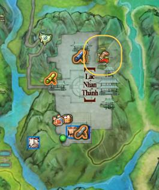

*Vị trí tiệm uy danh và danh vọng Hạo Khí Minh*

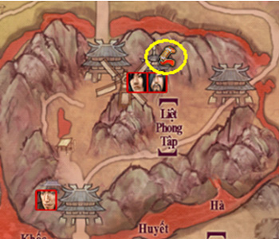

*Vị trí tiệm uy danh và danh vọng Ác Nhân Cốc*

### Nhiệm vụ doanh trại hàng ngày

Có nhiệm vụ Danh vọng hàng ngày và nhiệm vụ doanh trại hàng ngày.

#### Hạo Khí Minh

| Tên nhiệm vụ | Mục tiêu | NPC | Phần thưởng | Điều kiện |
| --- | --- | --- | --- | --- |
| Lịch huyết sa | Đến Nam Bình Sơn giúp đỡ thu thập cát dưới đáy sông. | Hoa Mộ Lam của Lạc Nhạn Thành Hội Minh Viện | 08 vàng 250 Danh vọng Hạo Khí Minh | - |
| Ngưng huyết thương | Đến Nam Bình Sơn thu thập huyết thảo. |  |  |  |
| Thâm nhập hổ huyệt | Đến miếu hoang phía đông thôn bắc Nam Bình Sơn cứu thôn dân bị Hồng Y Giáo Chủ và Phản Quân bắt đi. |  |  |  |
| Tứ xứ xuất kích | Đến Nam Bình Sơn tiêu diệt thảo khấu đầu mục. | Danh vọng Hạo Khí Minh đạt đến độ thân mật. |  |  |
| Xả thân lấy nghĩa cứu Phu Lỗ | Đi Lạc Nhật Lĩnh Doanh của Côn Lôn cứu nhân sĩ giang hồ. | Vân Vô Thương của Lạc Nhạn Thành Hội Minh Viện | 10 vàng 500 Danh vọng Hạo Khí Minh | - |
| Lực Bảo Thái Bình Tiểu Tặc bào | Đi tiêu diệt tinh nhuệ Ác Nhân Cốc đang luyện công ở dưới chân núi Tây Côn Lôn. | 10 vàng 500 Danh vọng Hạo Khí Minh |  |  |
| Vì dân trừ hại | Đi Côn Lôn Lạc Tuyết Lĩnh tiêu diệt Ác Nhân đang bắt giữ nhân sỹ giang hồ Thôi Mệnh Phán Quan. | 10 vàng 750 Danh vọng Hạo Khí Minh |  |  |
| Đồng Cừu Địch Khải | Đi tiêu diệt Ác Nhân Cốc đang luyện binh tướng dưới chân núi Tây Côn Lôn. | 24 vàng 1.500 Danh vọng Hạo Khí Minh |  |  |

#### Ác Nhân Cốc

| Tên nhiệm vụ | Mục tiêu | NPC | Phần thưởng | Điều kiện |
| --- | --- | --- | --- | --- |
| Độc y thí dược vô cùng tận | Đi Côn Lôn giúp Hạng Tiểu Long chế thuốc, sau đó trị thương cho nhân sỹ giang hồ bị thương. | Thân Dược Lang của Dung Thiên Cốc | 08 vàng 250 Danh vọng Ác Nhân Cốc | - |
| Thiết tượng luyện kiếm khuyết băng hồn | Đi Côn Lôn thu thập Băng Hồn về luyện kiếm. | Đổng Nguyên của Hoàng Tuyền Lộ |  |  |
| Tiếu khán nhân nghĩa loạn địch doanh | Đến dưới sạn đạo của Hạo Khí Minh Cung đoạt lấy tài vật của Hạo Khí Minh. | Âu Dương Trí của Tuyết Ma Uyên |  |  |
| Thu thuế trường nhạc | Đến Côn Lôn tại trường Nhạc Phường thu phí bảo kê. | Danh vọng Ác Nhân Cốc đạt đến độ thân mật. |  |  |
| Tiệp túc dinh đăng dinh cơ điện | Đến Nam Bình Sơn lấy Sa Thạch để chuẩn bị cho việc xây cố cung mới. | Lý Vệ của Bích Lạc Nghi Phong của Ác Nhân Cốc | 10 vàng 500 Danh vọng Ác Nhân Cốc | - |
| Diệt thử triều thực lưỡng thôn liên | Đến Nam Bình Sơn tiêu diệt Họ Vệ Vọng Bắc Thôn và Xích Mã Sơn. | 10 vàng 500 Danh vọng Ác Nhân Cốc |  |  |
| Tề tâm hiệp lực kích phá thiên | Đến Nam Bình Sơn tiêu diệt thế lực của Hạo Khí Minh. | 10 vàng 750 Danh vọng Ác Nhân Cốc |  |  |
| Chúng kình dị cử châp linh tiêm | Đến Nam Bình Sơn tiêu diệt hải binh của Hạo Khí Minh. | 24 vàng 1.500 Danh vọng Ác Nhân Cốc |  |  |

## Công Phòng Phe

**Công Phòng Phe** - nơi thể hiện sức mạnh của 2 phe Hạo Khí Minh và Ác Nhân Cốc, nơi đã từng chứng kiến biết bao những trận thư hùng nảy lửa giữa các nhân sĩ của 2 phe. Bất kể xuất thân từ Hạo Khi Minh hay Ác Nhân Cốc, hẳn những bậc cao nhân không thể nào quên được những trận thư hùng năm xưa tại bản đồ **Nam Bình Sơn và Côn Lôn** đã khiến đất trời lay động.

Nay trong thế giới Võ Lâm 3, câu chuyện về những trận chiến năm xưa đã dậy sóng khiến giang hồ trở nên đại loạn, anh hùng tứ phương tụ hội tiếp tục cùng Hạo Khí Minh và Ác Nhân Cốc sống lại một thời ký ức hào hùng.

- Điều kiện tham gia

- Nhiệm vụ hoạt động phe

- Công Phòng Phe

- Phương thức tính điểm

### Điều kiện tham gia

#### Nhiệm vụ hoạt động phe

| **Nhiệm vụ hoạt động phe** |  |
| --- | --- |
| **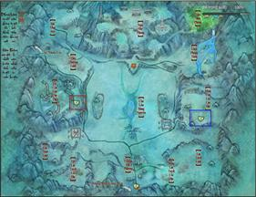** **Côn Lôn** | **Thời gian:** **12h00 Chủ Nhật** hàng tuần. **Đối tượng:** Nhân vật thuộc phe Ác Nhân Cốc và Hạo Khí Minh. **Phe công:** Ác Nhân Cốc. **Phe thủ:** Hạo Khí Minh. |
| **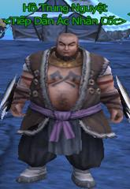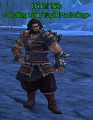** **Ác Nhân Cốc** đối thoại 2 NPC **Hồ Trung Nguyệt** và **Hà Phi Tiếu** nhận nhiệm vụ. | **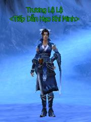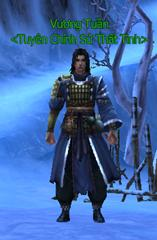** **Hạo Khí Minh** đối thoại 2 NPC **Trương Lệ Lệ** và **Vương Tuần** nhận nhiệm vụ. |
| 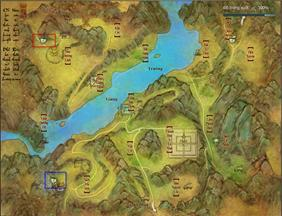 **Nam Bình Sơn** | **Thời gian:** **12h00 thứ Bảy** hàng tuần. **Đối tượng:** Nhân vật thuộc phe Ác Nhân Cốc và Hạo Khí Minh. **Phe công:** Ác Nhân Cốc. **Phe thủ:** Hạo Khí Minh. |
| 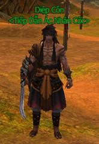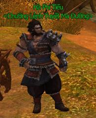 **Ác Nhân Cốc**đối thoại 2 NPC **Diệp Côn** và**Hà Phi Tiếu**nhận nhiệm vụ. | 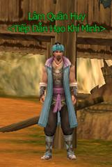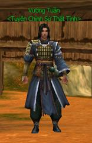 **Hạo Khí Minh** đối thoại 2 NPC **Lâm Quân Huy** và **Vương Tuần** nhận nhiệm vụ. |

#### Công Phòng Phe

| Công Phòng Phe |  |
| --- | --- |
| **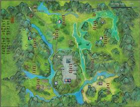** **Hạo Khí Minh** | **Thời gian:** **13h00 - 15h00, 19h00 - 21h00 thứ Bảy**hàng tuần. **Đối tượng:** Nhân vật thuộc phe Ác Nhân Cốc và Hạo Khí Minh. **Phe công:** Ác Nhân Cốc. **Phe thủ:** Hạo Khí Minh. |
| 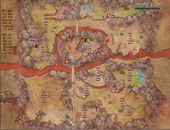 **Ác Nhân Cốc** | **Thời gian:** **13h00 - 15h00, 19h00 - 21h00 Chủ Nhật** hàng tuần. **Đối tượng:** Nhân vật thuộc phe Ác Nhân Cốc và Hạo Khí Minh. **Phe công:** Hạo Khí Minh. **Phe thủ:** Ác Nhân Cốc. |
| **Lưu ý:** Số nhân vật tham gia Công Phòng**mỗi phe giới hạn 400**, nhân sĩ cần di chuyển nhanh đến đia điểm trước thời gian diễn ra hoạt động. |  |

### Nhiệm vụ hoạt động phe

#### Phe công

| **Nhiệm vụ phe công** | **Phần thưởng** |  |  |  |
| --- | --- | --- | --- | --- |
| **Hạo Khí Minh (Côn Lôn)** | **Ác Nhân Cốc (Nam Bình Sơn)** | **Tiền vàng** | **Uy danh** | **Tích lũy chiến giới** |
| Cùng hội cùng thuyền! Côn Lôn | Đồng cam cộng khổ! Nam Bình Sơn | 15 | 500 | 25 |
| Xả thân hiệp nghĩa cứu tù binh | Nhanh chân đến trước Doanh Cơ Điện | 10 | 250 | 25 |
| Ra sức quét ổ cướp bảo vệ thái bình | Diệt miếu này ăn hai thôn | 10 | 250 | 25 |
| Vì dân tiêu diệt thủ lĩnh giặc | Đồng tâm hiệp lực kích phá thiên | 10 | 500 | 50 |
| Tiêu diệt đầu sỏ | Cùng nhau hiệp lực chấp hành mệnh lệnh | 24 | 1.000 | 100 |
| Long tranh hổ đấu! Côn Lôn | Cao thủ như lân! Nam Bình Sơn | 50 | 3.000 | 300 |

#### Phe thủ

| **Nhiệm vụ phe thủ** | **Phần thưởng** |  |  |  |
| --- | --- | --- | --- | --- |
| **Hạo Khí Minh (Nam Bình Sơn)** | **Ác Nhân Cốc (Côn Lôn)** | **Tiền vàng** | **Uy danh** | **Tích lũy chiến giới** |
| Cùng hội cùng thuyền! Nam Bình Sơn | Đồng cam cộng khổ! Côn Lôn | 15 | 500 | 25 |
| Chiến! Lịch huyết sa thạch | Chiến! Độc y thử thuốc | 8 | 500 | 50 |
| Chiến! Ngưng huyết thương | Chiến! Thợ rèn luyện kiếm thiếu băng | 8 | 500 | 50 |
| Chiến! Vào hang hổ | Chiến! Đoạt vật tư Hạo Khí Minh | 8 | 500 | 50 |
| Chiến! Tấn công bốn hướng | Chiến! Tiền thuế Trường Lạc Phường | 8 | 500 | 50 |
| Long tranh hổ đấu! Nam Bình Sơn | Cao thủ như lâm! Côn Lôn | 50 | 3.000 | 300 |

### Công Phòng Phe

#### Bản đồ Hạo Khí Minh

Phe Ác Nhân Cốc sẽ tiến hành tấn công vào các Boss của phe Hạo Khí Minh và nhận được số điểm và phần thưởng tương ứng:

| **Hạo Khí Minh** | **Ác Nhân Cốc** | **Uy Danh** | **Tích lũy chiến giới** |
| --- | --- | --- | --- |
| Khả Nhân | Mễ Lệ Cổ Lệ | 600 | 300 |
| Tư Không Trọng Bình | Thẩm Miên Phong | 600 | 300 |
| Ảnh | Mạc Vũ | 600 | 300 |
| Nguyệt Lộng Ngấn | Yên | 1.000 | 500 |
| Trương Chất Viên | Đào Hàn Đình | 1.000 | 500 |
| Địch Quý Chân | Tiêu Dược Nhi | 1.000 | 500 |
| Tạ Uyên | Vương Di Phong | 2.000 | 1.000 |

#### Bản đồ Ác Nhân Cốc

Phe Hạo Khí Minh sẽ tiến hành tấn công vào các Boss của phe Ác Nhân Cốc và nhận được số điểm và phần thưởng tương ứng:

| **Hạo Khí Minh** | **Ác Nhân Cốc** | **Uy Danh** | **Tích lũy chiến giới** |
| --- | --- | --- | --- |
| Khả Nhân | Mễ Lệ Cổ Lệ | 600 | 300 |
| Tư Không Trọng Bình | Thẩm Miên Phong | 1000 | 500 |
| Ảnh | Mạc Vũ | 1000 | 500 |
| Nguyệt Lộng Ngấn | Yên | 600 | 300 |
| Trương Chất Viên | Đào Hàn Đình | 600 | 300 |
| Địch Quý Chân | Tiêu Dược Nhi | 1000 | 500 |
| Tạ Uyên | Vương Di Phong | 2000 | 1000 |

### Phương thức tính điểm và chiến thắng

| **Tính điểm phe** | **Chiến thắng** |
| --- | --- |
| Sau khi hoàn thành nhiệm vụ tích **1000 điểm** công phòng chiến các nhân sĩ có thể giao nhiệm vụ cho **Hà Phi Tiếu** (Ác Nhân Cốc) **Vương Tuần** (Hạo Khí Minh) và nhận được phần thưởng. **Phần thưởng:** 150 Vàng, 1 Rương Báu Tinh Chế, 5.000 Uy Danh, 500 điểm Tích Lũy Chiến Giới. | Trong một trận công phòng phe tại bản đồ chỉ định có sự xuất hiện của **7 Boss**. Nếu phe nào sau 2 giờ công phòng có **số lượng Boss** của phe mình **xuất hiện nhiều hơn** là giành chiến thắng và nhận được **300 sĩ khí phe**. |

## Loạn chiến Nam Bình Sơn

Chặng đường hành hiệp trượng nghĩa chốn võ lâm luôn chứa đựng nhiều gian truân thử thách, ngoài những trải nghiệm thú vị với hệ thống nhiệm vụ phong phú xuyên suốt từ Đạo Hương Thôn đến tứ đại thành thị, các anh hùng hào kiệt cũng đã không ít lần phải "về thành dưỡng sức" vì những trận đại chiến khốc liệt giữa hai phe Hạo Khí Minh và Ác Nhân Cốc.

Và một trong những trận PK đã đem lại bao nhiêu ai oán cho những cao thủ nào chưa luyện đến tuyệt cảnh võ học có thể kể đến là Nam Bình Côn Lôn - trù bị, **diễn ra vào 10h00 - 22h00 thứ Ba và thứ Năm hàng tuần.** Bất kể xuất thân từ Hạo Khi Minh hay Ác Nhân Cốc, hẳn những bậc cao nhân không thể nào quên được những trận thư hùng năm xưa tại bản đồ **Nam Bình Sơn và Côn Lôn** đã khiến đất trời lay động.

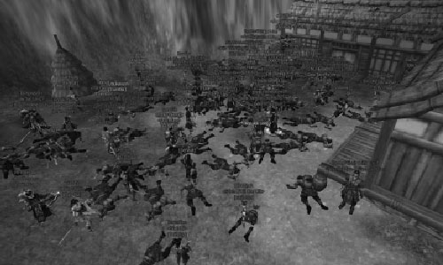  
 **Hạo khí Côn Lôn năm xưa không ít ai oán...**

Những bậc cao thủ năm xưa từng tham gia vào trận chiến Nam Bình Sơn nay đã ẩn thân, tránh xa ưu phiền thế sự, thế nhưng câu chuyện về Nam Bình Sơn vẫn được lưu truyền đến tận ngày nay, hận thù Hạo Khí Minh và Ác Nhân Cốc vẫn không hề được xóa bỏ.

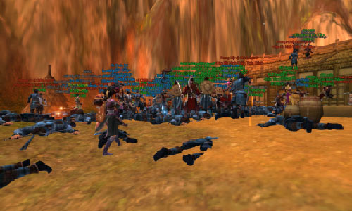  
 **Giang hồ dậy sóng khiến không ít cao thủ "về thành"...**

**Quách Hải Tân** - một sát thủ đã từng ra tay với nhiều cao nhân năm xưa, kẻ đã gây bao thù hận giữa Hạo Khí Minh và Ác Nhân Cốc, khi nghe tin cao thủ tề tựu tại Nam Bình Sơn đã mang theo thân tín xuất hiện khiến quần hùng thêm một phen lo lắng.

Trước sức mạnh tuyệt đỉnh võ công của hắn, **tổ đội 25 người** đã được các hào kiệt nhanh chóng bày binh bố trận, tận dụng tất cả kỹ năng tuyệt đỉnh của [cửu đại môn phái](../mon-phai/cuu-dai-mon-phai.md) quyết một phen ngăn cơn sóng dữ. Trong trận chiến thập tử nhất sinh này, không ít hào kiệt đã phải "về thành"...nhưng với khí thế ngút trời quyết hạ gục Quách Hải Tân, hàng loạt tuyệt kỹ võ công đã xuất ứng khiến y trở nên hoang mang và nhanh chóng thất thủ.

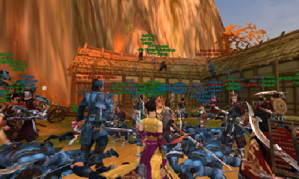  
 **Loạn chiến Nam Bình Côn Lôn sẽ tái diễn tại Võ Lâm 3?**

Quách Hải Tân đã chịu khuất phục trước cửu đại môn phái, thế nhưng ẩn sâu bên trong đó vẫn còn rất nhiều điều bí ẩn mang tên Nam Bình Côn Lôn. Liệu khi các cao thủ đạt đến **cấp độ 80** tuyệt cảnh võ học, Hạo Khí Minh và Ác Nhân Cốc sẽ tái diễn khung cảnh loạn chiến năm xưa? Bí mật kinh thiên nào đang được các thế lực dụng tâm che dấu?

Bí mật sẽ được bật mí tại phiên bản chính thức, quý anh hùng hào kiệt hãy nhanh chóng tề tựu đề cùng khám phá những trải nghiệm mới cùng Võ Lâm 3.

## Chuyển phe cá nhân

Để hiểu rõ và có thể dễ dàng **chuyển phe Cá nhân** giữa Hạo Khi Minh và Ác Nhân Cốc - đó là 2 thế lực lớn trong Võ Lâm 3 mà quý nhân sĩ có thể gia nhập khi đạt **đẳng cấp 67**.

Sau đây là thông tin hướng dẫn địa điểm, điều kiện và cách thức chuyển phe Cá nhân (riêng chuyển phe Bang hội sẽ cập nhất trong thời gian tới).

### Địa điểm & điều kiện chuyển phe Cá nhân

| Khu Bang hội tại các thành thị (vùng khoanh đỏ) |  |
| --- | --- |
| 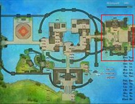 **Dương Châu** | **Điều kiện chuyển phe Cá nhân**: Trong vòng 30 ngày chỉ chuyển phe 1 lần. Phải rời khỏi Bang hội. Toàn bộ tích lũy chiến giới trong tuần sẽ mất. Tùy thuộc vào số người 2 phe hoạt động trong tuần chênh lệch, quyết định người chơi có thể chuyển phe, chuyển phe miễn phí hoặc tốn phí 5.000 vàng. |
| 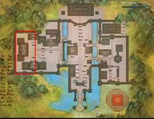 **Lạc Dương** | 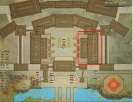 **Trường An** |

### Hướng dẫn chuyển phe Cá nhân

| Hình ảnh minh họa | Hướng dẫn |
| --- | --- |
|  | Đối thoại với NPC Huyền Tự Lục Bát. |
| 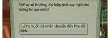 | Chọn "Ta muốn Cá nhân chuyển đến Phe đối địch". |
| 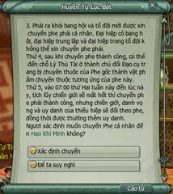 | Tìm hiểu quy tắc chuyển, sau đó nhấp chọn xác nhận chuyển. |
| 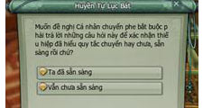 | Trả lời những câu hỏi của NPC đưa ra để có thể hoàn thành việc chuyển phe. |
| 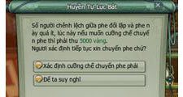 | Trường hợp số nhân sĩ chênh lệch 2 phe quá ít, nếu muốn chuyển phe phải tiêu phí 5.000 vàng. |
| 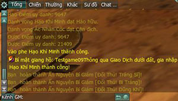 | Hệ thống thông báo người chơi chuyển phe thành công. |

Lưu ý

- Sau khi chuyển phe thành công có thể đến **Lý Thủ Tài** chuyển trang bị sang phe tương ứng.

- Cấp chiến giới, Danh vọng và Uy danh của nhân vật sẽ đổi theo phe, đồng thời được thưởng thêm Uy danh.  Gia nhập phe**ít** hơn: **Không tốn chi phí** và **được cộng điểm Uy danh**. Gia nhập phe **nhiều** hơn: **Tốn chi phí** và **không được cộng điểm Uy danh**.

- Giới hạn nhân sĩ chuyển phe mỗi tuần là **100 nhân sĩ**.

- Nhân sĩ hoạt động trong tuần mỗi phe được tính dựa trên hoạt động tham gia tuần trước:  Uy danh đạt 40% của mức cao nhất (55.000 Uy danh), hoàn thành 3 lần nhiệm vụ Đầm Hắc Long hoặc 6 lần chiến trường. Uy danh đạt 80% của mức cao nhất.

Ngoài ra, hiện tại - 16/08/2013, số lượng vàng khi gia nhập phe phái đang hiển thị không chính xác, đây là lỗi hiển thị, hoàn toàn không ảnh hưởng đến lượng vàng của nhân sĩ và lỗi này sẽ được khắc phục trong bản cập nhật sau.

| Hiển thị sai | Hiển thị đúng |
| --- | --- |
| 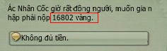 | 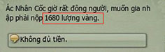 |

Nguồn: VNG (bài viết và hình ảnh)
