## Giới thiệu trang bị

Hệ thống vật phẩm trang bị giúp tăng cường các thuộc tính, có ảnh hưởng lớn đến quá trình hành tẩu tại thế giới Võ Lâm 3. Vì vậy, đồng đạo cần quan tâm các vật phẩm trang bị của nhân vật.

### Phương thức nhận trang bị

- **Nguồn gốc:** Nhận từ phần thưởng hoàn thành nhiệm vụ (chủ yếu), đánh quái, chế tạo từ [kỹ năng sống](./ky-nang-song.md) và mua từ cửa hàng.

- **Phân loại**: Tàn phẩm, phàm phẩm, tinh phẩm, cực phẩm, tuyệt phẩm, thần phẩm.

- **Ghi chú**: Vật phẩm có phẩm chất càng cao thuộc tính càng tốt, giá trị càng cao.

| Hình ảnh | Phẩm chất trang bị |
| --- | --- |
| 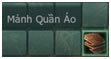 **Màu xám** | Tàn phẩm |
| 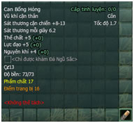 **Màu trắng** | Phàm phẩm |
| 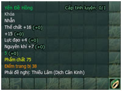 **Màu xanh lục** | Tinh phẩm |
| 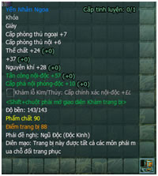 **Màu xanh lam** | Cực phẩm |
| 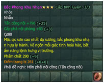 **Màu tím** | Tuyệt phẩm |
| 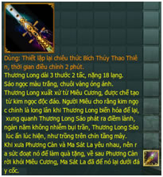 **Màu cam** | Thần phẩm |

### Phân loại trang bị

Trang bị có thể nâng cao khả năng chiến đấu và sinh tồn của nhân vật, phân bổ thành 3 loại:

- **Vũ khí**: Sáo, côn, bút, song binh, trường binh, đoản binh, trọng binh, loan đao, thiên cơ hạp, vũ khí tầm xa và ám khí.

- **Phòng cụ**: Nón, áo, hộ uyển, thắt lưng, quần, giày (một bộ trang bị gồm nón, áo, hộ uyển, thắt lưng, quần, giày. Chỉ cần thu thập đủ bộ có thể kích hoạt được thuộc tính ẩn).

- **Trang sức:** Dây chuyền, yêu trụy, nhẫn và đồ treo đặc thù (thỏa mãn yêu cầu trang trí làm đẹp cá tính như: hồ lô thắt eo, cổ cầm treo sau lưng…).

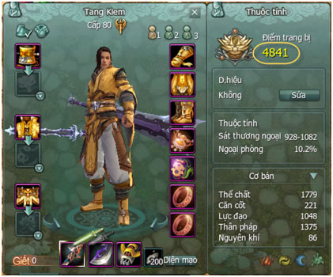

Ghi chú

**Quan hệ giữa trang bị và môn phá**

**i**

:

- Bản thân **vũ khí không yêu cầu chỉ định môn phái** nhưng có những kỹ năng chiêu thức cần yêu cầu đúng vũ khí mới phát huy tác dụng, ví dụ “[Thiếu Lâm](../mon-phai/thieu-lam.md) La Hán Côn” bắt buộc nhân vật phải trang bị “côn” mới có thể thi triển.

- Tương tự, **trang bị phòng ngự cũng không hạn chế hoặc chỉ định môn phái**. Nhưng thi triển kỹ năng võ học môn phái cần những trang bị hỗ trợ đều không giống nhau. Do đó, đồng đạo phải tự mình khám phá điều này.

**Phân loại trang bị khóa**:

- **Vật phẩm tự do**: Dù trạng thái nào cũng có thể mang vào, tháo ra, giao dịch…

- **Trang bị khóa**: Khi chưa sử dụng sẽ ở trạng thái có thể giao dịch nhưng khi đã trang bị vào người sẽ không thể giao dịch với người khác.

- **Nhặt xong khóa**: Khi đã nhặt vật phẩm thì sẽ không thể giao dịch với người khác. Do đó, đồng đạo cần cân nhắc nhường lại cho đồng đội nếu không cần thiết.

- **Vật phẩm nhiệm vụ**: Thường là sẽ khóa, không thể giao dịch hoặc bán đi.

### Độ bền trang bị

| Hình ảnh | Ghi chú |
| --- | --- |
| 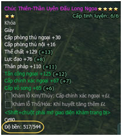 | Tất cả các trang bị đều có độ bền, riêng trang sức và trang sức đeo như dây chuyền, nhẫn, đồ treo trang trí không có thuộc tính độ bền. Khi tỷ võ, đồ sát, cừu sát, bị sát thương hoặc sử dụng vũ khí, đều có một tỷ lệ giảm độ bền của trang bị và vũ khí. Khi trọng thương, nếu hồi sinh tại sẽ bị giảm đi 10% độ bền trang bị, về thành dưỡng sức hoặc được nhân vật khác cứu sống lại chỉ mất đi 5% độ bền. |
| 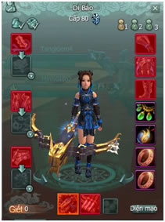 | Khi bên phải màn hình sẽ xuất hiện một biểu tượng nhân vật và trang bị màu đỏ, nhắc nhở đồng đạo tu sửa lại trang bị. Màu sắc đậm nhạt khác nhau thể hiện độ hư hao của trang bị khác nhau, bộ phận nào hiển thị bằng màu đỏ tức độ bền của trang bị đó bằng 0, hiệu quả của trang bị đó tạm thời mất đi. |
| 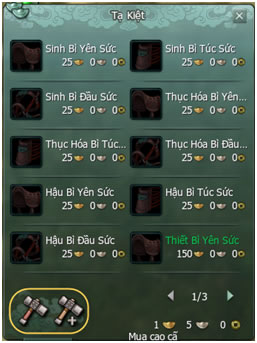 | Tất cả các cửa hàng vũ khí, cửa hàng dụng cụ rèn tạo, cửa hàng trang phục, trang sức đều cung cấp dịch vụ sửa chửa trang bị, chỉ cần tốn một ít phí tương ứng thì độ bền trang bị sẽ trở lại như ban đầu. |

## Ngũ hành thạch

[Tàng Kiếm](../mon-phai/tang-kiem.md) Sơn Trang Diệp Hà Khách chu du thiên hạ phát hiện nguyên thạch quý trong Động Ngọc Tùy ở trên núi Côn Lôn. Sau đó giao cho Tàng Kiếm Sơn Trang, hòa chung nhiều loại đá quý tạo ra viên đá kỳ diệu, đá kỳ diệu có thể gia tăng hiệu quả phẩm chất của trang bị vũ khí và kích hoạt sức mạnh tiềm năng của chúng, trên giang hồ thường gọi là Đá Ngũ Hành.

- Thu thập

- Tinh luyện Đá

- Khảm trang bị

- Kích hoạt Đá

- Tinh luyện trang bị

### Thu thập Đá Ngũ Hành

#### Cửa hàng Đá Ngũ Hành

- Đối thoại NPC Tăng Hâm (Thương Nhân Đá Ngũ Hành) tại 3 thành chính.

- Sử dụng cống hiến [Bang hội](./bang-hoi.md) hoặc điểm Uy danh.

#### Đánh bại NPC Lợn Cửu Giới

- Đánh bại NPC Lợn Cửu Giới nhận được Đá Ngũ Hành.

- Vị trí: Hoa viên Bang hội.

#### Đánh bại Đầu Lĩnh thứ 5

| Tên nhiệm vụ chung | Bản đồ | Đầu Lĩnh giai đoạn 5 |
| --- | --- | --- |
| Ngũ Thử Làm Loạn | Bạch Long Khẩu | Bạch Mi Thử Vương |
| Quyết Chiến Đỉnh Tuyết Sơn | Vô Lượng Sơn | Mẫu Đơn |
| Huyết Chiến Dung Thiên | Dung Thiên Lĩnh | Huyết Nhãn Long Vương |
| Thỏa Hiệp Của Tiểu Tà Tử | Đầm Hắc Long | Cúng Tế Nguyệt Thần |
| Kiếm Thần bại lộ | Thành Đô | Kiếm Tam Thiếu |

#### Tháo trang bị

- Tháo trang bị trong giao diện kỹ năng sống nhận được Đá Ngũ Hành.

- **Lưu ý:**  Chỉ có một số trang bị có thể thông qua kỹ năng tách để nhận Đá Ngũ Hành. Tháo trang bị sẽ phải tiêu hao tinh lực.  Tách trang bị đã được tinh luyện trước khi tháo.

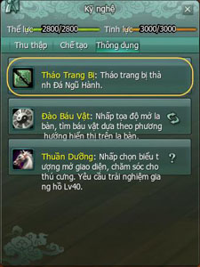

### Tinh luyện Đá Ngũ Hành

#### Giao diện tinh luyện

- Nhấp vào biểu tượng Đá Ngũ Hành bên phải giao diện trò chơi hoặc sử dụng phím tắt "Shift + F" để vào giao diện tinh luyện Đá Ngũ Hành.

#### Quy tắc tinh luyện

- Bất kỳ Đá Ngũ Hành nào đều có thể tinh luyện.

- Nguyên liệu cần tinh luyện là Đá Ngũ Hành, tối đa tinh luyện 16 viên Đá Ngũ Hành/lần.

- Tinh luyện Đá Ngũ Hành có tỷ lệ thành công khi tinh luyện.

- Số lượng, đẳng cấp, chủng loại Đá Ngũ Hành của nguyên liệu chế tạo quyết định tỷ lệ thành công khi tinh luyện.

- Tinh luyện Đá Ngũ Hành tuân theo qui tắc ngũ hành tương sinh tương khắc.  

    Chủng loại ngũ hành Tỷ lệ thành công     Ngũ hành tương sinh Tỷ lệ thành công tăng   Ngũ hành tương đồng Tỷ lệ thành công tăng   Không có quan hệ ngũ hành Tỷ lệ thành công bình thường   Ngũ hành tương khắc Tỷ lệ thành công thấp

- Tỷ lệ thành công hiển thị trên giao diện Đá Ngũ Hành (tinh luyện 1 lần Đá Ngũ Hành tối đa có thể tăng 2 cấp).

- Tinh luyện thất bại thì Đá Ngũ Hành giữ nguyên cấp độ (không xuống cấp).

- Nguyên liệu Đá Ngũ Hành sẽ bị tiêu hao khi tinh luyện thành công hoặc thất bại.

- Tinh luyện Đá Ngũ Hành cần phải tốn chi phí gia công, đồng thời còn phải tiêu hao tinh lực nhất định.

### Tinh luyện trang bị

#### Giao diện tinh luyện

- Nhấp vào biểu tượng Đá Ngũ Hành bên phải giao diện trò chơi để vào giao diện tinh luyện trang bị.

#### Quy tắc tinh luyện

- Trang bị bất kỳ có thuộc tính đều có thể tiến hành tinh luyện, căn cứ theo phẩm chất cấp độ khác nhau của trang bị, cấp độ tinh luyện cao nhất cũng khác nhau, hiện tại cấp độ tinh luyện cao nhất của trang bị là cấp 8.

- Tinh luyện trang bị cần sử dụng Đá Ngũ Hành làm nguyên liệu tinh luyện.

- Tinh luyện trang bị tốn chi phí và tiêu hao tinh lực nhất định.

- Trang bị, cấp độ, số lượng Đá Ngũ Hành của nguyên liệu chế tạo quyết định tỷ lệ thành công khi tinh luyện.

- Tinh luyện trang bị thành công, cấp độ tinh luyện tăng lên 1 cấp (1 lần tinh luyện trang bị tối đa chỉ tăng 1 cấp).

- Nếu thất bại, cấp độ tinh luyện trang bị vẫn giữ nguyên (không xuống cấp).

- Nguyên liệu Đá Ngũ Hành sẽ bị tiêu hao khi tinh luyện thành công hoặc thất bại.

#### Tách tinh luyện trang bị

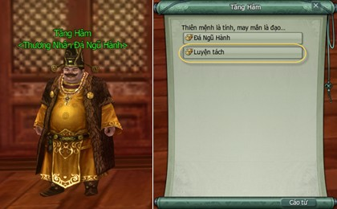

- Trang bị đã từng được tinh luyện mới có thể tiến hành tách tinh luyện.

- Tách tinh luyện trang bị tốn chi phí và tiêu hao tinh lực nhất định.

- Sau khi tách ra, căn cứ theo mức độ tinh luyện trước đây sẽ nhận lại Đá Ngũ Hành (sẽ có tổn thất nhất định), chủng loại Đá Ngũ Hành là ngẫu nhiên.

- Sau khi tách, cấp độ tinh luyện của trang bị là 0, thuộc tính tinh luyện tăng mất đi.

### Khảm trang bị

Công dụng thứ hai của Đá Ngũ Hành là có thể kích hoạt năng lực tiềm ẩn của trang bị vũ khí, trên giang hồ sắp xuất hiện 1 đợt trang bị cực phẩm, những trang bị này có lỗ khảm Đá Ngũ Hành. Đại hiệp nào sở hữu được, chỉ cần khảm Đá Ngũ Hành có chủng loại tương ứng vào trang bị thì có thể kích hoạt năng lực tiềm ẩn của trang bị.

#### Giao diện khảm trang bị

- Dùng chuột di chuyển trang bị cần khảm Đá Ngũ Hành vào, sáu đó nhấn tổ hợp phím "Shift + chuột phải" mở giao diện khảm trang bị và tiến hành khảm trang bị.

#### Quy tắc khảm trang bị

- Bất kỳ 1 thuộc tính khảm nào, đều được khảm bởi 2 loại Đá Ngũ Hành, dùng chuột di chuyển vào lỗ khảm để kiểm tra thông tin khảm.

- Cấp độ của Đá Ngũ Hành càng cao, thuộc tính kích hoạt càng cao.

- Sau khi Đá Ngũ Hành khảm thành công thì không thể tiến hành tháo Đá Ngũ Hành khảm ra được, nhưng có thể dùng Đá Ngũ Hành khác để khảm thay thế.

### Kích hoạt Đá Ngũ Hành

Tất cả vũ khí đều có 1 lỗ khảm đặc biệt, lỗ này chỉ có thể thông qua khảm Đá Ngũ Hành kích hoạt, sau khi kích hoạt thành công, vũ khí có thêm 3 dòng "thuộc tính ngũ hành".

#### Cách thức có được Đá Ngũ Sắc

Đá Ngũ Sắc không giống với Đá Ngũ Hành, Đá Ngũ Sắc chỉ có thể dùng vũ khí ngũ hành kích hoạt. Đồng thời chủng loại Đá Ngũ Sắc rất nhiều, Đá Ngũ Sắc chủng loại khác nhau thuộc tính vũ khí kích hoạt cũng không giống nhau.

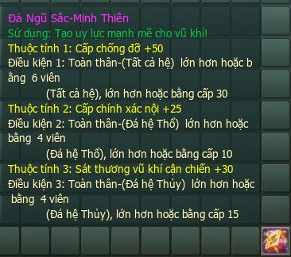

- **Cách 1:** Khi tìm bảo vật ở khu dã ngoại có xác suất nhận được Đá Ngũ Sắc (mở giao diện kỹ năng sống có thể mở tìm bảo vật).

- **Cách 2:** Đánh bại thủ lĩnh giai đoạn 5 nhiệm vụ chung cũng có thể nhận được, trong đó còn có Ngũ Hành Thạch cao cấp.  
    Tên nhiệm vụ chung Bản đồ Đầu Lĩnh giai đoạn 5     Ngũ Thử Làm Loạn Bạch Long Khẩu Bạch Mi Thử Vương   Quyết Chiến Đỉnh Tuyết Sơn Vô Lượng Sơn Mẫu Đơn   Huyết Chiến Dung Thiên Dung Thiên Lĩnh Huyết Nhãn Long Vương   Thỏa Hiệp Của Tiểu Tà Tử Đầm Hắc Long Cúng Tế Nguyệt Thần   Kiếm Thần bại lộ Thành Đô Kiếm Tam Thiếu

- **Cách 3:** Đánh bại Đầu Lĩnh Mật Cảnh của [Long Uyên Trạch](../pho-ban/pho-ban-10-nguoi.md#long-uyên-trạch) Anh Hùng và Địch Hoa Điển Anh Hùng có xác suất nhận được Đá Ngũ Sắc.

#### Giao diện kích hoạt Đá Ngũ Hành

- Dùng chuột di chuyển vũ khí cần khảm Đá Ngũ Sắc vào, sáu đó nhấn tổ hợp phím "shift + chuột phải" mở giao diện kích hoạt ngũ hành.

#### Quy tắc kích hoạt ngũ hành

- Chỉ có vũ khí mới có thể kích hoạt ngũ hành.

- Thuộc tính ngũ hành Đá Ngũ Sắc kích hoạt tối đa có 3 dòng.

- Sau khi Đá Ngũ Sắc khảm thành công, số lượng Đá ngũ hành đạt đến yêu cầu nhất định của tất cả trang bị khảm mới có thể kích hoạt thuộc tính ngũ hành (chỉ tính 1 bộ trang bị trong khung trang bị).  Ví dụ: Điều kiện kích hoạt dòng 1 thuộc tính ngũ hành, chỉ cần đủ "2 viên đá ngũ hành hỏa" là có thể kích hoạt thành công 1 dòng thuộc tính ngũ hành.

- Thuộc tính ngũ hành không cần phải kích hoạt theo thứ tự, chỉ cần thỏa điều kiện kích hoạt ngũ hành là có thể kích hoạt.

## Trang bị phẩm chất cao

**[Linh Tiêu Hiệp](../pho-ban/pho-ban-5-nguoi.md#linh-tiêu-hiệp)** và **[Thiên Công Phường](../pho-ban/pho-ban-5-nguoi.md#thiên-công-phường)** là 2 trong số những phó bản anh hùng đòi hỏi một tổ đội 5 nhân vật có đẳng cấp 70 trở lên mới có thể tham gia. Với Boss có một lượng máu khá cao cùng những hiệu ứng gây "định thân", sát thương cao chắc chắn sẽ là những trở ngại thật sự với các tổ đội muốn nhận được những vũ khí, trang bị "khủng" có **phẩm chất cao** từ 100 - 115 của 2 phó bản này.

- Linh Tiêu Hiệp

- Thiên Công Phường

### Linh Tiêu Hiệp- Anh Hùng

- **Đẳng cấp nhân vật**: Cấp **70** trở lên.

- **Yêu cầu**: Tổ đội 5 người.

- **Lối vào phó bản**: Bản đồ Thiếu Lâm

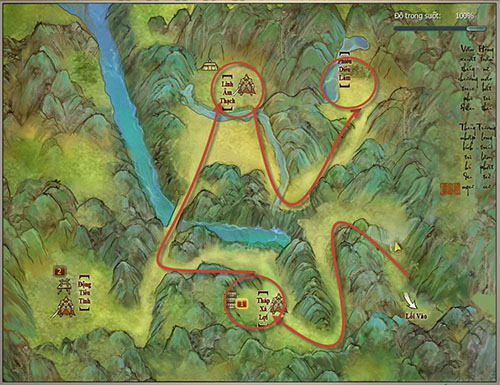   
 ***Linh Tiêu Hiệp- cổ đạo bí mật giữa vách núi phía sau Tung Sơn Thiếu Lâm Tự.***

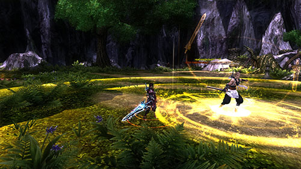   

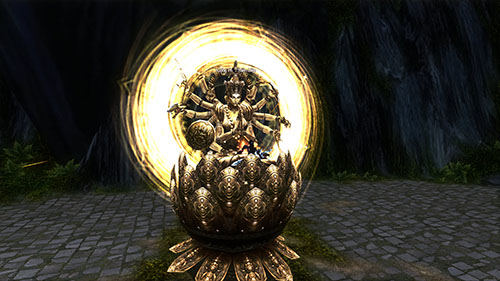  
 ***Tượng Phật Thiên Diệp - vũ khí mạnh nhất để đuổi ngoại xâm.***

#### Boss và hiệu ứng

| **Hình ảnh** | **Ghi chú** |
| --- | --- |
| ** Tuệ Chung** | Boss tự tạo ra hiệu ứng có lợi cho bản thân **Kim Chung Tráo:**Sát thương phải chịu -20%. Khi Boss tấn công tạo ra hiệu ứng bất lợi **Đại Long Trảo Thủ** gây định thân và **ngã xuống** làm cho nhân vật ngã xuống đất. **Đẳng cấp**:**70** **Sinh lực**: **120.000** |
| **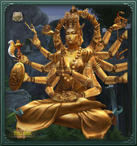 Tượng Phật Thiên Diệp** | Tượng Phật viễn cổ trong Linh TIêu Hiệp thật sự là kiệt tác của đại sư cơ giáp, được Thiên Trúc Già Lang Tăng sử dụng, trở thành vũ khí mạnh nhất để đuổi ngoại xâm. **Đẳng cấp**: **70** **Sinh lực**:**140.000** |
| **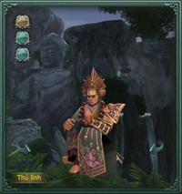 Thủy Trung Nguyệt** | Cần tấn công Hộp Tàng Kinh Thiên Trúc (HP: 150.000), khi HP của hộp giảm xuống còn 1/3 thì các thần tăng sẽ thi triển chiêu thức, chỉ cần đánh hết máu Hộp Tàng Kinh Thiên Trúc là được. Boss khi tấn công tạo ra hiệu ứng bất lợi Già Nam Bất Hoại Thân: Phản đòn sát thương 100%. **Đẳng cấp:** **70** **Sinh lực:** **324.980** |
| ** Kính Trung Hoa** |  |
| **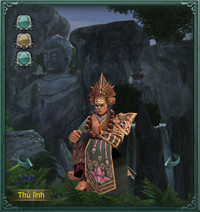 Không Trung Vân** |  |

- **Hiệu ứng Boss:**

| **Boss** | **Hình ảnh** | **Tác dụng** |
| --- | --- | --- |
| **Tuệ Chung** | **** | Đại Long Trảo Thủ: Định thân. |

#### Phần thưởng

- **Vũ khí:**Các loại vũ khí của phái Thiếu Lâm, Tàng Kiếm, [Minh Giáo](../mon-phai/minh-giao.md) với phẩm chất từ 100 - 115.

- **Trang bị:**Với các loại trang bị chủ yếu dành cho các phái chủ yếu là Thiếu Lâm, [Thiên Sách](../mon-phai/thien-sach.md) có phẩm chất đến 110.

- **Vật phẩm khác:** Ngoài vũ khí và trang bị, bí cảnh Linh Tiêu Hiệp anh hùng còn có thể rớt ra các công thức chế tạo trang bị thông qua các kỹ nghệ của nhân vật. Ngoài ra, còn có xuất hiện của các mật tịch của thiếu lâm và vật phẩm gia tăng túi trang sức lưng và trang sức vai.

### Thiên Công Phường - Anh Hùng

- **Đẳng cấp nhân vật**: Cấp **70** trở lên.

- **Yêu cầu**: Tổ đội 5 người.

- **Lối vào phó bản**: Tây Nam [Vạn Hoa](../mon-phai/van-hoa.md).

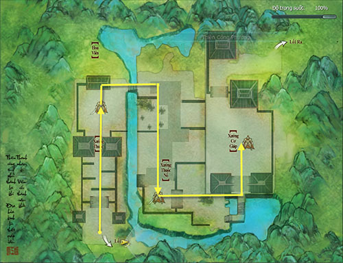   
 ***Thiên Công Phường - nơi điều chế độc dược của Tư Đồ Nhất Nhất.***

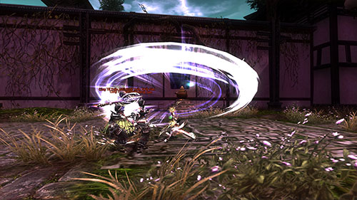  

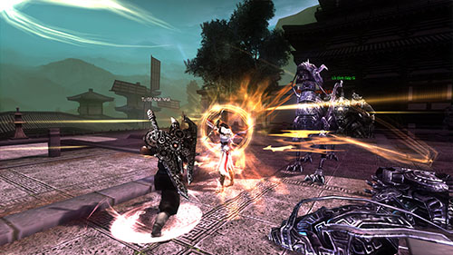   
 ***Nhân vật cần phải tiêu diệt Boss thật nhanh.***

#### Boss và hiệu ứng

| **Hình ảnh** | **Ghi chú** |
| --- | --- |
| ** Sát Linh Ma Thi** | Nhân vật cần tiêu diệt Boss càng sớm càng tốt, Boss trong trang thái Sát Lục Cơ Khí mỗi tần tấn công ngoại tăng 10%, tăng dần theo thời gian. **Đẳng cấp**: **70** **Sinh lực**: **126.463** |
| **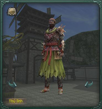 Tháp Mã** | Nhân vật cần tiêu diệt Boss càng sớm càng tốt, Boss sẽ sử dụng nhiều hiệu ứng gây độc cho người chơi. **Đẳng cấp**: **70** **Sinh lực**:**145.709** |
| ****Tư Đồ Nhất Nhất | Boss sẽ gọi quái ra để tấn công nhân vật, chỉ cần tiêu diệt được Boss các thiết giáp tự động bị tiêu diệt. **Đẳng cấp:** **70** **Sinh lực:** 166.524 |

- **Hiệu ứng Boss:**

| **Boss** | **Hình ảnh** | **Tác dụng** |
| --- | --- | --- |
| **Sát Linh Ma Thi** | **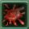** | **Tuyệt Vọng Tê Giảo**: Mỗi 3 giây chịu 953 điểm sát thương ngoại thời gian 25 giây. |
| Tháp Mã | **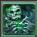** | **Độc Khí Lây Lan:** Mỗi 3 giây chịu 825 điểm sát thương độc thời gian 25 giây. |
| **** | **Ôn Dịch Không Truyền Nhiễm:** Mỗi 3 giây chịu 413 điểm sát thương độc, tất cả điểm uy hiếp chiêu thức còn 0, không thể lây lan thời gian 25 giây. |  |
| **** | **Ôn Dịch Truyền nhiễm** Mỗi 3 giây chịu 851 điểm sát thương độc, có thể chuyển cho 1 đồng đội ở gần để giảm hiệu quả Ôn Dịch thời gian 25 giây. |  |

#### Phần thưởng

- **Vũ khí:**Các loại vũ khí của phái Vạn Hoa, Tàng Kiếm, [Ngũ Độc](../mon-phai/ngu-doc.md) với phẩm chất từ 100 - 105.

- **Trang bị:**Với các loại trang bị chủ yếu dành cho các phái Vạn Hoa, [Thuần Dương](../mon-phai/thuan-duong.md), Ngũ Độc.

- **Vật phẩm khác:**Ngoài vũ khí và trang bị, bí cảnh Thiên Công Phường còn có thể rớt ra các công thức chế tạo trang bị thông qua các kỹ nghệ của người chơi. Ngoài ra, còn có xuất hiện của các vật phẩm gia tăng túi trang sức lưng và trang sức vai.

Hệ thống Phó Bản phong phú và đặc sắc của Võ Lâm 3 vẫn đang rộng mở đón chờ các anh hùng hào kiệt khắp chốn chinh phục. Quý nhân sĩ hãy tham gia ngay hôm nay để không bỏ lỡ cơ hội trở thành một nhân vật truyền kỳ chốn võ lâm.

Nguồn: VNG (bài viết và hình ảnh)
