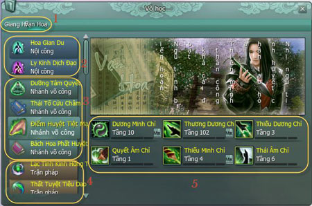

Diễn ra trong bối cảnh nhà Đường phồn thịnh nhưng hỗn nguyên bất ổn, Võ Lâm 3 tái hiện hoàn hảo về thời kỳ đỉnh cao của võ học trung nguyên với Nhất giáo, Nhị minh, Tam ma, Tứ gia, Ngũ kiếm và Cửu phái.

Cửu phái chính là cách gọi khác của cửu đại môn phái: [Thiếu Lâm](./thieu-lam.md), [Thất Tú](./that-tu.md), [Đường Môn](./duong-mon.md), [Minh Giáo](./minh-giao.md), [Thuần Dương](./thuan-duong.md), [Tàng Kiếm](./tang-kiem.md), [Thiên Sách](./thien-sach.md), [Ngũ Độc](./ngu-doc.md) và [Vạn Hoa](./van-hoa.md). Sơn môn rộng lớn, môn đồ trải khắp thiên hạ nhưng chỉ thu nhận tinh anh, cửu đại môn phái chính là thế lực chủ đạo nắm giữ vận mệnh thiên hạ với các tuyệt kỹ võ công xuất thần nhập hóa, danh chấn giang hồ.

Và tại Võ Lâm 3, mỗi môn phái đều sở hữu những điểm đặc biệt riêng về hệ thống chiêu thức, khinh công... Tuy hoa mỹ diễm lệ nhưng cũng đầy uy lực, thông qua các lượt so kè nảy lửa, tung hoành ngang dọc trong những trận chiến quy mô, đa dạng trong công thủ... mà nhân sĩ có thể dễ dàng nhận thấy qua đoạn phim sau đây:

[Video](http://www.youtube.com/embed/57OkIBfamds)

***Cửu đại phái - hoa mỹ diễm lệ nhưng thập phần uy lực***

Với cửu đại môn phái, nhân sĩ có thể tùy ý lựa chọn cho mình một phong thái thích hợp để nhập bước giang hồ, trải nghiệm thế giới võ lâm đầy phong ba thử thách và bội phần thú vị.

Sơ nhập giang hồ - thân bất do kỷ, nhân sĩ hãy dùng sức lực bản thân để nghịch chuyển càn khôn, thay đổi vận mệnh thiên hạ, trở thành những truyền kỳ chốn võ lâm được vạn người kính ngưỡng, hậu thế lưu truyền.

## Các phái

- [Thiên Sách](./thien-sach.md)
- [Thuần Dương](./thuan-duong.md)
- [Vạn Hoa](./van-hoa.md)
- [Thất Tú](./that-tu.md)
- [Thiếu Lâm](./thieu-lam.md)
- [Tàng Kiếm](./tang-kiem.md)
- [Ngũ Độc](./ngu-doc.md)
- [Đường Môn](./duong-mon.md)
- [Minh Giáo](./minh-giao.md)

## Bí kíp trấn phái

Lâu nay, bá tánh trong thiên hạ râm ran truyền tai nhau về Võ Lâm 3 của Võ Lâm Truyền Kỳ - nơi ẩn dấu tuyệt kỹ võ công, nơi khẳng định vị thế thượng đỉnh cung phu của cửu đại phái. Liệu lời đồn thổi này có chính xác?

Điểm đặc sắc nhất phải chăng là "Bí kíp trấn phái"? **Đường Môn***với thân pháp xuất quỷ nhập thần và Thiên Cơ Hạp thiên biến vạn hóa, âm thầm bày bố các cơ quan giăng bẫy, phối hợp với các loại ám khí, cung tiễn được thoa độc ở tầm xa, biến hóa khôn lường, uy lực kinh người* hay **Ngũ Độc** *vận dụng thần bí Cổ và Độc và vô số loại độc công kích đối phương, kết hợp Cổ thuật trị thương hồi sinh, chỉ cần nắm vững trong lòng bàn tay thì có thể vận dụng thành thạo 5 loại Độc Trùng gồm Thánh Hạt, Ngọc Thiềm, Linh Xà, Phong Ngô, Thiên Thù, đều là các tuyệt kỹ bất truyền của Miêu Cương*....

Tất cả mới chỉ là võ đoán! Hãy tự do cảm nghiệm và tự cho mình câu trả lời chân thực nhất thông qua đoạn phim sau:

[Video](http://www.youtube.com/embed/zAAiZ6ssmmM)

***Thông tin được bật mí vào mốc thời gian 1 phút 51 trong đoạn phim***

Bí kíp thần thông sẽ thuộc về ai? Hơn hết, võ lâm không thể một ngày không có minh chủ, liệu phái nào sẽ xuất hiện cao nhân thống lĩnh Võ Lâm 3? Hãy cùng chờ xem vì bí kíp vẫn còn là bí ẩn!

## Võ học

Hệ thống võ học của Võ Lâm 3 được thiết kế mô phỏng dựa trên tiểu thuyết võ hiệp truyền thống và kinh điển của tác giả Kim Dung và Cổ Long.

Với hiệu ứng đặc sắc kết hợp động tác chiêu thức tinh túy, hoàn toàn mang phong cách của một thế giới võ hiệp chính thống, gồm các loại hình:

**Võ học giang hồ | Võ học môn phái | Võ học mật tịch**

**Chiêu thức kỹ năng |** **Trận pháp môn phái**

### Võ học giang hồ

- Đây là loại hình võ học nhằm mục đích giúp quý hiệp khách làm quen và thích ứng với cuộc sống ngao du sơn thủy. Nhân vật dưới đẳng cấp 10 nên thuần thục thao tác cơ bản trước khi sơ nhập giang hồ.

- Võ học giang hồ còn gọi là các kỹ năng cơ bản, các kỹ năng này giúp nhân vật thuận tiện hơn trong quá trình bôn tẩu. Bao gồm các kỹ năng như: Khinh công, di chuyển, rèn luyện, thao tác cơ bản của vật… chủ yếu học tại Đạo Hương Thôn.

### Võ học môn phái

- Đạt cấp 15, nhân vật đã có thể tự do chọn môn phái cho mình, sau khi bái sư nhập môn, hiệp khách hãy tìm những vị Chưởng môn nhân hoặc Sư phụ môn phái để được truyền thụ võ công. Mỗi đại môn phái đều có 02 nhánh nội công tâm pháp và có đặc điểm riêng. Nhân vật tu luyện theo các hướng khác nhau sẽ tạo cho mình một đặc sắc riêng biệt về chiêu thức, kỹ năng chiến đấu và lối hành hiệp cũng trở nên đa dạng hơn. Mỗi môn phái có 04 bộ võ công, mỗi bộ võ công có chiêu thức khác nhau, mỗi chiêu thức cần nội công và loại vũ khí tương ứng.

- Từ cấp 25 trở đi, nhân vật có thể học 02 kỹ năng trận pháp lớn, phối hợp với kinh công, hệ thống [kinh mạch](../he-thong/kinh-mach.md). Đặc biệt, tu luyện võ công môn phái khác là một điểm nổi bất của võ học môn phái.

- Ngoài ra, khi nhân vật đat mốc đẳng cấp từ 60 trở đi thì có thể tham gia các liên minh Hào Khí hay Ác Nhân Cốc và có cơ duyên tu luyện tuyệt học võ lâm ở các môn phái khác.

*Giao diện võ học môn phái (nhấn phím tắt P để mở giao diện)*

Chú thích:

- (**1**): Thay đổi võ học môn phái khác nhau, bao gồm cả võ học giang hồ.

- (**2**): Trong cùng một trang võ học môn phái có 02 nội công tâm pháp khác nhau.

- (**3**): Võ học môn phái có 04 bộ võ công.

- (**4**): Hai bộ trận pháp lớn của võ học môn phái.

- (**5**): Chiêu thức khác nhau trong cùng 1 bộ võ công.

### Võ học mật tịch

- Mật tịch giang hồ (khóa/không khóa) là các loại bí kíp thần diệu ẩn chứa võ công bí thuật của các vị cao nhân lưu truyền lại, mật tịch thường tồn tại dưới dạng sách hoặc trang da thuộc. Nhân vật có thể thu thập mật tịch khi tham gia đánh quái, đổi từ các nguyên liệu quy định, phần thưởng từ nhiệm vụ hay dùng điểm Danh vọng để mua…

- Mật tịch ảnh hưởng trực tiếp đến chiêu thức của nhân vật, tối đa 01 chiêu thức bị ảnh hưởng nhiều nhất bởi 04 mật tịch. Lĩnh ngộ tối đa công năng của mật tịch, chiêu thức võ công sẽ đạt mức thượng thừa, giang hồ khó ai sánh kịp.

### Chiêu thức kỹ năng

- Kỹ năng võ học cần thông qua hoàn thành những nhiệm vụ chỉ định, lĩnh hội trong quá trình bôn tẩu giang hồ hoặc lĩnh hội từ Chưởng môn/Sư phụ sau khi [gia nhập môn phái](../tan-thu/huong-dan-gia-nhap-mon-phai-khi-dat-cap-16.md). Để học võ công, quý hiệp khách cần tiêu tốn một số lượng Ngân lượng nhất định.

- Chiêu thức kỹ năng võ học tồn tại ở hai trạng thái: Chủ động và Bị động. Kỹ năng chiêu thức càng cao, hiệu quả thi triển của võ công càng đạt mức uyên thâm. Trong quá trình hành hiệp, nhân vật có thể kết hợp các loại chiêu thức để tạo nên hệ thống kinh mạch độc đáo, mật tịch võ công phong phú, kỹ năng khinh công linh hoạt và trận pháp cũng trở nên lợi hại hơn.

### Trận pháp môn phái

- Trận pháp là hệ thống hỗ trợ giúp các nhân vật trong cùng đồng đội tác chiến trên [chiến trường](../he-thong/chien-truong.md), bố trận thích hợp có thể phát huy cao nhất khả năng chiến đấu của đội ngũ. Nhân vật đạt cấp 20 trở đi có thể đến tìm huấn luyện sư tại các môn phái học 02 kỹ năng trận pháp lớn. Chỉ đội trưởng mới khởi động được trận pháp, chỉ cần đội trưởng đã học kỹ năng trận pháp thì tất cả các thành viên còn lại đều có thể hưởng thụ hiệu quả, phạm vi áp dụng là 20 thước xung quanh trận.

- Cấu trúc của trận pháp gồm ba phần: Lập trận, duy trì trận và kết trận. Người giữ trận đóng vai trò là người kết trận, trong quá trình duy trì trận nếu người giữ trận bị trọng thương, hiệu quả trận pháp sẽ mất đi. Các trường hợp chuyển giao người giữ trận, hoặc người giữ trận di chuyển sang bản đồ đồ khác hay thoát khỏi trò chơi thì hiệu quả trận pháp cũng bị giải trừ. Thời gian duy trì trận pháp là 04 giờ.

Nguồn: VNG (bài viết và hình ảnh)
