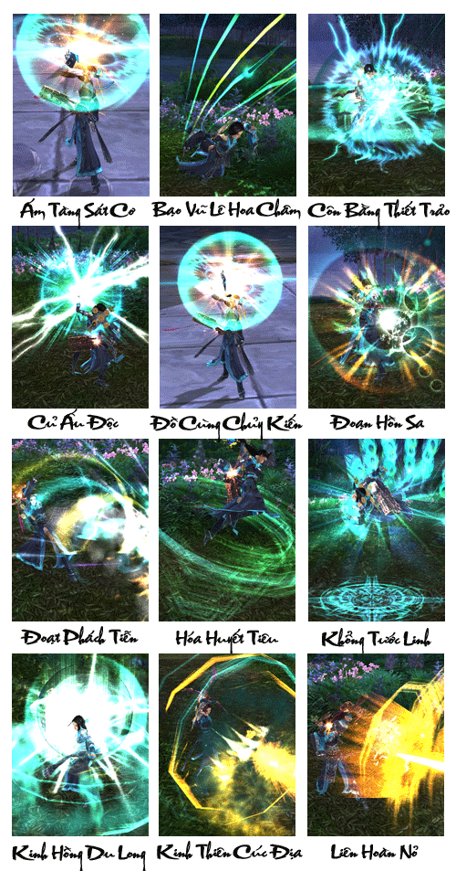
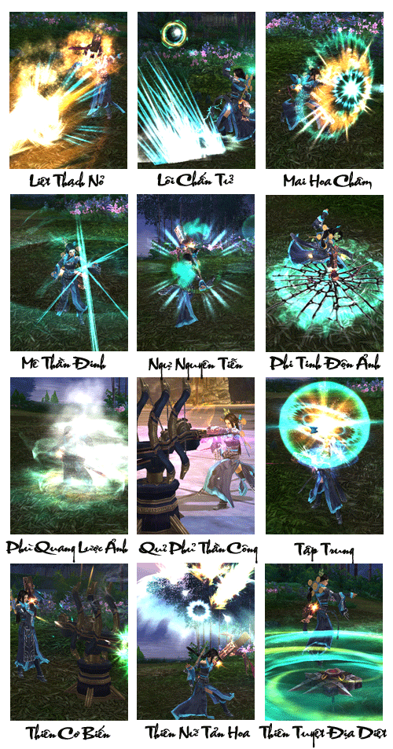
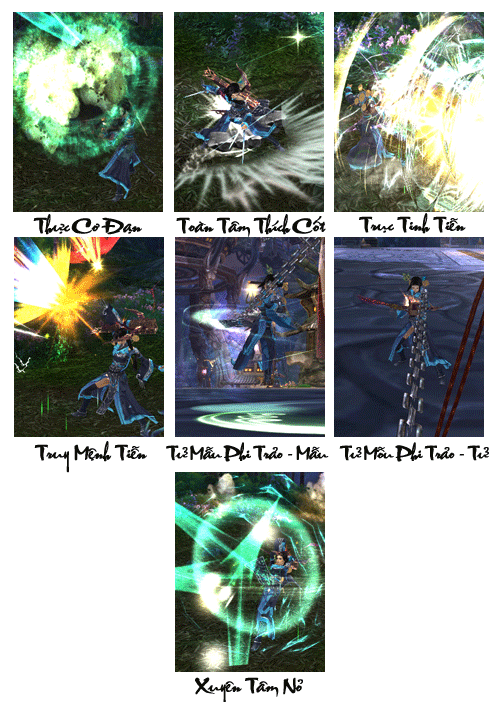

Đường Môn ban đầu là thích khách thế gia nhưng chỉ xuất hiện tại vùng Xuyên Thục. Sở trường Đường Môn thiên sử dụng ám khí, xuất quỷ nhập thần, khiến cho người bản địa vô cùng khiếp sợ. Dưới sự cai trị của Trinh Quan, quốc gia thái bình, dân an cư lạc nghiệp, khi thích khách đã không còn phù hợp với nhu cầu hằng ngày của nhà Đường. Nhà Đường vì đại nghiệp sinh tồn bắt đầu khuếch trương thương nghiệp, từ đó thế lực mạnh dần, danh tiếng của Đường Môn cũng bắt đầu ngày càng lớn lên.

Đường Gia phát triển đến nay, đã có rất nhiều phân đà, 1 số phân đà trong Đường Gia gần như không có địa vị gì, chẳng qua chỉ mang họ Đường mà thôi, 1 số phân đà lại phụ trách thương nghiệp của Đường Gia. Phân đà chủ yếu sống tại Nội Bảo, phần còn lại được sắp xếp Ngoại Bảo. Hiện tại ngoài phân đà Môn Chủ Đường Ngạo Thiên, còn có 3 phân đà của Đường Môn Tứ Lão nữa, đều là các phân đà có địa vị và tiếng tăm nhất trong Đường Môn hiện nay, họ nắm giữ mọi hoạt động trong Đường Môn, con cháu Đường Môn mỗi đời đều phân biệt vai vế của mình. Ví dụ đời thứ 1 là đời chữ "Hoài", Môn Chủ của đời này là chữ "Ngạo", thì đời tiếp theo sẽ là chữ "Vô". Họ Đường trong nội bảo mới có tư cách được xếp vai vế, Võ học của Đường Gia thường học, chỉ cần ngươi có đủ tố chất là có thể học hết. Số người còn lại mang họ Đường chỉ được học võ công nhập môn của Đường Gia.

Môn Chủ Đường Môn không phải cha truyền con nối, mà do Môn Chủ cùng tất cả đệ tử Đường Gia Tứ Lão bầu chọn ra, sau đó được bồi dưỡng vài năm, cho đến khi Môn Chủ đời trước thôi vị mới có thể kế thừa. Môn Chủ và Tứ Lão ngày thường công việc bận rộn, về việc bầu chọn Môn Chủ đời sau, Lão Thái Thái (mẫu thân Môn Chủ) đặc biệt giám sát việc này, vì thế thê tử của Môn Chủ cũng được lựa chọn rất tỉ mỉ, phải là người tài giỏi, không tư lợi mới được gia nhập Đường Gia. Sau đó, Môn Chủ Đường Môn không phải là người có thể hô phong hoán vũ, nếu chính sách của Môn Chủ đề ra bị 4 vị Trưởng lão phản đối, thì Môn Chủ không thể tự ý hành sự được.

Tóm lại, võ học**Đường Môn nổi tiếng trên giang hồ với ám khí và cạm bẫy**. Trong chiến đấu, Đường Môn thiên về **sử dụng thân pháp xuất quỷ nhập thần và Thiên Cơ Hạp thiên biến vạn hóa, âm thầm bày bố các cơ quan giăng bẫy, phối hợp với các loại ám khí, cung tiễn được thoa độc ở tầm xa, biến hóa khôn lường, uy lực kinh người**.

[Video](http://www.youtube.com/embed/NdUtZB-6Xb0)

***Ám khí Đường Môn - Thiên cơ truy mệnh***

## Năng lực môn phái

| Nội dung | Chi tiết |
| --- | --- |
| Đặc điểm môn phái | Ngoại công từ xa, 2 hướng sát thương tiễn nỏ và cạm bẫy. |
| Từ khóa | Ám khí, nỏ biến hình, bẫy, ảnh độn. |
| Độ khó làm quen | Trung, phải luôn duy trì 1 cự li nhất định với đối phương. |
| Ưu điểm | Công kích từ xa, mạnh, sức mạnh liên hoàn. |
| Nhược điểm | Năng lực cận chiến tương đối yếu. |
| Vị trí trong tổ đội | Không thể thiếu nhân vật linh hồn. |
| Đánh giá môn phái | Thân pháp xuất quỷ nhập thần, ám khí và cơ quan bí hiểm, xuất chiêu và không chế từ xa, liên hoàn vô hạn khiến cho Đường Môn độc bước trên giang hồ. |

## Phân nhánh môn phái

- **Kinh Vũ Quyết:**Kinh Vũ Xuyên Dương Liên Bách Trung, Hùng Tâm Tráng Trí Lưỡng Tranh Vinh. Môn chủ các đời của Đường Môn học sáng lập dựa theo các thuật phát động của Phi Tướng Quân Lý Quảng cùng với Dương Do Cơ, Hùng Cừ Tử, học được các thuật này có thể tinh thông các kỳ binh nhuệ khí trên trần gian.

- **Thiên La Ngụy Đạo:**Thiên La Địa Võng Khốn Long Xà, Thần Kinh Phách Quý Hướng Hoàng Tuyền. Tâm pháp lưu truyền nhiều đời của Đường Gia Bảo, kết hợp vũ khí và cơ quan tẩm thuốc độc đặc chế giết địch, khi xuất chiêu biến hóa khôn lường, chế ngự đối phương, trong đó Ao Diệu, Thần Quỷ thì không cần phải nói.

## Tổng hợp các chiêu thức phái Đường Môn

## Tâm pháp

### Kinh Vũ Quyết

| Nội dung | Mô tả |
| --- | --- |
| **Vai trò** | Sát thương chủ lực, hạ đối phương nhanh chóng |
| **Khả năng luyện cấp** | Tốt, dễ dàng hạ 1 mục tiêu nhanh chóng, tầm bắn rất xa, sát thương ngoại cực lớn. |
| **Khả năng PK** | Khả năng chiến đấu tầm xa, gây sát thương cao, với kỹ năng tàng hình và dịch chuyển là 1 lợi thế rất lớn cho Kinh Vũ Quyết. Chỉ cần không để bị ám sát, có thể nói Kinh Vũ Quyết là bất bại. |
| **Khả năng đội nhóm** | Với lối đánh tầm xa, Đường Môn luôn đóng vai dứt điểm mục tiêu với lượng sát thương gây ra khá cao. Kinh Vũ Quyết: Lợi thế khi săn boss với kỹ năng Truy Mệnh Tiễn có thể gây 1 lượng sát thương vô cùng lý tưởng. Thiên La Ngụy Đao: Lợi thế khi đánh quái với các đòn bẫy có thể tiêu diệt quái diện rộng cùng thời điểm. |
| **Nội/Ngoại** | Ngoại công, tầm xa |
| **Chỉ số quan trọng nhất** | Nguyên Khí, Lực Đạo |
| **Kỹ năng** | **Đường Môn - Kinh Vũ Quyết** tập trung vào các kỹ năng tầm xa có sát thương cực lớn lên từng mục tiêu đơn lẻ. Mục tiêu càng xa càng có cơ hội đẩy lùi mục tiêu, tỷ lệ chí mạng và sát thương chí mạng tỉ lệ thuận với tầm xa của mục tiêu. **Yếu điểm duy nhất** là khả năng sinh tồn rất kém và uy lực chiêu thức sẽ giảm rất nhiều nếu bị áp sát, thêm vào đó các kỹ năng cần thời gian vận công khá lớn nên sẽ rất bất lợi nếu ra chiêu trong cự ly gần và bị bao vây bởi nhiều mục tiêu. |

### Thiên La Ngụy Đao

| Nội dung | Mô tả |
| --- | --- |
| **Vai trò** | Sát thương chủ lực, hỗ trợ đồng đội, phối hợp tấn công |
| **Khả năng luyện cấp** | Rất tốt nhờ khả năng dọn quái trên diện rộng và nhanh chóng |
| **Khả năng PK** | Khả năng đặt bẫy vô hình vô sắc sẽ khiến cho đối thủ bất ngờ khi chạm đến, phải chịu lượng sát thương ngoại và nội độc khá khó chịu. Với chiêu thức đặt cơ quan có thể bắn mục tiêu liên tục sẽ là khắc tinh với những phái phải vận nội công khi thi triển chiêu thức. |
| **Khả năng đội nhóm** | Với lối đánh tầm xa, Đường Môn luôn đóng vai dứt điểm mục tiêu với lượng sát thương gây ra khá cao. Kinh Vũ Quyết: Lợi thế khi săn boss với kỹ năng Truy Mệnh Tiễn có thể gây 1 lượng sát thương vô cùng lý tưởng. Thiên La Ngụy Đao: Lợi thế khi đánh quái với các đòn bẫy có thể tiêu diệt quái diện rộng cùng thời điểm. |
| **Nội/Ngoại** | Ngoại công kết hợp nội công độc tấm xa |
| **Chỉ số quan trọng nhất** | Nguyên Khí, Thân Pháp |
| **Kỹ năng** | **Đường Môn-Thiên La Ngụy Đao** bổ sung những khuyết điểm trong chiến đầu tầm gần của **Đường Môn-Kinh Vũ Quyết**. Các chiêu thức cơ quan có khả năng sát thương nội độc trên diện rộng. Người chơi có thể tiêu diệt rất nhanh 1 nhóm quái lớn trong thời gian ngắn. **Nhược điểm** của **Đường Môn-Thiên La Ngụy Đao** chính là sát thương ngoại thấp nên sử dụng các chiêu thức tấn công ngoại không có tác dụng lớn. Và các chiêu thức đều tập trung vào sát thương diện rộng nên chiến đấu các mục tiêu đơn lẻ không có nhiều hiệu quả. |

Nguồn: VNG (bài viết và hình ảnh)
