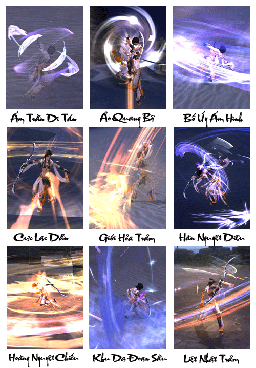
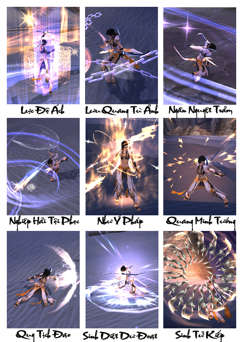
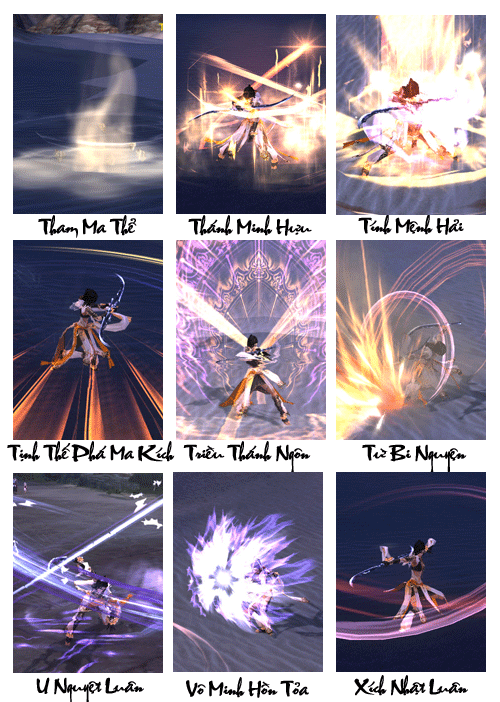

Minh giáo vốn do Mục Tát Cáp Giả Ni 1 trong 3 Trưởng Lão giáo phái Zoroastrianism Ba Tư, tên tiếng Hán là Lục Nguy Lâu 1 tay sáng lập tra, nguyên nhân Mục Tát sáng lập ra giáo phái phải bắt đầu nói từ việc truyền đạo Zoroastrianism.

Giáo phái Zoroastrianism có lịch sử lâu đời, Zoroaster (trước Công Nguyên 628 - sau Công Nguyên 551) là người cải cách tôn giáo của Ba Tư cũ, là người sáng lập ra giáo phái Zoroastrianism. "Zoroastrianism" là ngôn ngữ Hy Lạp cổ đại, tác phẩm tiếng Ba Tư cổ đại "Tra La Đồ Thi Đặc La" (Zarathushtra). Giáo Zoroastrianism sau khi truyền Ba Tư, thế lực phát triển rất nhanh, giáo chủ đảm nhận mọi việc trong giáo, tam đại trưởng đạo phụ trách truyền giáo, Thánh Nữ trong giáo vẫn là biểu tượng tinh thần của giáo phái.

Tạm đại Trưởng Lão lần lượt là "Ám Tinh Trưởng Lão" Y Mã Mục (đứng đầu 1 trong 3 vị Trưởng Lão), "Hàn Nhật Trưởng Lão" Hoắc Tang A Tát Tân, "Nguyệt Ảnh Trưởng Lão" Mục Tát Cáp Giả Ni (tên tiếng Hán là Lục Nguy Lâu).

Hoắc Tang A Tát Tân tinh thông hội họa, kỹ năng chiến đấu, tôn giáo, y học, thiên văn, số học… tài năng song toàn, là người đứng đầu của Hàn Nhật Trưởng Lão.

Mục Tát Cáp Giả Ni (Lục Nguy Lâu) tinh thông ngôn ngữ của các nước như Trung Hoa, Ba Tư, Nhật Bổn, từ nhỏ học sách nhiều, nhưng do gia thế gặp biến cố, lại có tài mua bán phi thường, trong người y có mang huyết thống của người Trung Hoa, chính vì tài hoa hơn người được chọn làm Ảnh Nguyệt Trưởng Lão trong giáo.

Hai người họ ở Ba Tư là những nhân vật tiếng tăm lừng lẫy, đảm nhận chức vụ Trưởng Lão nhiều năm đến Ba Tư truyền đạo, khiến cho giáo phái không ngừng hưng thịnh. Nếu so với 2 vị Trưởng Lão trên Y Mã Mục tuy cùng là tam đại Trưởng Lão trong giáo phái, nhưng bản thân y phụ trách nhiệm vụ truyền giáo ở nước lân cận, quanh năm thường ở ngoài nước Ba Tư, chính vì thế chức vị "Ám Tinh" Trưởng Lão cũng không thể hiện rõ ràng trong và ngoài giáo.

Tóm lại, võ học Minh Giáo do giáo chủ Lục Nguy Lâu sáng lập ra, **khi xuất chiêu như có uy lực nhật nguyệt** vậy, thường xuất chiêu**công kích như vũ bão vào những nơi mà đối phương không lường trước** được, mà **không thể né tránh được**. Tín ngưỡng kiên định khiến tín đồ tin rằng họ được Minh Tôn bảo vệ, thân hóa lưu li diệu tướng, khiến cho địch khó mà bắt và đánh trúng được. Cho dù có bị công kích, cũng có thể hấp thu được sức lực mới từ trên người đối phương.

[Video](http://www.youtube.com/embed/egcS35t5mP8)

***Sức mạnh của Minh Giáo - uy lực của Nhật Linh Nguyệt Hồn***

## Năng lực môn phái

| Nội dung | Chi tiết |
| --- | --- |
| Đặc điểm môn phái | 2 hướng phòng ngự và sát thương, cận chiến. |
| Từ khóa | Loạn đao, nhanh nhạy, linh động, nhật nguyệt hồn lượng. |
| Độ khó làm quen | Tương đối, tiết tấu chiến đấu phải nhanh. |
| Ưu điểm | Xuất chiêu nhanh, di chuyển nhanh, né tránh cao, sức sinh tồn mạnh. |
| Nhược điểm | Sinh lực tương đối thấp, khi chiến đấu cần tích lũy Nhật Linh hoặc Nguyệt Hồn. |
| Vị trí trong tổ đội | Công thủ đều có. |
| Đánh giá môn phái | Thân pháp nhanh nhạy, công kích nhanh, mang phong cách chiến đấu Tây Vực, đặc điểm Nhật Nguyệt nổi bật, bí hiểm và không thể lường trước được. |

## Phân nhánh môn phái

- **Phẫn Ảnh Thánh Quyết:**Công thì không mạnh, nhưng lại có tác dụng giải nguy, tìm kiếm cơ hội, 1 chiêu đánh bại địch. Trong công pháp Minh giáo, trong các cuộc so tài tay đôi có sở trường chuyển bại thành thắng.

- **Minh Tôn Lưu Li Thể:** Ỷ Thác Thanh Tịnh Giải Thoát Môn, Phổ Nguyện Li Chư Sinh Tử Khổ, Hiển Hóa Diệu Pháp Vô Tận Tàng, Minh Tôn Nhục Thân Lưu Li Tướng. Động tịnh tùy tâm, thân hóa lưu li.

## Tổng hợp các chiêu thức phái Minh Giáo

## Tâm pháp

### Phần Ảnh Thánh Quyết

| Nội dung | Mô tả |
| --- | --- |
| **Vai trò** | Sát thương chủ lực, hạ đối phương nhanh chóng |
| **Khả năng luyện cấp** | Rất tốt, chiêu thức cận chiến nội công có sát thương rất cao trên diện rộng, khả năng phòng thủ tốt thích hợp cho việc luyện cấp. |
| **Khả năng PK** | Công thì không mạnh, nhưng lại có tác dụng giải nguy, tìm kiếm cơ hội, 1 chiêu đánh bại địch. Trong công pháp Minh giáo, trong các cuộc so tài tay đôi có sở trường chuyển bại thành thắng. |
| **Khả năng đội nhóm** | Đảm nhiệm vai trò một sát thủ |
| **Nội/Ngoại** | Nội công Âm Dương, cận chiến |
| **Chỉ số quan trọng nhất** | Nguyên Khí, Thân Pháp |
| **Kỹ năng** | Kỹ năng tấn công của Minh Giáo không sử dụng nội lực mà chủ yếu dùng 2 cột Mãn Nhật và Mãn Nguyệt. Cột Mãn Nhật tượng trưng cho nội công dương tính và cột Mãn Nguyệt tượng trưng cho nội công âm tính. Đặc biệt kỹ năng Minh Giáo có thể tấn công liên hoàn 3 đoạn, mỗi đoạn sát thương và Nhật Nguyệt sẽ tăng thêm. Khi Mãn Nhật hoặc Mãn Nguyệt đầy có thể ra chiêu thức có sát thương lớn, hoặc khống chế mục tiêu. Thêm vào đó các kỹ năng hỗ trợ tấn công có thể giúp Minh Giáo áp sát và hạ gục rất nhanh. Minh Giáo còn có các kỹ năng ẩn thân mà không phái nào có được như tàng hình, độn thổ, dịch chuyển tức thời, đồng thời cũng có các kỷ năng chuyên về phòng thủ bảo vệ đồng đội. Minh Giáo phù hợp với nhân sĩ yêu thích PK cận chiến, áp sát. |

### Minh Tôn Lưu Ly Thế

| Nội dung | Mô tả |
| --- | --- |
| **Vai trò** | Nhận sát thương, bảo vệ đồng đội |
| **Khả năng luyện cấp** | Rất khó vì tập trung vào phòng thủ, không có sát thương |
| **Khả năng PK** | Sát thương thấp, chủ yếu thu hút sát thương, tăng phòng thủ chịu đòn, hồi máu toàn diện phe mình. |
| **Khả năng đội nhóm** | Nhận sát thương, bảo vệ đồng đội gom quái thu hút sát thương và hồi phục máu, tăng phòng thủ cho đồng minh cao. |
| **Nội/Ngoại** | Chuyên phòng thủ |
| **Chỉ số quan trọng nhất** | Thể Chất, Thân Pháp |
| **Kỹ năng** | Kỹ năng tấn công của Minh Giáo không sử dụng nội lực mà chủ yếu dùng 2 cột Mãn Nhật và Mãn Nguyệt. Cột Mãn Nhật tượng trưng cho nội công dương tính và cột Mãn Nguyệt tượng trưng cho nội công âm tính. Đặc biệt kỹ năng Minh Giáo có thể tấn công liên hoàn 3 đoạn, mỗi đoạn sát thương và Nhật Nguyệt sẽ tăng thêm. Khi Mãn Nhật hoặc Mãn Nguyệt đầy có thể ra chiêu thức có sát thương lớn, hoặc khống chế mục tiêu. Thêm vào đó các kỹ năng hỗ trợ tấn công có thể giúp Minh Giáo áp sát và hạ gục rất nhanh. Minh Giáo còn có các kỹ năng ẩn thân mà không phái nào có được như tàng hình, độn thổ, dịch chuyển tức thời, đồng thời cũng có các kỷ năng chuyên về phòng thủ bảo vệ đồng đội. Minh Giáo phù hợp với nhân vật yêu thích PK cận chiến, áp sát. |

Nguồn: VNG (bài viết và hình ảnh)
