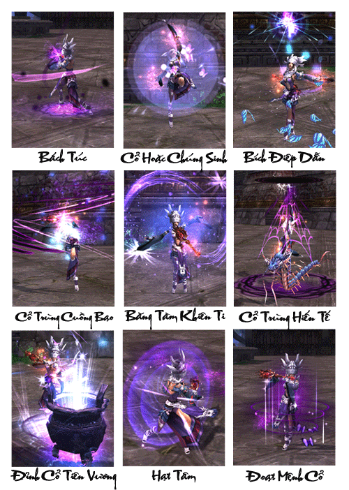
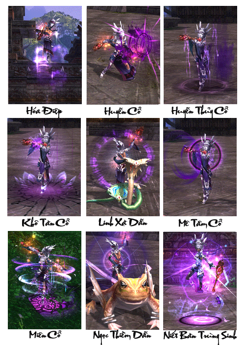
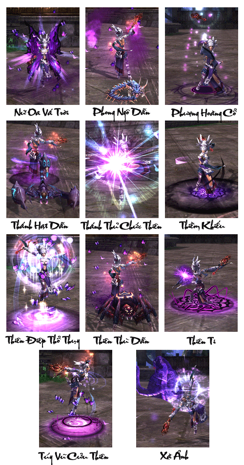

Ngũ Độc Giáo (nội bộ tự xưng là Ngũ Thánh Giáo) là giáo phái có lịch sử lâu đời vô cùng thần bí. Ngay cả giáo chúng trong giáo cũng không biết rõ Ngũ Thánh Giáo được sáng lập ra thế nào, đối với Võ Lâm Trung Nguyên mà nói, Ngũ Độc mãi là 1 môn phái rất thần bí, chúng tự cung tự cấp, không màn đến Trung Nguyên, nhưng một khi đụng đến chúng, không còn cách khác ngoài con đường chết, nếu không Ngũ Độc sẽ truy sát ngươi cho đến tận chân trời gốc biển, phải nói thêm rằng khó mà hóa giải được thuật phóng thích độc của Ngũ Độc, giết người vô hình bí hiểm, Ngũ Độc trở thành môn phái mà nhân sĩ vô lâm ít ai dám đụng đến.

[Đường Môn](./duong-mon.md) ở gần Ngũ Độc nhất vì muốn kìm hãm sự phát triển của Ngũ Độc (kỳ thực đây chẳng qua chỉ là cái cớ, cái mà họ quan tâm chính là võ thuật chế độc luyện cổ của Ngũ Độc), môn chủ Đường Môn 2 năm trước đã âm thầm bày kế tạo ra rạn nứt trong Ngũ Độc.

7 năm trước giáo chủ Ngũ Độc Ma Sát La đột nhiên mất tích, 5 năm sau dẫn 1 bé gái tên Khúc Vân được sinh ra với người Hán, mong muốn phong y làm tân giáo chủ. Mang huyết thống người Hán cũng tốt, hay là chịu sai khiến của Đường Thục Yến cũng tốt, cho dù là Khúc Vân bướng bỉnh khó phục tùng cũng tốt, Ô Mông Quý Hữu Trưởng Lão tạo phản, thừa cơ giết chết cựu giáo chủ Ma Sát La (đến nay vẫn chưa tìm ra thi thể, đệ tử Ngũ Độc đều tin rằng giáo chủ vẫn chưa chết), nhưng sau đó bị Ngải Lê Hữu Trưởng Lão trấn áp thành công, không thể không trốn khỏi Ngũ Độc, tự sáng lập ra Thiên Nhất Giáo, không chỉ như vậy, Ô Mông Quý muốn báo thù xưa rửa hận, ngang nhiên cấu kết với Nam Chiếu, đánh cắp bí kíp Cổ thuật luyện chế Thi Nhân, muốn đoạt lại Ngũ Độc do bí kíp chí bảo của Ngũ Độc thất truyền nhiều năm, đồng thời quá trình luyện chế vô cùng phức tạp, dẫn đến luyện chế Thi Nhân của đợt đầu tiên thất bại, sau nhiều lần luyện chế thành công, Ô Mông Quý quyết định luyện chế Thi Nhân sức mạnh to lớn hơn, vì thế quyết đến Trung Nguyên tìm võ lâm cao thủ làm hình thể cho Thi Nhân, điều này khiến cho người Miêu mang tiếng xấu tại Võ Lâm Trung Nguyên, nhưng người Hán làm sao phân biệt được ai là người của Thiên Nhất ai là đệ tử của Ngũ Độc đây? Trái lại đệ tử Ngũ Độc cũng căm ghét mưu mô xảo huyệt của người Hán cộng thêm bất đồng về ngôn ngữ, mâu thuẫn càng không thể hóa giải được, cứ thế mối thâm thù ngày càng lớn dần.

Tóm lại, võ học Ngũ Độc là võ thuật khống chế các loại côn trùng, là sự dung hợp giữa Miêu Cương Cổ Thuật và Ngũ Độc Độc Thuật. Vận dung thần bí Cổ và Độc,**dùng vô số loại độc công kích đối phương, kết hợp Cổ thuật trị thương hồi sinh, chỉ cần nắm vững trong lòng bàn tay, thì có thể vận dụng thành thạo 5 loại Độc Trùng gồm Thánh Hạt, Ngọc Thiềm, Linh Xà, Phong Ngô, Thiên Thù**, đều là các tuyệt kỹ bất truyền của Miêu Cương.

[Video](http://www.youtube.com/embed/ATqRAyvsta8)

***Ngũ Độc Giáo - Tuyệt độc kỳ nhân***

## Năng lực môn phái

| Nội dung | Chi tiết |
| --- | --- |
| Đặc điểm môn phái | Thuần nội công, nội công tâm pháp gồm 2 loại Độc tính sát thương và Cổ thuật trị thương, có thể khống chế số loại Độc Trùng Bảo Bảo (thú cưng) kháng địch**.** |
| Độ khó làm quen | Cấp trung, phải nắm bắt được thời cơ phóng thích độc và cổ, phải khống chế được Độc Trùng Bảo Bảo. |
| Ưu điểm | Độc Trùng Bảo Bảo hộ thân, tương tác giữa độc và cổ biến động linh hoạt, năng lực trị thương nhóm và hồi sinh chiến đấu rất mạnh. |
| Nhược điểm | Độc tính sát thương phát tán hơi chậm, cần thời gian và tính nhẫn nại. |
| Vị trí trong tổ đội | Độc tính sát thương và bổ trợ sát thương, trị thương nhóm. |
| Đánh giá môn phái | Độc Trùng Bảo Bảo độc bước giang hồ, hỗ trợ và sát thương bằng độc tính, vô cùng đặc sắc, trị thương nhóm, sức chiến đấu không thể thiếu trong lúc tổ đội. |

## Phân nhánh môn phái

- **Độc Kinh:** Tuyệt học của Miêu Cương, tinh túy thuật dùng độc được lưu truyền lại từ đời Ngũ Tiên Giáo, Độc Cổ kết hợp, có thể sử dụng hiệu quả 10 loại kịch độc khác nhau, hoặc cực độc, hoặc khống chế cực mạnh, phối hợp thao tác không chế Độc Trùng Bảo Bảo tiến hành công kích, có thể khiến nhân sĩ giang hồ nghe mà phát sợ.

- **Bổ Thiến Quyết：**Tiên Giáo Bí Quyết, dùng tâm quyết của Cổ thuật cường thể bổ thân, đạt đến cảnh giới Cổ, khí huyết sung mãn, võ học thiên về trị liệu.

## Tổng hợp các chiêu thức phái Ngũ Độc

## Tâm pháp

### Độc Kinh

| Nội dung | Mô tả |
| --- | --- |
| **Vai trò** | Hỗ trợ đồng đội, phối hợp tấn công |
| **Khả năng luyện cấp** | Tốt, nhưng thao tác hơi khó, dòi hỏi người chơi phải thực sự hiểu rõ chiêu thức mới có thể luyện cấp tốt |
| **Khả năng PK** | Gây hiệu ứng lên mục tiêu, khả năng khống chế mạnh, sát thương thấp nhưng có khả năng kéo dài hiệu quả, dể gây đột tử, bản thân có khả năng sinh tồn cao. |
| **Khả năng đội nhóm** | Đảm nhiệm vai trò hỗ trợ sát thương dùng thú nuôi để thu hút sát thương địch. |
| **Nội/Ngoại** | Nội công độc tầm xa |
| **Chỉ số quan trọng nhất** | Thể Chất, Căn Cốt, Nguyên Khí |
| **Kỹ năng** | Kỹ năng **Ngũ Độc** chủ yếu **là sự kết hợp** giữa độc cỗ và độc từ 5 chiêu thức độc từ 5 loài độc vật, từ việc kết hợp này sẽ cho ra các hiệu ứng khác nhau như tăng sát thương, hiệu ứng bất lợi, deBuff cho mục tiêu. Điều này đòi hỏi khá nhiều kỹ năng của nhân sĩ từ việc hiểu rõ kỹ năng và tùy trường hợp mà phối chiêu thức hợp lý bởi vì từ 3 loại độc cỗ và 5 loại trùng độc có thể phối ra hơn 15 loại kỹ năng khác nhau. Sức mạnh của **Ngũ Độc** còn đến từ việc triệu hồi các linh thú biểu trưng cho **Ngũ Độc**, mỗi linh thú đều có kỹ năng riêng và tùy trường hợp sữ dụng sẽ cho hiệu quả rất lớn kể cả trong PVP và PVE. |

### Bổ Thiên Quyết

| Nội dung | Mô tả |
| --- | --- |
| **Vai trò** | Chữa trị, hồi phục, cứu sống đồng đội, hỗ trợ đồng đội, phối hợp tấn công |
| **Khả năng luyện cấp** | Không nên dùng luyện cấp vì chiêu thức chủ yếu là trị liệu, các chiêu thức có khả năng gây sát thương rất ít. |
| **Khả năng PK** | Chủ yếu hỗ trợ, khả năng pk thấp. |
| **Khả năng đội nhóm** | Hỗ trợ bơm máu, hồi phục cho đồng đội. |
| **Nội/Ngoại** | Chuyên trị liệu |
| **Chỉ số quan trọng nhất** | Thể Chất, Căn Cốt, Nguyên Khí |
| **Kỹ năng** | **Bổ Thiên Quyết** là 1 nhánh nội công **Ngũ Độc** chuyên hỗ trợ và hồi phục cho đồng đội, các kỹ năng không có tính sát thương nhưng lượng khí huyết hồi phục cho đồng đội là cực lớn. **Bổ Thiên quyết** có thể hồi phục trên diện rộng cho đồng đội nên rất thích hợp khi tham gia các bí cảnh khó, ngoài ra **Bổ Thiên Quyết** còn có 1 số tác dụng **gây các DeBuff** bất lợi cho thủ lĩnh bí cảnh. |

Nguồn: VNG (bài viết và hình ảnh)
