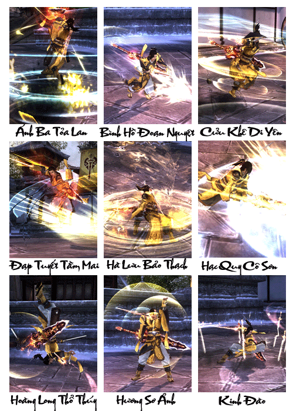
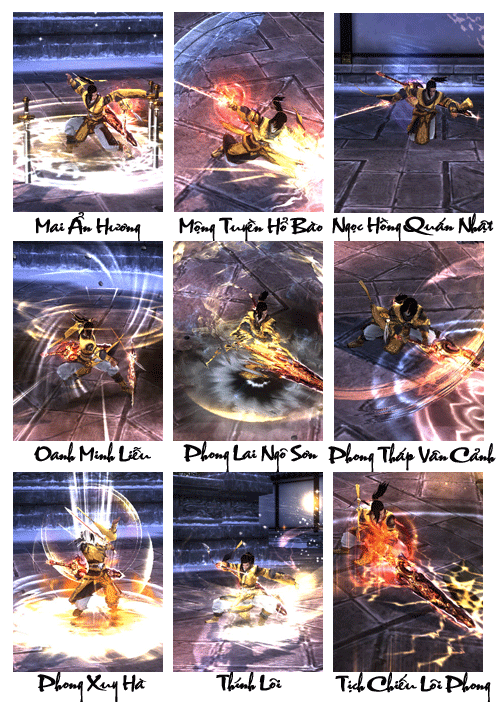
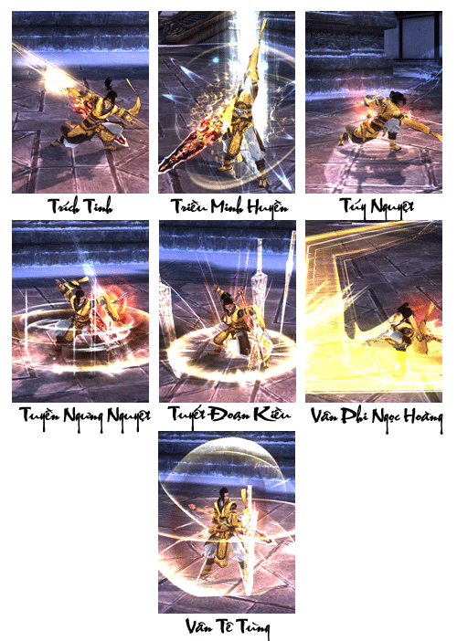

Lịch sử của Tàng Kiếm Sơn Trang tuy không lâu đời, trang chủ hiện nhậm Diệp Anh cũng chỉ là đời thứ 2, nhưng danh tiếng của Tàng Kiếm Sơn Trang trên giang hồ không ai không biết, không ai không ngưỡng mộ, đa phần danh tiếng cũng đến từ Danh Kiếm Đại Hội do Tàng Kiếm Sơn Trang tổ chức. Đại hội được tổ chức cách 10 năm 1 lần, phần thưởng dành tặng cho vị hào kiệt mạnh nhất là 1 thanh bảo kiếm tuyệt thế do Tàng Kiếm Sơn Trang tinh luyện. Trên giang hồ, người sở hữu bảo kiếm do Tàng Kiếm Sơn Trang trui rèn sẽ có địa vị và vinh dự cao quý.

Năm Công Nguyên 701, Giang Nam danh hiệp Diệp Mãnh Thu rời quê nhà đến Trường An ứng thi lần thứ 3, nhưng ý trời trêu người, Diệp Mãnh Thu do phạm lỗi đề thi mà tay trắng trở về. Từ đó về sau trên văn trường hậu triều mất đi một văn nhân tài cao, mà trên giang hồ lại có thêm một môn phái uy danh lừng lẫy. Sau khi ứng thí thất bại trở về, Diệp Mãnh Thu quyết định từ bỏ ý niệm thi công danh bấy lâu, mà chuyển chuyên tâm vào kiếm thuật và kiếm. Đại Đường Thần Long Nguyên Niên (năm Công Nguyên 705), ông đến vùng ven Tây Tử Hồ tại Hàn Châu dựng nên Tàng Kiếm Sơn Trang uy danh thiên hạ ngày nay.

Năm Cảnh Long thứ 3 (Công Nguyên năm 709), Diệp Mãnh Thu phát Tàng Kiếm Ngạo Kiếm Thiệp, lấy danh nghĩa phẩm danh kiếm, tổ chức Danh Kếm Đại Hội. Trùng hợp với ngày đó cũng là ngày Bá Đao Sơn Trang tổ chức theo tục lệ hằng năm Dương Đao Đại Hội. Bá Đao Sơn Trang lại là danh môn trên giang hồ trăm năm, hành động của Tàng Kiếm trong mắt giới nhân sĩ giang hồ khi đó như thế lấy trứng chọi đá, nhưng thế sự khó đoán. Do Bá Đao Sơn Trang không có phần thưởng là tuyệt thế bảo đao, ngược lại Diệp Gia lại là gia tộc chuyên rèn kiếm danh tiếng Giang Nam, phần thưởng "Ngự Thần Kiếm" lại chính là danh kiếm do chính tay đại hiệp Giang Nam Diệp Mãnh Thu rèn tạo, qua quá trình phức tạp, tôi luyện trong 3 năm mà thành, được xưng là một trong thập đại binh khí trên giang hồ. Tại Danh Kiếm Đại Hội Công Tôn Đại Nương lực áp quần hùng, giành được danh kiếm, từ đó danh tiếng của Tàng Kiếm theo gió bay xa.

Là một trong Tứ Đại Gia Tộc đương thời**,**Tàng Kiếm Sơn Trang hùng cứ vùng Hàn Châu**, nổi tiếng với tài rèn kiếm tuyệt thế vô song**. Môn đệ của Tàng Kiếm có thân phận hiển hách trên giang hồ.

[Video](http://www.youtube.com/embed/tmPxK_zi8gs)

***Tàng Kiếm Sơn Trang - Nhất kiếm ngạo thiên hạ***

## Năng lực môn phái

| Nội dung | Chi tiết |
| --- | --- |
| Đặc điểm môn phái | Khinh kiếm và trọng kiếm, nội công thay đổi nhanh chóng, cận chiến thuần ngoại công. |
| Từ khóa | Kiếm khí, nội công chuyển hóa nhanh. |
| Độ khó làm quen | Cao, cần kết hợp thao tác tốt. |
| Ưu điểm | Kiếm khí tục kháng liên tục, trang bị 2 vũ khí, động thái kết hợp, kiếm nặng và nhẹ hỗ trợ lẫn nhau. |
| Nhược điểm | Cần tích tụ một lượng kiếm khí mới có thể gây bộc phát. |
| Vị trí trong tổ đội | Thuộc nhóm gây sát thương chính, khi khẩn cấp có thể tạm thời đảm nhận trách nhiệm người phòng ngự (tanker). |
| Đánh giá môn phái | Thân pháp di chuyển linh hoạt và sát thương vùng xung quanh cao, trang bị 2 vũ khí, có thể chuyển đổi hệ nội công linh hoạt, uy lực đánh mạnh. |

## Phân nhánh môn phái

- **Vấn Thủy Quyết**: Hệ nội công phối hợp với khinh kiếm (nhẹ), nhân vật Tàng Kiếm có khả năng di chuyển linh hoạt xuất sắc, có thể xử lý các hoàn cảnh phức tạp, thi triển các chiêu thức khinh kiếm không tổn hao nội lực và khí huyết, mà còn có thể tích tụ kiếm khí, công thủ tùy biến.

- **Sơn Cư Kiếm Ý**: Hệ nội công phối hợp trọng kiếm (nặng), có khả năng sát thương lớn, thi triển các chiêu thức trọng kiếm không tổn hao nội lực hay khí huyết nhưng cần kiếm khí để thi triển, bộc phát tấn công mục tiêu. Sau khi trang bị trọng kiếm, nhân vật Tàng Kiếm cần cố gắng tiếp cận mục tiêu để đạt được hiệu quả sát thương cao nhất.

## Tổng hợp các chiêu thức phái Tàng Kiếm

## Tâm pháp

### Vấn Thủy Quyết

| Nội dung | Mô tả |
| --- | --- |
| **Vai trò** | Sát thương chủ lực, nhận sát thương, bảo vệ đồng đội |
| **Khả năng luyện cấp** | Tốt, chiêu thức có sát thương khá, không tốn nội lực, gia tăng kiếm khí cho Sơn Cư Kiếm Ý. |
| **Khả năng PK** | Kiếm khí tục kháng liên tục, trang bị 2 vũ khí, động thái kết hợp, kiếm nặng và nhẹ hỗ trợ lẫn nhau. Cần tích tụ một lượng kiếm khí mới có thể gây bộc phát. Kết hợp giửa 2 nội công phát phát huy được sức mạnh. |
| **Khả năng đội nhóm** | Thuộc nhóm gây sát thương chính, khi khẩn cấp có thể tạm thời đảm nhận trách nhiệm người phòng ngự (nhận sát thương, bảo vệ đồng đội). |
| **Nội/Ngoại** | Ngoại công cận chiến |
| **Chỉ số quan trọng nhất** | Thể Chất, Lực Đạo, Thân Pháp |
| **Kỹ năng** | Chiêu thức của **Vấn Thủy Quyết** rất linh hoạt, có thể dịch chuyển ra trước và sau mục tiêu nhanh chóng, sát thương gây ra không quá cao nhưng có tính liên tục. **Khả năng áp sát mục tiêu** rất tốt, khinh công trấn phái lướt đi 3 lần và có khả năng trói chân mục tiêu. **Vấn Thủy Quyết** là hệ nội công tạo ra kiếm khí là nguồn đề sử dụng kỹ năng **Sơn Cư Kiếm Ý.** |

### Sơn Cư Kiếm Ý

| Nội dung | Mô tả |
| --- | --- |
| **Vai trò** | Sát thương chủ lực, nhận sát thương, bảo vệ đồng đội |
| **Khả năng luyện cấp** | Không tốt lắm, thích hợp đánh boss. Sát thương rất cao, có thể tiệu diệt 1 lượng lớn quái nhanh chóng, nhưng phụ thuộc hoàn toàn vào kiếm khí |
| **Khả năng PK** | Kiếm khí tục kháng liên tục, trang bị 2 vũ khí, động thái kết hợp, kiếm nặng và nhẹ hỗ trợ lẫn nhau. Cần tích tụ một lượng kiếm khí mới có thể gây bộc phát. Kết hợp giửa 2 nội công phát phát huy được sức mạnh. |
| **Khả năng đội nhóm** | Thuộc nhóm gây sát thương chính, khi khẩn cấp có thể tạm thời đảm nhận trách nhiệm người phòng ngự (nhận sát thương, bảo vệ đồng đội). |
| **Nội/Ngoại** | Ngoại công cận chiến |
| **Chỉ số quan trọng nhất** | Thể Chất, Lực Đạo, Thân Pháp |
| **Kỹ năng** | **Sơn Cư Kiếm Ý** sử dụng trọng kiếm tấn công, tốc độ không cao nhưng **sát thương gây ra cực lớn**, kỹ năng của **Sơn Cư Kiếm Ý** cần kiếm khí để phát động. Chiêu thức của **Sơn Cư Kiếm Ý** gây ra sát thương ngoại công trên diện rộng và liên tục, rất tốt khi có 1 lượng lớn quái cần diệt nhanh chóng. |

Nguồn: VNG (bài viết và hình ảnh)
