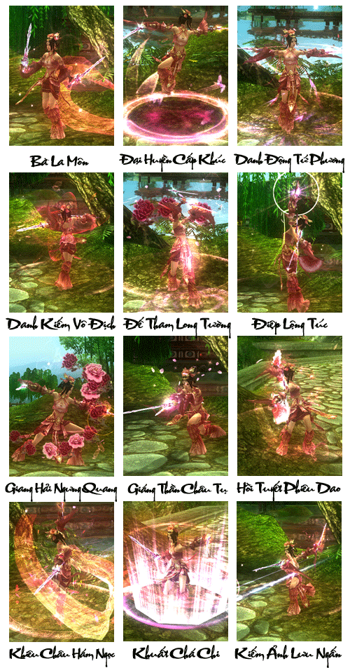
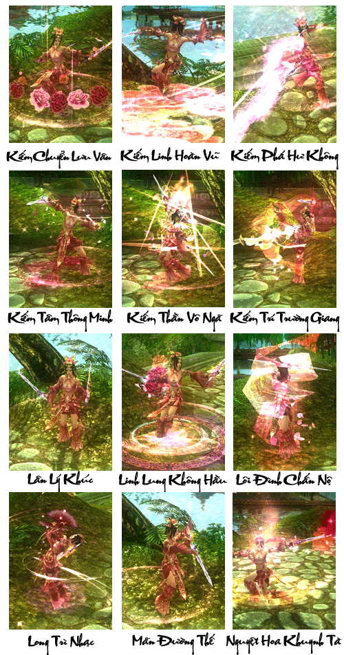
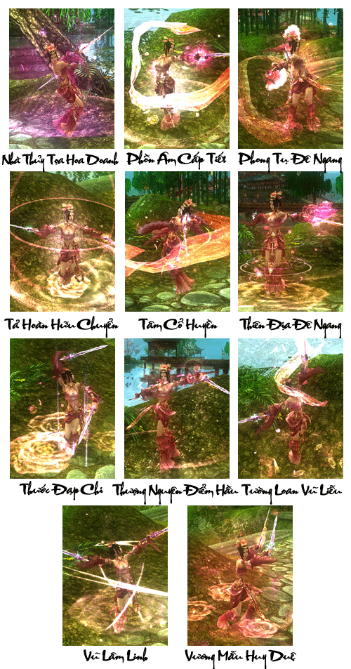

Giang hồ xưa kể rằng, những năm Hồi Thần Long trước khi Thất Tú Phòng được xây dựng, trên giang hồ xuất hiện một vị nữ hiệp kỳ tài văn võ song toàn, biết kết hợp vũ đạo vào võ công chiêu thức làm say đắm biết bao nhân sĩ hào kiệt, mọi người đều xưng là Công Tôn Đại Nương, cô ta còn có một vị song sinh tiểu muội khuôn mặt giống nhau như đúc. Vũ đạo kiếm vũ của dòng họ nhà Công Tôn vang danh thiên hạ, ngay cả hoàng đế đương triều Hoàng Trung Tông cũng vô cùng ngưỡng mộ và kính trọng. Vì mong muốn tuyệt nghệ Kiếm Vũ không bị thất truyền về sau, họ xây nên Thất Tú Phường bên cạnh Tây Hồ, mang kỹ năng kiếm vũ phát dương quang đại….

Nhiều năm sau Công Tôn Đại Nương và Nhị Nương không làm Đường Trung Tông thất vọng, trong những năm qua họ thu nhận hơn 20 bé gái mồ côi và truyền thụ võ nghệ lẫn Kiếm Vũ. Ngày sau những vị nữ hiệp này đều vang danh thiên hạ, ai nấy đều là giai nhân xinh đẹp võ công cao cường, khi đó danh tiếng của Thất Tú Phường có thể sánh ngang với Trường Ca Môn.

Thất Tú Phường gồm **các nữ hiệp có nhan sắc tuyệt trần và võ nghệ cao cường**. Với việc **kết hợp vũ đạo vào các chiêu thức võ công** (Kiếm Vũ), Thất Tú Phường làm say đắm biết bao nhân sĩ giang hồ.

[Video](http://www.youtube.com/embed/_bi50yQ9ZNQ)

***Thất Tú phường - Kiếm vũ song tuyệt***

## Năng lực môn phái

| Nội dung | Chi tiết |
| --- | --- |
| Đặc điểm môn phái | Gồm 2 đường trị liệu và sát thương. Sát thương cao, né tránh cao sở hữu nhiều chiêu thức hồi máu. |
| Từ khóa | Trị liệu, sinh tồn, hồi sinh, trị liệu nhóm. |
| Độ khó làm quen | Trung bình, chủ yếu thích hợp cho nữ game thủ. |
| Ưu điểm | Sát thương cao, đòn chí mạng mạnh, khả năng trị liệu cực tốt. |
| Nhược điểm | Máu ít, sức phòng thủ thấp. |
| Vị trí trong tổ đội | Vừa có thể công, vừa có thể hỗ trợ hồi máu. |
| Đánh giá môn phái | Môn phái thuần nữ mạnh về công kích lẫn trị liệu hỗ trợ. |

## Phân nhánh môn phái

- **Băng Tâm Thất Tú**: Tuy phòng thủ yếu, nhưng sở hữu hiệu quả né đòn cực kỳ lợi hại, thường xuyên khiến đối thủ gặp khó khăn. Chiêu thức nhanh nhẹn phối hợp với sự linh hoạt của thân pháp, trong thời khắc quyết định cùng sự bộc phát trong nháy mắt có thể xoay chuyển cục diện trận đánh.

- **Vân Thường Thất Tú**: Năng lực trị liệu vô cùng lợi hại, hỗ trợ hiệu quả trong khắc chế địch thủ và trợ giúp đồng đội, chiêu thức nhanh nhẹn, có thể giải cứu đồng đội trong chớp mắt. Đây chắc chắn là nhân vật luôn được hoan nghênh nhất trong tổ đội.

## Tổng hợp các chiêu thức phái Thất Tú

## Tâm pháp

### Băng Tâm Quyết

| Nội dung | Mô tả |
| --- | --- |
| **Vai trò** | Sát thương chủ lực |
| **Khả năng luyện cấp** | Rất tốt, sát thương nội công tầm xa rất cao, có kỹ năng trên diện rộng gây sát thương liên tục. |
| **Khả năng PK** | Hệ phái đánh xa nội âm với các chiêu thức có độ thi triển nhanh và lực tấn công âm lớn, nên khi chiến đấu lượng máu mà đối thủ phải nhận sẽ mất liên tục. Đối thủ nếu là những phái phải thi triển chiêu thức sẽ không thể thi triển nhanh được nội công tấn công Thất Tú với Băng Tâm Quyết. Cùng với kết hợp chiêu thức tạo thành sát thương lớn trong chiến đấu. Phòng thủ yếu. |
| **Khả năng đội nhóm** | Là thành viên đứng giữa đội hình đóng vai trò kéo máu của đội |
| **Nội/Ngoại** | Nội công âm tầm xa |
| **Chỉ số quan trọng nhất** | Nguyên Khí, Căn Cốt, Nguyên Khí |
| **Kỹ năng** | Nội công **Băng Tâm Quyết** của **Thất tú** với lợi thế thi triển nhanh các chiêu đánh vào mục tiêu tạo sát thương lớn liên tục. Thích hợp cho các môi trường chiến đấu và luyện cấp. **Có khả năng**kết hợp chiêu thức thành chiêu mang lượng sát thương lớn. **Khuyết điểm**: Có rất ít chiêu giải trừ trạng thái bất lợi cho bản thân và sức phòng thủ cơ bản yếu. |

### Vân Thường Tâm Kinh

| Nội dung | Mô tả |
| --- | --- |
| **Vai trò** | Chữa trị, hồi phục, cứu sống đồng đội, hỗ trợ đồng đội, phối hợp tấn công. |
| **Khả năng luyện cấp** | Không tốt, đây là đường thuần hỗ trợ và trị thương, không nên dùng luyện cấp. |
| **Khả năng PK** | Hệ phái hỗ trợ với các chiêu thức trị liệu cho đồng đội. Các chiêu thức trị liệu có lượng máu cung cấp trung bình nhưng ưu điểm là nhiều chiêu và có thể thi triển nhanh, nên Vân Thường Tâm Kinh của Thất Tú là một đường trị liệu ổn định nhất trong các phái. Không có khả năng pk đơn. |
| **Khả năng đội nhóm** | Vị trí hỗ trợ cho nhóm. Trị liệu cho toàn bộ thành viên, giữ vững lượng máu an toàn. |
| **Nội/Ngoại** | Chuyên trị liệu |
| **Chỉ số quan trọng nhất** | Nguyên Khí, Căn Cốt, Nguyên Khí |
| **Kỹ năng** | Nội công **Vân Thường Tâm Kinh** của **Thất Tú** lấy trị liệu làm chủ đạo thích hợp cho đi các tổ đội nhóm . **Sở trường là trị liệu** nhanh các mục tiêu và hồi sinh trong trấn đấu, là một phái luôn cần có trong các lần đi phó bản hoặc [chiến trường](../he-thong/chien-truong.md). **Khuyết điểm**: Phòng ngự yếu, khả năng luyện cấp và làm nhiệm vụ một mình khó. |

Nguồn: VNG (bài viết và hình ảnh)
