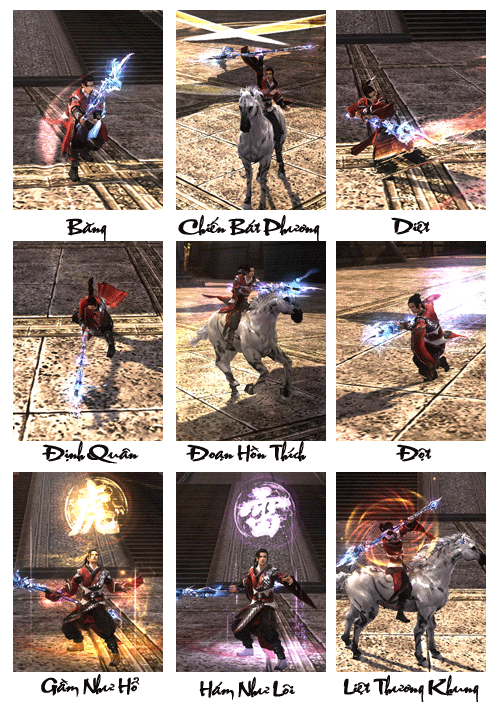
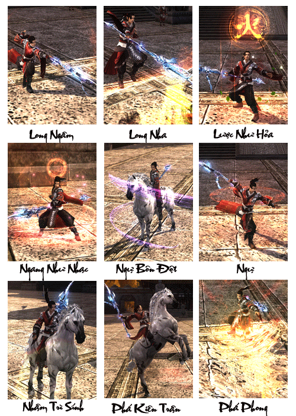
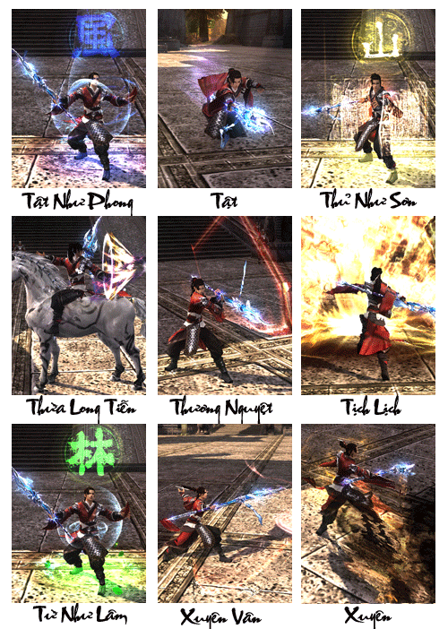

Thiên Sách Phủ tọa lạc tại Lạc Dương là tổ chức do Tần Vương Lý Thế Dân dựng nên, sau khi xưng đế trở thành một cơ quan bí mật do Lý Thế Dân cai quản trực tiếp, họ phụ trách giang hồ nghị sự, dần dần Thiên Sách Phủ trở thành một thế lực bí mật của vương triều Đại Đường. Thời đó thế lực của [Minh Giáo](./minh-giao.md) bành trướng đã sớm lọt vào tầm tiêu diệt của quan phủ, sau khi Huyền Tông thượng đài lập tức ban bố Phá Lập Lệnh, tuyên bố Minh Giáo là tổ chức phi pháp. Do đó, cuộc xung đột giữa Minh Giáo và Thiên Sách không thể tránh khỏi.

Sự kiện "Quang Minh Đỉnh" bùng nổ, Thiên Sách Phủ nhanh như chớp đột kích vào điểm tụ tập của Minh Giáo, trực tiếp tấn công vào Tứ Đại Pháp Vương cùng các tầng lãnh đạo khác. Minh Giáo tổn thất nghiêm trọng, giáo chủ bị tiêu diệt. Minh Giáo không thể không dời khỏi trung nguyên chuyển về tây vực. Từ đó uy danh "Đông Đô Chi Lang" (con sói vùng Đông Đô) vang khắp bốn phương.

Lực lượng Thiên Sách Phủ tuy không đông đảo, nhưng họ đều là những binh lính tinh nhuệ. Những hào kiệt này đều mang nặng tinh thần tận trung báo quốc, họ không bao giờ lãng phí thời gian dù trong chiến đấu hay luyện tập, nhận được nhiệm vụ lập tức khoác hồng bào phi dũng mã đi thực hiện mà không một khắc từ nan. Họ là những chiến binh uy dũng, chính trực, là biểu tượng chiến thần của Đại Đường.

**Dũng mãnh, nghĩa khí, trung thành tuyệt đối - là những từ nói về các anh hùng hào kiệt trong tổ chức Thiên Sách**. Được mệnh danh là "Đông Đô Chi Lang", vang danh giang hồ.

[Video](http://www.youtube.com/embed/T5O_uZ23NNE)

***Thiên Sách Phủ - Thiết huyết chiến ý***

## Năng lực môn phái

| Nội dung | Chi tiết |
| --- | --- |
| Đặc điểm môn phái | Gồm 2 đường phòng ngự và tấn công , chiêu chí mạng cao, cũng có thể làm lá chắn. |
| Từ khóa | Ngoại công phòng ngự, chiến đấu trên ngựa. |
| Độ khó làm quen | Trung bình, quan trọng về thao tác. |
| Ưu điểm | Là môn phái duy nhất có khả năng cưỡi ngựa chiến đấu. Máu, ngoại công, cơ động cao. |
| Nhược điểm | Năng lực khống chế phản đòn của đối phương kém. |
| Vị trí trong tổ đội | Nhân vật công thủ toàn diện. |
| Đánh giá môn phái | Chuyên gia ngoại công phòng ngự, một môn phái có sát thương phòng thủ tương đối cân bằng. |

## Phân nhánh môn phái

- **Ngạo Huyết Thiên Sách**: Bất kể là công hay thủ, đây là nhân vật "bá vương" của hệ ngoại công, cùng với ưu thế chiến đấu trên ngựa độc nhất trong các môn phái, có thể tự do tiến lùi chuyển đổi công thủ, trong thời khắc nguy cấp chính là ác mộng của những phái còn lại.

- **Thiết Lao Thiên Sách**: Công thủ ngoại nổi trội nhất trong năm phái, có thể xả thân chống địch trong thời khắc quan trọng, khiến Thiết Lao Thiên Sách là phòng tuyến được đồng đội yên tâm nhất trong khi giao chiến.

## Tổng hợp các chiêu thức phái Thiên Sách

## Tâm pháp

### Ngạo Huyết Chiến Ý

| Nội dung | Mô tả |
| --- | --- |
| **Vai trò** | Sát thương chủ lực, nhận sát thương, bảo vệ đồng đội |
| **Khả năng luyện cấp** | Tốt, sát thương cận chiến rất cao, có thể hạ mục tiêu nhanh chóng |
| **Khả năng PK** | Phái đánh cận chiến tấn công ngoại với ưu điểm là máu nhiều và sức tấn công cao nhờ sự hỗ trợ của đồ và trấn phải của đường Ngạo Huyết Chiến Ý. Sở trường của hệ này là áp sát và tấn công liên tục vào mục tiêu không để mục tiêu thoát ra khỏi tầm khống chế. Gặp khó khăn khi đối diện với các phái tấn công xa có các chiêu khống chế định thân. |
| **Khả năng đội nhóm** | Là thành viên chủ công, tập trung tấn công các mục tiêu mạnh của địch |
| **Nội/Ngoại** | Ngoại công cận chiến |
| **Chỉ số quan trọng nhất** | Thể Chất, Lực Đạo, Căn Cốt |
| **Kỹ năng** | **Thiên Sách Ngạo Huyết Chiến Ý** là hệ ngoại công nghiêng về sở trường tấn công ngoại nhanh và hạ mục tiêu nhanh chóng. Với sở trường này **Thiên Sách** luôn là một nhân vật tiên phong trong các trận chiến và làm nhiệm vụ tiêu diệt các mục tiêu khó nhất của đối phương hoặc phó bản. **Khả năng sinh tồn cao** với chiêu thức bất tử trong thời gian nhất định khi lượng khí huyết xuống thấp. Có khả năng chiến đấu và thi triển một số chiêu thức trên ngựa. **Khuyết Điểm**: Không thể giải trừ các trạng thái bất lợi của bản thân nên khi bị các phái khác khống chế rất khó thoát ra. |

### Thiệt Lao Luật

| Nội dung | Mô tả |
| --- | --- |
| **Vai trò** | Nhận sát thương, bảo vệ đồng đội |
| **Khả năng luyện cấp** | Không tốt, không nên dùng để luyện cấp vì Thiết Lao Luật có sát thương rất thấp nhưng bù lại khả năng phòng thủ cực cao, thích hợp bảo vệ đồng đội trong bí cảnh. |
| **Khả năng PK** | Phái đánh cận chiến tấn công ngoại với ưu điểm là máu nhiều và sức tấn công cao nhờ sự hỗ trợ của đồ và trấn phải của đường Ngạo Huyết Chiến Ý. Sở trường của hệ này là áp sát và tấn công liên tục vào mục tiêu không để mục tiêu thoát ra khỏi tầm khống chế. Gặp khó khăn khi đối diện với các phái tấn công xa có các chiêu khống chế định thân. |
| **Khả năng đội nhóm** | Là thành viên gom quái trong nhóm, mở màn các trận chiến. |
| **Nội/Ngoại** | Chuyên phòng thủ |
| **Chỉ số quan trọng nhất** | Thể Chất, Lực Đạo, Căn Cốt, Thân Pháp |
| **Kỹ năng** | **Thiên Sách Ngạo Huyết Chiến Ý** là hệ ngoại công nghiêng về sở trường tấn công ngoại nhanh và hạ mục tiêu nhanh chóng. Với sở trường này **Thiên Sách** luôn là một nhân vật tiên phong trong các trận chiến và làm nhiệm vụ tiêu diệt các mục tiêu khó nhất của đối phương hoặc phó bản. **Khả năng sinh tồn cao** với chiêu thức bất tử trong thời gian nhất định khi lượng khí huyết xuống thấp. Có khả năng chiến đấu và thi triển một số chiêu thức trên ngựa. **Khuyết Điểm**: Không thể giải trừ các trạng thái bất lợi của bản thân nên khi bị các phái khác khống chế rất khó thoát ra. |

Nguồn: VNG (bài viết và hình ảnh)
