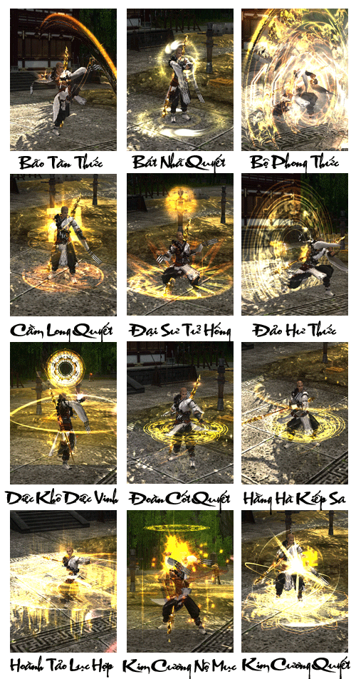
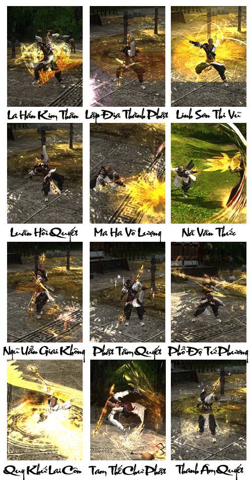
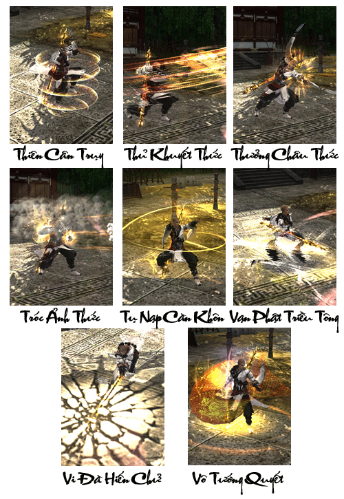

Thiếu Lâm Tự được xây dựng tại Bắc Ngụy Hiếu Văn Đế vào năm Thái Hòa thứ 19 (Công Nguyên năm 495). Khi đó một vị thiên trúc tăng Bạt Đà đến từ tây vực đến trung nguyên truyền giáo, được phật tử Hiếu Văn Đế vô cùng kính ngưỡng. Bạt Đà phát hiện dãy núi Thái Thất Sơn nối liền với Thiếu Thất Sơn như tạo ra một đóa hoa sen đang nở, có ý "Hoa trung lập tự". Hiếu Văn Đế bèn phái người xây dựng nên Thiếu Lâm Tự tại Thiếu Thất Sơn cung dưỡng Bạt Đà. Hơn 30 năm sau, Nam Thiên Trúc tăng nhân Bồ Đề Đạt Ma đến được Thiếu Lâm Tự, thu nạp nhiều đệ tử, truyền thụ thiền tông và trở thành vị khai sơn tổ sư của phật giáo thiền tông Trung Hoa.

Đạt Ma, tên đầy đủ là Bồ Đề Đạt Ma, người Nam Thiên Trúc, thuộc dòng dõi Bà La Môn, tự xưng là Phật truyền thiền tông đời thứ 28. Sau 9 năm diện bích tại Tung Sơn Thiếu Lâm Tự, ông quyết định xuất vũ môn du hóa chúng thân. Công Nguyên năm 536, Đạt Ma bắt đầu lưu truyền Thiền Tông tại Trung Quốc. "Trực chỉ nhân tâm, kiến tính thành phật, bất lập văn tự, ngoại giáo bất truyền", được nhị tổ Tuệ Hà, tam tổ Tăng Sán, tứ tổ Đạo Tín, ngũ tổ Hoằng Nhẫn, lục tổ Tuệ Năng và các vị tổ sư hoành dương thiên hạ, dần trở thành tông môn phật giáo lớn nhất Trung Hoa. Hậu thế bèn tôn Đạt Ma làm vị sư tổ của Thiền Tông Trung Quốc, tôn Thiếu Lâm Tự là Thiền Tông Tổ Đình.

Tóm lại, Thiếu Lâm Tự với các chiêu thức võ học biến hóa cùng tấm lòng bao dung được xem là nơi bắt nguồn của các chiêu thức võ thuật trong thiên hạ và trở thành môn phái được người đời kính trọng và ngưỡng mộ.

[Video](http://www.youtube.com/embed/5ODx_TwSwUo)

***Thiếu Lâm tự - Khởi nguồn võ học thiên hạ***

## Năng lực môn phái

| Nội dung | Chi tiết |
| --- | --- |
| Đặc điểm môn phái | Gồm 2 đường phòng thủ và tấn công, máu nhiều, thủ nội cao, năng lực khống chế đối phương cao. |
| Từ khóa | Nội công phòng ngự, phản đòn sát thương. |
| Độ khó làm quen | Cao, thao tác phức tạp. |
| Ưu điểm | Máu nhiều, phòng thủ nội công cao và khống chế cao, nội ngoại song luyện cân bằng toàn diện. |
| Nhược điểm | Khả năng sát thương hơi yếu, khó tiếp cận kẻ thù. |
| Vị trí trong tổ đội | Là nhân vật trọng tâm. |
| Đánh giá môn phái | Chuyên gia nội công phòng ngự. |

## Phân nhánh môn phái

- **Dịch Cân Thiếu Lâm**: Thuộc dạng nhân vật hỗ trợ cận chiến, đơn đấu không phải là sở trường, mà ưu thế nằm ở những trận chiến quy mô, đa dạng trong công thủ, yêu cầu kỹ năng thao tác điều khiển cao.

- **Tẩy Tủy Thiếu Lâm**: "*Ta không vào địa ngục, thì ai sẽ vào địa ngục?*" - Đây chính là nhân vật có khả năng phòng thủ nội công cao nhất trong tất cả các phái, tung hoành ngang dọc trong chiến trận, đồng thời là mục tiêu sẽ được đối thủ "chăm sóc" chu đáo nhất.

## Tổng hợp các chiêu thức phái Thiếu Lâm

## Tâm pháp

### Dịch Cân Kinh

| Nội dung | Mô tả |
| --- | --- |
| **Vai trò** | Nhận sát thương, bảo vệ đồng đội |
| **Khả năng luyện cấp** | Rất tốt, chiêu thức gây sát thương nội công cao, khả năng phòng thủ tốt. |
| **Khả năng PK** | Khả năng chiến đấu khá tốt khi đơn đấu, với những chiêu thức gây hiệu ứng khó chịu cho đối phương. Đặc biệt khi khi lượng máu đối phương xuống thấp có thể trực tiếp dứt điểm. |
| **Khả năng đội nhóm** | Không cần thiết lắm trong vị trí đội nhóm, vì sát thương gây ra không lý tưởng để đóng vai trò chủ đạo dứt điểm. |
| **Nội/Ngoại** | Nội công Dương cận chiến |
| **Chỉ số quan trọng nhất** | Nguyên Khí, Căn Cốt, Lực Đạo, Nguyên Khí |
| **Kỹ năng** | **Dịch Cân Kinh** của **Thiếu Lâm** thiên về tấn công cự ly gần và khống chế. Đầu tiên sử dụng **Tróc Ảnh Thức** để kéo mục tiêu về bản thân. Một khi đã **tiếp cận được đối phương** sẽ gây vận công ngắt đoạn, huyễn huân, định thân và nhiều hiệu ứng bất lợi khác. Kèm theo đó là những cú xoay gậy gây sát thương lớn trên diện rộng. Khi khí huyết mục tiêu dưới 30% có thể sử dụng **Nã Vân Thức** để kết thúc. |

### Tẩy Tủy Kinh

| Nội dung | Mô tả |
| --- | --- |
| **Vai trò** | Nhận sát thương, bảo vệ đồng đội |
| **Khả năng luyện cấp** | Không tốt và không nên dùng luyện cấp, tẩy Tủy Kinh bao gồm các chiêu thức gia tăng khả năng sinh tồn và phòng thủ, khả năng gây ra sát thương rất thấp. |
| **Khả năng PK** | Không có khả năng chiến đấu đơn độc, với lượng sát thương gây ra hầu như không ảnh hưởng đến đối thủ. |
| **Khả năng đội nhóm** | Một trong những ứng cử viên trong vai trò phòng ngự trong tổ đội không thể thiếu, với lực phòng thủ và sinh lực dồi dào có thể chịu tất cả sát thương cho thành viên trong đội. |
| **Nội/Ngoại** | Chuyên phòng thủ |
| **Chỉ số quan trọng nhất** | Nguyên Khí, Căn Cốt, Thân Pháp, Lực Đạo |
| **Kỹ năng** | **Tẩy Tủy Kinh của Thiếu Lâm** thiên về phòng thủ và khống chế. **Sinh lực dồi dào** (gần như gấp đôi đối thủ) cùng với giáp và kháng sát thương lớn khiến cho **Thiếu Lâm Tẩy Tủy Kinh** là mục tiêu rát khó tiêu diệt. Các chiêu hỗ trợ làm tăng giáp đáng kể đồng thời phản lại sát thương khiến cho kẻ địch tấn công phái Thiếu Lâm không những không hạ được mục tiêu mà ngược lại còn gây suy giảm sinh lực đáng kể. |

Nguồn: VNG (bài viết và hình ảnh)
