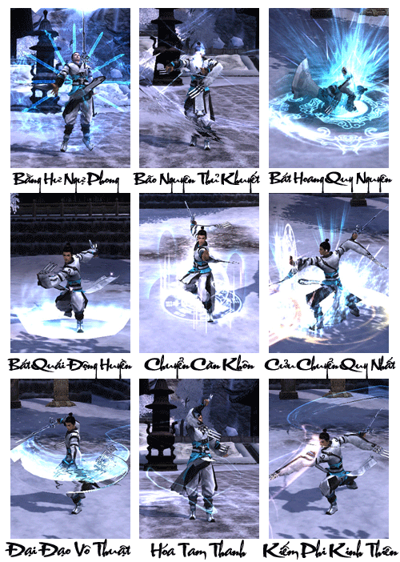
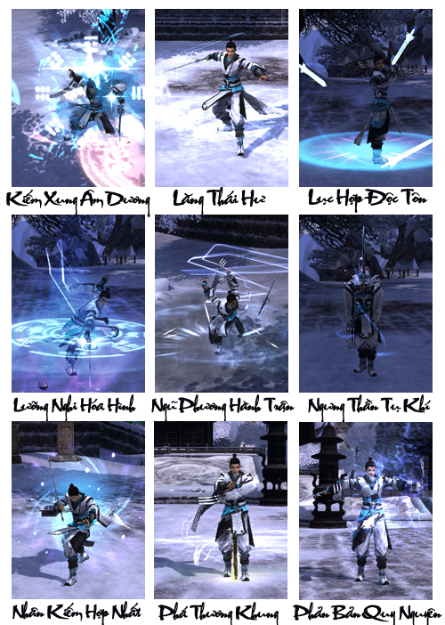
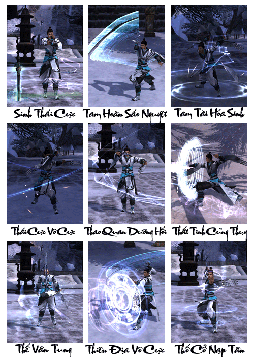

Tùy Văn Đế khai hoàng năm thứ 17 (năm Công Nguyên 598), Thái tông Lý Thế Dân giáng thế khi gia đình trên đường trở về Thái Nguyên. Vừa trở về Thái Nguyên, xuất hiện một đạo nhân đến thăm viếng và tiên đoán rằng cậu bé này sau này lớn lên sẽ cứu thế tế dân, bèn đặt tên là Thế Dân. Sau đó vị đạo nhân bèn tặng thêm cho Lý Uyên 1 quyển sách Khai Nguyên Điển Luận. Chính quyển sách này đã giúp Lý Thế Dân tạo cơ sở giành lấy giang sơn.

Điều đáng tiếc là Khai Nguyên Điển Luận phần lớn đều nói về làm thế nào để tranh đoạt giang sơn, đạo trị quốc lại vô cùng ít. Nhưng theo vị đạo nhân nói, trên thế gian này còn một bộ bảo điển trị quốc, và nói bảo điển này nhất định xuất hiện tại "Thuần Dương". Thế là Đường Thái Tông phái người truy tìm khắp nơi về vị trí hoặc cao nhân mang tên Thuần Dương, nhưng đều không có kết quả. Dần về sau hoàng triều đều quên đi việc truy tìm. Duy chỉ có một người còn chú ý đến bút tích này, đó chính là Hoàng Tử Lý Long Cơ. Nhưng khi đó Lý Long Cơ chỉ mới 15 tuổi. Thời kỳ đó chính là Võ Hậu đương quyền, các hoàng tử đều nơm nớp lo sợ, đành ngoan ngoãn chăm học trong cung. Chỉ riêng Lý Long Cơ quyết tâm truy tìm Trị Quốc Điển Luận này.

Thượng Nguyên năm thứ 2 (Công Nguyên 675), có một vị tiến sĩ tên là Lữ Động Tân, hiệu Thuần Dương Tử sau trúng cử lập tức từ quan ở ẩn. Lý Long Cơ cảm thấy người này chính là "Thuần Dương" mà vị đạo sĩ năm xưa đã đề cập, bèn phái người truy tìm khắp nơi. Điều kỳ lạ là vị Thuần Dương Tử này lại tự tìm đến Lý Long Cơ, mang tặng cho anh ta 1 quyển Đại Thống Điển Luận, chuyên nói về đạo trị quốc.

Biết bí mật của quyển điển luận không thể nào thoát khỏi tai mắt của mật thám Võ Tắc Thiên, Lý Long Cơ chủ động đi thỉnh tội và dâng lên Đại Thống Điển Luận. Võ hậu biết không thể hãm hại đành cho qua sự việc không truy cứu.

Sau cùng, nhờ Đại Thống Điển Luận cùng với tính ngưỡng phật giáo của Võ Tắc Thiên nên Thuần Dương Tử được lòng Võ Hậu. Thuần Dương Tử không thể chối từ, trước vì giang sơn Đại Đường tế trời, sau lưu trong cung giảng đạo. Lý Long Cơ nhân cơ hội này đề nghị Võ Tắc Thiên xây dựng một tòa đạo quan gần kinh thành nhất để cầu an cho giang sơn Đại Đường. Sau vì để Võ Hậu được thuận tiện đi bái tế và Thuần Dương Tử lại là Đắc Đạo Cao Nhân xây dựng môn phái, phát dương quang đại nên Võ Hậu không có lý do từ chối.

Trường An năm thứ 4 (Công Nguyên 704), Lữ Động Tân dưới sự hỗ trợ của triều đình, lập nên Thuần Dương Quan tại núi Hoa Sơn. Đến khi Huyền Tông kế vị, Thuần Dương phái càng được hỗ trợ phát triển lớn mạnh.

Tương truyền, Thuần Dương là môn phái do một trong Bát Tiên - Lữ Động Tân sáng lập. **Đệ tử Thuần Dương có cốt cách phi phàm, việc tu đạo để rèn luyện thân thể được đặt lên hàng đầu**.

[Video](http://www.youtube.com/embed/RdpC6lWrqIk)

***Thuần Dương quan - Vô ngã vô kiếm***

## Năng lực môn phái

| Nội dung | Chi tiết |
| --- | --- |
| Đặc điểm môn phái | Kiếm tông và khí tông, chuyên nội - ngoại công, đánh gần hoặc xa |
| Từ khóa | Khí trường |
| Độ khó làm quen | Cao, nhiều thao tác kết hợp |
| Ưu điểm | Sức sát thương cao, đòn chí mạng mạnh, năng lực phản đòn khống chế xuất sắc |
| Nhược điểm | Máu ít, sức phòng thủ thấp |
| Vị trí trong tổ đội | Nhân vật chủ lực trong sát thương, có thể khống chế cục diện |
| Đánh giá môn phái | Gây sát thương cao và khống chế tốt, khí trường vận dụng linh hoạt, đối diện các tình huống phức tạp đều có kỹ năng tương ứng |

## Phân nhánh môn phái

- **Tử Hà Thuần Dương**: Thuộc dạng tấn công từ xa nổi trội nhất trong năm môn phái, có ưu thế nắm bắt thời cơ chiến trận và giữ cự ly xa với đối thủ. Nếu tung ra các chiêu thức trong thời cơ khác nhau sẽ đạt được những hiệu quả hoàn toàn khác nhau.

- **Thái Hư Thuần Dương**: Thuộc dạng hỗ trợ cận chiến nên đơn đấu không phải là sở trường. Hệ phái này có ưu thế trong những [chiến trường](../he-thong/chien-truong.md) lớn, đa dạng trong công thủ, yêu cầu kỹ năng thao tác điều khiển cao.

## Tổng hợp các chiêu thức phái Thuần Dương

## Tâm pháp

### Thái Hư Kiếm Ý

| Nội dung | Mô tả |
| --- | --- |
| **Vai trò** | Sát thương chủ lực, hỗ trợ đồng đội, phối hợp tấn công |
| **Khả năng luyện cấp** | Tốt, sát thương cao ở cận chiến nhưng có nhược điểm là phòng thủ không tốt. |
| **Khả năng PK** | Với ưu điểm cách đánh chuyên gây choáng và làm chậm cao, nhưng nhược điểm chí mạng là phòng thủ và máu vô cùng thấp, nên Thuần Dương - Tử Hà Công với lối đánh tầm xa luôn sẽ là sự lựa chọn khá cao. |
| **Khả năng đội nhóm** | So sánh với đường nội công, mặc dù hỗ trợ khá tốt khi buff nhưng với lối đánh cận chiến 1 mục tiêu sẽ không được nhắc đến nhiều như Tử Hà Thần Công. |
| **Nội/Ngoại** | Ngoại công cận chiến |
| **Chỉ số quan trọng nhất** | Thể Chất, Lực Đạo, Căn Cốt, Thân Pháp |
| **Kỹ năng** | Kỹ năng **Thuần Dương** rất chú trọng nội lực, nội lực càng nhiều trong quá trình chiến đấu sẽ không bị gián đoạn vì các chiêu thức Thuần Dương khi sử dụng phải tiêu hao lượng lớn nội lực. Cả 2 hướng đi **Thuần Dương** đều có các kỹ năng hỗ trợ đồng đội rất tốt trong bí cảnh và chiến trường. Trong chiến đấu các kỹ năng Thuần Dương đều có lợi thế về việc làm chậm và gây choáng. **Ưu điểm**: **Thái Hư Kiếm Ý** chuyên về tấn công 1 mục tiêu gây sát thương ngoại lớn. **Tử Hà Công** tập trung tấn công diện rộng gây sát thương nội cao. **Nhược điểm**: Yếu điểm duy nhất với **Thuần Dương** là **phòng thủ thấp** và máu yếu, rất dễ trọng thương trong chiến đấu. |

### Tử Hà Thần Công

| Nội dung | Mô tả |
| --- | --- |
| **Vai trò** | Sát thương chủ lực, hỗ trợ đồng đội, phối hợp tấn công |
| **Khả năng luyện cấp** | Rất tốt, các kỹ năng nội công sát thương rất cao, có kỹ năng trên diện rộng |
| **Khả năng PK** | Với ưu điểm cách đánh chuyên gây choáng và làm chậm cao, nhưng nhược điểm chí mạng là phòng thủ và máu vô cùng thấp, nên Thuần Dương - Tử Hà Công với lối đánh tầm xa luôn sẽ là sự lựa chọn khá cao. |
| **Khả năng đội nhóm** | So sánh với đường nội công, mặc dù hỗ trợ khá tốt khi buff nhưng với lối đánh cận chiến 1 mục tiêu sẽ không được nhắc đến nhiều như Tử Hà Thần Công. |
| **Nội/Ngoại** | Nội công dương tầm xa |
| **Chỉ số quan trọng nhất** | Thể Chất, Căn Cốt, Nguyên Khí |
| **Kỹ năng** | Kỹ năng **Thuần Dương** rất chú trọng nội lực, nội lực càng nhiều trong quá trình chiến đấu sẽ không bị gián đoạn vì các chiêu thức Thuần Dương khi sử dụng phải tiêu hao lượng lớn nội lực. Cả 2 hướng đi **Thuần Dương** đều có các kỹ năng hỗ trợ đồng đội rất tốt trong bí cảnh và chiến trường. Trong chiến đấu các kỹ năng Thuần Dương đều có lợi thế về việc làm chậm và gây choáng. **Ưu điểm**: **Thái Hư Kiếm Ý** chuyên về tấn công 1 mục tiêu gây sát thương ngoại lớn. **Tử Hà Công** tập trung tấn công diện rộng gây sát thương nội cao. **Nhược điểm**: Yếu điểm duy nhất với **Thuần Dương** là **phòng thủ thấp** và máu yếu, rất dễ trọng thương trong chiến đấu. |

Nguồn: VNG (bài viết và hình ảnh)
