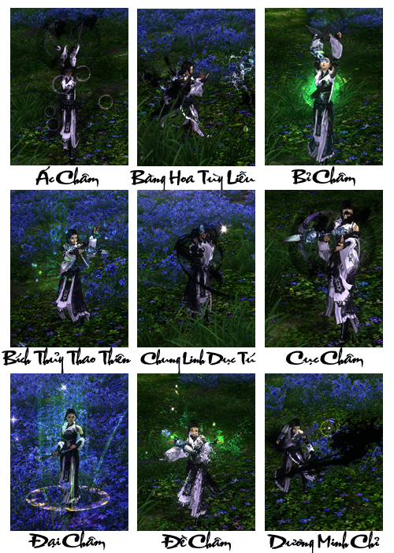
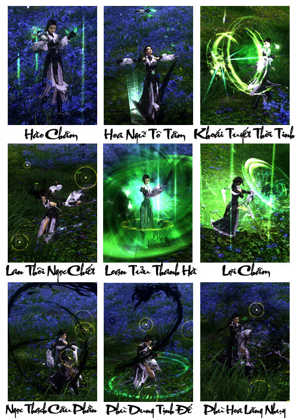
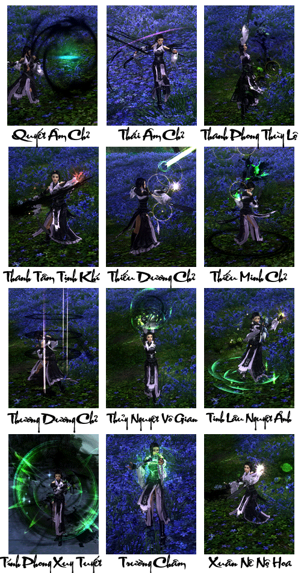

Đại Đường năm thứ 23, Vạn Hoa cốc chủ Đông Phương Vũ Hiên vân du tứ hải, vô tình lạc vào Tần Lĩnh Thanh Nham, vẻ đẹp sơn thủy tại đây đã chinh phục ông, thế là ông ta chiêu hiền nạp sĩ ẩn cư ngay tại đó, bèn đặt tên là "Vạn Hoa Cốc".

Vạn Hoa Cốc có thể nói là môn phái được một mình Đông Phương Vũ Hiên dựng nên, với khí phách hào hiệp sảng khoái, vô cùng được lòng kỳ nhân dị sĩ trong thiên hạ.

Đông Phương Vũ Hiên tinh thông cầm kỳ thi họa, sau khi thành lập Vạn Hoa Cốc, thường xuyên mời các vị khách có địa vị cao trên xã hội cùng với cao thủ võ lâm trên giang hồ đến chơi cờ phẩm trà, tranh thư luận kiếm. Thời gian về sau, Vạn Hoa Cốc trở thành địa danh phong nhã bậc nhất trên giang hồ, rất nhiều danh sĩ chán mỏi với cuộc sống sinh sát trên giang hồ, hiểm ác trên quan trường lần lượt tìm đến Vạn Hoa Cốc ẩn cư. Danh tiếng của Vạn Hoa Cốc khi đó có thể sánh ngang với Trường Ca Môn. Nhưng có điểm khác biệt giữa Trường Ca Môn với Vạn Hoa Cốc, Trường Ca Môn là nơi tụ tập của văn nhân thi sĩ trổ tài thi ca thơ vũ, ngâm thơ đối câu, còn Vạn Hoa Cốc có thể nói là nơi tụ tập của tất cả các thành viên trên giang hồ. Các kỳ nhân dị sĩ đều có thể tìm được một chốn dung thân cho mình tại Vạn Hoa Cốc này.

Tương truyền Vạn Hoa Mật Tịch bao gồm 7 bộ kinh thư: Tổng Cương, Võ Kinh, Thư Kinh, Kỳ Kinh,Y Kinh, Cầm Kinh và Tập Kinh. Đây chính là các [thành tựu](../he-thong/thanh-tuu.md) do năng nhân dị sĩ ẩn cư tại Vạn Hoa Cốc hao công nghiên cứu đúc kết hơn 10 năm mà thành, nội dung tinh thâm bác đại, trong đó Võ Kinh và Y Kinh được giới nhân sĩ võ lâm đặc biệt chú ý.

Tóm lại, y thuật thần kỳ của Vạn Hoa Cốc danh vang thiên hạ, đương truyền trong Y Kinh có cả liệu thuật cải tử hồi sinh. Quan trọng nhất,

**y thuật Vạn Hoa Cốc chính là khắc tinh của độc thuật [Ngũ Độc](./ngu-doc.md) Giáo**

. Nhân sĩ võ lâm thù hận bí độc của Ngũ Độc Giáo đều mong muốn có được bộ Y Kinh này.

[Video](http://www.youtube.com/embed/Yhit1xNYKGM)

***Vạn Hoa cốc - Diệu thủ hồi xuân***

## Năng lực môn phái

| **Nội dung** | **Chi tiết** |
| --- | --- |
| Đặc điểm môn phái | Gồm 2 đường trị liệu và khống chế, chuyên cứu chữa cho đồng đội, có thể áp chế đối thủ khống chế cục diện. |
| Từ khóa | Sát thương và trị liệu kéo dài, thay đổi linh động. |
| Độ khó làm quen | Cao, xem trọng thân pháp, di chuyển và khả năng khống chế hao tổn nội lực (mana). |
| Ưu điểm | Khả năng trị liệu liên tục và sát thương kéo dài tốt, năng lực sinh tồn cao, kéo dài tác chiến quy mô nhỏ. |
| Nhược điểm | Khả năng ra đòn chí mạng không duy trì lâu. |
| Vị trí trong tổ đội | Nhân vật linh hồn không thể thiếu. |
| Đánh giá môn phái | Với khả năng trị liệu tốt, đi đâu cũng được chào đón. |

## Phân nhánh môn phái

- **Hoa GianDu:** "Vạn Hoa tùng trung qua, phiến diệp bất tiêm thân". Là nhân vật khó thao tác nhất trong lục đại môn phái, với thân pháp phiêu diêu tao nhã, di chuyển khéo léo linh hoạt, bộc phát lực tấn công khiến Hoa Gian Du đạt đến cảnh giới "lấy nhu khắc cương".   

    Tác chiến đơn đấu: 04 điểm · Sự cần thiết trong phó bản: 05 điểm · Tác chiến tổ đội: 05 điểm · Độ khó thao tác: 03 điểm · Luyện cấp: 03 điểm

- **Ly Kinh Dịch Đạo:** "Diệu thủ nhân tâm", năng lực trị liệu bậc thầy, là linh hồn trong những trận chiến. Thuần thục trong việc khống chế điều phối sự hao tổn nội lực là điều kiện cần thiết để trở thành "Cửu Châm Vạn Hoa".  

    Tác chiến đơn đấu: 05 điểm · Sự cần thiết trong phó bản: 04 điểm · Tác chiến tổ đội: 03 điểm · Độ khó thao tác: 05 điểm · Luyện cấp: 04 điểm

## Tổng hợp các chiêu thức phái Vạn Hoa

## Tâm pháp

### Hoa Gian Du

| Nội dung | Mô tả |
| --- | --- |
| **Vai trò** | Sát thương chủ lực |
| **Khả năng luyện cấp** | Tốt, nhưng đòi hỏi người chơi phải có kỹ thuật và hiểu rõ kỹ năng Hoa Gian Du, cần cộng dồn nhiều hiệu ứng để gây sát thương lớn. |
| **Khả năng PK** | Hệ phái đánh xa với nhiều chiêu thức gây làm chậm, định thân, trói buộc cùng với hệ thống chiêu thức liên tục gây sát thương lớn của thuộc tính nội hỗn nguyên. Vạn Hoa trong chiến đấu cần phải kết hợp nhiều chiêu thức để có được tốc độ ra chiêu thức nhanh nhất để tiêu diệt mục tiêu. Khó khăn khi gặp các phải có chiêu giải trừ hiệu ứng xuất chiêu liên tục. Lực phòng thủ của hệ phái này yếu nên cần phải thao tác né tránh nhiều. |
| **Khả năng đội nhóm** | Là thành viên đóng vai trò bắn tỉa trong đội, triệt hạ nhanh các mục tiêu cần tiêu diệt trong thời gian ngắn. |
| **Nội/Ngoại** | Nội công hỗn nguyên tầm xa |
| **Chỉ số quan trọng nhất** | Thể Chất, Căn Cốt, Nguyên Khí |
| **Kỹ năng** | Nội công Hoa Gian Du của Vạn hoa thích hợp cho các [chiến trường](../he-thong/chien-truong.md) và các cuộc hỗn chiến, ngoài ra có thể dùng để **kết thúc boss** rất nhanh. Do các chiêu thức của đường này chủ yếu kết hợp mang lượng sát thương lớn. Ngoài các chiêu thức tấn công, các chiêu hỗ trợ của **Hoa Gian Du** sẽ giúp khóa mục tiêu và hỗ trợ cho việc thi triển nhanh các chiêu tấn công. Thao tác đòi hỏi phải linh hoạt và linh động. Các chiêu thực của **Vạn hoa** luôn được hỗ trợ giảm tiêu hao nội lực rất lớn nên luôn duy trì tình trạng trị liệu ổn định cho toàn đội. **Khuyết điểm**: Phòng ngự yếu, dễ bị phá chiêu combo khi đấu với các phái khác, khả năng luyện cấp và làm nhiệm vụ khó. |

### Ly Kinh Dịch Đạo

| Nội dung | Mô tả |
| --- | --- |
| **Vai trò** | Chữa trị, hồi phục, cứu sống đồng đội, hỗ trợ đồng đội, phối hợp tấn công. |
| **Khả năng luyện cấp** | Không tốt và không nên dùng để luyện cấp, chiêu thức chủ yếu là trị liệu và sát thương không cao, đóng vai trò hỗ trợ trị thương là chủ yếu. |
| **Khả năng PK** | Hệ phái hỗ trợ với các chiêu thức trị liệu cho đồng đội. Các chiêu thức trị liệu có lượng máu cung cấp rất lớn nhưng cần phải có thời gian thi triển, đây cũng là điểm yếu của hệ này. Không có khả năng pk đơn. |
| **Khả năng đội nhóm** | Vị trí hỗ trợ cho nhóm. Trị liệu cho các thành viên gom quái hay đương đầu sát thương với boss. |
| **Nội/Ngoại** | Chuyên trị liệu |
| **Chỉ số quan trọng nhất** | Thể Chất, Căn Cốt, Nguyên Khí |
| **Kỹ năng** | Nội công **Ly Kinh Dịch Đạo** của **Vạn Hoa** lấy trị liệu làm chủ đạo thích hợp cho đi các tổ đội nhóm nhỏ. **Sở trường là trị liệu** đơn thể mạnh nên giúp cho các phái nhận sát thương, bảo vệ đồng đội tiêu diệt boss. Các chiêu thực của **Vạn hoa** luôn được hỗ trợ giảm tiêu hao nội lực rất lớn nên luôn duy trì tình trạng trị liệu ổn định cho toàn đội. **Khuyết điểm**: Phòng ngự yếu, khả năng luyện cấp và làm nhiệm vụ một mình khó. |

Nguồn: VNG (bài viết và hình ảnh)
