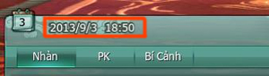
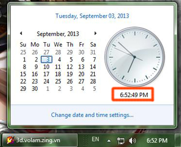
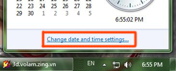
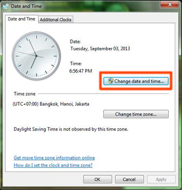
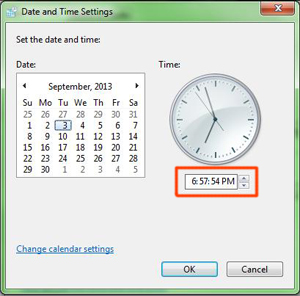

Thời gian gần đây, Võ Lâm 3 đã nhận được thông tin về việc một số nhân sĩ **không thể nhận được nhiệm vụ hàng ngày**. Trường hợp này xảy ra do một số máy tính có thời gian không trùng khớp với thời gian hệ thống, quý nhân sĩ có thể **thực hiện theo các bước sau đây để khắc phục tình trạng trên**:

| Hình ảnh | Ghi chú |
| --- | --- |
|  **Giờ hệ thống trong trò chơi**  **Giờ hiện tại của máy tính** | **Bước 1**: Kiểm tra trong giao diện Time Zone của máy tính có trùng khớp thời gian với giờ hệ thống trong trò chơi hay không. |
|  | **Bước 2**: Nếu thời gian hiển thị hiện tại của máy tính không trùng với thời gian trong trò chơi, đồng đạo cần điều chỉnh lại cho trùng khớp. Nhấn vào :" **Change date and time settings..**." |
|  | **Bước 3**: Trong cửa sổ hiện ra, tiếp tục nhấn vào "**Change date and time...**" |
|  | **Bước 4**: Điều chỉnh thời gian trùng khớp với thời gian hệ thống trong trò chơi, sau đó nhấn "**Ok**". Đồng đạo có thể thoát khỏi trò chơi sau đó đăng nhập lại và nhận nhiệm vụ hàng ngày bình thường. |

Nguồn: VNG (bài viết và hình ảnh)
