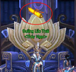
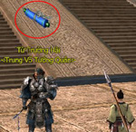
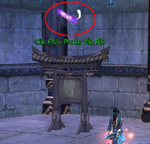
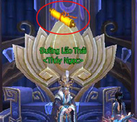
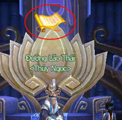
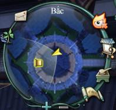
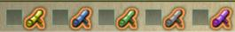

Với sự phong phú và đa dạng về các thể loại, hệ thống nhiệm vụ trong Võ Lâm 3 có thể giúp đồng đạo trải nghiệm một cách đầy đủ nhất khi phiêu lưu mạo hiểm trong thế giới võ hiệp đầy bất ngờ và thú vị. Thông qua việc thực hiện các nhiệm vụ, đồng đạo có thể dễ dàng tìm hiểu bối cảnh trò chơi, luyện cấp, thu thập trang bị và nâng cao danh vọng.

### Phân loại nhiệm vụ

| Hình ảnh |  |  |
| --- | --- | --- |
|  **Nhiệm vụ tăng cấp** Trục cuốn màu vàng. Tăng điểm kinh nghiệm. |  **Nhiệm vụ tuần hoàn** Trục cuốn màu xanh. Có thể thực hiện nhiều lần trong ngày. |  **Nhiệm vụ hoạt động** Trục cuốn màu tím Thể hiện các hoạt động ngày lễ và phe phái. |

### Nhận và trả nhiệm vụ

| Hình ảnh | Nội dung |
| --- | --- |
|  **Nhiệm vụ có thể nhận** (trục cuốn cuộn lại) | Đối thoại với NPC có trục cuộn tròn trên đầu để nhận nhiệm vụ. Đối thoại để trả nhiệm vụ, trục cuốn sổ ra là hoàn thành nghiệm vụ. Các NPC có trục cuộn màu xanh lục nghĩa là nhiệm vụ đó có cấp độ thấp hơn so với cấp độ hiện tại của nhân vật, dù hoàn thành thì phần thưởng kinh nghiệm cũng sẽ giảm đi một phần. |
|  **Nhiệm vụ đã hoàn thành** (trục cuốn sổ thành trang) |  |
|  | Trên bản đồ lớn cũng như bản đồ nhỏ có thể thấy được vị trí của NPC nhận và trả nhiệm vụ với ký hiệu tương ứng. |

### Giao diện nhiệm vụ

- Nhấn phím**L** để mở giao diện gồm danh sách nhiệm vụ đã nhận và miêu tả chi tiết cho mỗi nhiệm vụ đó: mục tiêu, đối tượng, phần thưởng.

- Hệ thống còn có thể phân loại nhiệm vụ theo khu vực, tiện cho nhân vật quản lý, theo dõi.

- Hệ thống mặc định theo dõi 5 nhiệm vụ gần nhất mà nhân vật vừa nhận.

- Nhấp vào biểu tượng quyển trục cuộn lại trên góc phải sẽ mở ra vị trí của NPC nhận và trả nhiệm vụ trên bản đồ lớn.

### Ý nghĩa màu sắc của nội dung nhiệm vụ

Trong nội dung đối thoại với NPC, những từ khóa mô tả cần thực hiện thể hiện qua màu sắc:

- **Màu đỏ**: Tên quái cần tiêu diệt.

- **Màu xanh lam**: Tên vật phẩm cần thu thập.

- **Màu xanh lục**: Tên bản đồ và tên NPC cần tìm.

### Độ khó nhiệm vụ

Nhiệm vụ trong danh sách được dùng màu sắc để phân biệt độ khó dễ của nhiệm vụ so với cấp độ nhân vật. Lưu ý: Nhiệm vụ càng đơn giản thì phần thưởng kinh nghiệm càng ít.

| Phân loại màu sắc | Độ khó | Đề nghị |
| --- | --- | --- |
| **Nhiệm vụ xám** | Rất đơn giản | Nên từ loại bỏ nhiệm vụ màu này (thấp hơn cấp độ nhân vật 9 cấp trở lên) |
| **Nhiệm vụ xanh lục** | Đơn giản | Có thể không cần thực hiện (thấp hơn cấp độ nhân vật 4 - 8 cấp) |
| **Nhiệm vụ vàng** | Trung bình | Thích hợp cho nhân vật rèn luyện cấp độ (chênh lệch với cấp độ nhân vật 3 cấp) |
| **Nhiệm vụ cam** | Khá khó khăn | Nên tìm đồng đội hỗ trợ để hoàn thành nhiệm vụ (cao hơn cấp nhân vật 4 - 5 cấp) |
| **Nhiệm vụ đỏ** | Rất khó khăn | Nên luyện thêm vài cấp rồi hãy nhận nhiệm vụ này (cao hơn cấp độ nhân vật 6 cấp trở lên) |

Ghi chú

- **Hạn chế số lượng nhiệm vụ**: Tổng số nhiệm vụ trên danh sách nhiệm vụ, nhân vật có thể nhận là 25, nếu đã đạt giới hạn này mà đồng đạo vẫn muốn nhận thêm nhiệm vụ mới bắt phải từ bỏ một số nhiệm vụ đã nhận từ trước (có thể từ bỏ nhiệm vụ bất cứ lúc nào, nếu muốn làm lại nhiệm vụ thì buộc phải đến vị trí cũ nhận lại).

- **Hỗ trợ nhiệm vụ**:  Nhân vật hỗ trợ và được hỗ trợ bắt buộc phải tổ đội và ở gần nhau. Nhân vật hỗ trợ phải hoàn thành nhiệm vụ này từ trước. Giới hạn hỗ trợ nhân vật khác làm nhiệm vụ mỗi ngày không quá 16 lần.

- **Phần thưởng hỗ trợ nhiệm vụ**: Khi tổ đội cùng làm một nhiệm vụ thì độ hảo hữu của nhân vật hỗ trợ và được hỗ trợ đều được tăng thêm 05 điểm. Nhân vật hỗ trợ sẽ nhận được 04 điểm tinh lực và 04 điểm thể lực.

Nguồn: VNG (bài viết và hình ảnh)
