Nhân vật cấp độ 15, 20, 60 và 80... có thể tham gia những hoạt động tiêu biểu hàng ngày như bên dưới để thu thập thêm những vật phẩm hỗ trợ đặc biệt cho quá trình bôn tẩu giang hồ.

- Nhĩ Hải Đoạt Mã

- Lệnh truy nã

- Nhiệm vụ chung

- Danh Vọng

- Nơi thí luyện

- Luyện tập - Môn phái

- Đua ngựa

- Tiềm Hành

- Hái Tiên Thảo

- Quán trà

- Mỹ Nhân Đồ

- Hàng ngày - Môn phái

### Nhĩ Hải Đoạt Mã

- **Thời gian**: 21h00 - 22h00 thứ Sáu, thứ Bảy và Chủ Nhật hàng tuần.

- **Điều kiện**: Nhân vật đẳng cấp 80 trở lên.

- **Vị trí**: Bản đồ Thương Sơn Nhĩ Hải.

- **Phần thưởng**:  Tín vật chủ trại ngựa, cỏ rơm cấp 03 và 04, các loại ngựa non từ cấp 04 - 09.  May mắn có thể đánh bắt được ngựa non cấp 13.

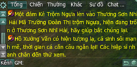  
 Thông báo trên kênh Thế Giới

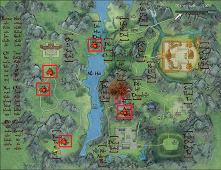  
 Bản đồ Thương Sơn Nhĩ Hải

### Lệnh truy nã Ẩn Nguyên

- **Thời gian**: Hoạt động diễn ra suốt ngày và phát thưởng vào các mốc giờ chẵn trong ngày (bắt đầu phát thưởng từ sau 10h00).

- **Điều kiện tham gia**: Nhân vật đẳng cấp 80 trở lên.

- **Vị trí**: Bản đồ Thành Đô.

- **Phần thưởng**:  Nhận 02 Nạp Nguyên Đơn, Rương Bảo Vật, 05 Vàng và 100 điểm Cống Hiến Bang. Nhận điểm tích lũy Ẩn Nguyên Hội. Khi số điểm tích lũy đạt tới mốc 03, 06, 10 sẽ được nhận thêm phần thưởng. Hoàn thành 01 vòng nhiệm vụ (10 lần) nhân vật có thể đến nộp thời gian tại NPC Mạc Ly Thường.

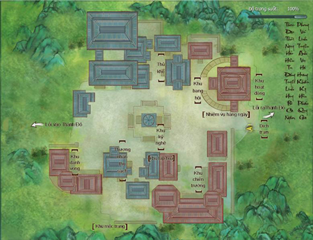

- **Lưu ý**:  Chọn "Lừa kẻ trộm báu vật đến bên cạnh" nếu Trộm Báu Vật ở vị trí khó tiếp cận. Chọn "Đánh dấu lại mục tiêu nhiệm vụ trên bản đồ" nếu đang thực hiện nhiệm vụ mà vị trí của Trộm Báu Vật không xuất hiện. Có thể lập tổ đội cùng tham gia nhiệm vụ.

### Nhiệm vụ chung hằng ngày

- **Thời gian**: Hoạt động diễn ra cả ngày.

- **Điều kiện tham gia**: Nhân vật đẳng cấp 80 trở lên.

- **Vị trí**: Thành Đô, Lạc Dương, Dương Châu, Trường An.

- **Tham gia**: Đối thoại Bảng Cống Hiến tại các thành thị để nhận nhiệm vụ.

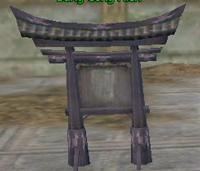

***Bảng Cống Hiến tại các thành thị***

- **Lưu ý**: Các điểm Nghĩa Hiệp và Hiên Viên Xã có thể dùng để đổi trang bị, vật phẩm quý.

- **Phần thưởng**:

| **Nhiệm vụ** | **Phần thưởng** |  |
| --- | --- | --- |
| Đại Chiến! Anh Hùng [Tiên Tung Lâm](../pho-ban/pho-ban-5-nguoi.md#tiên-tung-lâm) |  Nạp Nguyên Đơn  Rương Báu Thiết 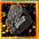 Đá Huyền Long | **50** Vàng Giám Bản Ấn Văn: **+10** Điểm Hiệp Nghĩa: **+500** Cống Hiến Bang: **+3500** Phát Triển Bang :**+40** Quỹ Bang: **+50** Vàng |
| Đại Chiến! Anh Hùng [Hang Pháp Vương](../pho-ban/pho-ban-5-nguoi.md#hang-pháp-vương) |  |  |
| Đại chiến! [Đường Môn Mật Thất](../pho-ban/pho-ban-5-nguoi.md#đường-môn-mật-thất) |  |  |
| Đại Chiến! Anh Hùng [Độc Thần Điện](../pho-ban/pho-ban-5-nguoi.md#độc-thần-điện) |  |  |
| Đại Chiến! Anh Hùng [Tịch Diệt Sảnh](../pho-ban/pho-ban-5-nguoi.md#tịch-diệt-sảnh) |  |  |
| Tiền thưởng - Anh Hùng Tam Tài Trận |  Rương Báu Đồng  Nạp Nguyên Đơn 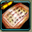 Giám Bản Ấn Văn 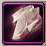 Tử Vẫn | **20** Vàng Điểm Hiệp Nghĩa **+500** Cống Hiến Bang **+1000** Điểm Phát Triển Bang **+20** Quỹ Bang **+10** Vàng |
| Tiền Thưởng! Anh Hùng [Thiên Công Phường](../pho-ban/pho-ban-5-nguoi.md#thiên-công-phường) |  |  |
| Tiền thưởng - Anh Hùng [Không Vụ Phong](../pho-ban/pho-ban-5-nguoi.md#không-vụ-phong) |  |  |
| Tiền thưởng - Anh Hùng [Đảo Vô Diêm](../pho-ban/pho-ban-5-nguoi.md#đảo-vô-diêm) |  |  |
| Tiền thưởng - Anh Hùng [Linh Tiêu Hiệp](../pho-ban/pho-ban-5-nguoi.md#linh-tiêu-hiệp) |  |  |
| Tiền thưởng - Anh Hùng Địch Hoa Cung |  |  |
| Tiền thưởng - Anh Hùng [Nhật Luân Sơn Thành](../pho-ban/pho-ban-5-nguoi.md#nhật-luân-sơn-thành) |  |  |
| Tiền thưởng - Anh Hùng [Phong Vũ Đạo Hương Thôn](../pho-ban/pho-ban-5-nguoi.md#phong-vũ-đạo-hương-thôn) |  |  |
| Tiền thưởng - Anh Hùng [Thiên Tử Phong](../pho-ban/pho-ban-5-nguoi.md#thiên-tử-phong) |  |  |
| Tiền thưởng - Anh Hùng [Kiếm Chủng](../pho-ban/pho-ban-5-nguoi.md#kiếm-chủng) |  |  |
| Huyết chiến núi Dung Thiên |  Rương Báu Thiếc | **75** Vàng Danh Vọng Hiên Viên Xã **+350** |
| Tiêu diệt đệ tử kiếm thần chúng Nam Chiếu |  |  |
| Tiêu diệt Giáo Chúng Thiên Nhất |  |  |
| Tiêu diệt giáo chúng Hồng Y |  |  |
| Tiêu diệt tùy tùng Ngũ Thử |  |  |
| Huyết chiến núi Dung Thiên | 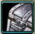 Rương Báu Thiếc | **75** Vàng Điểm Nghĩa Hiệp **+150** |
| Tiêu diệt đệ tử kiếm thần chúng Nam Chiếu |  |  |
| Tiêu diệt Giáo Chúng Thiên Nhất |  |  |
| Tiêu diệt giáo chúng Hồng Y |  |  |
| Tiêu diệt tùy tùng Ngũ Thử |  |  |

### Hoạt động Danh Vọng hằng ngày

- **Thời gian**: Hoạt động diễn ra cả ngày.

- **Điều kiện tham gia**: Nhân vật đẳng cấp 80 trở lên.

- **Vị trí**: Thương Sơn Nhĩ Hải, Vô Lượng Sơn.

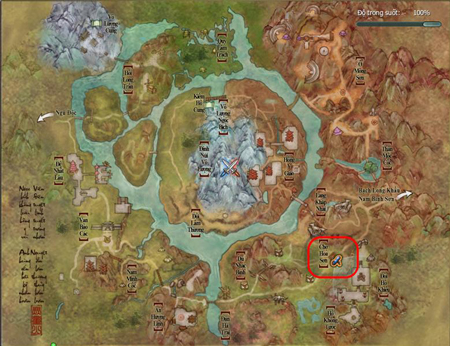  
 Bản đồ Vô Lượng Sơn

- **Phần thưởng**: Rương Báu Thiếc, tiền Vàng, Danh Vọng Vô Quy Nam Linh, Danh Vọng Cửu Lê Tộc (có thể mua được đồ Danh Vọng Vô Quy Nam Linh, Danh Vọng Cửu Lê Tộc khi số điểm này đạt mốc nhất định).

### Nơi thí luyện

- **Thời gian**: Vào lúc 00h00, 03h00, 09h00, 12h00, 15h00, 18h00 và 21h00 mỗi ngày. Thời gian diễn ra hoạt động là 01 giờ kể từ lúc bắt đầu.

- **Ghi chú**: Hoạt động bao gồm nhiều tầng thí luyện, mỗi tầng có 05 ải. Mỗi lần vượt 01 tầng sẽ nhận được 01 cơ hội lật bài nhận thưởng.

- **Điều kiện tham gia**: Nhân vật đẳng cấp 80 trở lên.

- **Lưu ý**: Khi tổ đội thì mỗi thành viên trong đội sẽ ở mỗi bản đồ khác nhau.

- **Vị trí**: NPC Người Già Thần Bí tại thành Lạc Dương, Thành Đô, Dương Châu, Trường An.

| Hình ảnh |  |
| --- | --- |
| 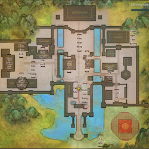 Khu vực báo danh thành Lạc Dương | 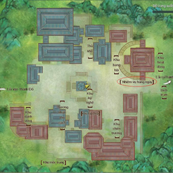 Khu vự báo danh Thành Đô |
| 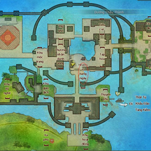 Khu vực báo danh thành Dương Châu | 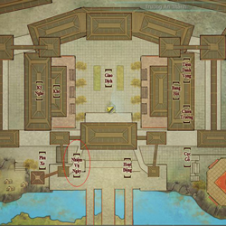 Khu vực báo danh thành Trường An |
|  NPC Người Già Thần Bí | 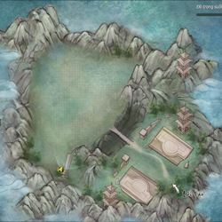 Bản đồ Nơi Thí Luyện |

- **Phần thưởng:**  Điểm tích lũy phụ thuộc vào thời gian hoàn thành vượt ải, điểm cao nhất cho mỗi ải là 10.000 điểm, điểm càng cao thì phần thưởng càng giá trị. Mỗi qua 01 tầng sẽ được lật thẻ bài, có cơ hội nhận được: Tiền Vàng, Cống Hiến Bang, Đá Ngũ Hành, Đá Ngũ Sắc, vật liệu, điểm Nghĩa Hiệp và trang bị,... Trang bị nhận được là **trang bị Vô Uy** phẩm chất từ 270 - 330. Vật phẩm sẽ được chuyển vào hành trang và sẽ chuyển vào thư tín khi hoàn tất một tầng. Nếu hành trang đầy thì phần thưởng của ải sẽ được gửi vào thư tín.

### Luyện tập - Môn phái

- **Thời gian**: Vào lúc 00h00, 03h00, 09h00, 12h00, 15h00, 18h00 và 21h00 mỗi ngày. Thời gian diễn ra hoạt động là 01 giờ kể từ lúc bắt đầu.

- **Điều kiện tham gia**: Nhân vật đẳng cấp 20 trở lên.

- **Vị trí**: Cửu Châu Phong Vân Bài ở các môn phái.

- **Phần thưởng**:  Khi cấp độ tối đa: 100 Vàng và 25 điểm Giám Bản Ấn Văn.  Khi cấp độ chưa tối đa: 30 Cửu Hoa Ngọc Lộ Tán.

### Hoạt động đua ngựa

- **Thời gian**: Diễn ra trong ngày, cách 10 phút bắt đầu 01 lần (04 phút báo danh, 05 phút thi đấu, 01 phút tổng kết).

- **Phí báo danh**: 50 lượng bạc.

- **Điều kiện tham gia**: Nhân vật đẳng cấp 80 trở lên.

- **Vị trí**: Thương Sơn Nhĩ Hải, khu vực "Trường Đua Đoàn Thị".

- **Phần thưởng**: Mỗi ngày, hoàn thành 01 lần đua ngựa được thưởng (nhận tại NPC Tín Sứ):100 Vàng, cỏ rơm cấp 03, cỏ rơm cấp 04.

- **Tham gia**:  Một trận đua ngựa có **tối đa 20**nhân vật tham gia. Chạy đua 02 vòng, chiến thắng được tính bằng thứ tự đến đích. Mỗi nhân vật sẽ **có 05 kỹ năng**, bao gồm:      Loại kỹ năng Tên Công dụng     02 kỹ năng hỗ trợ (cố định) 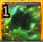   
 Ngựa Nhanh Thêm Roi Tốc độ di chuyển +30%, duy trì 05 giây   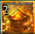  
 Hộ Thân Canh Khí Không chịu ảnh hưởng giảm tốc, duy trì 05 giây   02 kỹ năng gây bất lợi cho đối phương (ngẫu nhiên 02 trong 04 kỹ năng) 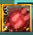  
 Bộ Bộ Kinh Tâm Quăng dây cột ngựa ra, nhân vật trong phạm vi dây cột ngựa đánh trúng sẽ bị -30% tốc độ di chuyển, duy trì 03 giây   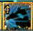  
 Xông Vào Trận Địa Xung kích mục tiêu khiến mục tiêu Tỏa Túc 02 giây.   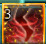  
 Cơ Quan Kẹp Sắt Phóng ra kẹp sắt khiến hiệp sĩ đạp trúng Tỏa Túc 03 giây   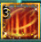  
 Vũ Bảo Dùng chưởng phong chấn nhiếp các hiệp sĩ xung quanh làm họ định thân 02 giây   01 kỹ năng lên ngựa 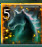  
 Phi Ngựa Lên ngựa    Nhân vật sẽ nhặt các kỹ năng trong quá trình đua ngựa, riêng kỹ năng Phi Ngựa không cần nhặt.   
 

### Hoạt động Tiềm Hành

- **Thời gian**: Vào lúc 00h00, 03h00, 09h00, 12h00, 15h00, 18h00 và 21h00 mỗi ngày. Thời gian diễn ra hoạt động là 01 giờ kể từ lúc bắt đầu. Ngoài thời gian trên, vẫn có thể thực hiện nhiệm vụ nhưng không thể tiến hành trả nhiệm vụ.

- **Điều kiện tham gia**: Nhân vật đẳng cấp 80 trở lên.

- **Vị trí**: Khu vực Bạch Đế Thành – Cù Đường Hiệp (đến Cữu Châu Phong Vân Bài để kích hoạt chuỗi nhiệm vụ Mỹ Nhân Đồ - Tiềm Hành).

- **Phần thưởng**:  7 lượng Vàng, 50 lượng Bạc. Điểm Nghĩa Hiệp: 300. Rương nội phủ Bạch Đế Thành, bên trong chứa nhiều vật phẩm giá trị.

### Hoạt động hái Tiên Thảo

- **Thời gian**: Vào lúc 00h00, 03h00, 09h00, 12h00, 15h00, 18h00 và 21h00 mỗi ngày. Thời gian diễn ra hoạt động là 01 giờ kể từ lúc bắt đầu. Nhận nhiệm vụ tại vợ chủ quán gần dịch trạm.

- **Điều kiện tham gia**: Nhân vật đẳng cấp 60 trở lên.

- **Vị trí**: Cù Đường Hiệp.

- **Tham gia**: Tìm đủ 05 nấm Nguyệt Anh để hoàn thành nhiệm vụ.

- **Phần thưởng**: Khi hoàn thành nhiệm vụ, mỗi 15 điểm tích lũy sẽ nhận được 33 Vàng và 01 rương Lãnh Hinh Lan (tối đa nhận được 100 Vàng và 03 rương Lãnh Hinh Lan).

### Hoạt động quán trà

- **Thời gian**: Vào lúc 00h00, 03h00, 09h00, 12h00, 15h00, 18h00 và 21h00 mỗi ngày. Thời gian diễn ra hoạt động là 01 giờ kể từ lúc bắt đầu.

- **Điều kiện tham gia**: Nhân vật đẳng cấp 20 trở lên.

- **Vị trí**: Gần dịch trạm Lạc Dương, Trường An, Dương Châu, Thành Đô (đối thoại với Triệu Vân Duệ để nhận nhiệm vụ).

- **Phần thưởng**:  Tổng phần thưởng của 10 nhiệm vụ là: 50 Vàng, 3.500 Cống Hiến Bang, 30 Nạp Nguyên Đơn. Phần thưởng của nhiệm vụ thử thách rèn luyện là: 50 Vàng, 240 điểm Nghĩa Hiệp, 01 Đá Huyền Long.

### Hoạt động Mỹ Nhân Đồ

- **Thời gian**: Vào lúc 00h00, 03h00, 09h00, 12h00, 15h00, 18h00 và 21h00 mỗi ngày. Thời gian diễn ra hoạt động là 01 giờ kể từ lúc bắt đầu. Dự kiến hoàn thành nhiệm vụ khoảng 20 phút.

- **Điều kiện tham gia**: Nhân vật đẳng cấp 80 trở lên.

- **Vị trí**: Cù Đường Hiệp – Khu vực trước cổng Bạch Đế Thành ( đối thoại NPC Cửu Châu Phong Vân Bài).

- **Lưu ý**:  Để vẽ tranh một người, người đó phải là nhân vật **nữ**, là **hảo hữu** và phải ở trong **tổ đội**. Bất cứ tranh nữ hiệp nào cũng có thể hoàn thành nhiệm vụ nhưng nếu giao đúng tranh NPC Cung Quan yêu cầu thì sẽ được thưởng thêm **10 Vàng** mỗi tranh. Mỗi ngày có thể vẽ tối đa 05 tranh, có thể vẽ cả 05 tranh cho 01 người hay của 05 người đều được.

**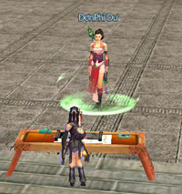**

- **Phần thưởng**:  50 điểm Nghĩa Hiệp. 05 Rương ngoại phủ Bạch Đế Thành (mở ra vật phẩm ngẫu nhiên). 10 Kim Ngọc Trát - Mỹ Nhân Đồ (mỗi vật phẩm đổi được 100 Danh Vọng). 05 Hiệp Công Lục Lâm - Mỹ Nhân Đồ (Đổi 500 cống hiến mỗi cái)

### Hoạt động ngẫu nhiên hằng ngày - Môn phái

- **Thời gian**: Từ 19h00 đến 20h00 mỗi ngày, lần lượt tại mỗi môn phái lớn sẽ diễn ra hoạt động ngẫu nhiên, người chơi đến khu vực bản đồ môn phái chỉ định để tham gia hoạt động.

- **Điều kiện tham gia**: Nhân vật đẳng cấp 15 trở lên.

- **Phần thưởng**:

- **Vị trí**: Tại các bản đồ môn phái.

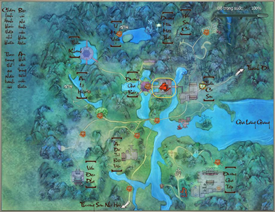  
 Vị trí diễn ra sự kiện "[Đường Môn](../mon-phai/duong-mon.md) - Đường gia đưa dâu"

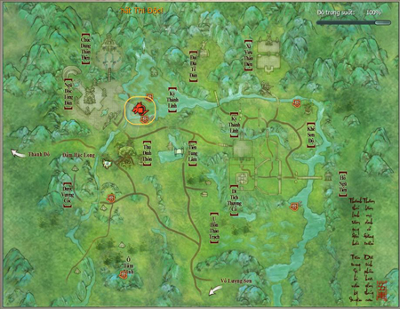  
 Vị trí diễn ra sự kiện "[Ngũ Độc](../mon-phai/ngu-doc.md) - Khúc Vân giải độc"

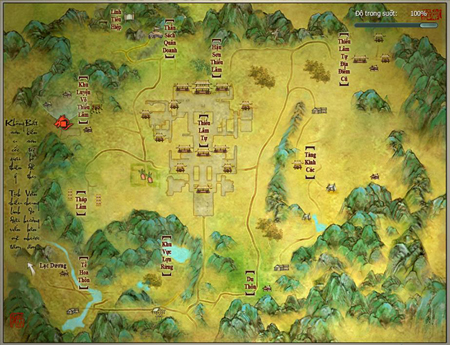  
 Vị trí diễn ra sự kiện "[Thiếu Lâm](../mon-phai/thieu-lam.md) - Đại hội thi đấu"

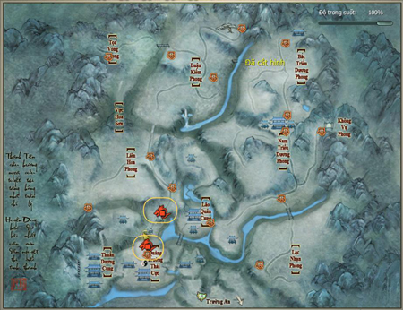  
 Vị trí diễn ra sự kiện "[Thuần Dương](../mon-phai/thuan-duong.md) - Kazuto quấy nhiễu"

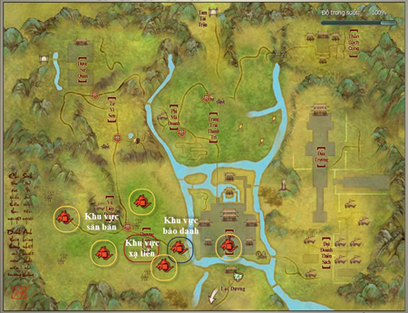  
 Vị trí diễn ra sự kiện "[Thiên Sách](../mon-phai/thien-sach.md) - [Bãi Săn](../he-thong/bai-san-khuay-dong-vung-troi-thien-sach.md)"

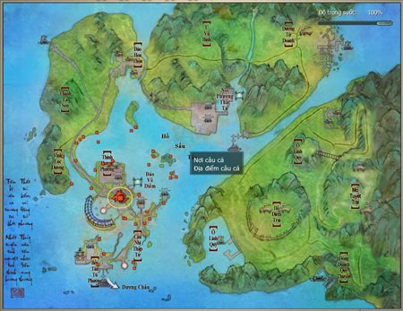  
 Vị trí diễn ra sự kiện "[Thất Tú](../mon-phai/that-tu.md) - Đại hội tỷ võ"

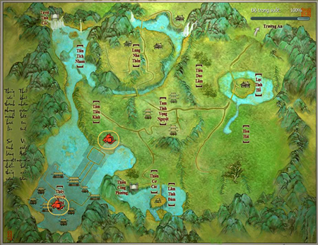  
 Vị trí diễn ra sự kiện "[Vạn Hoa](../mon-phai/van-hoa.md) - Cơ giáp đại chiến"

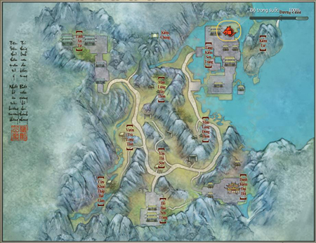  
 Vị trí diễn ra sự kiện "[Tàng Kiếm](../mon-phai/tang-kiem.md) - Diệp Phàm đón dâu"

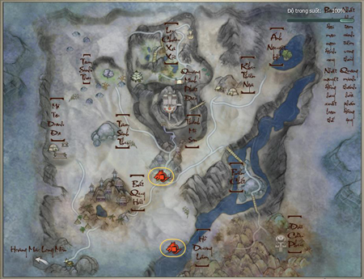  
 Vị trí diễn ra sự kiện "[Minh Giáo](../mon-phai/minh-giao.md) - Bảo vệ Lục Yên Nhi"

Nguồn: VNG (bài viết và hình ảnh)
