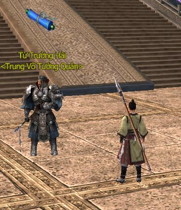
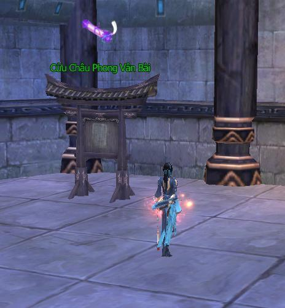
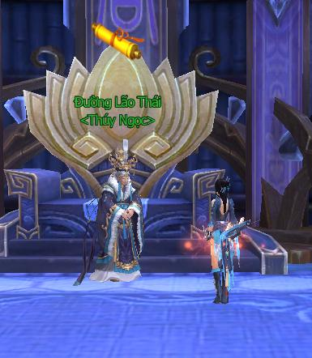
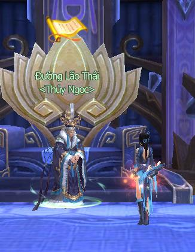
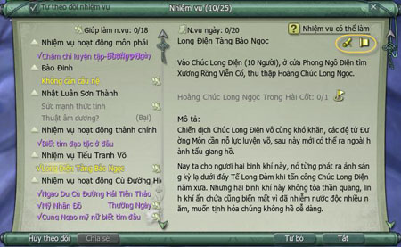

Với sự phong phú và đa dạng về các thể loại, hệ thống nhiệm vụ trong Võ Lâm 3 có thể giúp đồng đạo trải nghiệm một cách đầy đủ nhất khi phiêu lưu mạo hiểm trong thế giới võ hiệp đầy bất ngờ và thú vị. Thông qua việc thực hiện các nhiệm vụ, đồng đạo có thể dễ dàng tìm hiểu bối cảnh trò chơi, luyện cấp, thu thập trang bị và nâng cao danh vọng.

### Phân loại nhiệm vụ

Nhiệm vụ trong thế giới Võ Lâm 3 đa dạng phong phú, có thể chia làm 03 loại hình nhiệm vụ chính như sau:

- **Nhiệm vụ tăng cấp**(trục cuốn màu vàng): Nhiệm vụ chính tăng điểm kinh nghiệm.  
 

- **Nhiệm vụ tuần hoàn** (trục cuốn màu xanh): Nhiệm vụ có thể thực hiện nhiều lần trong ngày.  
 

- **Nhiệm vụ hoạt động** (trục cuốn màu tím): Bao gồm các nhiệm vụ hoạt động ngày lễ và nhiệm vụ phe phái.  
 

#### Nhận và thực hiện nhiệm vụ

| Hình ảnh | Nội dung |
| --- | --- |
|  **Nhiệm vụ có thể nhận** | Đối thoại với những NPC có quyển trục cuộn vàng trên đầu để nhận nhiệm vụ, quyển trục cuộn lại tức hiện đang có nhiệm vụ cần đồng đạo giúp đỡ. Khi gặp NPC có quyển trục được mở ra phát sáng, tức là đồng đạo đã hoàn thành nhiệm vụ được giao và có thể mang vật phẩm nhiệm vụ hoặc đến đối thoại để nhận phần thưởng. Các NPC có quyển trục cuộn lại màu xanh nghĩa là có nhiệm vụ tuần hoàn. Các NPC có quyển trục cuộn lại màu xanh lục nghĩa là nhiệm vụ đó có cấp độ thấp hơn so với cấp độ hiện tại của nhân vật, dù có hoàn thành thì phần thưởng kinh nghiệm cũng sẽ giảm đi một phần. |
|  **Nhiệm vụ đã hoàn thành** |  |
|  | Trên bản đồ lớn cũng như bản đồ nhỏ có thể thấy được vị trí của NPC nhận và trả nhiệm vụ với ký hiệu tương ứng. |

#### Hướng dẫn nhiệm vụ

- Có thể tìm hướng dẫn hoặc nội dung của nhiệm vụ đang tiến hành trong giao diện nhiệm vụ. Nhấn L để mở giao diện, nội dung bên trong bao gồm danh sách nhiệm vụ đã nhận và miêu tả chi tiết cho mỗi nhiệm vụ đó: mục tiêu, đối tượng, phần thưởng.

- Hệ thống còn có thể phân loại nhiệm vụ theo khu vực, tiện cho người chơi có thể dễ dàng quản lý, theo dõi thực hiện.

- Kéo “nút thắt hoa” bên phải giao diện có thể dịch chuyển giao diện thông tin nhiệm vụ.

#### Theo dõi nhiệm vụ

- Mặc định hệ thống sẽ theo dõi 5 nhiệm vụ gần nhất đồng đạo vừa nhận. Nhiệm vụ được theo dõi sẽ xuất hiện trên danh sách nhiệm vụ trên màn hình chính để thuận tiện cho đồng đạo dễ dàng thực hiện.

- Nhấp vào biểu tượng quyển trục cuộn lại trên góc phải giao diện nhiệm vụ sẽ mở ra vị trí của NPC mà đồng đạo đã nhận nhiệm vụ đó trên bản đồ lớn. Tương tự với quyển trục mở ra sẽ cho người chơi biết được vị trí của NPC để trả nhiệm vụ.

*Nhấp vào trục cuốn để biết vị trí NPC nhận và trả nhiệm vụ*

### Hướng dẫn về mô tả nhiệm vụ

Trong phần nội dung đối thoại với NPC, những từ khóa mô tả cần thực hiện cho nhiệm vụ đều được dùng màu sắc để đồng đạo dễ dàng nắm bắt:

- **Màu đỏ**: Tên quái cần tiêu diệt.

- **Màu xanh lam**: Tên vật phẩm cần thu thập.

- **Màu xanh lục**: Tên bản đồ và tên NPC cần tìm.

### Độ khó nhiệm vụ

Nhiệm vụ trong danh sách liệt được dùng màu sắc để phân biệt độ khó dễ của nhiệm vụ so với cấp độ nhân vật. Nhiệm vụ càng đơn giản thì phần thưởng kinh nghiệm càng ít.

- **Nhiệm vụ màu xám**: quá đơn giản, đồng đạo nên từ bỏ nhiệm vụ màu này (cấp độ nhiệm vụ thấp hơn cấp độ nhân vật 9 cấp trở lên).

- **Nhiệm vụ xanh lục**: rất đơn giản (cấp độ nhiệm vụ thấp hơn cấp độ nhân vật 4 - 8 cấp).

- **Nhiệm vụ vàng**: thích hợp cho nhân vật rèn luyện cấp độ (cấp độ nhiệm vụ chênh lệch với cấp độ nhân vật 3 cấp).

- **Nhiệm vụ cam**: hơi khó khăn, nên tìm vài đồng đội hỗ trợ để hoàn thành nhiệm vụ (cấp độ nhiệm vụ cao hơn cấp nhân vật 4 - 5 cấp).

- **Nhiệm vụ đỏ**: vô cùng khó khăn, nên luyện thêm vài cấp rồi hãy quay trở lại nhận nhiệm vụ này (cấp độ nhiệm vụ cao hơn cấp độ nhân vật 6 cấp trở lên).

*Phân loại nhiệm vụ theo màu sắc trục cuốn*

### Hạn chế số lượng nhiệm vụ

Tổng số nhiệm vụ trên danh sách nhiệm vụ nhân vật có thể nhận là 25, nếu đã đạt giới hạn này mà đồng đạo vẫn muốn nhận thêm nhiệm vụ mới bắt buộc phải từ bỏ một số nhiệm vụ đã nhận từ trước. Đồng đạo có thể từ bỏ nhiệm vụ bất cứ lúc nào, nếu muốn làm lại nhiệm vụ thì buộc phải đến vị trí cũ nhận lại.

### Hỗ trợ nhiệm vụ

- Người hỗ trợ và người được hỗ trợ bắt buộc phải cùng tổ đội và ở gần nhau.

- Người hỗ trợ phải hoàn thành nhiệm vụ này từ trước.

- Giới hạn người chơi hỗ trợ người khác làm nhiệm vụ mỗi ngày không quá 16 lần.

### Phần thưởng hỗ trợ nhiệm vụ

Khi tổ đội cùng làm một nhiệm vụ thì độ hảo hữu của người hỗ trợ và người được hỗ trợ đều được tăng thêm 05 điểm. Người hỗ trợ sẽ nhận được 04 điểm tinh lực và 04 điểm thể lực.

Nguồn: VNG (bài viết và hình ảnh)
