## Giới thiệu

Nam Chiếu Vương dùng thân phận phú hào ẩn náu ở Trung Nguyên nhiều năm, cho rằng thời cơ đã đến, đã có âm mưu khởi binh tấn công Đại Đường.

Qua nhiều năm chiến tranh, Đại Đường gặp khó khăn, dân chúng lầm than. Sau khi các nghĩa sĩ giang hồ tụ tập ở Tụ Hiền Trang đại náo Đồ Long Đại Hội, phát hiện Vương Gia Thiên Nam và Thần Kiếm Nam Chiếu có mưu đồ gây rối.

Trung Nguyên Kiếm Thánh một mình đến Nam Chiếu, muốn dùng thanh kiếm trong tay phá bỏ bức màn tội ác, trảm sát hàng nghìn binh tướng Nam Chiếu, nhưng đã bị Thần Kiếm Nam Chiếu là Đại Đường Kiến Ninh Vương - Lý Đàm dùng con tin uy hiếp, Kiếm Thánh đành phải thả Lý Đàm.

[Video](http://www.youtube.com/embed/A-qd-ZoXqeo?rel=0)

 ***Hoàng Cung Nam Chiếu - Nơi ẩn thân của Kiến Ninh Vương Lý Đàm***

Lý Phục biết đã bứt dây động rừng, tình hình nghiêm trọng, bắt giặc phải bắt kẻ cầm đầu trước, đã dẫn các cao thủ Trung Nguyên đến Hoàng Cung Nam Chiếu. Nam Chiếu Vương lật bài úp, hào kiệt Trung Nguyên và quần hùng Nam Chiếu ở Nam Cương Cung Thành đã tiến hành cuộc chiến kịch liệt để bảo vệ bách tính lương dân!

Kể từ ngày**28/10/2013**, cánh cổng **Hoàng Cung Nam Chiếu** sẽ rộng mở để chư vị nhân sĩ tham gia hỗ trợ Lý Phục ngăn chặn mưu đồ phản Đường của Kiến Ninh Vương.

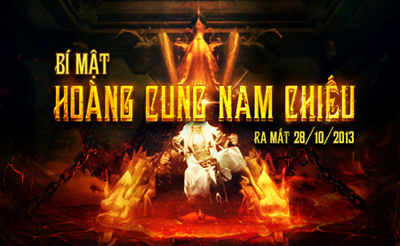

### Bản đồ & điều kiện tham gia

- **Đẳng cấp nhân vật**: Cấp **80** trở lên.

- **Yêu cầu**: Tổ đội 25 người.

- **Lối vào phó bản**: Phía Đông Bắc bản đồ Thương Sơn Nhĩ Hải.

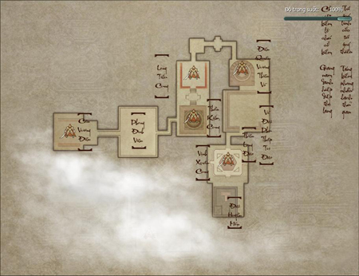

### Boss

| **Hình ảnh** | **Ghi chú** |
| --- | --- |
| **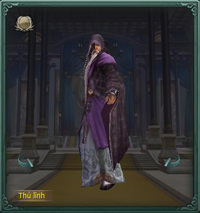Khô Vinh Đại Sư** | Khô Vinh Đại Sư là cao tăng Thiên Long Tự, bị Cung Chủ Thần Kiếm Đoàn Kiệm Ngụy dụ dỗ, đến Nam Chiếu hoàng cung trợ uy. Đoàn Kiệm Ngụy lệnh cho đệ tử kết thành Lục Mạch Thần Kiếm Trận bảo vệ Khô Vinh Đại Sư, dùng Nhất Dương Chỉ của Khô Vinh Đại Sư, hiệp sĩ chưa kịp thời thi triển khinh công hoặc bộ pháp e rằng khó thoát. **Đẳng cấp**: **83** **Sinh lực**: **72.580.000** |
| **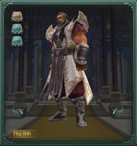 Đoàn Tông Công** | Đoàn Tông Công là lão tướng lập nhiều chiến công cho nam Chiếu, giỏi phòng thủ phản kích. Thái Sùng Thái là một trong những người sáng lập Thái Quyền, võ công tuyệt đỉnh, là Quyền Pháp Lão Sư cảu Nam Chiếu Quân. Các La Hồng là Bắc Viện Đại Vương, thống soái hơn một nửa binh mã của Nam Chiếu, rất trung thành với Nam Chiếu Vương - Các La Phụng. **Đẳng cấp**: **83** **Sinh lực Đoàn Tông Công**:**47.600.000** **Sinh lực Thái Sùng Thái**:**47.600.000** **Sinh lực Các La Hồng**:**47.600.000** |
| **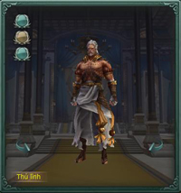 Thái Sùng Thái** |  |
| **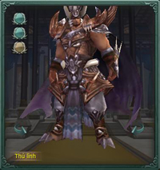 Các La Hồng** |  |
| ** Tiêu Sa** | Huyết Nhãn Long Vương - Tiêu Sa nhận lời Nam Chiếu Vương - Các La Phụng, phụ trách trấn thủ Long Tiếu Cung. Tạ Uyên muốn trừ hại cho võ lâm, Mục Huyền Anh đến báo thù cho cha, Vương Di Phong chịu án oan tại Tự Cống và Mạc Vũ đến trợ uy sẽ cùng hắn chiến đấu tại đây. **Đẳng cấp**: **83** **Sinh lực**: **114.200.000** |
| **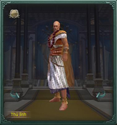Ma Đề Gia La** | Sau khi Sư Tử Quang qua đời, Ma Đề Gia La trở thành Bồ Đề Chưởng Hội, ra sức phát triển Bồ Đề Hội, thề khôi phục Phật Pháp tại Trung Nguyên, phái người đến [Thiếu Lâm](../mon-phai/thieu-lam.md) Trung Nguyên đoạt lại kinh thư. Ông đến Ấn Độ và Tây Vực, với ý đồ liên minh với các thế lực đối địch với Thiếu Lâm. **Đẳng cấp**: **83** **Sinh lực**: **264.380.000** |
| **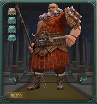 Trần Hòa Thượng** | Liễu Công Tử, Trần Hòa Thương, Khang Tuyết Chúc là ác mộng của nữ nhi, Huyết Đao Phi Mặc của họ xuất quỷ nhập thần. Khi Nam Chiếu Vương đổi quân phục đích thân xuất chiến, trận ác chiến mới vừa bắt đầu! **Đẳng cấp**: **83** **Sinh lực Trần Hòa Thượng**:**54.400.000** **Sinh lực Khang Tuyết Chúc**:**55.080.000** **Sinh lực Liễu Công Tử**:**43.350.000** **Sinh lực Các La Phụng**:**76.50-0.000** |
| **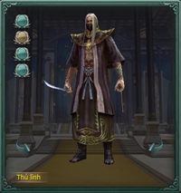 Khang Tuyết Chúc** |  |
| **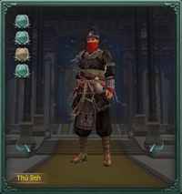 Liễu Công Tử** |  |
| **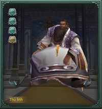 Các La Phụng** |  |
| **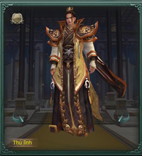Lý Đàm** | Để lên ngôi và thay đổi thể chế Đại Đường, trả thù cho tỷ tỷ, cuối cùng trở thành Nhất Đại Minh Quân lý tưởng trong mắt tỷ tỷ, Kiến Ninh Vương Lý Đàm với thân phận bề trên có thể lợi dụng và vứt bỏ bất cứ người nào. Hắn cùng Nam Chiếu - Các La Phụng kết liên minh, phát động đại loạn Nam Chiếu phản Đường, lại bị võ lâm Trung Nguyên ngăn cản, thắng thua khó đoán. **Đẳng cấp**: **84** **Sinh lực**: **168.480.000** |

### Ảnh đẹp phó bản

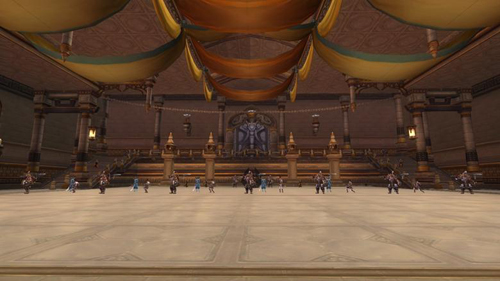

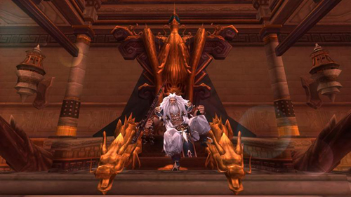  
 ***"Huyết Nhãn Long Vương" Tiêu Sa trấn thủ Long Tiếu Cung***

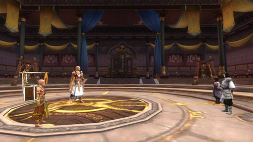  
 ***Lý Phục cùng nhân sĩ võ lâm tiến công Hoàng Cung***

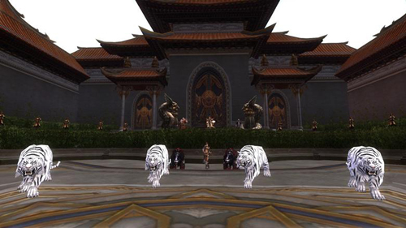

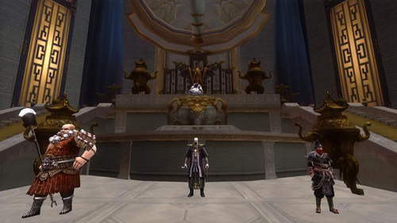

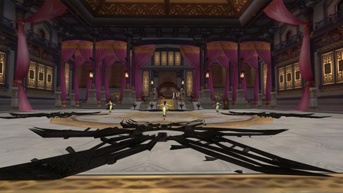

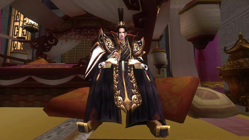  
 ***"Kiến Ninh Vương" Lý Đàm - Kẻ phát động Nam Chiếu phản Đường***

Thông tin về **những phần thưởng hấp dẫn và giá trị của phó bản Hoàng Cung Nam Chiếu sẽ được tiết lộ ở bài viết tiếp theo**, thân mời quý nhân sĩ đón theo dõi.

Hệ thống Phó Bản phong phú và đặc sắc của Võ Lâm 3 vẫn đang rộng mở đón chờ các anh hùng hào kiệt khắp chốn chinh phục. Quý nhân sĩ hãy tham gia ngay hôm nay để không bỏ lỡ cơ hội trở thành một nhân vật truyền kỳ chốn võ lâm.

## Phần thưởng

Tại bản tin trước, quý nhân sĩ đã được biết về cuộc đại chiến ở Nam Cương Cung Thành để chống lại âm mưu phản Đường, bảo vệ bách tính của Lý Phục cùng các cao thủ trung nguyên. Theo đó, nếu muốn hỗ trợ Lý Phục ngăn chặn kế hoạch của "Kiến Ninh Vương" Lý Đàm, quý nhân sĩ sẽ phải tiến vào **Hoàng Cung Nam Chiếu** - nơi được canh phòng cực kỳ cẩn mật, bẫy rập vô số, nguy hiểm trùng trùng, cửu tử nhất sinh.

[Video](http://www.youtube.com/embed/A-qd-ZoXqeo?rel=0)

 ***Hoàng Cung Nam Chiếu - Nơi ẩn thân của Kiến Ninh Vương Lý Đàm***

Phú quý hiểm trung cầu, tuy hung hiểm vô song nhưng Hoàng Cung Nam Chiếu cũng là nơi cất giữ một phần quốc khố Nam Chiếu với vô số kỳ trân dị bảo, binh giáp tàng thư. Khi thành công vượt qua phó bản, quý nhân sĩ sẽ có cơ hội sở hữu **trang bị phẩm chất 330 - 335**với những thuộc tính uy lực hơn người,**mảnh vỡ Phá Quân đổi trang bị môn phái**cùng vật phẩm nhiệm vụ **vũ khí đặc biệt của [Thuần Dương](../mon-phai/thuan-duong.md), [Thiên Sách](../mon-phai/thien-sach.md) và [Minh Giáo](../mon-phai/minh-giao.md)**.

Sau đây, thân mời quý nhân sĩ tham khảo thông tin về những bảo vật sẽ xuất hiện trong **Hoàng Cung Nam Chiếu - phó bản mạnh nhất Võ Lâm 3 hiện tại**, được ra mắt từ ngày **28/10/2013**.

### Vũ khí

#### Vũ khí phẩm chất 330 của các môn phái

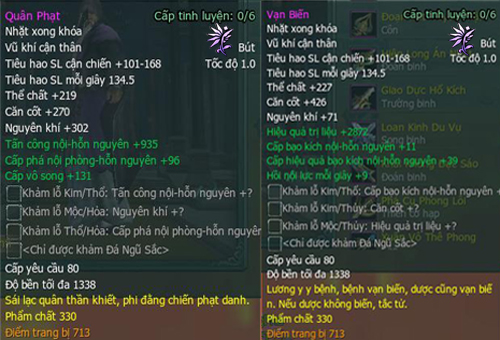
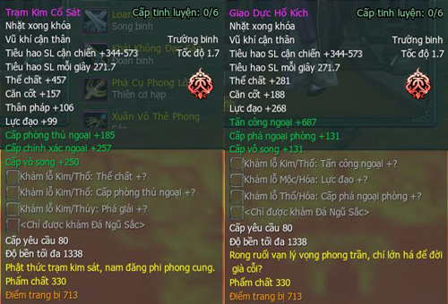
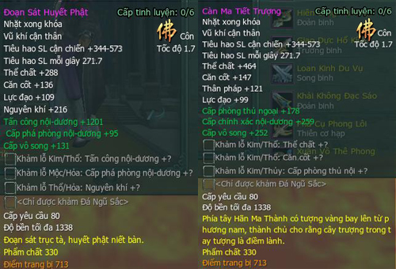
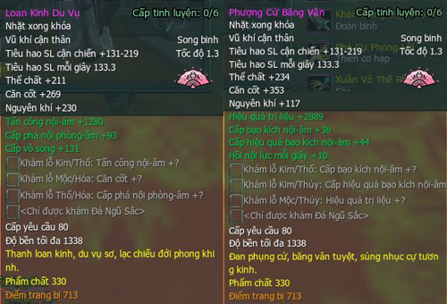
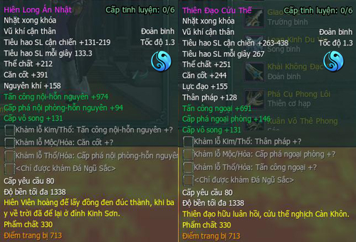
**Vũ khí phẩm chất 330 của các phái**

#### Vũ khí phẩm chất 335 (thuộc tính đặc biệt)

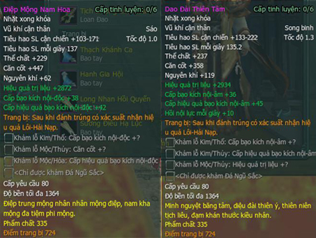  
 ***Vũ khí phẩm chất 335 của [Ngũ Độc](../mon-phai/ngu-doc.md), [Thất Tú](../mon-phai/that-tu.md), [Đường Môn](../mon-phai/duong-mon.md) và Minh Giáo***

### Trang bị phẩm chất 335

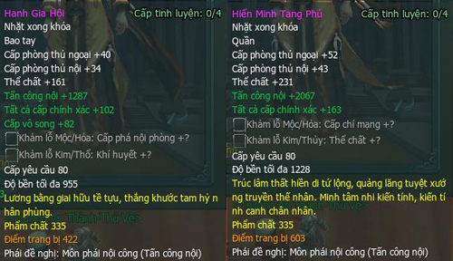  
 ***Trang bị theo 4 hướng: Nội công, ngoại công, trị liệu và phòng thủ***

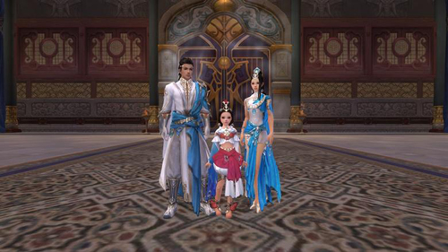  
 ***Vẻ đẹp hoàng tộc của những trang bị trong phó bản***

### Trang sức

#### Yêu trụy phẩm chất 320 (thuộc tính đặc biệt)

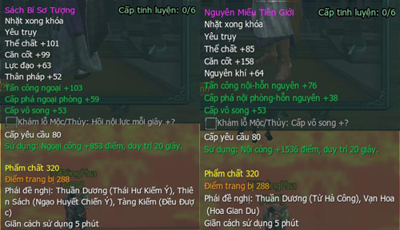  
 ***Yêu trụy 320 với những thuộc tính đặc biệt "bá đạo" trong 20 giây***

| Loại thuộc tính đặc biệt | Môn phái đề nghị |
| --- | --- |
| Trị liệu tăng 3.071 điểm, duy trì 20 giây | [Vạn Hoa](../mon-phai/van-hoa.md), Ngũ Độc, Thất Tú |
| Nội công tăng 1.536 điểm, duy trì 20 giây | Vạn Hoa, Ngũ Độc, Thuần Dương, Thiếu Lâm, Đường Môn, Minh Giáo, Thất Tú |
| Khí huyết tối đa tăng 20%, duy trì 20 giây | Thiếu Lâm, Thiên Sách, Minh Giáo |
| Ngoại công tăng 853 điểm, duy trì 20 giây | Thuần Dương, Thiên Sách, [Tàng Kiếm](../mon-phai/tang-kiem.md), Đường Môn |

#### Dây chuyền phẩm chất 300 (thuộc tính đặc biệt)

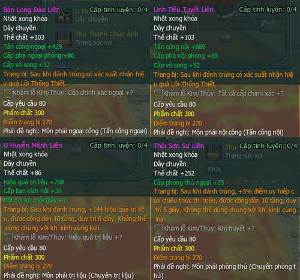  
 ***Dây chuyền theo 4 hướng: Nội công, ngoại công, trị liệu và phòng thủ***

### Vật phẩm khác

| **Hình ảnh** | **Vật phẩm** |
| --- | --- |
| **[Video](http://www.youtube.com/embed/K-FZ4i46Q-Q?rel=0) Nguyên liệu chế tạo Thần Binh 80 phẩm chất 280** | **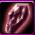** **Ô Kim Vân Thiết** |
| **** **Hóa Ngọc Huyền Tinh** |  |
| [Video](http://www.youtube.com/embed/slTM42uiFO0?rel=0) **Vật phẩm nhiệm vụ đổi vũ khí đặc biệt Thiên Sách** | **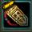** **Lệnh Bài Hỏa Chính** |
| **[Video](http://www.youtube.com/embed/fvSyZt0Iawg?rel=0)** **Vật phẩm nhiệm vụ đổi vũ khí đặc biệt Thuần Dương** | **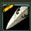** **Bao Kiếm Ngọc Nam Vương** |
| **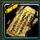** **Bùa Trấn Kiếm** |  |
| [Video](http://www.youtube.com/embed/wnVIF2FHqzk?rel=0) **Vật phẩm nhiệm vụ đổi vũ khí đặc biệt Minh Giáo** | **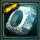** **Khóa Minh Nguyệt** |
| **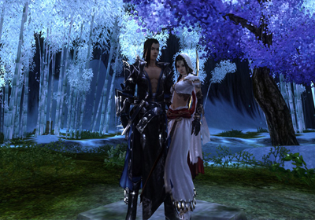** **Nguyên liệu đổi trang bị môn phái phẩm chất 310** | **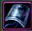** **Phá Quân** |

## Thuật ngữ thường dùng

- **Tank - Tanker**: Nhân vật chịu sát thương chính, sinh lực cao, phòng thủ mạnh, phụ trách thu hút cừu hận của Boss và NPC để bảo vệ các thành viên trong đội nhóm. Môn phái thích hợp: Thiếu Lâm, Thiên Sách, Minh Giáo...

- **DPS - Damage Dealer**: Nhân vật có khả năng gây sát thương mạnh tầm xa hoặc cận chiến, phụ trách tấn công Boss và NPC, sinh lực trung bình, phòng thủ yếu. Môn phái thích hợp: Đường Môn, Thuần Dương, Tàng Kiếm...

- **Buff - Healer**: Nhân vật có các kỹ năng hồi sinh lực cho một hoặc nhiều mục tiêu, là linh hồn của đội nhóm, sinh lực và phòng thủ trung bình/yếu. Môn phái thích hợp: Vạn Hoa, Ngũ Độc, Thất Tú...

## Boss 1: Khô Vinh Đại Sư

"Khô Vinh Đại Sư vốn là một cao tăng của Thiên Long Tự, bị Cung Chủ Thần Kiếm Đoàn Kiệm Ngụy dụ dỗ, đến Nam Chiếu hoàng cung trợ uy. Đoàn Kiệm Ngụy lệnh cho đệ tử kết thành Lục Mạch Thần Kiếm Trận bảo vệ Khô Vinh Đại Sư, dùng Nhất Dương Chỉ của Khô Vinh Đại Sư, hiệp sĩ chưa kịp thời thi triển khinh công hoặc bộ pháp e rằng khó thoát."

Đó là những thông tin được giang hồ đồn đãi về **Khô Vinh Đại Sư - Boss đầu tiên của phó bản Hoàng Cung Nam Chiếu**. Với lượng sinh lực "khủng" đến 72.580.000 cùng những luồng kiếm khí nguy hiểm có khả năng "nhất kích tất sát", vị cao tăng này chính là một chướng ngại khó lòng vượt qua cho những ai muốn chinh phục phó bản và tìm kiếm những vũ khí đặc biệt của Thuần Dương, Thiên Sách hay Minh Giáo.

[Video](http://www.youtube.com/embed/wnVIF2FHqzk?rel=0)

 *Vũ khí đặc biệt Minh Giáo - Cơn cuồng nộ của đại mạc*

Vì lẽ đó, để hỗ trợ quý nhân sĩ sớm ngày sở hữu các trang bị mạnh mẽ và đẹp mắt từ Hoàng Cung Nam Chiếu, Võ Lâm 3 thân mời chư vị cùng tham khảo bản **hướng dẫn cách vượt qua Khô Vinh Đại Sư**. Chi tiết:

### Phân bố đội hình

- **Tank**: 1 tank Thiếu Lâm hoặc 1 tank chính Thiếu Lâm + 1 tank phụ sinh lực cao.

- **Buff**: Tổ đội từ 5 buff trở lên. Kiến nghị: 2 Ngũ Độc, 2 Thất Tú, 1 Vạn Hoa hoặc 2 Ngũ Độc, 3 Thất Tú.

- **DPS**: Số nhân vật còn lại trong đội nhóm, không hạn chế cận chiến hoặc tầm xa. Số lượng DPS cận chiến không quá 12 người.

### Chi tiết cần lưu ý

| Hình ảnh | Ghi chú |
| --- | --- |
| 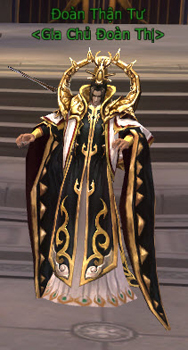 **Đoàn Thận Tư - NPC nhận hiệu ứng kháng kiếm khí** | 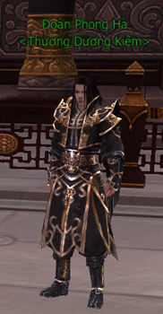 **Đoàn Phong Hà - 1 trong 6 Boss nhỏ tượng trưng cho Lục Mạch Thần Kiếm** |
| 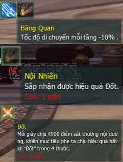 **Các hiệu ứng bất lợi do Boss gây ra** |  |

### Hướng dẫn đánh bại Khô Vinh Đại Sư

- Phân công 12 DPS tấn công 6 Boss nhỏ ở vòng ngoài. Các DPS này phải **nhận hiệu ứng kháng kiếm khí** tương ứng Boss của mình tại **NPC Đoàn Thận Tư**. Các thành viên còn lại tập trung tấn công Khô Vinh Đại Sư.

- Trong lúc tấn công, 6 Boss nhỏ sẽ di chuyển xung quanh vòng ngoài, các DPS được phân công phải đi theo Boss và **đỡ kiếm khí cho đồng đội** bên trong.

- Thành viên bị trúng hiệu ứng bất lợi **Băng Quan** và **Nội Nhiên** có thể chạy đến cạnh tanker chính để các buff sử dụng kỹ năng trị liệu hồi sinh lực nhóm.

- Trong khi chiến đấu, Khô Vinh Đại Sư sẽ ngẫu nhiên gọi tên 1 thành viên thắp đuốc lên, lúc này nhân vật được gọi tên sẽ có thể di chuyển đến gần các thành viên bị Băng Quan để giải hiệu ứng. **Nhân vật được giải hiệu ứng phải chú ý sinh lực để tránh bị thương**.

- Các buff phải phân tán xa nhau và chia đều trong các vòng, nếu bị trúng hiệu ứng bất lợi thì phải lập tức vào trong đứng cạnh tanker chính để được hồi sinh lực.

- Các DPS tầm xa tập trung gây sát thương lên Boss Khô Vinh Đại Sư và đồng thời chú ý né kiếm khí của 6 Boss nhỏ.

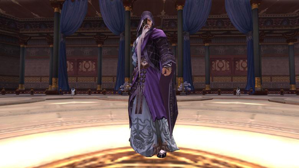  
 *Khô Vinh Đại Sư - Cao tăng nổi danh cùng tuyệt học Nhất Dương Chỉ*

Hy vọng thông tin này sẽ giúp quý nhân sĩ thêm thuận đường bôn tẩu và sớm ngày chinh phục được phó bản Hoàng Cung Nam Chiếu.

## Boss 2: Đoàn Tông Công, Thái Sùng Thái, Các La Hồng

Sau khi vượt qua Boss đầu tiên của Hoàng Cung Nam Chiếu - Khô Vinh Đại Sư, quý nhân sĩ sẽ tiếp tục được đối đầu với Boss 2 - những nhân vật thanh danh hiển hách nhất Nam Chiếu: "Lão tướng" **Đoàn Tông Công**, "Quyền Pháp Lão Sư" **Thái Sùng Thái** và "Bắc Viện Đại Vương" **Các La Hồng**.

[Video](http://www.youtube.com/embed/A-qd-ZoXqeo?rel=0)

 ***Hoàng Cung Nam Chiếu - Phó bản mạnh nhất VLTK Võ Lâm 3 hiện nay***

Dưới mệnh lệnh của "Nam Chiếu Vương" Các La Phụng, họ sẽ trở thành những đối thủ ngăn cản bước tiến của chư vị nhân sĩ tại Hoàng Cung Nam Chiếu. Và để quý nhân sĩ có thể sớm ngày tiến vào Hoàng Cung hỗ trợ Lý Phục ngăn chặn âm mưu phản Đường của "Kiến Ninh Vương" Lý Đàm, Võ Lâm 3 thân gửi đến chư vị bản **hướng dẫn cách vượt qua Boss 2** như sau:

### Phân bố đội hình & chi tiết lưu ý

- **Tank**: 3 tank Thiếu Lâm hoặc Thiên Sách hoặc Minh Giáo.

- **Buff**: Tổ đội từ 5 - 6 buff trở lên. Kiến nghị nên có đủ 3 môn phái Ngũ Độc, Thất Tú và Vạn Hoa.

- **DPS**: Số nhân vật còn lại trong đội nhóm.

- **Lưu ý**:  Có 3 Boss là Thái Sùng Thái/Đoàn Tông Công/Các La Hồng. Quá trình đánh Boss được chia làm 3 giai đoạn. Đánh hết 5 Boss nhỏ phía ngoài sẽ bước vào giai đoạn 1.

### Giai đoạn 1

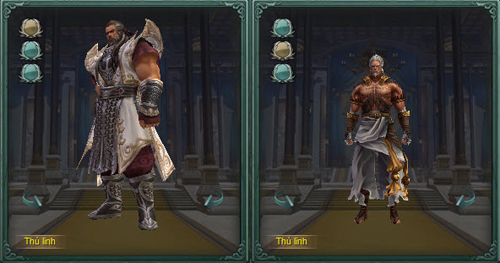  
 ***Đoàn Công Tông - Thái Sùng Thái***

- Tanker 1 - 2 chia làm 2 hướng trái/phải thu hút cừu hận của Thái Sùng Thái và Đoàn Công Tông. Tanker 3 còn lại sẽ phụ trách hút cừu hận khi Thương Binh xuất hiện.

- **Phong Ấn**: Thái Sùng Thái sẽ ngẫu nhiên phóng thích kỹ năng "Phong Ấn", gây mất máu kèm xác xuất bị định thân, các DPS phải đứng phân tán ra và không nên tập trung lại thành 1 nhóm.

- **Tần Quyền Thủ**: Thái Sùng Thái sẽ sử dụng Tần Quyền Thủ tạo ra những luồng sóng công kích về phía trước. Tổng cộng có 04 đợt Tần Quyền Thủ với số luồng sóng là 2 - 3 - 3 - 2. Các DPS có thể tấn công các luồng sóng để bảo vệ đội nhóm.

- **Cầu Xanh**: Khi Cầu Xanh xuất hiện, đội trưởng chỉ định 1 thành viên đến nhận và sau đó di chuyển tách ra xa nhóm, chú ý cự ly để nhận trị liệu và nên mở những kỹ năng/trạng thái giảm sát thương của bản thân.

- **Thương Binh và Cầu Đỏ**:  Tanker 3 sẽ phụ trách hút Thương Binh (bên trái hoặc bên phải) đến gần vị trí trung tâm. Các DPS công kích Thương Binh còn 30% sinh lực thì ngưng, chờ **Cầu Đỏ** xuất hiện. Tanker 3 sẽ kéo Thương Binh di chuyển vào trung tâm để nhận Cầu Đỏ, lúc này Thương Binh sẽ bị trúng độc "Bão Phá Kích", các DPS có thể tiếp tục tiêu diệt Thương Binh và Cầu Đỏ sẽ không phát nổ. Ở đợt Tần Quyền Thủ thứ 2 và 3 sẽ xuất hiện thêm 2 Thương Binh mới. Tanker 3 tiếp tục hút cừu hận và đánh dấu 1 trong 2 Thương Binh, các DPS sẽ tập trung tấn công mục tiêu được đánh dấu. **Khi hút Thương Binh cần chú ý hướng di chuyển để Thương Binh không gây sát thương cho các NPC Thiên Sách**.

- Đánh xong 4 đợt Tần Quyền Thủ sẽ chuẩn bị chuyển sang giai đoạn 2. Tanker phụ trách Thái Sùng Thái phải kéo Boss di chuyển ra xa nhóm, các thành viên còn lại tập trung cạnh Đoàn Công Tông.

### Giai đoạn 2

- **Hoán đổi sinh lực**: 2 Boss sẽ lần lượt kích hoạt khả năng hoán đổi sinh lực cho nhau theo thứ tự cố định: Đoàn Công Tông → Thái Sùng Thái → Đoàn Công Tông → Thái Sùng Thái, các DPS có thể dựa trên thứ tự để tấn công Boss. Khi còn **9% sinh lực,** Thái Sùng Thái sẽ ngồi xuống.

- **Thống Soái**: Khi Thái Sùng Thái ngồi xuống, Tanker phụ trách Boss và Tanker 3 phải đến vị trí trung tâm để chờ Thống Soái xuất hiện. Tanker bị Thống Soái đuổi theo sử dụng Nhiếp Vân Truy Nguyệt để **di chuyển về Thái Sùng Thái**. Sau khi Thống Soái chết sẽ rơi ra **Mảnh Giáp**.

- **Thái Sùng Thái điểm danh**: Thành viên bị Thái Sùng Thái điểm danh phải di chuyển từ từ và kéo Boss ra xa khỏi nhóm.

- **Tiệt Mạch** (định thân): Kỹ năng Băng Hư Ngự Phong của Thuần Dương (có mật tịch) hoặc Hồ Điệp của Ngũ Độc có thể giải hiệu quả Tiệt Mạch.

- **Chước Thiêu**: Thành viên trúng hiệu ứng Chước Thiêu phải di chuyển ra ngoài để không gây sát thương cho đồng đội xung quanh.

- **Thái Sùng Thái - Trửu Kích**: Tanker nhận được 2 Mảnh Giáp rơi ra từ Thống Soái có thể khắc chế Trửu Kích của Thái Sùng Thái.

### Giai đoạn 3

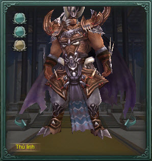  
 ***"Bắc Viện Đại Vương" Các La Hồng***

- **Dằn Vặt**: Nhân vật trúng hiệu ứng Dằn Vặt sẽ bị giảm sinh lực, **hấp thu trị liệu** (tất cả kỹ năng trị liệu nhóm xung quanh sẽ chỉ có tác dụng cho thành viên này) và **phát nổ**. Thành viên phái Ngũ Độc - Thất Tú - Vạn Hoa trúng Dằn Vặt sau một thời gian sẽ tự hóa giải nhưng vẫn phát nổ. Sau khi nổ, Boss sẽ tiếp tục gây Dằn Vặt cho một thành viên khác.

## Boss 3: Tiêu Sa

Nếu đã từng trải qua tham gia phó bản [Hồi Ức Trì Quốc Thiên Vương](./pho-ban-10-nguoi.md#hồi-ức-trì-quốc-thiên-vương), chắn chắn quý nhân sĩ sẽ không thể nào quên được **Tiêu Sa** - nhân vật gây ra cuộc thảm sát ở Tứ Xuyên năm xưa, làm chốn giang hồ dấy lên tinh phong huyết vũ, nỗi khiếp sợ của cả võ lâm và cũng là mục tiêu truy lùng của hắc bạch lưỡng đạo.

Nay, vì nhận lời "Nam Chiếu Vương" Các La Phụng, Tiêu Sa sẽ phụ trách trấn thủ Long Tiếu Cung - khu vực tiếp theo sau khi quý nhân sĩ vượt qua Boss 2 gồm bộ ba Thái Sùng Thái/Đoàn Tông Công/Các La Hồng.

[Video](http://www.youtube.com/embed/A-qd-ZoXqeo?rel=0)

 ***Hoàng Cung Nam Chiếu - Nơi nguy hiểm trùng trùng, kỳ bảo vô số***

Ngoài ra, trong lần tái chiến này còn có sự góp mặt của "Hạo Khí Minh Minh Chủ" Tạ Uyên, "Tiểu Phong Tử" Mạc Vũ cùng người bạn thân Mục Huyền Anh. Họ sẽ hỗ trợ đánh bại Tiêu Sa để quý nhân sĩ có thể tiếp tục tiến sâu vào Hoàng Cung, trợ giúp Lý Phục ngăn chặn âm mưu phản Đường của Lý Đàm.

Sau đây là thông tin hướng dẫn**cách vượt qua Boss 3 - "Huyết Nhãn Long Vương" Tiêu Sa**, thân mời quý nhân sĩ cùng tham khảo.

### Phân bố đội hình & chi tiết lưu ý

- **Tank**: 3 tank Thiếu Lâm hoặc Thiên Sách hoặc Minh Giáo.

- **Buff**: Tổ đội từ 5 - 6 buff trở lên. Kiến nghị nên có đủ 3 môn phái Ngũ Độc, Thất Tú và Vạn Hoa.

- **DPS**: Số nhân vật còn lại trong đội nhóm.

- **Lưu ý**:  Tiêu diệt các con sư tử ở lối đi Vũ Đại Phu. Mở cơ quan đầu rồng ở 2 bên cửa. **Trị liệu đầy sinh lực cho Mục Huyền Anh**.

### Giai đoạn 1

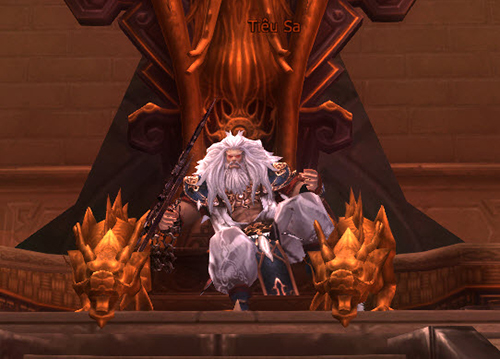  
 ***"Huyết Nhãn Long Vương" Tiêu Sa***

- **Cầu đỏ:** Né các quả cầu đỏ bay về hướng Boss.

- **Khí độc:** Tiêu Sa sẽ phóng khí độc phía về sau lưng mình, vì thế vị trí tốt nhất để đánh Boss là đứng sau lưng **Tạ Uyên**.

- Tiêu Sa có thể kéo và hút sinh lực của 1 thành viên bất kỳ, nếu trước khi đánh đã trị liệu đầy sinh lực cho Mục Huyền Anh thì thành viên này sẽ có cơ hội được cứu.

- **Nhĩ Quang**:  Tiêu Sa sẽ chọn 1 mục tiêu bất kỳ để thi triển Nhĩ Quang. Trước khi xuất chiêu, Tiêu Sa sẽ thực hiện 1 số động tác và vẫy tay phải để ném vòng Nhĩ Quang về phía trước 8 thước. Có thể sử dụng Lên Như Diều Gặp Gió để né hoặc chạy ra sau lưng Tiêu Sa. Nếu mục tiêu tiếp theo đang ở bên cạnh (ví dụ DPS cận chiến), Tiêu Sa sẽ bỏ qua các động tác ban đầu và ném vòng Nhĩ Quang. Khi Tiêu sa còn**79% sinh lực**sẽ bước sang**giai đoạn 2**.

### Giai đoạn 2

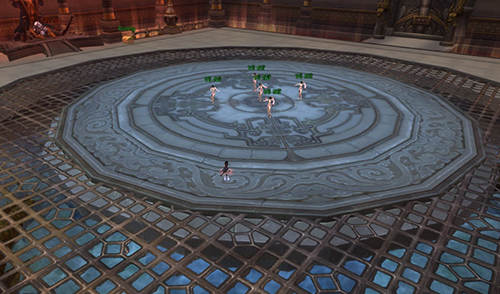  
 ***Toàn cảnh Long Tiếu Cung***

- Giai đoạn này tối đa duy trì 2 phút, sau đó sẽ bước sang giai đoạn 3. Nếu chưa đến 2 phút đã tấn công Tiêu Sa còn **50% sinh lực** thì sẽ vẫn chuyển sang giai đoạn 3.

- **Băng Tuyết Sương Hoàng**:  Các DPS cận chiến, tấn công nội - độc, tấn công nội - hỗn nguyễn sử dụng Lên Như Diều Gặp Gió nhảy lấy hiệu ứng Băng Tuyết Sương Hoàng (5 tầng), sau đó nhảy qua khỏi các mảnh đá vụn dưới chân và đi đánh Tiêu Sa. Khi thời gian hiệu lực của Băng Tuyết Sương Hoàng còn khoảng 5 giây thì ra tìm các thành viên Buff để chờ hồi sinh lực. Sau khi hồi đầy sinh lực, tiếp tục lấy hiệu ứng Băng Tuyết Sương Hoàng và đánh Tiêu Sa. **Chú ý**: Khi trong trạng thái Băng Tuyết Sương Hoàng không thể tiến hành trị thương và sử dụng các kỹ năng khinh công như Lên Như Diều Gặp Gió, Nhiếp Vân Truy Nguyệt... nhưng có thể sử dụng kỹ năng cơ động của môn phái như Đột, Thê Vân Tung, Điểu Tường Bích Không...

- **Mảnh đá vụn**: Bị đá rơi trúng sẽ gây sát thương, giảm sinh lực, choáng...

### Giai đoạn 3

- Thành viên bị Tiêu Sa điểm danh (gọi tên) phải dùng Nhiếp Vân Truy Nguyệt đi tìm **Mạc Vũ**. Mạc Vũ sẽ xuất chiêu chống đỡ sát thương của Tiêu Sa.

- **Long Vương Chi Nộ:**  Khác với [phó bản 10 người](./pho-ban-10-nguoi.md), Tiêu Sa 25 người xuất hiện thêm 1 kỹ năng AOE là Long Vương Chi Nộ, cách 10 giây sẽ xuất hiện một lần, sát thương không tính kháng khoảng 10.000 sinh lực. Tất cả DPS và Buff cần tập trung ở vị trí trung tâm và phân công sử dụng các kỹ năng hồi sinh lực.

- Các DPS cận chiến phải chú ý di chuyển ở khu vực trung tâm để tránh vòng Nhĩ Quang, đi vòng ra phía sau Boss để công kích Tiêu Sa.

- Các DPS tầm xa và Buff trong giai đoạn này phải phản ứng thật nhanh để tránh vòng Nhĩ Quang. Mỗi thành viên chỉ có 2 giây để phản ứng, nếu sau 2 giây không sử dụng Nhiếp Vân ra ngoài, Tiêu Sa sẽ xuất hiện ngay vị trí nhóm và ném vòng Nhĩ Quang.

- Khi Tiêu sa còn **39% sinh lực**sẽ bước sang**giai đoạn 4**.

### Giai đoạn 4

- DPS cận chiến tiếp tục áp sát công kích Tiêu Sa. Các Buff và DPS tầm xa chia ra xung quanh và chuẩn bị tránh Bào Long.

- **Bào Long:**  5 con rồng sẽ chia nhau truy sát 5 môn phái đánh xa (bao gồm cả Buff). thành viên bị truy sát phải chạy theo hướng định sẵn (ví dụ: ngược chiều kim đồng hồ), dọc theo hình vuông của khu vực chiến đấu. Không được chạy quá nhanh để rồng có thể theo kịp và cũng không nên quá chậm để rồng chạm vào người. Không được để rồng chạm vào thành viên khác. Không được để 2 rộng chạm vào nhau, cả nhóm sẽ bị trọng thương. Nếu rồng sắp chạm phải thành viên trong nhóm hoặc rồng khác, có thể sử dụng Lên Như Diều Gặp Gió hoặc khinh công giang hồ chạy để đến 1 vị trí khác và né tránh.

- **Long Tướng Ba Nặn**: Thành viên bị rồng chạm vào sẽ trúng hiệu ứng Long Tướng Ba Nặn. Khi đó **không được trị liệu** cho thành viên này vì sẽ gây ra tác dụng ngược. Chú ý cẩn thận khi sử dụng kỹ năng Hồ Điệp, Thiên Điệp Thổ Thụy, Túy Vũ Cửu Thiên…

- Khi Tiêu sa còn**19% sinh lực**sẽ bước sang**giai đoạn 5**.

### Giai đoạn 5

- Khi vào giai đoạn này những mảnh đá vụn và cầu đỏ sẽ xuất hiện lại.

- Các thành viên bị Bào Long truy đuổi phải tiếp tục dẫn Bào Long chạy. Rồng sẽ bị giảm tốc độ và dễ chạy hơn. Cần phải chú ý sử dụng kỹ năng Lên Như Diều Gặp Gió để né tránh cầu đỏ.

- Có thể để rồng chạm nhau và nổ, nhưng sử dụng phương án này phải chú ý các chi tiết:  Bên cạnh không được có các thành viên khác. Bản thân phải đầy sinh lực. Trong khoảng thời gian ngắn tiếp theo sẽ không có cầu đỏ xuất hiện. **Chú ý**: Cực kỳ nguy hiểm, khả năng cả nhóm "về thành dưỡng sức" rất cao.

- **Hồng cầu:** Sử dụng Lên Như Diều Gặp Gió để né, có thể quan sát thấy Tiêu Sa múa vũ khí trước khi cầu đỏ xuất hiện.

- **Mảnh đá vỡ vụn**: Phải né các mảnh đá vỡ, không được để chạm vào người.

- **Khí độc**: Di chuyển ra phía sau lưng Tạ Uyên để tránh khí độc

- **Băng Ngưng**:  Đứng yên sẽ rơi vào trạng thái Băng Ngưng, tăng công kích nhưng giảm tốc độ di chuyển. Tối đa cộng dồn 10 tầng Băng Ngưng, sau đó chuyển hóa thành định thân. Các DPS có thể sử dụng Băng Ngưng để tăng hiệu quả sát thương, tuy nhiên phải chú ý di chuyển trước khi Băng Ngưng đạt đến tầng 10.

Nguồn: VNG (bài viết và hình ảnh)
