Mức độ khó và phức tạp của Phó bản 25 người cao hơn [Phó bản 10 người](./pho-ban-10-nguoi.md) rất nhiều, đòi hỏi sức mạnh tập thể và kỹ năng phối hợp hài hòa trong từng bước tiến lùi, quý nhân sĩ Võ Lâm 3 liệu có vượt qua được các ải này không?

- [Chiến Bảo Già Lan](#chiến-bảo-già-lan)

- [Trì Quốc Thiên Vương](#trì-quốc-thiên-vương-điện)

- [Di Tích Thần Võ](#di-tích-thần-võ)

- [Địch Hoa Cung Hậu Sơn](#địch-hoa-cung-hậu-sơn)

- [Long Uyên Trạch](#long-uyên-trạch)

- [Hồi Ức Trì Quốc Thiên Vương](#hồi-ức-trì-quốc-thiên-vương)

- [Chúc Long Điện](#chúc-long-điện)

## Chiến Bảo Già Lan

Năm Trinh Quán thứ 22, Vua nước Ma Già Đà là Thi La Đa Dật tạ thế, trong nước đại loạn, phản thần A La Thuận Na Tự xưng vương, Sư Tử Quang dựa vào thế lực đó đã lập nên một ngôi tự to lớn tên là "[Chiến Bảo Già Lan](./pho-ban-10-nguoi.md#chiến-bảo-già-lan)", tự xưng "Bồ Đề Hội", thực chất là tổ chức bí mật chống lại Đại Đường.

Năm Trường Thọ thứ 3, Sư Tử Quang qua đời, đệ tử Ma Đề Gia La kế tục. Lúc ấy Bồ Đề Hội đã trở thành nơi tập hợp những phần tử tôn giáo cuồng tín. Phật Giáo ngày càng thịnh vượng ở Đại Đường nhưng lại từng bước suy vong ở Ấn Độ, đệ tử Bồ Đề Hội càng muốn đòi lại thậm chí tiêu hủy luôn kinh thư Thiên Trúc mà tự viện triều Đường đã cất giữ. Ma Đề Gia La đã phái vài vị trong Thập Nhị Bảo Thụ Vương để chi viện Trung Thổ, hy vọng liên kết với các thế lực khác để đạt được mục đích.

Năm Thiên Bảo thứ 5, do Dương Quý Phi đắc sủng, Dương Quốc Trung tiếp quản Thần Sách Quân hợp tác với Bồ Đề Hội nhằm triệt hạ [Thiếu Lâm](../mon-phai/thieu-lam.md) - vốn có quan hệ tốt với [Thiên Sách](../mon-phai/thien-sach.md) Phủ. Bồ Đề Hội cuối cùng cũng có tự viện của riêng mình tại Trung Thổ, họ lấy tên "Chiến Bảo Già Lan" cho ngôi tự viện này để tưởng nhớ Thiên Trúc tổng giáo, người đời gọi họ là "Thiên Trúc Già Lan Tăng".

### Chiến Bảo Già Lan - Anh Hùng (25 người)

- **Đẳng cấp nhân vật**: Cấp **80** trở lên.

- **Yêu cầu**: Tổ đội tối đa 25 người.

- **Lối vào phó bản**: Ngoại thành Lạc Dương.

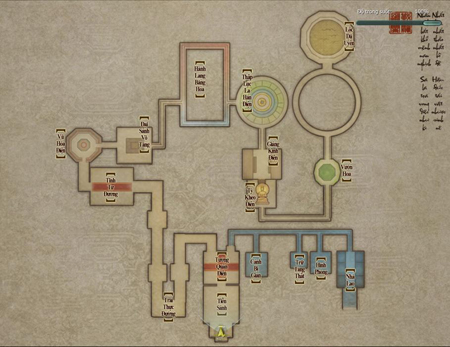

#### Boss

| **Hình ảnh** | **Ghi chú** |
| --- | --- |
| **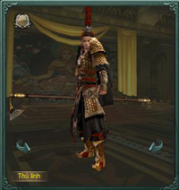 Vương Hải Ngân** | Vương Hải Ngân là quân Thần Sách, phụ trách liên lạc với Hội Bồ Đề chủ trì xây dựng Chiến Bảo Già Lan, đã chiếm dụng tầng đầu tiên làm [doanh trại](../he-thong/tran-doanh.md#doanh-trại) của mình. Vương Hải Ngân kiêu ngạo tự cao, thích làm nhất là mộng tướng quân, thích nghe nhất là lệnh tướng quân, để thỏa mãn lòng tự tôn kiêu ngạo của mình. **Đẳng cấp**: **73** **Sinh lực**: **5.300.000** |
| **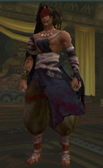 Chu Quý** | Chu Quý là huynh đệ kết nghĩa với Vương Hải Ngân, học Huyết Linh Sát của Thiên Nhất Giáo bị tẩu hỏa nhập ma. Vương Hải Ngân đón Chu Quý về Chiến Bảo Già Lan, hy vọng nhờ vào cửa phật để kiềm nén ma tính trong lòng y. Tiếc rằng Chu Quý trúng độc quá nặng, làm bị thương nhiều người, cuối cùng đành phải giam y nơi sấu nhất địa lao ở Âm Sâm. **Đẳng cấp**: **Sinh lực**: |
| **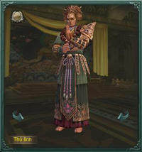 Bình Đẳng** | Bình Đẳng người như tên, theo đuổi sự bình đẳng. Phật giáo hưng thịnh ở Trung Thổ thì Thiên Trúc cũng vậy, phật giáo ở Thiên Trúc suy sụp thì ở Trung Thổ cũng không lớn mạnh. Y giỏi kích động giáo chúng, từ lúc đến Đông Thổ, sĩ khí đệ tử Hội Bồ Đề càng tăng mạnh. **Đẳng cấp:** **73** **Sinh lực:** **8.100.000** |
| **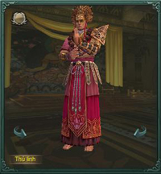 Chưởng Hỏa** | Chưởng Hỏa vô cùng tín ngưỡng Hội Bồ Đề, tính cách điềm tĩnh, mỗi lần đại loạn đều có thể bình tĩnh đối phó. Đồng thời y cũng là kẻ mạnh nhất về võ công trong thập nhị Bảo Thụ Vương! Võ công của y chỉ sau "Phong Hỏa Vân Tam Sứ", tinh thông tuyệt kỹ "Xuyến Hỏa Chưởng". **Đẳng cấp:** **73** **Sinh lực:** **7.000.000** |
| **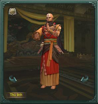 Trấn Ác** | Trấn Ác tính cách mạnh mẽ, sức mạnh như thần, cùng Trí Tuệ Vương trong Tàng Kinh Các ở Chiến Bảo Già Lan nghiên cứu bí kíp võ công. Trí Tuệ Vương như trẻ con, võ công rất yếu, nhưng trí mưu vô cùng. Đa số hoạt động ở Trung Thổ của Hội Bồ Đề đều từ kế hoạch của y, là chủ mưu hợp tác với Thần Sách. **Đẳng cấp:** **72** **Sinh lực:** **1.400.000** |
| **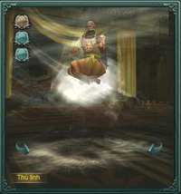 Xan Phong** | Hội Bồ Đề dựa vào phật lý của Tam Pháp Ấn lập ra Phong Hỏa Vân Tam Sứ - 3 vị tăng lữ chí tôn chỉ sau Ma Đề Gia La, tu hành phật pháp và võ công đều rất cao thâm, khi 3 người cùng tác chiến thì uy lực vô cùng. **Đẳng cấp:** **73** **Sinh lực:** **5.000.000** |
| **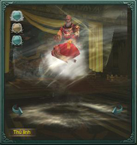 Ẩm Hỏa** |  |
| **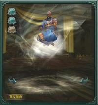 Thôn Vân** |  |
| **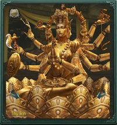 Thiên Phủ Quan Âm** | Bí mật ẩn chứa sâu nhất của Chiến Bảo Già Lan, tương truyền bao gồm cả cơ giáp phật môn diệp pháp vô thượng, uy lực không thể đoán được. **Đẳng cấp:** **73** **Sinh lực:** **9.830.000** |

#### Hiệu ứng trong bí cảnh

| **Boss** | **Tên Hiệu Ứng** | **Tác dụng** |
| --- | --- | --- |
| **Vương Hải Ngấn** | Thôi Thành Thương (Thần Cơ) | Gây sát thương nội - dương 800 điểm/03 giây. |
| Mãnh kích | Gây trạng thái Huyễn Huân. |  |
| Hùng Hống | Tấn công ngoại giảm 80%. |  |
| Thôi Thành Thương (Tư Hầu) | Gây trạng thái điểm huyệt. |  |
| Chưởng kích | Giảm ngoại thủ. |  |
| Nộ Mục | Chính xác giảm 50%. |  |
| **Bình Đằng** | Vương Thủ Tiệt Mạch | Sát thương nội - dương nhận được tăng 100%, hiệu quả trị thương giảm 30%, tốc độ di chuyển tăng 50%, gây sát thương độc 1.650 điểm/03 giây. |
| Vương Nhẫn Trấn Hồn | Gây trạng thái ngủ say. |  |
| **Chưởng Hỏa** | Chân - Triêu Vân | Sát thương dương tính nhận được tăng 100%/tầng. |
| Xuyên Hỏa Chưởng - Viêm Hoa | Gây 110 sát thương nội - dương/02 giây/tầng. |  |
| **Trấn Ác** | Minh Băng Chưởng | Tốc độ di chuyển giảm 80%, sát thương nội - âm nhận được tăng 200%. |
| Phá Băng Chân khí | Gây trạng thái Định Thân. |  |
| **Xan Phong Ẩm Hỏa Xuyên Vân** | Chân - Thiêu Vân | Sát thương dương tính nhận được tăng 100%/tầng. |
| Chích Hỏa Liên Miên | Sát thương nội - dương nhận được tăng 10%/tầng. |  |
| Sơn Cùng Thủy Tận | Sát thương nội - âm nhận được tăng 10%/tầng. |  |
| **Thiên Thủ Quan Âm** | Phạn Âm Kiếp | Sát thương Phạn Âm Kiếp tăng 15%/tầng. |
| Cấm Cổ Chú | Hiệu ứng bất lợi - hỗn nguyên. Tốc độ di chuyển giảm 70%, khi biến mất sẽ bộc phát sức mạnh gây sát thương nội - dương 700 điểm/giây. |  |
| Tàn Phế | Không thể thi triển kinh công. |  |

## Trì Quốc Thiên Vương Điện

Động Đạt Ma nằm ở Hậu Sơn phía Tây Bắc Tung Sơn Thiếu Lâm Tự là cấm địa nổi tiếng, được canh gác chặt chẽ. Bên trong cất giữ bí kíp võ học Thiếu Lâm và giam giữ nhiều nhân vật tội ác tày trời, trong đó nguy hiểm nhất là Huyết Nhãn Long Vương của [Minh Giáo](../mon-phai/minh-giao.md).

Từ sau trận Quang Minh Đỉnh, Minh Giáo chia năm xẻ bảy, Thần Sách Hiệu Úy Hoa Hạc Viêm tính kế xâm nhập Động Đạt Ma cứu Huyết Nhãn Long Vương bị Thiếu Lâm và giang hồ nghĩa sĩ đánh bại, chôn thân chốn vực sâu. Nhưng đứng sau âm mưu này không phải là giáo chủ Minh Giáo mà là một nhân vật khác...

Không lâu sau, muội muội của Hoa Hạc Viêm là Hoa Thu Nhi đến Thiếu Lâm, khi hay tin vô cùng phẫn nộ. Dưới sự xúi giục của một tiểu hòa thượng, Hoa Thu Nhi bất chấp ngăn cản xông vào tầng thứ nhất [Trì Quốc Thiên Vương Điện](./pho-ban-10-nguoi.md#trì-quốc-thiên-vương-điện) của Động Đạt Ma đê làm rõ chân tướng. Thiếu Lâm lập tức tăng cường phong tỏa, tránh để trọng phạm trốn thoát và truy tìm Hoa Thu Nhi.

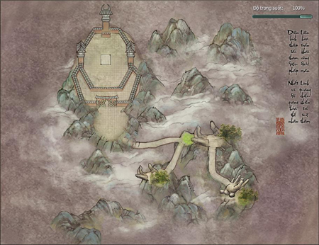

### Trì Quốc Thiên Vương - Thường (25 người)

- **Đẳng cấp nhân vật**: Cấp **70** trở lên.

- **Yêu cầu**: Tổ đội tối đa 25 người.

- **Lối vào phó bản**: Tây Bắc Thiếu Lâm.

#### Boss

| **Hình ảnh** | **Ghi chú** |
| --- | --- |
| **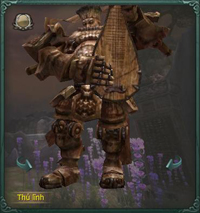 Đề Đa La Tra** | Cơ quan mộc giáp "Đông Phương Trì Quốc Thiên" Đề Đa La Tra là kiệt tác của Tăng Nhất Hành Quỷ Phủ Thần Công, được tặng cho Thiếu Lâm để trấn thủ vô số bí kíp võ công trong Động Đạt Ma. Phụ trách giam cầm Pháp Vương "Huyết Nhãn Long Vương" Tiêu Sa - người có võ công cao nhất Minh Giáo trước đây. **Đẳng cấp**: **73** **Sinh lực**: **18.990.000** |

#### Hiệu ứng trong bí cảnh

| **Boss** | **Hiệu ứng** | **Tác dụng** |
| --- | --- | --- |
| **Đề Đa La Tra** | Đà La Khúc (Cương Chấn) | Huyễn Huân trong 10 giây. |
| Hoa Tán Khúc | Gây sát thương nội - hỗn nguyên 38.000 điểm/giây trong 2 phút. |  |
| Hoa Tán Khúc (Bích Hải) | Giảm nội lực 800 điểm/03 giây trong 30 giây. |  |
| Hoa Tán Khúc (Hắc Động) |  |  |
| Hoa Tán Khúc (Bạch Lộ) | Gây sát thương độc 1.500 điểm/03 giây trong 30 giây. |  |
| Hoa Tán Khúc (Chu Vân) | Gây sát thương nội công 1.500 điểm/03 giây trong 30 giây. |  |
| Khúc Tán | Gây sát thương nội - âm 1.000 điểm/03 giây/tầng trong 60 giây. |  |
| Trấn Hồn Khúc (Phá Tinh Thiên Môn) | Giảm 2% nội lực/giây, nội công giảm 75%. Khi nội lực bằng 0 hoặc hiệu quả biến mất sẽ gây trạng thái Khúc Tán. |  |
| Trấn Hồn Khúc (Trấn Hồn Trường Khúc) | Giảm 2% nội lực/giây, tốc độ di chuyển giảm 50%. Khi nội lực bằng 0 hoặc hiệu quả biến mất sẽ gây trạng thái Khúc Tán. |  |
| Trấn Hồn Khúc (Dục Thổ Địa Táng) | Giảm 2% nội lực/giây, ngoại công giảm 75%. Khi nội lực bằng 0 hoặc hiệu quả biến mất sẽ gây trạng thái Khúc Tán. |  |
| Trấn Hồn Khúc (Phổ Độ Bát Âm) | Giảm 2% nội lực/giây, trị thương giảm 50%. Khi nội lực bằng 0 hoặc hiệu quả biến mất sẽ gây trạng thái Khúc Tán. |  |

### Trì Quốc Thiên Vương - Anh Hùng (25 người)

- **Đẳng cấp nhân vật**: Cấp **70** trở lên.

- **Yêu cầu**: Tổ đội tối đa 25 người.

- **Lối vào phó bản**: Tây Bắc Thiếu Lâm.

#### Boss

| **Hình ảnh** | **Ghi chú** |
| --- | --- |
| ** Đề Đa La Tra** | Cơ quan mộc giáp "Đông Phương Trì Quốc Thiên" Đề Đa La Tra là kiệt tác của Tăng Nhất Hành Quỷ Phủ Thần Công, được tặng cho Thiếu Lâm để trấn thủ vô số bí kíp võ công trong Động Đạt Ma. Phụ trách giam cầm Pháp Vương "Huyết Nhãn Long Vương" Tiêu Sa - người có võ công cao nhất Minh Giáo trước đây. **Đẳng cấp**: **73** **Sinh lực**: **27.000.000** |

#### Hiệu ứng trong bí cảnh

| **Boss** | **Hiệu ứng** | **Tác dụng** |
| --- | --- | --- |
| **Đề Đa La Tra** | Đà La Khúc (Cương Chấn) | Huyễn Huân trong 10 giây. |
| Hoa Tán Khúc | Gây sát thương nội - hỗn nguyên 38.000 điểm/giây trong 2 phút. |  |
| Hoa Tán Khúc (Bích Hải) | Giảm nội lực 800 điểm/03 giây trong 30 giây. |  |
| Hoa Tán Khúc (Hắc Động) |  |  |
| Hoa Tán Khúc (Bạch Lộ) | Gây sát thương độc 2.500 điểm/03 giây trong 30 giây. |  |
| Hoa Tán Khúc (Chu Vân) | Gây sát thương nội công 2.500 điểm/03 giây trong 30 giây. |  |
| Khúc Tán | Gây sát thương nội - âm 1.000 điểm/03 giây/tầng trong 60 giây. |  |
| Trấn Hồn Khúc (Phá Tinh Thiên Môn) | Giảm 2% nội lực/giây, nội công giảm 75%. Khi nội lực bằng 0 hoặc hiệu quả biến mất sẽ gây trạng thái Khúc Tán. |  |
| Trấn Hồn Khúc (Trấn Hồn Trường Khúc) | Giảm 2% nội lực/giây, tốc độ di chuyển giảm 50%. Khi nội lực bằng 0 hoặc hiệu quả biến mất sẽ gây trạng thái Khúc Tán. |  |
| Trấn Hồn Khúc (Dục Thổ Địa Táng) | Giảm 2% nội lực/giây, ngoại công giảm 75%. Khi nội lực bằng 0 hoặc hiệu quả biến mất sẽ gây trạng thái Khúc Tán. |  |
| Trấn Hồn Khúc (Phổ Độ Bát Âm) | Giảm 2% nội lực/giây, trị thương giảm 50%. Khi nội lực bằng 0 hoặc hiệu quả biến mất sẽ gây trạng thái Khúc Tán. |  |

## Di Tích Thần Võ

Khấu Đảo, một hòn đảo nhỏ tiêu điều và thần bí. Không ai ngờ được tại đây đang diễn ra một hồi ân oán giữa chưởng môn chính phái và vị sư huynh phản bội sư môn: Tạ Vân Lưu - phản đồ [Thuần Dương](../mon-phai/thuan-duong.md) lừng danh giang hồ, Lý Vong Sinh - chưởng môn hiện tại của Thuần Dương.

Trước đây Tạ Vân Lưu từng là đại đệ tử của Thuần Dương và có mối thâm giao với thái tử, sau khi thái tử bị phế Tạ Vân Lưu cũng bị liên lụy. Vì hiểu lầm mà ra tay với Thuần Dương Chân Nhân nên phạm phải tội lớn, bị các đại phái truy sát chỉ có thể đến Đông Doanh xa xôi, ẩn thân nhiều năm.

Tạ Vân Lưu đến Nhật Bản, vì sở trường kiếm thuật nên được xem trọng, sau đó sáng lập ra Kazuto, nhưng vì có thâm thù với võ lâm Trung Nguyên nên nhiều năm nay chưa từng qua lại.

Lần này bí mật gặp ở Khấu Đảo, hai người có ý muốn hóa giải hận thù năm xưa. Lý Vong Sinh cũng luôn muốn giải thích rõ rang chuyện năm ấy với võ lâm, vì thế mời các đại phái đến [Di Tích Thần Võ](./pho-ban-10-nguoi.md#di-tích-thần-võ) ở Khấu Đảo bí mật gặp mặt.

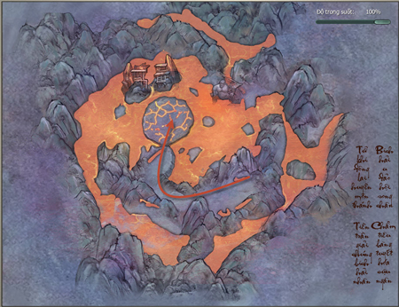

### Di Tích Thần Võ - Thường (25 người)

- **Đẳng cấp nhân vật**: Cấp **70** trở lên.

- **Yêu cầu**: Tổ đội tối đa 25 người.

- **Lối vào phó bản**:

#### Boss

| **Hình ảnh** | **Ghi chú** |
| --- | --- |
| **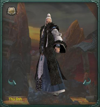 Tạ Vân Lưu** | Tạ Vân Lưu và Lý Vong Sinh muốn gặp nhau để hóa giải ân oán bao năm. Lý Vong Sinh giải thích rõ câu chuyện năm đó với võ lâm, mời danh nhân các phái đến Di Tích Thần Võ. Tuy nhiên đã có kẻ xấu giá họa, gây ra sự xung đột giữa các đại phái và Tạ Vân Lưu. **Đẳng cấp**: **73** **Sinh lực**: **45.140.000** |

#### Hiệu ứng trong bí cảnh

| **Boss** | **Hiệu ứng** | **Tác dụng** |
| --- | --- | --- |
| **Tạ Vân Lưu** | Sinh Thái Cực | Giảm 80% tốc độ di chuyển trong 5 giây. |
| Định Thân trong 8 giây. |  |  |
| Lăng Thái Hư – Tiêu Phong | Giảm 50% sát thương chiêu thức trong 5 giây. |  |
| Không thể vận công trong 12 giây. |  |  |
| Toái Tinh Thần | Giảm 80% hiệu quả trị thương nhận được trong 5 giây. |  |
| Không thể được trị thương trong 12 giây. |  |  |
| Kiếm Xung Âm Dương | Giảm hiệu quả trị thương nhận được 10%/tầng trong 45 giây. |  |
| Hào Khí Kiếm Không | Gây Huyễn Thân trong 3 giây. |  |
| Lục Hợp Độc Tôn | Giảm 80% tốc độ di chuyển, gây sát thương nội - hỗn nguyên 1.500 điểm/03 giây trong 12 giây. |  |

### Di Tích Thần Võ - Anh Hùng (25 người)

- **Đẳng cấp nhân vật**: Cấp **70** trở lên.

- **Yêu cầu**: Tổ đội tối đa 25 người.

- **Lối vào phó bản**:

#### Boss

| **Hình ảnh** | **Ghi chú** |
| --- | --- |
| ** Tạ Vân Lưu** | Tạ Vân Lưu và Lý Vong Sinh muốn gặp nhau để hóa giải ân oán bao năm. Lý Vong Sinh giải thích rõ câu chuyện năm đó với võ lâm, mời danh nhân các phái đến Di Tích Thần Võ. Tuy nhiên đã có kẻ xấu giá họa, gây ra sự xung đột giữa các đại phái và Tạ Vân Lưu. **Đẳng cấp**: **73** **Sinh lực**: **62.210.000** |

#### Hiệu ứng trong bí cảnh

Giống phần Hiệu ứng trong bí cảnh của Di Tích Thần Võ - Thường (25 người) ở trên.

## Địch Hoa Cung Hậu Sơn

Năm Thần Long thứ hai, hai vị trưởng lão Bái Hỏa Giáo bội phản, mang theo bí bảo và thánh điển chạy đến Trung Nguyên, sáng lập nên Minh Giáo và Hồng Y Giáo.

Bái Hỏa Giáo mất đi ba vị trưởng lão và hai bộ thánh điển, thiệt hại nghiêm trọng. Mười mấy năm sau, mâu thuẫn giữa hoàng tộc Ba Tư và Tư Tế Bái Hỏa Giáo ngày càng gay gắt, triều đình muốn lập tôn giáo mới, phế truất ngôi vị quốc giáo của Bái Hỏa Giáo. Giáo tôn lo sợ, phái hai trong năm vị Thánh Hỏa Sứ đến Trung Nguyên mời ba vị trưởng lão quay về, đồng thời thu hồi thánh điển.

Sứ giả Mục Tháp Cáp Đạt Địch đến Trung Nguyên, ráo riết truy tìm tung tích A Tát Tân. Nghe nói giáo lý Hồng Y Giáo cũng gần giống như của Bái Hỏa Giáo, Giáo chủ cũng là người Ba Tư, bèn tìm cách điều tra.

Nhưng A Tát Tân vẫn chưa lộ diện, khiến bọn người Cáp Đạt Địch khó phán đoán thân phận. Họ ẩn thân trong giang hồ, tự gọi là "An Hồn Giả", bí mật giám sát Hồng Y Giáo.

Hay tin Địch Hoa Thánh Điện xuất hiện ở Tiền Sơn, người của Cáp Đạt Địch tìm đến và phát hiện phong cách của Địch hoa Thánh Điện giống Tổng đàn Bái Hỏa Giáo, mười phần đã chắc tám chín. Để mau chóng giải quyết sự việc và đưa A Tát Tân trở về Ba Tư, người của Cáp Đạt Địch bắt đầu hành trình dài đăng đẵng.

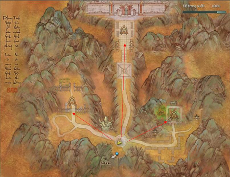

## Long Uyên Trạch

Khi Vương Chiếu Nam nổi tiếng khắp giang hồ với tên gọi Thiên Nam Đại Hiệp, Tụ Hiền Sơn Trang do ông thành lập là nơi người trong giang hồ hay đến tụ họp. Vương Chiêu Nam và Tinh Túc Lão Tiên liên kết tạo dựng [Lôi Đài](../he-thong/loi-dai.md) Anh Hùng [Long Uyên Trạch](./pho-ban-10-nguoi.md#long-uyên-trạch), là thánh địa võ lâm sánh ngang với [Thiên Tử Phong](./pho-ban-5-nguoi.md#thiên-tử-phong) của [Nam Bình Sơn](../he-thong/tran-doanh.md#loạn-chiến-nam-bình-sơn).

Thiên Tử Phong là [chiến trường](../he-thong/chien-truong.md) trước đây Kiếm Trung Thánh và Đông Hải Phương Càn quyết chiến, cuộc chiến năm xưa bây giờ trong giang hồ ít ai biết đến. Long Uyên Trạch Lôi tại Ba Thục tuy cũng tương tự nhưng nay vẫn có nhiều hiệp sĩ giang hồ và các vị hồng nhan đến luận kiếm. Hơn nữa, tại đây Thiên nam Đại Hiệp Vương Chiếu nam sẽ cung cấp các loại thư tịch, bảo kiếm và tuyệt mã hiếm có.

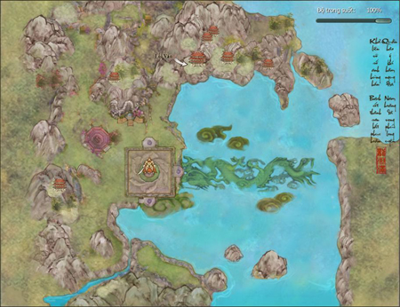

### Long Uyên Trạch - Thường (25 người)

- **Đẳng cấp nhân vật**: Cấp **80** trở lên.

- **Yêu cầu**: Tổ đội tối đa 25 người.

- **Lối vào phó bản**: Tây Nam Thành Đô.

#### Boss

| **Hình ảnh** | **Ghi chú** |
| --- | --- |
| **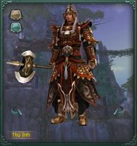 Mộ Dung Dã Hồ** | Mộ Dung Dã Hồ và Ân Thanh Ti vốn là đạo tặc Liêu Đông, võ công cao cường, tinh thông Đại Lực Kim Cang Thương Pháp. Sau đó Nam Chiếu Vương tổ chức Long Uyên Trạch Lôi, phu phụ hai người nhờ chiến pháp kiên cường, ra tay tàn bạo, được chọn là Đệ Nhất Lôi Chủ. **Đẳng cấp**: **83** **Sinh lực Mộ Dung Dã Hồ**: **18.660.000** **Sinh lực Ân Thanh Ti**: **16.890.000** |
| **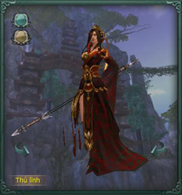 Ân Thanh Ti** |  |
| **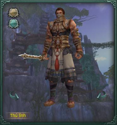 Lý Xích Mai** | "Man Soái" Lý Xích Mai và "Man Tướng" Tô Bối Đức Cáp là tâm phúc của đại tướng quân Nam Chiếu Các - La Hồng. Cả hai vốn là người của Nam Man Hổ Tộc, sau khi gia nhập Nam Chiếu Quân đã lập vô số quân công và được đặc cách vào Hắc Kỳ Doanh. Sau đó Nam Chiếu Vương tổ chức Long Uyên Trạch Lôi, đã điều họ Từ Thương Sơn Nhĩ Hải đến Long Uyên Trạch ổn định tình hình. **Đẳng cấp**: **82** **Sinh lực Lý Xích Mai**: **17.700.000** **Sinh lực Tô Bối Đức Cáp**: **16.370.000** |
| **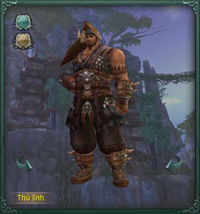 Tô Bối Đức Cáp** |  |

#### Hiệu ứng trong bí cảnh

| **Boss** | **Hiệu ứng** | **Tác dụng** |
| --- | --- | --- |
| **Mộ Dung Dã Hồ** | Kim Cang | Sát thương ngoại nhận được tăng 20%, tốc độ di chuyển giảm 30% trong 30 giây. |
| **Ân Thanh Ti** | Tịch Dương | Tốc độ di chuyển giảm 50% trong 10 giây. |
| Viêm Dương | Bốc cháy, gây sát thương nội - dương 1000 điểm/giây trong 30 giây. |  |
| **Lý Xích Mai** **Tô Bối Đức Cáp** | Trọng Kích | Sát thương nội nhận được tăng 10%, sau 5 tầng Trọng Kích sẽ bị đánh ngã trong 10 giây. |
| Băng Phách | Sát thương nội - âm tăng 10%/tầng trong 10 giây. |  |
| Khiếp Sợ | Giảm 30% sát thương trong 40 giây. |  |
| Chước Thiêu | Sát thương nội - dương tăng 10%/tầng trong 10 giây. |  |
| Viêm Bộc | Bốc cháy, gây sát thương nội - dương 1.800 điểm/giây trong 10 giây. |  |
| Hàn Túc | Giảm 30% tốc độ di chuyển trong 10 giây. |  |
| Triền Thân | Giảm 80% tốc độ di chuyển trongs 5 giây. |  |
| Cấp Đông | Tỏa Túc trong 5 giây. |  |
| Uy Hiếp | Tỏa Túc trong 3 giây. |  |
| Sát thương ngoại nhận được tăng 5%/tầng trong 5 giây. |  |  |

### Long Uyên Trạch - Anh Hùng (25 người)

- **Đẳng cấp nhân vật**: Cấp **80** trở lên.

- **Yêu cầu**: Tổ đội tối đa 25 người.

- **Lối vào phó bản**: Tây Nam Thành Đô.

#### Boss

| **Hình ảnh** | **Ghi chú** |
| --- | --- |
| ** Mộ Dung Dã Hồ** | Mộ Dung Dã Hồ và Ân Thanh Ti vốn là đạo tặc Liêu Đông, võ công cao cường, tinh thông Đại Lực Kim Cang Thương Pháp. Sau đó Nam Chiếu Vương tổ chức Long Uyên Trạch Lôi, phu phụ hai người nhờ chiến pháp kiên cường, ra tay tàn bạo, được chọn là Đệ Nhất Lôi Chủ. **Đẳng cấp**: **83** **Sinh lực Mộ Dung Dã Hồ**: **24.130.000** **Sinh lực Ân Thanh Ti**: **21.830.000** |
| ** Ân Thanh Ti** |  |
| ** Lý Xích Mai** | "Man Soái" Lý Xích Mai và "Man Tướng" Tô Bối Đức Cáp là tâm phúc của đại tướng quân Nam Chiếu Các - La Hồng. Cả hai vốn là người của Nam Man Hổ Tộc, sau khi gia nhập Nam Chiếu Quân đã lập vô số quân công và được đặc cách vào Hắc Kỳ Doanh. Sau đó Nam Chiếu Vương tổ chức Long Uyên Trạch Lôi, đã điều họ Từ Thương Sơn Nhĩ Hải đến Long Uyên Trạch ổn định tình hình. **Đẳng cấp**: **83** **Sinh lực Lý Xích Mai**: **20.390.000** **Sinh lực Tô Bối Đức Cáp**: **18.450.000** |
| ** Tô Bối Đức Cáp** |  |

#### Hiệu ứng trong bí cảnh

| **Boss** | **Hiệu ứng** | **Tác dụng** |
| --- | --- | --- |
| **Mộ Dung Dã Hồ** | Kim Cang | Sát thương ngoại nhận được tăng 20%, tốc độ di chuyển giảm 30% trong 30 giây. |
| **Ân Thanh Ti** | Tịch Dương | Tốc độ di chuyển giảm 50% trong 10 giây. |
| Viêm Dương | Bốc cháy, gây sát thương nội - dương 1900 điểm/giây trong 30 giây. |  |
| **Lý Xích Mai** **Tô Bối Đức Cáp** | Trọng Kích | Sát thương nội nhận được tăng 10%, sau 5 tầng Trọng Kích sẽ bị đánh ngã trong 10 giây. |
| Băng Phách | Sát thương nội - âm tăng 10%/tầng trong 10 giây. |  |
| Khiếp Sợ | Giảm 30% sát thương trong 40 giây. |  |
| Chước Thiêu | Sát thương nội - dương tăng 10%/tầng trong 10 giây. |  |
| Viêm Bộc | Bốc cháy, gây sát thương nội - dương 2.000 điểm/giây trong 10 giây. |  |
| Hàn Túc | Giảm 30% tốc độ di chuyển trong 10 giây. |  |
| Triền Thân | Giảm 80% tốc độ di chuyển trongs 5 giây. |  |
| Cấp Đông | Tỏa Túc trong 5 giây. |  |
| Uy Hiếp | Tỏa Túc trong 3 giây. |  |
| Sát thương ngoại nhận được tăng 5%/tầng trong 5 giây. |  |  |

## Hồi Ức Trì Quốc Thiên Vương

Khói bụi đã qua, nhớ lại năm xưa, Trí Tuệ Vương ngụy trang thành Đạo Hải buông lời ngon ngọt, lôi kéo một số nhân sĩ phá hỏng "Mộc Giáp Cơ Quan" Trì Quốc Thiên Vương Đề Đa La Tra trấn thủ Động Đạt Ma. Đồng thời, Thử Vương Bức Vương và các đệ tử cũ của Minh Giáo cũng phát động tấn công từ bên ngoài, nhằm giải cứu Huyết Nhãn Long Vương Tiêu Sa bị nhốt nhiều năm ở Thiếu lâm Tự.

Thiếu Lâm Tự trong ngoài đều bị địch tấn công, nhưng may nhờ Trừng Chính Đại Sư đứng ra, ủy thác một số nhân sĩ giang hồ vào Động Đạt Ma giúp đỡ Tuệ Si - kẻ có võ công cao cường nhưng không hiểu thế sự, để tạo thành lá chắn cuối cùng ngăn cản Huyết Nhãn Long Vương chạy trốn. Nhưng người tính không bằng trời tính…

Huyết Long thoát thân, thiên hạ ắt đại loạn, xót bao xương tàn phơi nội cỏ, nỉ non chi một khúc đoạn trường…

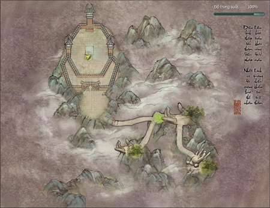

### Hồi Ức Trì Quốc Thiên Vương - Anh Hùng (25 người)

- **Đẳng cấp nhân vật**: Cấp **80** trở lên.

- **Yêu cầu**: Tổ đội tối đa 25 người.

- **Lối vào phó bản**: Đối thoại với NPC Trừng Chính tại Thiếu Lâm.

#### Boss

| **Hình ảnh** | **Ghi chú** |
| --- | --- |
| ** Đề Đa La Tra** | Cơ quan mộc giáp "Đông Phương Trì Quốc Thiên" Đề Đa La Tra là kiệt tác của Tăng Nhất Hành Quỷ Phủ Thần Công, được tặng cho Thiếu Lâm để trấn thủ vô số bí kíp võ công trong Động Đạt Ma. Phụ trách giam cầm Pháp Vương "Huyết Nhãn Long Vương" Tiêu Sa - người có võ công cao nhất Minh Giáo trước đây. **Đẳng cấp**: **82** **Sinh lực**: **16.130.000** |
| **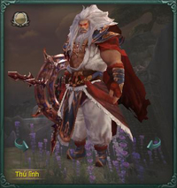 Tiêu Sa** | Tiêu Sa là đệ tử phái Hồng Trần, trước là Minh Giáo Huyết Nhãn Long Vương. Hắn căm ghét sư đệ Vương Di Phong, cho rằng người này giành hết mọi thứ của mình. Võ lâm Trung Nguyên nhận biết việc ác của Huyết Nhãn Long Vương, liên thủ tiêu diệt. Cuối cùng Tiêu Sa bại dưới trướng Như Lai Nghìn Tay của Thiếu Lâm lão phương trượng, bị giam ở Động Đạt Ma. **Đẳng cấp**: **82** **Sinh lực**: **27.560.000** |

#### Hiệu ứng trong bí cảnh

| **Boss** | Hiệu ứng | **Tác dụng** |
| --- | --- | --- |
| **Đề Đa La Tra** | Hoa Tán Khúc | Gây sát thương nội - hỗn nguyên 38.000 điểm/giây trong 2 phút. |
| Hoa Tán Khúc (Bích Hải) | Giảm 3% nội lực/03 giây trong 30 giây. |  |
| Hoa Tán Khúc (Hắc Động) |  |  |
| Hoa Tán Khúc (Hắc Động - Hồn Tán) | Định Thân trong 8 giây. |  |
| Hoa Tán Khúc Bạch Lộ | Gây sát thương độc 7.800 điểm/03 giây trong 30 giây. |  |
| Hoa Tán Khúc (Bạch Lộ - Hồn Tán) | Gây sát thương độc 2.800 điểm/03 giây trong 30 giây. |  |
| Hoa Tán Khúc (Chu Vân) | Gây sát thương nội - dương 7.800 điểm/03 giây trong 30 giây. |  |
| Hoa Tán Khúc (Chu Vân - Hồn Tán) | Không thể thi triển chiêu thức trong 8 giây. |  |
| Trấn Hồn Khúc (Phá Tinh Thiên Môn) | Giảm 2% nội lực/giây, nội công giảm 75%. Khi nội lực bằng 0 sẽ gây 19.400 sát thương âm, hiệu quả biến mất sẽ gây trạng thái Khúc Tán. |  |
| Khúc Tán | Gây sát thương nội - âm 2.000 điểm/giây/tầng trong 10 giây. |  |
| Trấn Hồn Khúc (Trấn Hồn Trường Khúc) | Giảm 2% nội lực/giây, tốc độ di chuyển giảm 50%. Khi nội lực bằng 0 sẽ gây 19.400 sát thương âm, hiệu quả biến mất sẽ gây trạng thái Khúc Tán. |  |
| Đà La Khúc (Cương Chấn) | Huyễn Huân trong 10 giây. |  |
| Trấn Hồn Khúc (Dục Thổ Địa Táng) | Giảm 2% nội lực/giây, ngoại công giảm 75%. Khi nội lực bằng 0 sẽ gây 19.400 sát thương âm, hiệu quả biến mất sẽ gây trạng thái Khúc Tán. |  |
| Trấn Hồn Khúc (Phổ Độ Bát Âm) | Giảm 2% nội lực/giây, hiệu quả trị thương giảm 50%. Khi nội lực bằng 0 sẽ gây 19.400 sát thương âm, hiệu quả biến mất sẽ gây trạng thái Khúc Tán. |  |
| **Tiêu Sa** | Trọng Áp | Khó tiến nửa bước thời gian 30 giây. |
| Hủy Diệt - Quyền Ấn | Giảm 200% hiệu quả trị thương trong 60 giây. |  |
| Phá Giáp | Ngoại thủ giảm 50% trong 30 giây. |  |
| Lưu Huyết | Gây sát thương ngoại 7.800 điểm/02 giây trong 02 phút. Khí huyết đầy có thể giải trừ hiệu ứng. |  |

## Chúc Long Điện

Trong Nam Cương Đầm Hắc Long của Trùng Độc Mật Bố tàng ẩn cung [Chúc Long Điện](./pho-ban-10-nguoi.md#chúc-long-điện). Đây là thánh địa tối thượng trong lòng giáo đồ Thiên Nhất Giáo, là nơi họ gửi gắm niềm tin, là nguồn sáng duy nhất dẫn dắt họ bước đi trong đêm tối.

Giáo chủ Ô Mông Quý nhờ vào Chúc Long Điện nhanh chóng phát triển Thiên Nhất Giáo, bắt đầu thu thập di thể tráng sĩ cao thủ ở các nơi để chế tạo thành con rối hung hãn. Nhưng [Ngũ Độc](../mon-phai/ngu-doc.md) Giáo dưới sự chỉ đạo của Khúc Vân đã được sự ủng hộ của võ lâm Trung Nguyên. Nếu muốn muôn đời trường tồn, giữ ưu thế tuyệt đối, phải xây dựng trên di thể của Ngũ Độc Giáo và võ lâm nhân sĩ.

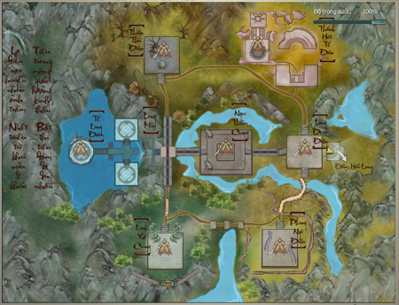

### Chúc Long Điện - Anh Hùng (25 người)

- **Đẳng cấp nhân vật**: Cấp **80** trở lên.

- **Yêu cầu**: Tổ đội tối đa 25 người.

- **Lối vào phó bản**: Phía Tây bản đồ Đầm Hắc Long.

#### Boss

| **Hình ảnh** | **Ghi chú** |
| --- | --- |
| **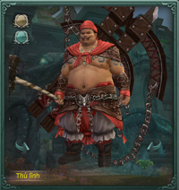 Hồ Thát** | Thử Vương Bạch Mi Hồ Thát kết hợp cùng chuột bạch mi tạo ra võ công đào hang tung hoành khắp nơi. Thanh Dực Bức Vương Vũ Duật Thanh tạo ra võ dơi lập nhìu kỳ công. Họ tuân mệnh Huyết Nhãn Long Vương Tiêu Sa, liên thủ hình thành phòng tuyến đầu tiên của Chúc Long Điện. **Đẳng cấp**: **81** **Sinh lực Hồ Thát**: **5.460.000** **Sinh Lực Vũ Dực Thanh**: **5.800.000** |
| ** Vũ Dực Thanh** |  |
| **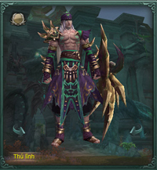 Sách Địch Nhĩ** | Ô Mông Quý không ngại dùng linh dược do Ngũ Độc chế tạo kỳ công để Sách Địch Nhĩ luyện thể, giúp hắn nhanh chóng trở thành cao thủ võ công tuyệt đỉnh và được Thiên Nhất Giáo gọi là "Thánh Đồng". Trong Chúc Long Điện, Sách Địch Nhĩ phụ trách canh giữ [Thất Tú](../mon-phai/that-tu.md) Phường Chủ - Diệp Chỉ Thanh nhưng nảy sinh tình cảm với nàng. **Đẳng cấp**: **81** **Sinh lực**: **11.790.000** |
| **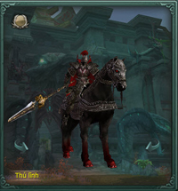 Lục Tâm** | Lục Tâm vốn là hộ vệ cung đình Đại Đường, nhưng vì đắc tội với hoàng tộc nên bị thích chữ lên mặt, xung làm lính biên cương Nam Chiếu đại tướng quân. Lục Tâm biết Thiếu Lâm phương Trượng Huyền Chính bị Nam Chiếu Vương Bắt, chủ động xin canh giữ với ý định làm nhục Đại Đường hoàng thất. **Đẳng cấp**: **82** **Sinh lực**: **8.520.000** |
| **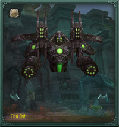 Nam Lôi Thần** | Sát Lục Giả là Cơ Giáp do Tư Đồ Nhất Nhất dày công chế tạo, được Tư Đồ Nhất Nhất dùng để giam [Vạn Hoa](../mon-phai/van-hoa.md) Cốc Chủ, chứng minh mình là Cơ Quan Đại Tông Sư hơn hẳn Vạn Hoa [Kỹ Nghệ](../he-thong/ky-nang-song.md). **Đẳng cấp**: **81** **Sinh lực**: **11.930.000** |
| ** Thiên Thu Tử** | "Tinh Túc Lão Tiên" Thiên Thu Tử thử chế Sơn Hà Xã Tắc Đồ thành sa bàn tại Chúc Long Điện. Khi biết Vạn Hoa Cốc Chủ Đông Phương Vũ Hiên được đưa đến đây, hắn chủ động xin Ô Mông Quý được canh giữ ông, còn đưa Cổ Hàn Tuyền đến để ức chế công lực cao thâm của ông. **Đẳng cấp**: **82** **Sinh lực**: **9.830.000** |
| ** Thiên Thù Lão Yêu** | Thiên Thù Lão Yêu có vai vế cao nhất trong Thiên Nhất Giáo, thủ đoạn tàn độc, kẻ nào dám làm phật ý sẽ bị chuốc rượu sai rồi đem cho nhện ăn. Lần này do Thuần Dương Chưởng Môn Lý Vong Sinh nội lực thâm hậu, khinh công siêu quần nên Ô Mông Quý giao cho Thiên Thù Lão Yêu canh giữ. **Đẳng cấp**: **81** **Sinh lực**: **2.630.000** |
| **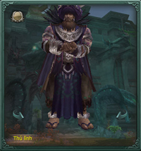 Ô Mông Quý** | Ô Mông Quý dựa vào Chúc Long Điện bắt đầu thu thập thi thể tráng sĩ cao thủ để chế tạo Con Rối Chiến Đấu, ý đồ phát triển Thiên Nhất Giáo và chống lại Ngũ Độc Giáo được Võ Lâm Trung Nguyên ủng hộ. Hắn muốn đánh bại Khúc Vân hòng đoạt lại Ngũ Độc Giáo thánh địa. **Đẳng cấp**: **82** **Sinh lực**: **12.150.000** |

#### Hiệu ứng trong phó bản

| **Boss** | **Hiệu ứng** | **Tác dụng** |
| --- | --- | --- |
| **Hồ Thát** | Cát Liệt | Gây sát thương ngoại 5.800 điểm/03 giây trong 14 giây. |
| **Vũ Dực Thanh** | Ầm Vang | Tăng sát thương nội nhận được 20%/tầng trong 05 giây. |
| Xích Dực Thanh Phong Công | Giảm 15% nội lực/giây, tốc độ di chuyển giảm 30%. |  |
| Âm Ba Công | Định Thân trong 19 giây. |  |
| Tiêu Hao Khí Huyết | Gây sát thương nội - âm 3.900 điểm/giây trong 07 giây. |  |
| **Thiên Ngạo Thù** | Răng Độc Cắn Mạnh | Gây 4.800 sát thương/giây. |
| **Sách Địch Nhĩ** | Huẫn Long Toàn | Giảm điểm uy hiếp 10%/tầng trong 43 giây. |
| Uy Áp | Gây sát thương ngoại 3.000 điểm/giây trong 04 giây. |  |
| Áp Bức | Gây trạng thái Áp Bức. |  |
| **Nam Lôi Thần** | Tỏa Định | Tăng sát thương ngoại 10%/tầng trong 05 giây. |
| **Thiên Thu Tử** | Hàn Băng Cầm Cố | Tỏa Túc trong 05 giây. |
| Đóng Băng | Gây 2.000 sát thương/giây ( không thời hạn). |  |
| **Thiên Thù Lão Yêu** | Định Thân | Định Thân trong 10 phút. |
| Cấm Liệu | Giảm hiệu quả trị liệu 100%. |  |
| **Ô Mông Quý** | Hấp Hồn Công | Không thể duy chuyển và khinh công. |
| Độc Tố Cảm Nhiễm | Gây sát thương độc 2.900/giây trong 17 giây. |  |
| Phong Tỏa | Không thể thi triển chiêu thức. |  |
| Ăn Mòn | Tăng sát thương độc nhận được 10%/tầng. |  |

Nguồn: VNG (bài viết và hình ảnh)
