Hệ thống phó bản 5 người sẽ đem đến cho quý nhân sĩ những trải nghiệm thú vị và kỳ diệu. Hãy cùng 5 thành viên, phối hợp nhịp nhàng để phát huy sức mạnh của tập thể trước các cửa ải.

Hệ thống phó bản phong phú, bí ẩn và đầy thách thức. Quý nhân sĩ Võ Lâm 3 nhất định sẽ lập được những kỳ tích đặc biệt khi phiêu lưu tại các phó bản đặc sắc sau:

- [Kiếm Chủng](#kiếm-chủng)

- [Thiên Địa Tam Tài](#thiên-địa-tam-tài-trận)

- [Đường Môn Mật Thất](#đường-môn-mật-thất)

- [Không Vụ Phong](#không-vụ-phong)

- [Quang Minh Mật Đạo](#quang-minh-mật-đạo)

- [Tiên Tung Lâm](#tiên-tung-lâm)

- [Linh Tiêu Hiệp](#linh-tiêu-hiệp)

- [Đảo Vô Diêm](#đảo-vô-diêm)

## Kiếm Chủng

Kiếm Chủng có nghĩa là nơi để chôn kiếm. Vì trang chủ [Tàng Kiếm](../mon-phai/tang-kiem.md) Sơn Trang đời thứ nhất Diệp Mạnh Thu đã mang số kiếm luyện thành cả đời chôn ở đây, nên được gọi là "Kiếm Chủng".

Năm 699 sau Công Nguyên (thời Võ Tắc Thiên, Thánh Lịch năm thứ hai), Diệp Mạnh Thu - sau này là trang chủ đời đầu của Tàng Kiếm Sơn Trang - sau khi đi qua nhiều nơi, cuối cùng cũng tìm ra Cổ Kiếm Lư, nơi có tuyệt thế bảo kiếm. Nơi ấy có lịch sử lâu đời, vốn là lò đúc kiếm của hoàng thất Ngô Việt thời xuân thu, bên trong sơn cốc như tiên cảnh, do địa mạch dị thường nên nơi đây hình thành một kiểu khí hậu rất lạ.

Thầy đúc kiếm thời cổ có nói, đúc kiếm cần phối hợp với thời tiết, một thanh kiếm tốt cần được tôi luyện giữa thiên nhiên, khí hậu bốn mùa cũng sẽ ảnh hưởng đến bảo kiếm. Chính vì nơi đây thể hiện đặc điểm này rõ nhất, khí hậu trong đó khác hẳn bên ngoài, bên trong Kiếm Chủng có các sơn cốc hiện hữu đầy đủ cảnh sắc và khí hậu bốn mùa xuân hạ thu đông, vô cùng kỳ diệu.

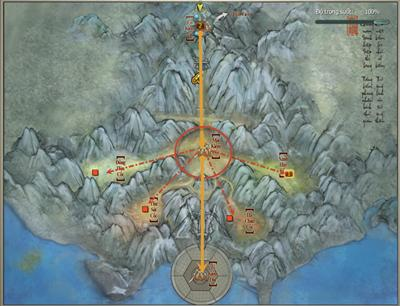

### Mộ Kiếm - Thường

- **Đẳng cấp nhân vật**: Cấp **18** trở lên.

- **Yêu cầu**: Tổ đội 5 người.

- **Lối vào phó bản**: Phía bắc bản đồ Tàng Kiếm Sơn Trang.

#### Boss

| **Hình ảnh** | **Ghi chú** |
| --- | --- |
| **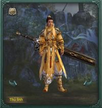 Diệp Phương Trí** | Diệp Phương Trí từ nhỏ giỏi luyện kiếm, tuy chỉ là chi thứ của Diệp gia nhưng được truyền kiếm pháp Diệp thị, tự cho rằng đạo dùng kiếm lấy vũ khí làm trọng, không phải bảo kiếm thì không cầm, không phải thần kiếm thì hổ thẹn khi rút khỏi bao. Y là chủ quản Kiếm Chủng, trấn giữ Cổ Kiếm Lư tại cổng Kiếm Chủng. **Đẳng cấp**: **21** **Sinh lực**: **20.750** |
| **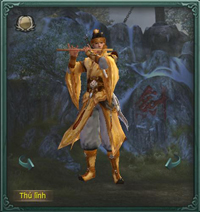 Diệp Vô Tâm** | Diệp Vô Tâm là đệ tử cuối cùng của Trang Chủ Tàng Kiếm Sơn Trang Diệp Mạnh Thu, quanh năm bế quan tu luyện trong Kiếm Lư, trấn thủ ở Mai Kiếm Cốc. Y giỏi sử dụng bảo kiếm Huyết Xà, kiếm này được luyện từ Xích Huyết Thạch ngàn năm, tà khí rất nặng, người không có tâm địa trong sáng không thể dùng. **Đẳng cấp**: **22** **Sinh lực**:**21.697** |
| **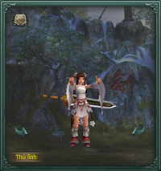 Diệp Kỳ Phỉ** | Diệp Kỳ Phỉ là cháu gái của Trang Chủ Tàng Kiếm Sơn Trang, được tổ phụ Diệp Mạnh Thu đích thân truyền thụ nội công, đang ở Tế Kiếm Đài trong Kiếm Chủng chờ chư vị hiệp sĩ đến khiêu chiến. **Đẳng cấp:** **23** **Sinh lực:** **22.663** |
| **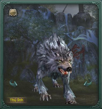 Dạ Tiếu(nhiệm vụ)** | Thủ lĩnh bí ẩn của Kiếm Chủng. Dạ Tiếu ẩn sâu trong Kiếm Chủng, gặp phải hắn khó tránh khỏi một trận ác chiến. **Đẳng cấp:** **21** **Sinh lực:** **21.697** |

#### Hiệu ứng trong phó bản

| **Boss** | **Hiệu ứng** | **Tác dụng** |
| --- | --- | --- |
| **Lưu Phong**(Xuân Huy Cốc) | Điếu Ngữ Hoa Hương | Mỗi 3 giây phục hồi khí huyết 300 điểm, duy trì 5 phút |
| **Thanh Ti**(Hạ Chấn Cốc) | Thất Nguyệt Lưu Hoa | Tăng 100% ngoại công trong 5 phút |
| **Huyền Trạch**(Thu Sát Cốc) | Kim Phong Ngọc Lộ | Tăng 100% nội ngoại thủ trong 5 phút |
| **Xuân Thu**(Đông Hàn Cốc) | Thích Cốt | Tăng 50% tốc độ di chuyển trong 5 phút |

### Mộ Kiếm - Anh Hùng

- **Đẳng cấp nhân vật**: Cấp **70** trở lên.

- **Yêu cầu**: Tổ đội 5 người.

- **Lối vào phó bản**: Phía bắc bản đồ Tàng Kiếm Sơn Trang.

#### Boss

| **Hình ảnh** | **Ghi chú** |
| --- | --- |
| **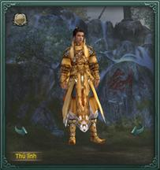 Diệp Lăng Liệt** | Diệp Lăng Liệt là con của nhị trang chủ Diệp Huy, do không chú trọng tuần tự giảm tiến của võ học và bồi dưỡng nội công nên tiến bộ chậm chạp. Sau đó đổ tội cho vấn đề của võ học Tàng Kiếm nên đã bỏ kiếm dùng đao, quên sự khác nhau của tâm pháp tu luyện giữa đao và kiếm, nay gần như tẩu hỏa nhập ma, làm hại không ít đệ tử môn phái. **Đẳng cấp**: **71** **Sinh lực**:**576.000** |
| **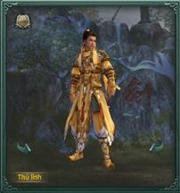 Diệp Vô Tâm** | Diệp Vô Tâm là đệ tử cuối cùng của Trang Chủ Tàng Kiếm Sơn Trang Diệp Mạnh Thu, quanh năm bế quan tu luyện trong Kiếm Lư, trấn thủ ở Mai Kiếm Cốc. Y giỏi sử dụng bảo kiếm Huyết Xà, kiếm này được luyện từ Xích Huyết Thạch ngàn năm, tà khí rất nặng, người không có tâm địa trong sáng không thể dùng. **Đẳng cấp**: **71** **Sinh lực**: **720.000** |
| **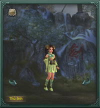 Diệp Hỏa Tịch** | Diệp Hỏa Tịch phụ trách trông nom Xuân Huy Cốc trong Kiếm Chủng. Cô ấy bản chất linh hoạt, võ học không hạn chế một kiểu, luôn có thể tự mình sáng tạo ra điều kỳ diệu mà người thường không thể tưởng tượng.. **Đẳng cấp**: **71** **Sinh lực**: **560.000** |
| **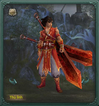 Diệp Hạo Thiên** | Diệp Hạo Thiên phụ trách trông coi Hạ Chấn Cốc trong Kiếm Chủng, y thích tu luyện nơi cực nóng, ước mơ cả đời là có thể tự chế ra kiếm pháp mạnh nhất thế gian. **Đẳng cấp**: **71** **Sinh lực**: **780.000** |
| **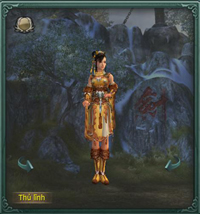 Diệp Kim Tố** | Diệp Kim Tố phụ trách trông coi Thu Sắt Cốc trong Kiếm Chủng, tâm tính lương thiện. Để cứu chữa sinh linh trong cốc đã khiến mình rơi vào tình cảnh nguy hiểm, các hiệp sĩ nếu ra tay giúp đỡ, cô ta nhất định sẽ trả công. **Đẳng cấp**: **71** **Sinh lực**: **110.000** |
| **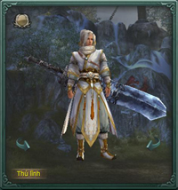 Diệp Đông Thần** | Diệp Đông Thần phụ trách trông coi Đông Hàn Cốc trong Kiếm Chủng, y thích nhất tu luyện nơi rất lạnh, ước mơ cả đời là có thể chế ra kiếm pháp lạnh nhất thế gian. **Đẳng cấp**: **71** **Sinh lực**: **648.000** |
| **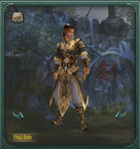 Diệp Thu Trì** | Là đệ tử bế quan cao nhất về võ công trong Kiếm Chủng, Diệp Thu Trì tinh thông Tứ Quý tâm pháp, một người có thể bao hàm được 4 loại kiếm pháp xuân hạ thu đông, do đó cũng phụ trách trấn thủ bí mật nơi sâu nhất trong Kiếm Chủng. **Đẳng cấp**: **71** **Sinh lực**: **350.000** |

#### Hiệu ứng trong phó bản

| **Boss** | **Hiệu ứng** | **Tác dụng** |
| --- | --- | --- |
| **Diệp Hỏa Tích**(Xuân Huy Cốc) | Bào Tử Đỏ | Mỗi giây tiêu hao 100 nội lực trong 5 phút. |
| Bào Tử Trắng | Sát thương nhận được +20% trong 5 phút. |  |
| Bào Tử Vàng | Hiệu quả trị thương -20% trong 5 phút. |  |
| Bào Tử Lục | Sát thương gây ra -20% trong 5 phút. |  |
| Bào Tử Tương Khắc | Mỗi 3 giây nhận 3.200 sát thương nội - độc trong 5 phút. |  |
| Xuân Ý Ngạo Thiên | Hiệu quả trị thương +10%, tấn công -2,5% trong 3 phút. |  |
| **Diệp Hạo Thiên**(Hạ Chấn Cốc) | Hạ Nhật Viên Viên | Mỗi giây nhận 100 sát thương nội - dương. |
| Viên Lân | Mỗi giây nhận 75 sát thương nội - dương. |  |
| Hạ Nhật Viên Viên (đã tiêu diệt Boss) | Sát thương ngoại +20%, mỗi giây tốn 0.2% nội lực trong 3 giờ. |  |
| **Diệp Kim Tố**(Thu Sát Cốc) | Thu Phong Lạc Diệp | Nội lực tiêu hao chiêu thức +20%. |
| Thu Phong Lạc Diệp (bảo vệ thành công Diệp Kim Tố) | Cấp phòng thủ ngoại +300 điểm, cấp phòng thủ nội +150 điểm trong 3 giờ. |  |
| **Diệp Đồng Thần**(Đông Hàn Cốc) | Hàn Phong Thích Cốt | Sát thương nội - âm nhận được +4%. |
| Cực Lạnh | Cộng dồn nhiều tầng, mỗi tầng sát thương nội - âm nhận được + 4%. |  |
| Hàn Phong Thích Cốt (đã tiêu diệt Boss) | Sát thương tấn công nội +40%, sát thương nhận được +20% trong 3 giờ. |  |
| **Diệp Vô Tâm** | Tiểu Mãn | Cấp phòng thủ nội -20%. |
| Mang Chủng | Cấp phòng thủ ngoại -20%. |  |
| Hàn Lộ | Mỗi giây nhận 500 sát thương. |  |
| Cốc Vũ | Sát thương nội -20%. |  |
| Đông Chí | Tốc độ di chuyển -50%. |  |
| Đại Hàn | Thể chất -25%. |  |
| **Diệp Thu Trì** | Liệt Diệm Chu Minh | Cộng dồn nhiều tầng, mỗi tầng khiến sát thương Liệt Diệm Chu Minh +15%. |
| Tố Tuyết Kiếm | Mỗi giây nhận 300 sát thương ngoại. |  |

## Thiên Địa Tam Tài Trận

Thiên Địa Tam Tài Trận là thế trận đối đầu âm thầm của Thần Sách Quân và [Thiên Sách](../mon-phai/thien-sach.md) Quân, nằm ở phía sau Thiên Sách Phủ, do Thần Sách Phủ quản lý. Để không cho thế lực Thiên Sách bành trướng làm ảnh hưởng đến mình Thần Sách đã bố trí Tam Tài Trận, ngoài mặt là hợp tác với Thiên Sách, thực chất là giới hạn khả năng thông tin liên lạc của Thiên Sách. Trung Thư Thiên Sách là Thương Trọng Vĩnh trộm binh thư của sư phụ là Chu Kiếm Thu, chạy đến nơi này nương nhờ Thần Sách.

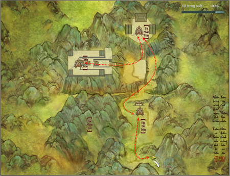

#### Phần thưởng

- **Vũ khí:**Vũ khí nhận được tại Mộ Kiếm (Kiếm Chủng) anh hùng là vũ khí tầm xa của tất cả các phái có phẩm chất 130 - 140. Nổi bật là các vũ khí có hiệu ứng đặc biệt mà vũ khí bình thường không có, mỗi vũ khí của mỗi phái sẽ có hiệu ứng riêng biệt.

- **Trang bị:**Trang bị bộ **Cang Chính**của Tàng Kiếm phẩm chất xanh lam bao gồm: Bao tay, nón, áo, giày, thắt lưng. Ngoài ra còn có yêu trụy, nhẫn, dây chuyền phẩm chất xanh lam dành cho các môn phái khác. Toàn bộ có phẩm chất đạt 110 - 140.

### Thiên Địa Tam Tài Trận - Thường

- **Đẳng cấp nhân vật**: Cấp **25** trở lên.

- **Yều cầu**: Tổ đội 5 người.

- **Lối vào phó bản**: Bản đồ Thiên Sách.

#### Boss

| **Hình ảnh** | **Ghi chú** |
| --- | --- |
| **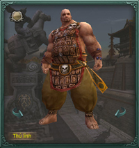 Gấu Ngựa** | Cha mẹ không rõ, là Hùng Si trong Thần Sách Quân, từ bé lớn lên cùng gấu. Là người không hiểu đạo lý đối nhân xử thế, thật thà chất phác. Do sức lực lớn mạnh, lại giỏi dẫn gấu tác chiến, được phái trấn thủ Địa Hổ Trận. **Đẳng cấp**: **26** **Sinh lực**: **3.541** |
| **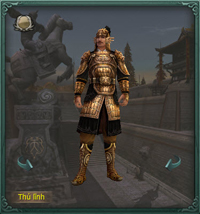 Đặng Văn Phong** | Đặng Văn Phong là tướng lĩnh hạng trung trong Thần Sách, chính y đã khiến cho Thương Trọng Vĩnh bố trí Thiên Địa Tam Tài Trận. Đặng Văn Phong võ nghệ tầm thường, chỉ đựa vào thuộc hạ Hanh Cáp, y bắt rất nhiều quân sĩ và gia quyến Thiên Sách, đóng giữ Tứ Nhân Trận. **Đẳng cấp**: **26** **Sinh lực**:**5.600** |
| **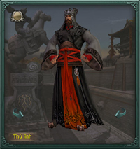 Thương Trọng Vĩnh** | Thương Trọng Vĩnh bái Chu Kiếm Thu làm thầy, Chu Kiếm Thu thấy y tuổi trẻ lông bông, sợ y lạc lối nên dạy y đạo đức văn học. Trọng Vĩnh lại cho rằng ân sư sợ mình hơn ông ấy, âm thầm học cơ quan trận thư, sau cùng bị Đặng Văn Phong xúi giục, bày Thiên Địa Tam Tài Trận đối kháng với ân sư. **Đẳng cấp:** **27** **Sinh lực:** **10.500** |
| **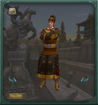 Lý Thương Thủy** | Thủ lĩnh bí ẩn của Tam Tài Trận. Người của Thần Sách Quân phái đến giám sát Thương Trọng Vĩnh, võ công cao cường, tâm tính xảo quyệt. Nếu có người đánh bại Thương Trọng Vĩnh, y sẽ ra mặt giải quyết. Các hiệp sĩ phải cẩn thận ứng phó. **Đẳng cấp:** **27** **Sinh lực:** **48.000** |

### Thiên Địa Tam Tài Trận - Anh Hùng

- **Đẳng cấp nhân vật**: Cấp **70** trở lên.

- **Yêu cầu**: Tổ đội 5 người.

- **Lối vào phó bản**: Bản đồ Thiên Sách.

#### Boss

| **Hình ảnh** | **Ghi chú** |
| --- | --- |
| **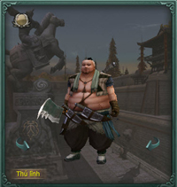 Phạm Bá** | Là một bếp trưởng trong phiến quân Vũ Văn, món Phạm Bá thích nhất là Phạn Bào Hoạt Nhân, điều này thật khó tưởng tượng, nhưng lại luôn đạt được kết quả y muốn. **Đẳng cấp**: **70** **Sinh lực**: **112.000** |
| **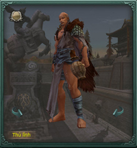 Triệu Thiên Long** | Triệu Thiên Long là chủ Thiên Long Trại Thập Nhị Liên Hoàn Ổ, sau khi sào huyệt thất thủ đành phải bán mạng cho huynh đệ Vũ Văn, lần này phụng mệnh trà trộn vào Bắc Mang Sơn chuẩn bị đối kháng Thiên Sách Phủ, đây là việc bất đắc dĩ. **Đẳng cấp**: **70** **Sinh lực**:**140.000** |
| **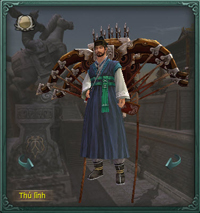 Phác Tôn Tử** | Sau khi Tam Tài Trận bị công phá, phiến quân Vũ Văn trà trộn vào Bắc Mang Sơn, bày lại quân trận, từ Cao Lệ mời chuyên gia thuốc nổ Phác Tôn Tử, ý đồ nhờ vào hỏa khí để đánh bại Thiên Sách Phủ. **Đẳng cấp:** **70** **Sinh lực:** **200.000** |

## Đường Môn Mật Thất

Chuyện Tàng Kiếm Sơn Trang - Diệp Phàm và [Đường Môn](../mon-phai/duong-mon.md) – Đường Tiểu Uyển bỏ trốn cuối cùng cũng không được Đường Môn và Bá Đao tha thứ. Sau sự kiện Kim Thủy Trấn, Diệp Phàm và Đường Tiểu Uyển biết chuyện tỷ tỷ Đường Thư Nhạn trà trộn vào [Ngũ Độc](../mon-phai/ngu-doc.md) Giáo thất bại, bị Thiên Nhất Giáo biến thành Thi Nhân nên quyết định trở lại Đường Môn.

Không ngờ đây là kế hoạch của Đường Ngạo Thiên để dụ Đường Tiểu Uyển trở lại Đường Môn, Đường Ngạo Thiên đã giam lỏng Đường Tiểu Uyển và mời Liễu Kinh Đào - Chưởng môn Bá Đao Sơn đến Đường Môn, hy vọng cứu vãn mối nhân duyên giữa Liễu Kinh Đào và Đường Tiểu Uyển.

Diệp Phàm sau khi biết được đã tập kích đoàn rước dâu, muốn Đường Ngạo Thiên rút lại quyết định, cuối cùng Đường Ngạo Thiên hứa cho Diệp Phàm một cơ hội, nhưng phải vượt qua được Đường Môn Mật Thất mới thả Đường Tiểu Uyển, Diệp Phàm biết rõ Đường Môn Mật Thất rất nguy hiểm nhưng vẫn nhận lời.

Đường Tiểu Uyển biết cha mình không dễ dàng để yên, nhất định sẽ phái sát thủ ám sát. Đại hiệp! Hãy vào mật thất giúp Diệp Phàm vượt qua thử thách.

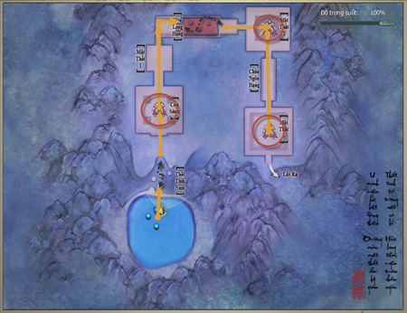

#### Phần thưởng

- **Vũ khí:**Rơi ra vũ khí các môn phái phẩm chất 100, các vũ khí này có điểm trang bị và chỉ số vượt trội hơn rất nhiều các vũ khí có được từ các nhiệm vụ dưới cấp 70, có ích rất nhiều trong quá trình luyện cấp từ 70 đến 80.

- **Trang bị:**Các loại áo, quần, giày, găng tay, nón, nhẫn, yêu trụy phẩm chất 100 - 110 , các loại trang này thuộc tính phòng thủ rất cao đồi với người chơi cấp 70.

- **Vật phẩm khác:**Các loại công thức trang bị theo bộ phẩm chất từ 95 - 100 - 112 và đặc biệt là túi trang sức vai, túi trang sức lưng dùng mở rộng ô ngoại trang của nhân vật. Đây là những vật phẩm không thể thiếu nếu người chơi muốn tao bản sắc riêng cho mình thông qua các ngoại trang đeo lưng, vai, giúp mở rộng thêm ô chưa ngoại trang cho nhân vật.

Hệ thống Phó Bản phong phú và đặc sắc của Võ Lâm 3 vẫn đang rộng mở đón chờ các anh hùng hào kiệt khắp chốn chinh phục. Quý nhân sĩ hãy tham gia ngay hôm nay để không bỏ lỡ cơ hội trở thành một nhân vật truyền kỳ chốn võ lâm.

### Đường Môn Mật Thất - Thường

- **Đẳng cấp nhân vật**: Cấp **25** trở lên.

- **Yêu cầu**: Tổ đội 5 người.

- **Lối vào phó bản**: Phía Bắc bản đồ Đường Môn.

#### Boss

| **Hình ảnh** | **Ghi chú** |
| --- | --- |
| **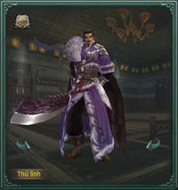 Liễu Kính Đào** | Liễu Kinh Đào đến Đường Môn gặp riêng Đường Ngạo Thiên, chuyện trò thân mật. Đường Ngạo Thiên tỏ ý gả tiểu nữ Đường Tiểu Uyển cho Liễu Kính Đào. Không ngờ Diệp Phàm cùng Đường Tiểu Uyển bỏ trốn. Liễu Kinh Đào mất mặt, liền phái Đệ Tử Bá Đao hành thích Diệp Phàm, hòng đoạt lại hôn thê. **Đẳng cấp**:**25** **Sinh lực**: **9.000** |
| **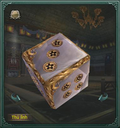 Cơ Quan Xúc Xắc** | Xúc xắc lớn được chế tác tinh xảo, là thiết bị điều khiển mật thất thứ hai, phối hợp mật thất có thể nhanh chóng bố trí thành Địa Vong Trận, Song Tử Trận, Thiên Lôi Trận, Tứ Tượng Trận, Ngũ Hành Trận hoặc Lục Hợp Trận và thay đổi các thế trận, thể hiện kỹ năng cao siêu của phòng ngự Đường Môn, rất khó đề phòng. **Đẳng cấp**: **25** **Sinh lực**:**25.000** |
| **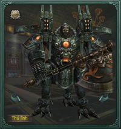 Hán Đường** | Cơ quan Hán Đường là công trình tâm đắc của Ngự Đường Đường Môn, trấn giữ mật thất thứ ba, cao lớn vững chãi, người bình thường không thể chống lại. Dung hợp Cơ Quan Thuật Đường Môn, kỹ thuật Tịch Lịch Đường Hỏa Khí, công thủ vẹn toàn. Hình như có cùng nguồn gốc với Cơ Giáp Thuật của Tư Đồ Nhất Nhất. **Đẳng cấp:** **25** **Sinh lực:** **9.000** |

#### Các trận pháp tại Cơ Quan Xúc Xắc

| **Trận pháp** | **Ghi chú** |
| --- | --- |
| **Địa Mang Trận** | Chông nhọn sẽ lần lượt nhô lên, người chơi cần phải nhảy vào những khu vực không có chông nhọn. |
| **Song Tử Trận** | Triệu hồi ra 2 song tử cơ giáp. |
| **Thiên Lôi Trận** | Thiên lôi xuất hiện từ trên trời gây sát thương. |
| **Tứ Tượng Trận** | 04 cơ quan giáp nhân sẽ xuất hiện và di chuyển xung quanh, sau đó tiến vào giữa và hợp nhất thành một. |
| **Ngũ Hành Trận** | 05 quả cầu tương ứng Kim Mộc Thủy Hỏa Thổ với 5 hiệu ứng bất lợi khác nhau sẽ xuất hiện. |
| **Lục Hợp Trận** | 06 cơ giáp nhân sẽ lần lượt xuất hiện. |

### Đường Môn Mật Thất - Anh Hùng

- **Đẳng cấp nhân vật**: Cấp **80** trở lên.

- **Yêu cầu**: Tổ đội 5 người.

- **Lối vào phó bản**: Phía Bắc bản đồ Đường Môn.

#### Boss

| **Hình ảnh** | **Ghi chú** |
| --- | --- |
| ** Liễu Kính Đào** | Liễu Kinh Đào đến Đường Môn gặp riêng Đường Ngạo Thiên, chuyện trò thân mật. Đường Ngạo Thiên tỏ ý gả tiểu nữ Đường Tiểu Uyển cho Liễu Kính Đào. Không ngờ Diệp Phàm cùng Đường Tiểu Uyển bỏ trốn. Liễu Kinh Đào mất mặt, liền phái Đệ Tử Bá Đao hành thích Diệp Phàm, hòng đoạt lại hôn thê. **Đẳng cấp**:**81** **Sinh lực**: **618.800** |
| ** Cơ Quan Xúc Xắc** | Xúc xắc lớn được chế tác tinh xảo, là thiết bị điều khiển mật thất thứ hai, phối hợp mật thất có thể nhanh chóng bố trí thành Địa Vong Trận, Song Tử Trận, Thiên Lôi Trận, Tứ Tượng Trận, Ngũ Hành Trận hoặc Lục Hợp Trận và thay đổi các thế trận, thể hiện kỹ năng cao siêu của phòng ngự Đường Môn, rất khó đề phòng. **Đẳng cấp**: **81** **Sinh lực**:**250.000** |
| ** Hán Đường** | Cơ quan Hán Đường là công trình tâm đắc của Ngự Đường Đường Môn, trấn giữ mật thất thứ ba, cao lớn vững chãi, người bình thường không thể chống lại. Dung hợp Cơ Quan Thuật Đường Môn, kỹ thuật Tịch Lịch Đường Hỏa Khí, công thủ vẹn toàn. Hình như có cùng nguồn gốc với Cơ Giáp Thuật của Tư Đồ Nhất Nhất. **Đẳng cấp:** **81** **Sinh lực:** **618.800** |

#### Các trận pháp tại Cơ Quan Xúc Xắc

Giống phần Các trận pháp tại Cơ Quan Xúc Xắc của Đường Môn Mật Thất - Thường ở trên.

## Quang Minh Mật Đạo

Sự biến Đại Quang Minh Tự đã qua nhiều năm, quan hệ giữa [Minh Giáo](../mon-phai/minh-giao.md) và các môn phái Trung Nguyên dần êm dịu, nhằm duy trì mối quan hệ tốt đẹp, và chuẩn bị cho Minh Giáo về lại Trung Nguyên, giáo chủ Minh Giáo Lục Nguy Lâu quyết định phái một số đệ tử tư chất tốt xuống núi về Trung Nguyên.

Đường đến Trung Nguyên gian nan hiểm nguy, Lục Nguy Lâu hạ lệnh đệ tử nào vượt qua Càn Khôn Đại Na Di Ngũ Hành Trận Pháp, mới có tư cách xuống núi.

Cần Khôn Đại Na Di Ngũ Hành Trận Pháp - tức Quang Minh Mật Đạo, do 5 Đại Chưởng Kỳ Sứ của Minh Giáo Ngũ Hành Kỳ trấn thủ, gồm: Lưu Kim Kỳ, Tinh Mộc Kỳ, Hồng Thủy Kỳ, Diệu Hóa Kỳ và Phương Thổ Kỳ biến hóa khôn lường, rất khó vượt qua!

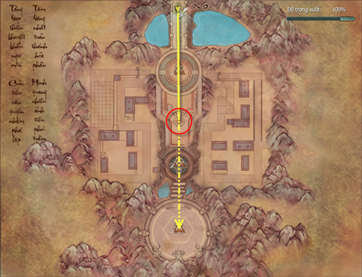

#### Phần thưởng

- **Vũ khí:**Vũ khí nhận được là vũ khí tầm xa của tất cả các phái có phẩm chất đến 255. Nổi bật là các vũ khí có hiệu ứng đặc biệt mà vũ khí bình thường không có. Mỗi vũ khí của mỗi phái sẽ có hiệu ứng riêng biệt.   

 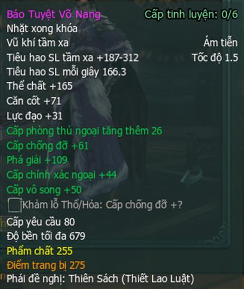 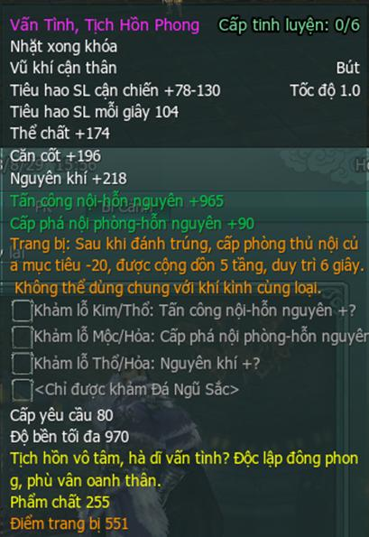

- **Trang bị:**Trang bị nhận được của tất cả các phái bao gồm: Bao tay, nón, áo, quần, giày, thắt lưng, yêu trụy, nhẫn, dây chuyền có phẩm chất đạt 255.

- **Vật phẩm khác:**Mảnh Thục Ngọc, vật phẩm nhiệm vụ ẩn, Bùa Hào Hiệp, Bùa Khuông Nghĩa.

### Quang Minh Mật Đạo - Thường

- **Đẳng cấp nhân vật**: Cấp **20** trở lên.

- **Yêu cầu**: Tổ đội tối đa 5 người.

- **Lối vào phó bản**: Phía Bắc bản đồ Minh Giáo.

#### Boss

| **Hình ảnh** | **Ghi chú** |
| --- | --- |
| **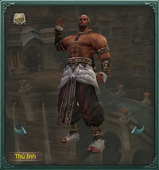 Vấn Hàn Tùng** | Vấn Hàn Tùng là Chưởng Kỳ Sứ - Tinh Mộc Kỳ, lỗ mãng và sức mạnh vô cùng. Giỏi sử dụng Thần Lực Huy Vũ Cự Mộc, có thể dùng thiên trụ làm thành Tinh Mộc Trận, khiến đối thủ rơi vào trận pháp khôn lường khó đề phòng, đến nay đã có vô số kẻ khiêu chiến phải ngậm hờn. **Đẳng cấp**:**25** **Sinh lực**: **9.000** |
| **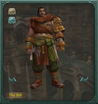 Tần Nhiên** | Ngô Dĩnh Liên và Tân Nhiên lần lượt là Chưởng Kỳ Sứ - Hồng Thủy Kỳ và Chưởng Kỳ Sứ - Diệu Hỏa Kỳ, Ngô Dĩnh Liên giỏi dùng Thủy, Tân Nhiên giỏi dùng Hỏa. Tuy tương khắc, nhưng cả hai lại phối hợp được với nhau, quả là kỳ diệu và khó lường. **Đẳng cấp**: **25** **Sinh lực**:**5.000** |
| **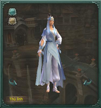 Ngô Dĩnh Liên** |  |
| **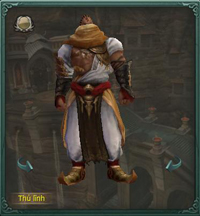 Tiết Sơn** | Tiết Sơn là Phó Chưởng Kỳ Sứ - Lưu Kim Kỳ. Do Chưởng Kỳ Sứ - Lưu Kim Kỳ là Trang Chính quá nghiêm khắc với thủ hạ, Lục Yên Nhi sợ Trang Chính làm trọng thương đệ tử nên đã phái Tiết Sơn đến trấn thủ. Hắn giỏi Thương Pháp, đệ tử Lưu Kim Kỳ đều có tuyệt kỹ riêng như Cung Tên, Đại Phủ, Đoản Đao. **Đẳng cấp:** **26** **Sinh lực:** **10.000** |

#### Hiệu ứng trong bí cảnh

| **Boss** | **Hiệu ứng** | **Tác dụng** |
| --- | --- | --- |
| **Vấn Hàn Trung** | Cự Mộc Xung Tràng | Huyễn Thân trong 5 giây. |
| Cuồng Bạo | Nếu trong 90 độ phía sau sẽ chịu sát thương, trường hợp ngược lại sẽ phản đòn sát thương. |  |
| **Tần Nhiên** | Liệt Hỏa Oanh Lôi | Tất cả tấn công cơ bản tăng 20% trong 5 giây. |
| **Ngô Dĩnh Liên** | Thủy Trụ | Huyễn Thân trong 3 giây. |
| Thủy ngưng | Hiệu quả được trị liệu giảm xuống 0, sát thương nội - dương phải chịu giảm 30%. |  |
| **Tiết Sơn** | Đoạn Cốt | Tốc độ di chuyển giảm, mỗi giây gây 40 điểm sát thương ngoại trong 5 giây. |

### Quang Minh Mật Đạo cấp 80

- **Đẳng cấp nhân vật**: Cấp **80** trở lên.

- **Yêu cầu**: Tổ đội tối đa 5 người.

- **Lối vào phó bản**: Phía Bắc bản đồ Minh Giáo.

#### Boss

| **Hình ảnh** | **Ghi chú** |
| --- | --- |
| ** Vấn Hàn Tùng** | Vấn Hàn Tùng là Chưởng Kỳ Sứ - Tinh Mộc Kỳ, lỗ mãng và sức mạnh vô cùng. Giỏi sử dụng Thần Lực Huy Vũ Cự Mộc, có thể dùng thiên trụ làm thành Tinh Mộc Trận, khiến đối thủ rơi vào trận pháp khôn lường khó đề phòng, đến nay đã có vô số kẻ khiêu chiến phải ngậm hờn. **Đẳng cấp**:**81** **Sinh lực**: **6.300.000** |
| ** Tần Nhiên** | Ngô Dĩnh Liên và Tân Nhiên lần lượt là Chưởng Kỳ Sứ - Hồng Thủy Kỳ và Chưởng Kỳ Sứ - Diệu Hỏa Kỳ, Ngô Dĩnh Liên giỏi dùng Thủy, Tân Nhiên giỏi dùng Hỏa. Tuy tương khắc, nhưng cả hai lại phối hợp được với nhau, quả là kỳ diệu và khó lường. **Đẳng cấp**: **81** **Sinh lực**:**3.300.000** |
| ** Ngô Dĩnh Liên** |  |
| ** Tiết Sơn** | Tiết Sơn là Phó Chưởng Kỳ Sứ - Lưu Kim Kỳ. Do Chưởng Kỳ Sứ - Lưu Kim Kỳ là Trang Chính quá nghiêm khắc với thủ hạ, Lục Yên Nhi sợ Trang Chính làm trọng thương đệ tử nên đã phái Tiết Sơn đến trấn thủ. Hắn giỏi Thương Pháp, đệ tử Lưu Kim Kỳ đều có tuyệt kỹ riêng như Cung Tên, Đại Phủ, Đoản Đao. **Đẳng cấp:** **81** **Sinh lực:** **6.080.000** |
| **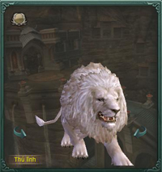 Sư Vương Tây Vực** (nhiệm vụ) | Chưởng Kỳ Sứ Lưu Kim Kỳ - Trang Chính tự tay nuôi Sư Vương hung hãn. Trang Chính là người giỏi võ công nhất trong Chưởng Kỳ Sứ - Ngũ Hành Kỳ, lần này bị kẻ xấu dụ dỗ đại náo Ngũ Hành Trận, lại còn lệnh cho Sư Vương Tây Vực quấy rối người vào Ngũ Hành Trận. **Đẳng cấp:** **81** **Sinh lực:** **12.900.000** |

#### Hiệu ứng trong bí cảnh

| **Boss** | **Hiệu ứng** | **Tác dụng** |
| --- | --- | --- |
| **Vấn Hàn Trung** | Cự Mộc Xung Tràng | Huyễn Thân trong 5 giây. |
| Cuồng Bạo | Nếu đứng trong 90 độ phía sau sẽ chịu sát thương, ngược lại sẽ phản đòn sát thương. |  |
| **Tần Nhiên** | Liệt Hỏa Oanh Lôi | Tất cả tấn công cơ bản tăng 20% trong 5 giây. |
| **Ngô Dĩnh Liên** | Thủy Trụ | Huyễn Thân trong 3 giây. |
| Thủy ngưng | Hiệu quả được trị liệu giảm xuống 0, sát thương nội - dương phải chịu giảm 30%. |  |
| **Tiết Sơn** | Đoạn Cốt | Tốc độ di chuyển giảm, mỗi giây gây 1.700 điểm sát thương ngoại trong 5 giây. |
| Vô Ảnh Kích | Không thể sử dụng chiêu thức nội công trong 5 giây |  |
| Chấn Địa | Huyễn Thân thời gian 3 giây. |  |
| **Sư Vương Tây Vực** | Giảm Tốc | Tốc độ di chuyển mỗi tầng giảm 5%. |
| Song Sư Đột Tiến | Tấn công cơ bản và hiệu quả trị thương cơ bản giảm 20.000 điểm. |  |

## Tiên Tung Lâm

Sau khi Ngũ Độc Giáo chia năm sẻ bảy, tuy bị Thiên Nhất Giáo tấn công nhưng Khúc Vân vẫn không từ bỏ việc giúp đỡ tộc Tháp Nạp. Tuy không nhận được sự tha thứ từ Tháp Nạp, Khúc Vân tin rằng phải tự mình đền bù những sai lầm của bổn giáo.

Gần đây, Khúc Vân biết tin Thiên Nhất Giáo định đánh lén Ngũ Tiên Đàm - nơi ở của tộc Tháp Nạp, vì thế đã hẹn thủ lĩnh tộc Tháp Nạp Đường Thư Nhạn đến Tiên Tung Lâm gần Ngũ Tiên Đàm gặp mặt, hy vọng có thể cảnh báo cho tộc Tháp Nạp.

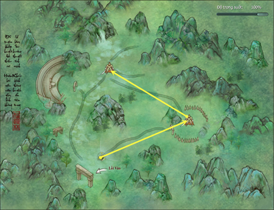

### Tiên Tung Lâm cấp 20

- **Đẳng cấp nhân vật**: Cấp **20** trở lên.

- **Yêu cầu**: Tổ đội tối đa 5 người.

- **Lối vào phó bản**: Trung tâm bản đồ Ngũ Độc.

#### Boss

| **Hình ảnh** | **Ghi chú** |
| --- | --- |
| **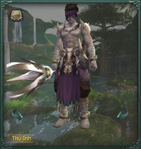 Tháp Nạp Đao Vương** | Tháp Nạp Đao Vương lai lịch thần bí, trước kia từng là môn chủ, đao phóng ra như cuồng phong bạo vũ. Thủ lĩnh Tháp Nạp Đường Thư Nhạn lệnh cho Đao Vương trấn thủ lối vào Tiên Tung Lâm, không cho ai quấy rầy cuộc gặp gỡ với giáo chủ Ngũ Độc Khúc Vân. **Đẳng cấp**:**21** **Sinh lực**: **8.000** |
| **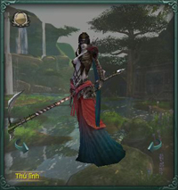 Thủy Vân** | Thủy Vân là thầy tế Thiên Nhất Giáo, có địa vị cao trong giáo phái. Cùng với tỷ tỷ Thủy Yên dung mạo xinh đẹp, võ công cao cường, được gọi là song sinh Kim Hoa của Thiên Nhất Giáo. Việc Thủy Yên bị hiệp sĩ Trung Nguyên bao vây thánh điện khiến Thủy Vân rất đau lòng, thề quyết báo thù. **Đẳng cấp**: **21** **Sinh lực**:**6.500** |
| **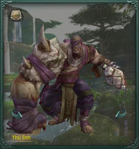 Tô Tủy** | Tô Tủy là cuồng nhân nổi tiếng trong Thiên Nhất Giáo, cánh tay mạnh như vật tổ Man Tộc! Lúc thống lĩnh giáo đồ Thiên Nhất tấn công, Tô Tủy luôn giơ cao cánh tay đồ sộ, gầm một tiếng lớn: Tay ta là cờ, xung phong. **Đẳng cấp:** **22** **Sinh lực:** **11.500** |

#### Hiệu ứng trong bí cảnh

| **Boss** | **Hiệu ứng** | **Tác dụng** |
| --- | --- | --- |
| **Tháp Nạp Đao Vương** | Độc Tố Lây Lan | Mỗi 3 giây khiến xung quanh chịu 50 sát thương độc. |
| **Thủy Vân** | Kích Độc | Mỗi 3 giây gây 15 sát thương nội - độc trong 10 giây. |

### Tiên Tung Lâm - Thường

- **Đẳng cấp nhân vật**: Cấp **72** trở lên.

- **Yêu cầu**: Tổ đội tối đa 5 người.

- **Lối vào phó bản**: Trung tâm bản đồ Ngũ Độc.

#### Boss

| **Hình ảnh** | **Ghi chú** |
| --- | --- |
| ** Tháp Nạp Đao Vương** | Tháp Nạp Đao Vương lai lịch thần bí, trước kia từng là môn chủ, đao phóng ra như cuồng phong bạo vũ. Thủ lĩnh Tháp Nạp Đường Thư Nhạn lệnh cho Đao Vương trấn thủ lối vào Tiên Tung Lâm, không cho ai quấy rầy cuộc gặp gỡ với giáo chủ Ngũ Độc Khúc Vân. **Đẳng cấp**:**74** **Sinh lực**: **430.000** |
| ** Thủy Vân** | Thủy Vân là thầy tế Thiên Nhất Giáo, có địa vị cao trong giáo phái. Cùng với tỷ tỷ Thủy Yên dung mạo xinh đẹp, võ công cao cường, được gọi là song sinh Kim Hoa của Thiên Nhất Giáo. Việc Thủy Yên bị hiệp sĩ Trung Nguyên bao vây thánh điện khiến Thủy Vân rất đau lòng, thề quyết báo thù. **Đẳng cấp**: **74** **Sinh lực**:**260.000** |
| ** Tô Tủy** | Tô Tủy là cuồng nhân nổi tiếng trong Thiên Nhất Giáo, cánh tay mạnh như vật tổ Man Tộc! Lúc thống lĩnh giáo đồ Thiên Nhất tấn công, Tô Tủy luôn giơ cao cánh tay đồ sộ, gầm một tiếng lớn: Tay ta là cờ, xung phong. **Đẳng cấp:** **75** **Sinh lực:** **430.000** |

#### Hiệu ứng trong bí cảnh

| **Boss** | **Hiệu ứng** | **Tác dụng** |
| --- | --- | --- |
| **Tháp Nạp Đao Vương** | Độc Tố Lây Lan | Mỗi 3 giây khiến xung quanh chịu 1.400 sát thương độc |
| **Thủy Vân** | Kích Độc | Mỗi 3 giây gây 300 sát thương nội - độc trong 10 giây |

### Tiên Tung Lâm - Anh Hùng

- **Đẳng cấp nhân vật**: Cấp **80** trở lên.

- **Yêu cầu**: Tổ đội tối đa 5 người.

- **Lối vào phó bản**: Trung tâm bản đồ Ngũ Độc.

#### Boss

| **Hình ảnh** | **Ghi chú** |
| --- | --- |
| ** Tháp Nạp Đao Vương** | Tháp Nạp Đao Vương lai lịch thần bí, trước kia từng là môn chủ, đao phóng ra như cuồng phong bạo vũ. Thủ lĩnh Tháp Nạp Đường Thư Nhạn lệnh cho Đao Vương trấn thủ lối vào Tiên Tung Lâm, không cho ai quấy rầy cuộc gặp gỡ với giáo chủ Ngũ Độc Khúc Vân. **Đẳng cấp**:**81** **Sinh lực**: **1.220.000** |
| ** Thủy Vân** | Thủy Vân là thầy tế Thiên Nhất Giáo, có địa vị cao trong giáo phái. Cùng với tỷ tỷ Thủy Yên dung mạo xinh đẹp, võ công cao cường, được gọi là song sinh Kim Hoa của Thiên Nhất Giáo. Việc Thủy Yên bị hiệp sĩ Trung Nguyên bao vây thánh điện khiến Thủy Vân rất đau lòng, thề quyết báo thù. **Đẳng cấp**: **81** **Sinh lực**:**760.000** |
| ** Tô Tủy** | Tô Tủy là cuồng nhân nổi tiếng trong Thiên Nhất Giáo, cánh tay mạnh như vật tổ Man Tộc! Lúc thống lĩnh giáo đồ Thiên Nhất tấn công, Tô Tủy luôn giơ cao cánh tay đồ sộ, gầm một tiếng lớn: Tay ta là cờ, xung phong. **Đẳng cấp:** **81** **Sinh lực:** **1.220.000** |

#### Hiệu ứng trong bí cảnh

| **Boss** | **Hiệu ứng** | **Tác dụng** |
| --- | --- | --- |
| **Tháp Nạp Đao Vương** | Độc Tố Lây Lan | Mỗi 3 giây khiến xung quanh chịu 2.000 sát thương độc |
| **Thủy Vân** | Kích Độc | Mỗi 3 giây gây 500 sát thương nội - độc trong 10 giây |

## Không Vụ Phong

Không Vụ Phong nằm trên núi tuyết đông bắc Hoa Sơn, từng là nơi luyện kiếm của Tạ Vân Lưu thời trẻ và đệ tử Kiếm Tông. Sau khi Tạ Vân Lưu bỏ đi, những đệ tử Kiếm Tông nhớ Tạ Vân Lưu thường đến đây luyện kiếm.

Giờ đã khác xưa, giang hồ lưu truyền Tạ Vân Lưu cấu kết với trọng phạm triều đình Lý Sùng Mậu gây nên nhiều chuyện bất nghĩa, giờ đang bị Ám Vệ Quân của Thần Sách truy bắt. Thần Sách Quân mượn cớ bắt tội phạm đến [Thuần Dương](../mon-phai/thuan-duong.md) gây chuyên, bị Lý Vong Sinh ngăn cản không chịu hợp tác, Thần Sách Quân buộc phải rút lui.

Sau đó, nghe nói Tạ Vân Lưu tái xuất giang hồ và xuất hiện ở Không Vụ Phong, rất nhiều binh sĩ Thần Sách lên Không Vụ Phong bắt giữ tội phạm. Nhưng vì đánh không lại, Thần Sách Quân đã tấn công đệ tử Thuần Dương lên Không Vụ Phong luyện kiếm để uy hiếp, buộc Tạ Vân Lưu đầu hang và mua chuộc Hội Tiên Đồng che giấu mọi chuyện.

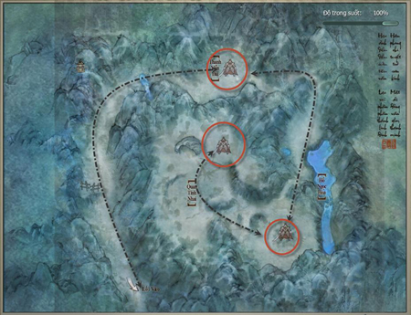

#### Phần thưởng

- **Vũ khí:**Vũ khí nhận được là vũ khí tầm xa của tất cả các phái có phẩm chất đến 255. Nổi bật là các vũ khí có hiệu ứng đặc biệt mà vũ khí bình thường không có. Mỗi vũ khí của mỗi phái sẽ có hiệu ứng riêng biệt.

- **Trang bị:**Trang bị nhận được của tất cả các phái bao gồm: Bao tay, nón, áo, quần, giày, thắt lưng, yêu trụy, nhẫn, dây chuyền có phẩm chất đạt 255.

- **Vật phẩm khác:**Vảy Thánh Thú tăng 50 điểm danh vọng Ngũ Độc Giáo, bí kíp Ngũ Độc Giáo, Mảnh Thục Ngọc, Bùa Hào Hiệp, Bùa Khuông Nghĩa.

### Không Vụ Phong - Thường

- **Đẳng cấp nhân vật**: Cấp **26** trở lên.

- **Yêu cầu**: Tổ đội 5 người.

- **Lối vào phó bản**: Phía Đông bản đồ Thuần Dương.

#### Boss

| **Hình ảnh** | **Ghi chú** |
| --- | --- |
| **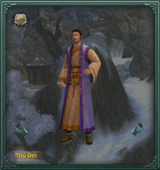 Phùng Độ** | Phùng Độ là một trong những đầu mục Hội Tiên Đồng, y và đại ca Phùng Bách bị phó úy Vương Ngạn Trực của Thần Sách ức hiếp, thống lĩnh thuộc hạ đến Không Vụ Phong tìm kho báu, thật ra là bị lợi dụng đến trấn thủ Thanh Viễn Đài. Sau này vì muốn nuốt trọn kho báu mà ngay cả huynh đệ của mình cũng hạ độc, rất tàn ác. **Đẳng cấp**:**26** **Sinh lực**: **8.000** |
| **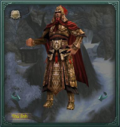 Vương Ngạn Trực** | Vương Ngạn Trực là phó úy Phong Tập Doanh của Thần Sách Quân, phụng mệnh truy bắt Tạ Vân Lưu. Do sợ võ công tuyệt đỉnh của Tạ Vân Lưu, Vương Ngạn Trực dẫn hơn 10 đệ tử của Tạ Vân Lưu đến Không Vụ Phong, hành hạ bằng hình phạt tàn khốc, lợi dụng họ để khống chế Tạ Vân Lưu. **Đẳng cấp**: **28** **Sinh lực**:**11.288** |
| **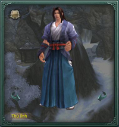 Tiểu Thứ Lang Quỷ Ảnh** | Tiểu Thứ Lang Quỷ Ảnh một đời thượng võ, được Tạ Vân Lưu dạy dỗ và học được bí truyền, luôn mong muốn trở thành đệ nhất võ học. Sau này Đằng Nguyên Quảng Tự cho rằng Tạ Vân Lưu muốn hóa giải ân oán với Thuần Dương Cung, bí mật phái y ngụy trang thành Tạ Vân Lưu, trà trộn vào Thuần Dương Cung sinh sự. **Đẳng cấp:** **29** **Sinh lực:** **15.097** |
| **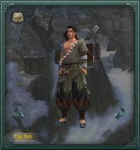 Lỗ Phi** | Nghe đồn sau khi Lỗ Phi trộm được bản đồ kho báu từ một nhà giàu ở kinh thành, liền trốn vào Thuần Dương Không Vụ Phong, chắc có liên quan tới kho báu đó. **Đẳng cấp:** **29** **Sinh lực:** **13.167** |

#### Hiệu ứng trong bí cảnh

| **Boss** | **Hiệu ứng** | **Tác dụng** |
| --- | --- | --- |
| **Vương Ngạn Trực** | Huyễn Huân | Không thể cử động trong 3 giây. |

### Không Vụ Phong - Anh Hùng

- **Đẳng cấp nhân vật**: Cấp **70** trở lên.

- **Yêu cầu**: Tổ đội 5 người.

- **Lối vào phó bản**: Phía Đông bản đồ Thuần Dương.

#### Boss

| **Hình ảnh** | **Ghi chú** |
| --- | --- |
| **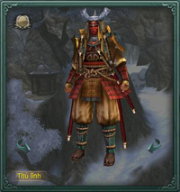 Tịch La Song** | Tịch La Song là cao thủ Nhẫn Thuật của Đông Doanh, là một bộ tướng đắc lực của Mai Kiếm Hùng. Y đã học Vụ Ẩn Lưu nhiều năm, có nhiều thuộc hạ quỷ yêu trợ trận, rất khó đối phó. **Đẳng cấp**:**70** **Sinh lực**: **186.800** |
| **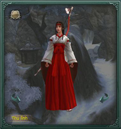 Đằng Nguyên Anh Nại** | Cô gái thần bí Đằng Nguyên Anh Nại đến từ nhà Đằng Nguyên, từ bé đã vào Y Thế Thần Cung, thuật âm dương huyền bí vô cùng. Quỷ Ảnh Thiên Hoa muốn phục thù cho cháu Tiểu Thứ Lang. **Đẳng cấp**: **70** **Sinh lực**:**108.678** |
| **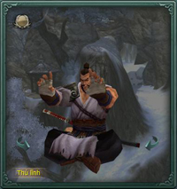 Mai Kiếm Hùng** | Mai Kiếm Hùng sau khi đến Đông Doanh đổi tên thành Vụ Ẩn Kiếm Tàng, học Mai Gia kiếm pháp kết hợp với nhẫn thuật Đông Doanh, tạo ra Vụ Ẩn Lưu, trở thành đại tướng đắc lực dưới trướng Đằng Nguyên Quảng Tự. Lần này hiệp trợ Tạ Vân Lưu đến võ lâm trung nguyên phục thù, thống lĩnh thuộc hạ đến Không Vụ Phong, ý đồ đoạt bí kíp Tọa Vọng Kinh của Thuần Dương. **Đẳng cấp:** **70** **Sinh lực:** **184.600** |

#### Hiệu ứng trong bí cảnh

| **Boss** | **Hiệu ứng** | **Tác dụng** |
| --- | --- | --- |
| **Tịch La Song** | Lợi Nhẫn của Tịch La Song | Gây mất máu liên tục trong 3 giây |
| Bộ Trì | Giảm 50% di chuyển |  |
| **Đằng Nguyên Anh Nại** | Chân - Phong Độn Định Ảnh | Gây định thân trong 15 giây |

## Linh Tiêu Hiệp

Đây là cổ đạo bí mật giữa vách núi phía sau Tung Sơn [Thiếu Lâm](../mon-phai/thieu-lam.md) Tự. Vốn thuộc nơi sơn cảnh hữu tình, nhưng bè đảng Minh Giáo trước kia còn sót lại nay là Hiệu Uy Tả Quân Hoa Hạc Viêm của Thần Sách Quân, vì muốn cứu Huyết Nhãn Long Vương - thủ lĩnh Pháp Vương Minh Giáo - bị nhốt trong Động Đạt Ma đã thống lĩnh quân đồn trú trong Linh Tiêu Hiệp bên trái Đạt Ma Động, mưu đồ đả thông đường hầm xâm nhập Động Đạt Ma…

#### Phần thưởng

- **Vũ khí:** Các loại vũ khí tầm xa như Ám Tiễn và Cung phẩm chất 100 - 105 dành cho phái ngoại công và nội độc.

- **Trang bị:** Các loại trang bị theo bộ phẩm chất 100 - 105 dành cho phái Thuần Dương.

- **Vật phẩm khác:** Các túi trang sức vai, lưng dùng để mở ô chứa trang sức và 2 quyển sách xanh lam cấp 65.

### Linh Tiêu Hiệp - Thường

- **Đẳng cấp nhân vật**: Cấp **35** trở lên.

- **Yêu cầu**: Tổ đội 5 người.

- **Lối vào phó bản**: Phía Bắc bản đồ Thiếu Lâm.

#### Boss

| **Hình ảnh** | **Ghi chú** |
| --- | --- |
| **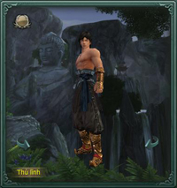 Hổ Gầm** | Trấn thủ Tháp Xá Lợi ở cổng vào Linh Tiêu Hiệp là Hổ Gầm, y đối đãi với Hoa Hạc Viêm như anh trai. Hổ Gầm lớn lên cùng Hoa Hạc Viêm, đối với y, ca ca là người duy nhất đối xử tốt với mình. **Đẳng cấp**:**35** **Sinh lực**: **15.996** |
| **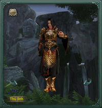 Xạ Vân** | Thần Sách Xạ Vân thật ra là đệ tử Minh Giáo che giấu thân phận. Sau chiến dịch Quang Minh Tự, Minh Giáo ồ ạt tây di. Đệ tử Minh Giáo các nơi chịu sự truy sát của Thiên Sách, y bất đắc dĩ phải che giấu thân phận gia nhập Thần Sách Quân. **Đẳng cấp**: **35** **Sinh lực**:**13.940** |
| **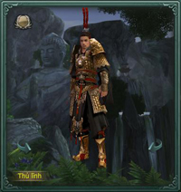 Hoa Hạc Viêm** | Hoa Hạc Viêm vốn là thân tín của Huyết Nhãn Long Vương Tiêu Sa của Minh Giáo, ẩn thân trong Thần Sách Quân để né tránh sự vây hãm của võ lâm Trung Nguyên. Sau này y biết được Huyết Nhãn Long Vương bị giam ở Thiếu Lâm Tự Động Đạt Ma, liền dẫn người đến Linh Tiêu Hiệp đào mật đạo, hòng xâm nhập vào động cứu Huyết Nhãn Long Vương. **Đẳng cấp:** **36** **Sinh lực:** **19.584** |
| **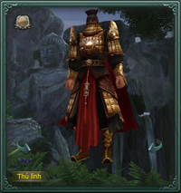 Thích Khách Vệ Thần Sách** | Thích khách Thần Sách Quân phái đến giám sát Hoa Hạc Viêm, nếu phát hiện ra điều gì khác lạ, y sẽ ra tay không thương tình. **Đẳng cấp:** **36** **Sinh lực:** **34.425** |

#### Hiệu ứng trong bí cảnh

| **Boss** | **Hiệu ứng** | **Tác dụng** |
| --- | --- | --- |
| **Hổ Gầm** | Thương Pháp - Toái Trảo | Mỗi 3 giây nhận 184 sát thương ngoại trong 15 giây. |
| **Xạ Vân** | Bách Bộ Xà Châm | Mỗi 3 giây nhận 246 sát thương độc trong 15 giây. |
| **Hoa Hạc Viêm** | Ngũ Hành Thuật - Chấn Lôi | Đẩy đối phương ra xa. |

### Linh Tiêu Hiệp - Anh Hùng

- **Đẳng cấp nhân vật**: Cấp **70** trở lên.

- **Yêu cầu**: Tổ đội 5 người.

- **Lối vào phó bản**: Phía Bắc bản đồ Thiếu Lâm.

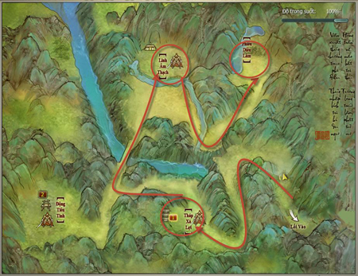

#### Boss

| **Hình ảnh** | **Ghi chú** |
| --- | --- |
| **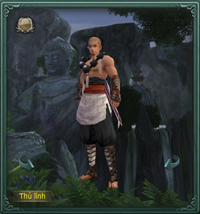 Tuệ Chung** | Thiên Trúc Già Lan Tăng cho rằng Linh Tiêu Hiệp giấu bí mật lớn của Thiếu Lâm Tự, họ phái 3 vị sứ giả thần bí Bảo Thụ Vương mang tượng phật Thiên Diệp của Thiên Trúc vào nơi này và cấu kết với hòa thượng Tuệ Chung trong tự, mưu đồ náo loạn Thiếu Lâm Tự. **Đẳng cấp**:**70** **Sinh lực**: **120.000** |
| ** Tượng Phật Thiên Diệp** | Tượng Phật viễn cổ trong Linh TIêu Hiệp thật sự là kiệt tác của đại sư cơ giáp, được Thiên Trúc Già Lan Tăng sử dụng, trở thành vũ khí mạnh nhất để đuổi ngoại xâm. **Đẳng cấp**: **70** **Sinh lực**:**140.000** |
| ** Thủy Trung Nguyệt** | Ba người đứng đầu trong Thiên Trúc Già Lan Tăng, cùng lĩnh ngộ kỹ năng võ thuật huyền bí Đồng Khí Liên Chi nhiều năm, thực lực cao thâm. **Đẳng cấp:** **70** **Sinh lực:** **324.980** |
| ** Kính Trung Hoa** |  |
| ** Không Trung Vân** |  |

#### Hiệu ứng trong bí cảnh

| **Boss** | **Hiệu ứng** | **Tác dụng** |
| --- | --- | --- |
| **Tuệ Chung** | Đại Long Trảo Thủ | Gây định thân trong 2 phút, nếu nhận sát thương sẽ giải trừ hiệu ứng. |
| Ngã xuống | Làm người chơi ngã xuống đất. |  |
| **Thủy Trung Nguyệt** | Già Lan bất hoại thân | Phản đòn sát thương 100%. |
| **Kính Trung Hoa** |  |  |
| **Không Trung Vân** |  |  |

## Đảo Vô Diêm

Đảo này nằm cô lập phía đông Dương Châu và [Thất Tú](../mon-phai/that-tu.md) Phường, có rất nhiều thủy tảo và thảo dược dưới nước. Cho đến Thập Nhị Liên Hoàn - Thảo Tựu Ổ do Tiền Tông Long đứng đầu cũng chiếm lấy đảo này và cướp bóc những thương thuyền qua lại. Có người nói đã thấy Lý Khỏa Nhi của Thất Tú Phường qua lại với chúng, vì vậy triều đình cũng chưa xuất binh diệt trừ. Về sau đảo này trở thành nơi tụ tập của bọn thủy tặc.

### Đảo Vô Diêm - Thường

- **Đẳng cấp nhân vật**: Cấp **36** trở lên.

- **Yêu cầu**: Tổ đội 5 người.

- **Lối vào phó bản**: Trung tâm bản đồ Thất Tú.

#### Boss

| **Hình ảnh** | **Ghi chú** |
| --- | --- |
| ** La Dực** | La Dực vốn là một thợ săn giỏi, bình thường làm ăn với người ở Đảo Vô Diêm, có thê tử và 2 con. Vì gia đình, chuyện gì y cũng dám làm, nên bị Đỗ Cơ Hân lợi dụng trấn thủ tuyến phòng thủ đầu tiên của Đảo Vô Diêm. **Đẳng cấp**:**42** **Sinh lực**: **15.000** |
| ** Thường Vạn Sơn** | Nhị Đương Gia Thường Vạn Sơn ở Vô Diêm Trại vừa háo sắc vừa độc tài và rất ngu xuẩn. Hắn luôn muốn có được mỹ nhân Đỗ Cơ Hân, nhưng lại không có gan cướp người phụ nữ của Đại Đương Gia. **Đẳng cấp**: **42** **Sinh lực**:**25.000** |
| ** Đỗ Cơ Hân** | Đỗ Cơ Hân vốn là đệ tử của Lý Khỏa Nhi trong Nội Phường Thất Tú, Lý Khỏa Nhi oán hận Lý Long Cơ hãm hại mình phải mai danh ẩn tích nhiều năm. Để báo thù, bà ta đã bắt đệ tử phản lại Thất Tú Phường, ẩn thân ở Đảo Vô Diêm bày mưu tính kế. **Đẳng cấp:** **43** **Sinh lực:** **18.000** |
| ** Ôn Sa Nhi** | Thủ lĩnh bí ẩn của Đảo Vô Diêm, có một câu chuyện thần bí cảm động. **Đẳng cấp:** **45** **Sinh lực:** **20.677** |

#### Hiệu ứng trong bí cảnh

| **Boss** | **Hiệu ứng** | **Tác dụng** |
| --- | --- | --- |
| **La Dực** | Thủy Độc | Mỗi 3 giây nhận 188 sát thương độc trong 15 giây. |
| **Thường Vạn Sơn** | Chước Thiêu | Gây 500 sát thương nội - dương trong 15 giây. |
| **Đỗ Cơ Hân** | Kiếm Tâm Thông Minh | Không thể sử dụng chiêu thức nội công trong 3 giây. |
| **Ôn Sa Nhi** |  |  |

### Đảo Vô Diêm - Anh Hùng

- **Đẳng cấp nhân vật**: Cấp **70** trở lên.

- **Yêu cầu**: Tổ đội 5 người.

- **Lối vào phó bản**: Trung tâm bản đồ Thất Tú.

#### Boss

| **Hình ảnh** | **Ghi chú** |
| --- | --- |
| ** La Dực** | La Dực sau khi từ Đảo Vô Diêm bị hiệp sĩ đánh bại, bị thương nặng, may nhờ được tướng lĩnh Thần Sách Bàng Hổ Văn cứu, sau đó gia nhập Thần Sách Quân. Qua bao năm khổ luyện, võ công La Dực tăng mạnh, lần này phụng mệnh Thần Sách Quân trở lại Đảo Vô Diêm thực hiện mệnh lệnh. **Đẳng cấp**:**70** **Sinh lực**: **107.69**1 |
| ** Bàng Hổ Văn** | Tướng lĩnh Thần Sách Bàng Hổ Văn có thù sát hại sư huynh với Tiểu Thất của Thất Tú Phường. Y câu kết với La Dực ở Đảo Vô Diêm và nữ tướng Dương Tâm Vũ chiếm lĩnh đảo Vô Diêm, âm thầm bắt nhiều đệ tử Thất Tú Phường và dân vô tội, dùng thủ đoạn tàn nhẫn hại người vô tội để trút cơn giận của mình. **Đẳng cấp**: **70** **Sinh lực**:**235.803** |
| ** Dương Tâm Vũ** | Thần Sách nữ tướng Dương Tâm Vũ nghe nói có quan hệ bí mật với Dương Quốc Trung, có địa vị cao trong đội quân. Dưới sự nịnh bợ của Bàng Hổ Văn, cô ta đồng ý dẫn thuộc hạ công đánh Đảo Vô Diêm. **Đẳng cấp:** **70** **Sinh lực:** **209.577** |

#### Hiệu ứng trong bí cảnh

| **Boss** | **Hiệu ứng** | **Tác dụng** |
| --- | --- | --- |
| **La Dực** | Định Thân | Làm người chơi ngã xuống đất. |
| Hủy Diệt Chùy Kích |  |  |
| **Bàng Hổ Văn** | Bộ Trì | Tốc độ di chuyển -50%. |
| **Dương Tâm Vũ** | Khiêu Bát Ly Gian | Mỗi 2 giây gây sát thương ngoại cho đồng đội trong phạm vi 8 thước. |
| Đoạt Hồn Nhiếp Phách | Không thể thi triển chiêu thức trong 3 giây. |  |

- [Thiên Tử Phong](#thiên-tử-phong)

- [Hang Pháp Vương](#hang-pháp-vương)

- [Thiên Công Phường](#thiên-công-phường)

- [Tịch Diệt Sảnh](#tịch-diệt-sảnh)

- [Vô Lượng Cung](#vô-lượng-cung)

- [Độc Thần Điện](#độc-thần-điện)

- [Nhật Luân Sơn Thành](#nhật-luân-sơn-thành)

- [Địch Hoa Cung Tiền Sơn](#địch-hoa-cung-tiền-sơn)

- [Phong Vũ Đạo Hương Thôn](#phong-vũ-đạo-hương-thôn)

## Phong Vũ Đạo Hương Thôn

Đạo Hương Thôn phía bắc Lạc Đạo là quê hương của thiếu hiệp thiếu niên, Mạc Vũ sau khi thất lạc Mao Mao ở Phong Hoa Cốc, quyết định quay về Đạo Hương Thôn tìm Mao Mao theo giao hẹn thời thơ ấu. Tuyết Ma Vương Di Phong vì muốn thu nhận Mạc Vũ làm đệ tử, nên đi theo Mạc Vũ đến Đạo Hương Thôn.

#### Phần thưởng

- **Vũ khí:**Các loại vũ khí như Bút và Sáo phẩm chất 100 - 105 dành cho phái [Vạn Hoa](../mon-phai/van-hoa.md) và Ngũ Độc.

- **Trang bị:**Các loại trang bị theo bộ phẩm chất 110 dành cho phái Đường Môn.

- **Vật phẩm khác:**Các túi trang sức vai và lưng dùng để mở ô chứa trang sức, 2 quyển sách xanh lam cấp 65 và danh vọng Thất Tú khi tiêu diệt Boss.

### Phó bản Phong Vũ Đạo Hương Thôn - Thường

- **Đẳng cấp nhân vật**: Cấp **50** trở lên.

- **Yêu cầu**: Tổ đội 05 người.

- **Lối vào phó bản**: Đối thoại NPC Xa Phu Vương Cường ở 01 trong 03 thành chính.

#### Boss

| **Hình ảnh** | **Ghi chú** |
| --- | --- |
| ** Ân Bất Vi** | Ân Bất Vi là một người giỏi võ công trong phiến quân chỉ sau Tần Lôi. Với các tuyệt học như Độc Sơn Cự Thủ, Man Hùng Toái Lô Kích, y đã đánh bại rất nhiều kẻ địch, được giao trọng trách bảo vệ tuyến phòng thủ đầu tiên ở cứ điểm Đạo Hương Thôn. **Đẳng cấp**: **51** **Sinh lực**: **36.923** |
| ** Tiêu Đồng** | Tiêu Đồng là cao thủ do giáo chủ Ô Mông Quý của Thiên Nhất Giáo phái đến Đạo Hương Thôn cướp đoạt Không Minh Quyết, nổi tiếng Nam Cương với thuật điều khiển rắn độc, đặc biệt là tuyệt học Thất Hoang Hắc Nha khiến kẻ địch phải khiếp sợ. **Đẳng cấp**: **52** **Sinh lực**:**42.450** |
| ** Lưu Đại Hải** | Lưu Đại Hải vì bảo vệ Đạo Hương Thôn, đã bị Thiên Nhất Giáo và phiến quân bắt tay bắt giữ, bị cấy ghép Xà Đằng Kinh Lạc Thuật, tạm thời mất đi tự chủ, công lực lại tăng cao, trở thành kẻ địch đáng sợ. **Đẳng cấp:** **53** **Sinh lực:** **22.663** |
| ** Tần Lôi** | Là thủ lĩnh cao nhất trong phiến quân Đạo Hương Thôn, Tần Lôi phụ trách tìm Không Minh Quyết, cho dù đối diện bao nhiêu hiệp sĩ giang hồ võ công cao cường, y đều dùng Nhãn Hắc Lang Đao trong tay để hạ gục, thề phải hoàn thành sứ mạng của mình. **Đẳng cấp:** **53** **Sinh lực:** **65.445** |
| ** Lang Nha Thích Khách** | Thích khách do Lang Nha Quân phái đến giám sát thủ lĩnh phiến quân Tần Lôi ở Đạo Hương Thôn. Nếu Tần Lôi có hành động lạ, hoặc có hiệp sĩ bên ngoài ngăn cản kế hoạch chiếm đoạt Không Minh Quyết của họ, y sẽ thích sát không thương tình, cho dù trả giá bằng cả sinh mệnh. **Đẳng cấp:** **50** **Sinh lực:** **35.233** |

#### Hiệu ứng trong Phó bản

| Boss | Hiệu ứng | Tác dụng |
| --- | --- | --- |
| Ân Bất Vi | Khí Nhiếp Ngũ Hành | Gây Huyễn Huân trong 03 giây. |
| Man Hùng Toái Lô Kích | Gây Huyễn Huân trong 3 giây. |  |
| Tiêu Đồng | Trúng Độc | Mỗi 03 giây gây 186 sát thương nội - độc trong 15 giây. |
| Tần Lôi | Ám Lang Tập Trảo | Gây Định Thân trong 09 giây. |

### Phó bản Phong Vũ Đạo Hương Thôn - Anh Hùng

- **Đẳng cấp nhân vật**: Cấp **70** trở lên.

- **Yêu cầu**: Tổ đội 05 người.

- **Lối vào phó bản**: Đối thoại với NPC Lý Phục ở Hoang Mạc Long Môn.

#### Boss

| **Hình ảnh** | **Ghi chú** |
| --- | --- |
| ** Lư Nguyên Bá** | Một trong những bá chủ Thập Nhị Liên Hoàn Ổ tiền nhiệm, rất có tài năng. Do gặp phải sự đố kỵ của Cung Ngạo và sự hãm hại của người nội bộ, bị ép rời khỏi Thập Nhị Liên Hoàn Ổ, phiêu bạt lang thang, được tướng quân phiến quân Uông Mãng chiêu mộ, do đó tận tâm tận lực làm việc cho Uông Mãng. **Đẳng cấp**: **71** **Sinh lực**: **290.304** |
| ** Tề Tông Cường** | Tề Tông Cường là phó úy cánh tả kiêu kỵ phiến quân, trải qua trăm trận chiến, đặc biệt giỏi về phá nổ. Y bị thương trong một chiến dịch đối kháng Thiên Sách Phủ, dung mạo gần như bị thiêu hủy, phải dùng nón che mặt. Y mang một nội tâm cô đơn và giận dữ. **Đẳng cấp**: **71** **Sinh lực**:**327.726** |
| ** Tiêu Hồng** | Cô gái kiều diễm có trái tim rắn độc. Nàng trước tiên nhờ Thiên Nhất Giáo, sau lại theo người yêu là tướng quân phiến quân Uông Mãng, đã tiết lộ bí mật thánh đàn Ngũ Độc Giáo, khiến Ngũ Độc giáo đồ vô cùng phẫn nộ. **Đẳng cấp:** **71** **Sinh lực:** **274.515** |
| ** Hùng Khuê** | Hùng Khuê vốn là một tên thổ phỉ, làm toàn chuyện xấu, được Uông Mãng xem trọng, ỷ vào thế lực phiến quân làm rất nhiều chuyện ác. **Đẳng cấp:** **71** **Sinh lực:** **345.510** |
| ** Uông Mãng** | Uông Mãng là tướng quân tuyên uy tự phong trong phiến quân, đến Đạo Hương Thôn tìm thứ mà Vương Mao Trọng muốn có. **Đẳng cấp:** **71** **Sinh lực:** **304.030** |

#### Hiệu ứng trong Phó bản

| Boss | Hiệu ứng | Tác dụng |
| --- | --- | --- |
| Lư Nguyên Bá | Lang Nha Phong Liệt Tiêu | Hiệu quả trị thương -30% trong 15 giây. |
| Địa Đường Chấn | Tốc độ di chuyển -75% trong 15 giây. |  |
| Tề Tông Cường | Ngã xuống | Gây ngã xuống đất trong 03 giây. |
| Lạc Đầu Chùy | Tốc độ di chuyển -60% trong 10 giây. |  |
| Tiêu Hồng | Thất Hoang Hắc Nha | Mỗi giây nội lực giảm 360 điểm, khi sinh lực nhỏ hơn 50%, Hắc Nha sẽ sinh ra sát thương độc rất mạnh trong 15 giây. |
| Phục Xà Độc Giảo | Mỗi tầng mỗi 03 giây chịu 60 sát thương độc, tác dụng 15 giây. |  |
| Hùng Khuê | Địa Hổ Chiến Trần Chùy | Trạng thái tấn công bị đánh tan, tấn công -50% trong 20 giây. |
| Uông Mãng | Lang Hổ Song Diệt Nha | Mỗi tầng giảm lực tấn công 10% trong 15 giây. |

## Thiên Tử Phong

Năm xưa Kiếm Thánh và Phương Càn hẹn nhau so tài trên Thiên Tử Phong, cuối cùng Phương Càn bại dưới tay Kiếm Thánh. Dù thua trận nhưng không cam lòng, Phường Càn đã khắc lại khẩu quyết phá giải kiếm pháp Kiếm Thánh, mong có hậu nhân hữu duyên học được võ công của mình để đánh bại Kiếm Thánh.

Chuyện qua đã lâu nhưng dấu vết hai người để lại vẫn còn khá rõ, nhiều nhân sĩ giang hồ tụ hợp tại Thiên Tử Phong luyện võ, hy vọng từ những vết tích để lại có thể học được vài ba chiêu thức thượng thừa.

#### Phần thưởng

- **Vũ khí:**Phong Vũ Đạo Hương Thôn anh hùng có rớt tất cả vũ khí có phẩm chất 120 của tất cả môn phái. Các vũ khí này có đẳng cấp mặc định là 70.  

 

- **Trang bị:**Các loại trang bị rớt ngẫu nhiên từng loại bộ phận của tất cả các phái có phẩm chất nằm trong khoảng 115.

- **Vật phẩm khác:**Ngoài vũ khí và trang bị, bí cảnh Phong vũ đạo hương thôn anh hùng còn có thể rớt ra các công thức chế tạo trang bị thông qua các [kỹ nghệ](../he-thong/ky-nang-song.md) của nhân vật, các công thức này sẽ chế tạo loại trang bị này có phẩm chất từ 124. Ngoài ra còn có xuất hiện của các mật tịch gia tang độ thuần thục và vật phẩm gia tăng túi trang sức lưng và trang sức vai.   
 

### Bí cảnh Thiên Tử Phong - Thường

- **Đẳng cấp nhân vật**: Cấp **59** - **63**.

- **Yêu cầu**: Tổ đội tối đa 05 người.

- **Lối vào phó bản**: Phía đông nam [Nam Bình Sơn](../he-thong/tran-doanh.md#loạn-chiến-nam-bình-sơn).

#### Boss

| **Hình ảnh** | **Ghi chú** |
| --- | --- |
| ** Liễu Tủy Phong** | Đệ tử Thuần Dương nổi tiếng giang hồ, võ công tuy chưa đạt đến đỉnh cao, nhưng hiểu được tinh túy võ học Thuần Dương, một chiêu Thất Tinh Củng Thụy phát huy đến đỉnh cao, rất nhiều cao thủ bại dưới chiêu này. **Đẳng cấp**: **61** **Sinh lực**: **97.440** |
| ** Tôn Kính Tiêu** | Cao thủ Thiên Sách, tu vi võ học vào hàng cao thủ giang hồ. Nhưng võ công một người có cao cũng không địch nổi nhiều người, muốn trở thành cao thủ chân chính cần nghiên cứu binh pháp, thông thạo thuật bày binh bố trận. **Đẳng cấp**: **61** **Sinh lực**:**66.184** |
| ** Lý Nghiêu** | Sau khi Lý Nghiêu trải qua rất nhiều biến cố, tính cách trở nên trầm lặng, một lòng rời xa giang hồ, cùng bằng hữu ẩn cư ở Dịch Kỳ Phong, chuyên tâm nghiên cứu kỳ thuật. **Đẳng cấp:** **61** **Sinh lực:** **93.320** |
| ** Huyền Bi** | Muốn có được sự tôn trọng của người đời không nhất định phải võ công cái thế. Một người có thể chiến rồi thua, thua rồi chiến cũng có thể khiến đối thủ nể trọng. Mọi người biết có thể thắng Huyền Bi, nhưng không thể thắng được ý chí của y. **Đẳng cấp:** **61** **Sinh lực:** **133.475** |
| ** Mạch Hương** | Có lẽ là số trời mà đường tình cảm của nữ nhi Thất Tú luôn gặp trắc trở. Trải qua nhiều sóng gió, Mạch hương đã cảm thấy mình mệt mỏi, không muốn bị tình cảm ràng buộc nữa. **Đẳng cấp:** **61** **Sinh lực:** **121.341** |
| ** Phương Vũ Khiêm** | Thời niên thiếu gặp Phương Càn, sau theo y đi khắp nơi, là người duy nhất trải qua cuộc chiến năm đó, nay từ ngoài biển về, cư trú ở Thiên Tử Phong, nghiên cứu võ học của thầy năm đó, mong có thể đánh bại Kiếm Thánh. **Đẳng cấp:** **62** **Sinh lực:** **145.610** |

#### Hiệu ứng trong Bí cảnh

| Boss | Hiệu ứng | Tác dụng |
| --- | --- | --- |
| Liễu Tủy Phong | Thất Tinh Cùng Thụy | Định thân trong 05 giây. |
| Tôn Kính Tiêu | Chước Thiêu | Mỗi 03 giây nhận 413 sát thương nội - dương trong 18 giây. |
| Bộ Trì | Tốc độ di chuyển -50% trong 05 giây. |  |
| Tỏa Chí | Tấn công tất cả chiêu thức giảm 30% trong 60 giây. |  |
| Trí Thương | Sát thương ngoại mỗi tầng phải chịu 1% trong 08 giây. |  |
| Huyền Bi | Hoành Tảo Lục Hợp | Mỗi 02 giây nhận 181 điểm dương tính trong 10 giây. |
| Mạch Hương | Nhuyễn Vị Giáp | Mỗi 02 giây khiến mục tiêu trong phạm vi 01 thước chịu 2.488 sát thương nội âm. |
| Danh Kiếm Vô Địch | Gây 1.849 điểm sát thương hỗn nguyên, giảm tốc độ di chuyển của mục tiêu 50% trong 08 giây. |  |
| Kiếm Thần Vô Ngã | Mỗi giây chịu 181 điểm sát thương nội âm trong 12 giây. |  |
| Phương Vũ Khiêm | Kiếm Lưu Ngân | Hiệu quả được trị thương giảm 50% trong 15 giây. |

### Bí cảnh Thiên Tử Phong - Anh Hùng

- **Đẳng cấp nhân vật**: Cấp **70** trở lên.

- Tổ đội tối đa 05 người.

- **Lối vào phó bản**: Phía đông nam Nam Bình Sơn.

#### Boss

| **Hình ảnh** | **Ghi chú** |
| --- | --- |
| ** Huyền Âm Tử** | Huyền Âm Tử và Thuần Dương Tử Lữ Động Tân có mối thù chưa giải, rất hận người Thuần Dương. Y với dung mạo giống Tạ Vân Lưu, đã đồn đại trên giang hồ rằng Tạ Vân Lưu ẩn ở Thiên Tử Phong, ý đồ gây sóng gió giang hồ, để đạt âm mưu lật đổ Thuần Dương Cung. **Đẳng cấp**: **71** **Sinh lực**: **121.986** |
| ** Trình Ngạo** | Trình Ngạo là cháu của Trình Giảo Kim, bị vu tội là nghịch thần phản loạn, đành phải rời khỏi cấm địa Thiên Sách, lưu vong khắp nơi. Tướng quân Từ Trường Hải của Thiên Sách Phủ phụng mệnh truy bắt Trình Ngạo, cuối cùng tìm được y ở Thiên Tử Phong. Tuy hai người có tình cảm, nhưng lệnh vua khó phạm, đành phải đánh nhau. **Đẳng cấp**: **72** **Sinh lực**:**161.590** |
| **** | Vương Tích Tân tuy là một trong thất thánh Vạn Hoa, cờ đạo của y trên thế gian khó có địch thủ. Cách đây mấy chục năm Vương Tích Tân ở Thiên Tử Phong gặp Lý Nghiêu. Lý Nghiêu đối với sự lý giải về cờ đạo đã khiến Vương Tích Tân có cảm hứng, phối hợp với công nghệ mà công thánh Tăng Nhất Hành truyền thụ, đã sáng lập cách chơi mới của cờ vây. **Đẳng cấp:** **8** **Sinh lực:** |
| ** Đạo Diễn** | Đại sư Đạo Diễn của Thiền Tông Nhất Mạch Bắc Thiếu Lâm vì tìm con đường hồi sinh võ học Thiếu Lâm, tự mình vào cửa chùa, cùng cao thủ các nơi tề tựu tại Thiên Tử Phong nghiên cứu võ học. Họ vui vẻ bàn về sự kỳ diệu của võ học, thỉnh thoảng tỷ võ so tài. **Đẳng cấp:** **72** **Sinh lực:** **108.211** |
| ** Lý Thường Thu** | Lý Thường Thu tuy có huyết thống hoàng thất, nhưng chưa từng hưởng thụ qua sự đãi ngộ của hoàng thất, lại bị tỷ muội Lý Khỏa Nhi giam lỏng đã 10 năm tại Nội Phường Thất Tú. Cầm tù 10 năm, Lý Thường Thu từ lâu đã chán nản. Chỉ muốn ẩn cư tại một nơi vắng người, sống cuộc sống yên tĩnh. **Đẳng cấp:** **71** **Sinh lực:** **170.422** |
| ** Phương Hạc Ảnh** | Để thực hiện dã tâm của mình, Phương Hạc Ảnh âm thầm ẩn ở Thiên Tử Đỉnh nghiên cứu kiếm thuật mà người xưa ở Thiên Tử Phong lưu lại, dự tính sau này thành công sẽ đi tìm người trong Phương gia đã xem thường mình bao năm để báo thù, đặc biệt là người con gái mình yêu Phương Bích Linh, lấy lại sự công bằng từ cốc chủ Đông Phương Vũ Hiên ở Vạn Hoa Cốc. **Đẳng cấp:** **71** **Sinh lực:** **248.885** |

#### Hiệu ứng trong Bí cảnh

| Boss | Hiệu ứng | Tác dụng |
| --- | --- | --- |
| Huyền Âm Tử | Tam Tài Hóa Sinh | Tỏa Túc trong 05 giây. |
| Thất Tinh Củng Thụy | Định thân trong 08 giây. |  |
| Đạo Diễn | Hoành Tảo Lục Hợp | Mỗi 02 giây nhận 1.300 điểm dương tính trong 12 giây. |
| Lý Thường Thu | Nhuyễn Vị Giáp | Mỗi 02 giây gây cho xung quanh 01 thước 5.000 sát thương nội - âm. |
| Danh Kiếm Vô Địch | Giảm tốc độ di chuyển 50%. |  |
| Kiếm Thần Vô Ngã | Mỗi giây chịu 1.200 điểm sát thương nội âm trong 12 giây. |  |
| Phương Hạc Ảnh | Kiếm Lưu Ngân | Hiệu quả trị liệu giảm 50%. |

## Hang Pháp Vương

Thử Vương và Bức Vương vốn là cao thủ hang đầu trong võ lâm, năm xưa đã theo Huyết Nhãn Long Vương ra khỏi Minh Giáo, tàn sát giang hồ, dấy lên một cuộc chiến đẫm máu.

Minh chủ Tạ Uyên muốn ngăn chặn hành vi độc ác của Tam Đại Pháp Vương nên đã cùng mọi người bao vây tấn công, nhưng bị Tam Pháp Vương đánh trọng thương, dưới sự yểm trợ của “ Nhân kiếm” Mục Thiên Lỗi (cha của Mao Mao) mới có thể chạy thoát.

Sau cuộc chiến, Tam Đại Pháp Vương cũng bị trọng thương, Long Vương bị cao tăng Thiếu Lâm đánh bại và giam tại [Trì Quốc Thiên Vương Điện](./pho-ban-10-nguoi.md#trì-quốc-thiên-vương-điện). Bức Vương và Thử Vương cũng từ đó biến mất trên giang hồ, thực chất ẩn cư tại Hang Pháp Vương ở Bạch Long Khấu để củng cố thế lực.

Lần này Trí Tuệ giải cứu Huyết Nhãn Long Vương thành công, đồng thời mang theo Dịch Cân Kinh, Sơn Hà Xã Tắc Đồ trộm được chạy về phía Nam, Được Thử Vương và Bức Vương yểm trợ đón về nơi ẩn cư tại Hang Pháp Vương.

Tạ Uyên vì muốn lấy Sơn Hà Xã Tắc Đồ, ngày đêm hành quân tấn công vào Hang Pháp Vương, Mao Mao vì muốn điều tra tình hình kẻ thù giết cha nên đã âm thầm vào Hang Pháp Vương. Cuộc chiên Hang Pháp Vương sắp nổ ra…

#### Phần thưởng

- **Vũ khí:**Các loại vũ khí của tất cả môn phái kèm theo hiệu ứng phẩm chất 120.   

 

- **Trang bị:**Nhận được Yêu Trụy và Nhẫn phẩm chất 120 có hiệu ứng hỗ trợ trong thời gian ngắn.

- **Vật phẩm khác:**Các túi trang sức vai và lưng dùng để mở ô chứa trang sức, danh vọng Ẩn Nguyên Hội khi tiêu diệt Boss.

### Phó bản Hang Pháp Vương - Thường

- **Đẳng cấp nhân vật**: Cấp **70** trở lên.

- **Yêu cầu**: Tổ đội 05 người.

- **Lối vào phó bản**: Phía bắc Cù Đường Hiệp đối thoại với NPC Sứ Vận Chuyển Quân Nhu & phía bắc Bạch Long Khấu.

#### Boss

| **Hình ảnh** | **Ghi chú** |
| --- | --- |
| ** Hồ Thát** | Lão Thử sáng tạo ra võ học hiếm có, uy lực lớn mạnh, dần dần danh tiếng đồn xa, trở thành một trong những Hộ Giá Pháp Vương của Minh Giáo, nhưng do tính hèn nhát, nên dù kinh nghiệm nhiều hơn Bức Vương, địa vị vẫn không cao bằng Bức Vương. **Đẳng cấp**: **71** **Sinh lực**: **2.140.000** |
| ** Vũ Dật Thanh** | Vũ Dật Thanh tuy mất đi đôi chân, nhưng nhờ Cơ Quan thuật gia truyền sáng lập nên Cơ Quan Bức Dực, một loại võ công kỳ lạ độc môn, vì Minh Giáo lập nhiều kỳ công, trở thành Hộ Giáo Pháp Vương, xưng là Thanh Dực Bức Vương. **Đẳng cấp**: **71** **Sinh lực**:**1.880.000** |
| ****Trí Tuệ | Một trong 12 Bảo Thụ Vương ở Thiên Trúc. Nam Chiếu Vương Các La Phụng rất xem trọng tài trí của hắn, nên trọng trách cứu Huyết Nhãn Long Vương, giành lấy Sơn Hà Xã Tắc Đồ dĩ nhiên lại thuộc về hắn. **Đẳng cấp:** **72** **Sinh lực:** 480.000 |

#### Hiệu ứng trong phó bản

| Boss | Hiệu ứng | Tác dụng |
| --- | --- | --- |
| Hồ Thát (Bạch Mi) | Bệnh Dịch | Bị nhiễm bệnh dịch, mỗi tầng hiệu quả trị thương và trị liệu giảm 20%. |
| Đương Đầu Nhất Sừ | Giảm tốc độ 50%. |  |
| Vũ Dật Thanh | Bức Dực Phong Trở | Giảm tốc 50%. |
| Âm Ba Công | Định thân 15 giây. |  |
| Huyết Bức Âm Phá | Tỏa túc. |  |
| Dơi Độc | Mỗi 03 giây chịu 1.200 điểm sát thương nội - độc. |  |
| Tiêu Hao Huyết Khí | Mỗi giây tạo thành 700 sát thương nội - âm. |  |

### Phó bản Hang Pháp Vương - Anh Hùng

- **Đẳng cấp nhân vật**: Cấp **70** trở lên.

- **Yêu cầu**: Tổ đội 05 người.

- **Lối vào phó bản**: Phía bắc Cù Đường Hiệp đối thoại với NPC Sứ Vận Chuyển Quân Nhu & phía bắc Bạch Long Khấu.

#### Boss

| **Hình ảnh** | **Ghi chú** |
| --- | --- |
| ** Hồ Thát** | Lão Thử sáng tạo ra võ học hiếm có, uy lực lớn mạnh, dần dần danh tiếng đồn xa, trở thành một trong những Hộ Giá Pháp Vương của Minh Giáo, nhưng do tính hèn nhát, nên dù kinh nghiệm nhiều hơn Bức Vương, địa vị vẫn không cao bằng Bức Vương. **Đẳng cấp**: **81** **Sinh lực**: **7.140.000** |
| ** Vũ Dật Thanh** | Vũ Dật Thanh tuy mất đi đôi chân, nhưng nhờ Cơ Quan thuật gia truyền sáng lập nên Cơ Quan Bức Dực, một loại võ công kỳ lạ độc môn, vì Minh Giáo lập nhiều kỳ công, trở thành Hộ Giáo Pháp Vương, xưng là Thanh Dực Bức Vương. **Đẳng cấp**: **81** **Sinh lực**:**6.280.000** |
| ****Trí Tuệ | Một trong 12 Bảo Thụ Vương ở Thiên Trúc. Nam Chiếu Vương Các La Phụng rất xem trọng tài trí của hắn, nên trọng trách cứu Huyết Nhãn Long Vương, giành lấy Sơn Hà Xã Tắc Đồ dĩ nhiên lại thuộc về hắn. **Đẳng cấp:** **81** **Sinh lực:** 1.610.000 |

#### Hiệu ứng trong phó bản

| Boss | Hiệu ứng | Tác dụng |
| --- | --- | --- |
| Hồ Thát (Bạch Mi) | Bệnh Dịch | Bị nhiễm bệnh dịch, mỗi tầng hiệu quả trị thương, trị liệu giảm 20%, mỗi giây chịu 1.200 sát thương nội - độc. |
| Đương Đầu Nhất Sừ | Giảm tốc độ 50%. |  |
| Vũ Dật Thanh | Bức Dực Phong Trở | Giảm tốc 50%. |
| Âm Ba Công | Định thân 15 giây. |  |
| Huyết Bức Âm Phá | Tỏa túc. |  |
| Dơi Độc | Mỗi 03 giây chịu 4.800 điểm sát thương nội - độc. |  |
| Tiêu Hao Huyết Khí | Mỗi giây tạo thành 3.900 sát thương nội - âm. |  |

## Thiên Công Phường

Tư Đồ Nhất Nhất sau khi đến Vạn Hoa Cốc đã xây một phân xưởng ở Tây Nam Cốc, nghiên cứu thuật cơ quan gọi là Thiên Công Phường. Sau này Tư Đồ do nhiều lần thất bại khi tỷ thí với Công Thánh Tăng Nhất Hành, quá khứ đau buồn khiến ông trở nên nhỏ nhen, dần dần xa rời mọi người trong cốc.

Phương Hạc Ảnh từ Đảo Bồng Lai đến Vạn Hoa Cốc để trả thù Đông Phương Vũ Hiên, muốn hủy hoại Vạn Hoa Cốc do Đông Phương Vũ Hiên tạo nên, y phát hiện ra sự bất mãn của Tư Đồ nên âm thầm khiêu khích lôi kéo. Y và Tư Đồ cùng các đệ tử, nhân sĩ giang hồ biến Thiên Công Phường thành nơi điều chế độc dược, thuốc nổ và cơ quan giáp thú. Lãm Tinh Đàm hừng hực sát khí, mây mưa vân vũ…

#### Phần thưởng

- **Vũ khí:**Các loại vũ khí của tất cả môn phái kèm theo hiệu ứng phẩm chất 255.

- **Trang bị:**Các loại trang bị của tất cả môn phái phẩm chất 255.

- **Vật phẩm khác:**Vảy Thánh Thú, Mảnh Thục Ngọc, Bùa Khuông Nghĩa, Bùa Hào Hiệp.

### Bí cảnh Thiên Công Phường - Thường

- **Đẳng cấp nhân vật**: Cấp **20** trở lên.

- **Yêu cầu**: Tổ đội tối đa 05 người.

- **Lối vào phó bản**: Phía tây nam Vạn Hoa.

#### Boss

| **Hình ảnh** | **Ghi chú** |
| --- | --- |
| ** Phương Quý Thường** | Phương Quý Thường là thân tín của Phương Hạc Ảnh, bào chế độc dược khống chế tâm trí người Lung Nha, lệnh cho họ tấn công Vạn Hoa Cốc, vô cùng tàn nhẫn. **Đẳng cấp**: **26** **Sinh lực**: **6.800** |
| ** Bình Tam Chỉ** | Bình Tam Chỉ là thân tín của Phương Hạc Ảnh, trộm bài thuốc gia truyền, khiến Phương Lạc mưu toan hủy Lam Thiên Thê, tâm địa độc ác. **Đẳng cấp**: **27** **Sinh lực**:**7.886** |
| ****Chấn Thiên Giáp Sĩ | Chấn Thiên Giáp Sĩ là cơ giáp lớn do Tư Đồ Nhất Nhất dốc tâm huyết chế tạo, uy lực lớn, y dùng nó để báo thù cho phụ thân bại vong tại Vạn Hoa Cốc năm xưa. **Đẳng cấp:** **28** **Sinh lực:** 9.500 |
| ** Hoa Thiết Lô** | Thủ lĩnh bí ẩn của Thiên Công Phường. Khi Tăng Nhất Hành đại bại cũng bị lãng quên ở Thiên Công Phường, sau đó bị Thiên Lôi đánh trúng, lại hồi sinh. Các hiệp sĩ chạm trán phải nên cẩn thận. **Đẳng cấp**: **25** **Sinh lực**:**13.368** |

#### Hiệu ứng trong bí cảnh

| Boss | Hiệu ứng | Tác dụng |
| --- | --- | --- |
| Phương Quý Thường | Yếu Đuối | Lực đạo giảm 6 điểm trong 15 giây. |
| Chấn Thiên Giáp Sĩ | Cát Liệt | Mỗi 03 giây bị sát thương ngoại 17 điểm trong 15 giây. |
| Hoa Thiết Lô | Bộ Trì | Tốc độ di chuyền -50% trong 05 giây. |

### Bí cảnh Thiên Công Phường - Anh Hùng

- **Đẳng cấp nhân vật**: Cấp **80** trở lên.

- **Yêu cầu**: Tổ đội tối đa 05 người.

- **Lối vào phó bản**: Phía tây nam Vạn Hoa.

#### Boss

| **Hình ảnh** | **Ghi chú** |
| --- | --- |
| ** Sát Linh Ma Thi** | Phương Hạc Ảnh không cam tâm thất bại, liên kết với Thiên Nhất Giáo, âm thầm triệu hồi Tư Đồ Nhất Nhất, biến Thiên Công Phường trở thành mảnh đất chết, tạo ra quái vật lớn mạnh Sát Linh Ma Thi trấn thủ tuyến phòng thủ đầu tiên. **Đẳng cấp**: **70** **Sinh lực**: **126.463** |
| ** Tháp Mã** | Là người chỉ huy cao nhất Thiên Nhất Giáo ở Thiên Công Phường, Tháp Mã có quyền sinh sát trong tay. Trong địa ngục đầy hoa độc, nàng thường tiêu diệt kẻ xâm nhập rồi chế thành độc nhân mà mình yêu thích. **Đẳng cấp**: **70** **Sinh lực**:**145.709** |
| ****Tư Đồ Nhất Nhất | Tư Đồ Nhất Nhất đã rút được bài học thất bại năm đó, thuật đúc cơ giáp thành thục hơn, lần này lấy cơ quan và độc vật hợp thành một thể, chế thành quái vật tuyệt đỉnh chưa từng có, khiến Thiên Công Phường ngày càng nhiều chất độc và các loại cơ quan khủng khiếp. **Đẳng cấp:** **70** **Sinh lực:** 166.524 |

#### Hiệu ứng trong bí cảnh

| Boss | Hiệu ứng | Tác dụng |
| --- | --- | --- |
| Sát Linh Ma Thi | Tuyệt Vọng Tê Giảo | Trong 25 giây, cứ mỗi 03 giây chịu 953 điểm sát thương ngoại |
| Tháp Mã | Độc Khí Lây Lan | Trong 25 giây, cứ mỗi 03 giây hịu 825 điểm sát thương độc. |
| Ôn Dịch Không Truyền Nhiễm | Trong 25 giây, cứ mỗi 03 giây chịu 413 điểm sát thương độc, tất cả điểm uy hiếp chiêu thức còn 0, không thể lây lan. |  |
| Ôn Dịch Truyền Nhiễm | Trong 25 giây, cứ mỗi 03 giây chịu 851 điểm sát thương độc, có thể chuyển cho 01 đồng đội ở gần để giảm hiệu quả của Ôn Dịch. |  |
| Tư Đồ Nhất Nhất | Bộ Trì | Tốc độ di chuyển -50% trong 05 giây. |

## Tịch Diệt Sảnh

Thổ Phồn chúng tăng tiền thân vốn là Già Lan Tăng Thiên Trúc, thất thế ở Trung Nguyên, không còn mặt mũi về nước, nên trú thân ở nước Thổ Phồn. Thủ lĩnh Thiên Trúc Tăng là Ma Đề Gia La nhậm chức quốc sư Thổ Phồn, phụng mệnh chi viện Nam Chiếu.

Tịch Diệt Sảnh từng được Ma Đề Gia La dùng làm nơi chiêu mộ nhân sĩ võ lâm thiên hạ đến tỉ thí võ nghệ và là nơi giao lưu võ thuật giữa hai quốc gia. Thực ra, đa số hiệp sĩ Trung Nguyên chiến bại đều bị giam tại đây, trở thành đối tượng nghiên cứu và luyện võ của đệ tử Thiên Trúc Tăng. Rất nhiều đệ tử của các môn phái không chịu được sự dọa nạt và cám dỗ trở thành tay sai của Nam Chiếu, đánh nhau với các hiệp khách Trung Nguyên đến khiêu chiến sau này.

Nhân sĩ được tin từ một số đệ tử chạy thoát, một lòng muốn giải cứu các đệ tử bị giam cầm đã không ngại hiểm nguy tìm đến, họ sắp phải đối mặt một cuộc chiến đồng môn tương tàn… Vì chính nghĩa, vì tôn nghiêm của môn phái, khi cần phải đại nghĩa diệt thân, thanh lý môn hộ.

### Bí cảnh Tịch Diệt Sảnh - Thường

- **Đẳng cấp nhân vật**: Cấp **75** trở lên.

- **Yêu cầu**: Tổ đội tối đa 05 người.

- **Lối vào phó bản**: Phía đông Dung Thiên Lĩnh.

#### Boss

| **Hình ảnh** | **Ghi chú** |
| --- | --- |
| ** Tàng Kiếm Tà Cưu** | Tàng Kiếm Tà Cưu là đệ tử nhập môn của Ma Đề Gia La, từ nhỏ đã phụng lệnh ẩn mình trong Tàng Kiếm Sơn Trang, lén học Tàng Kiếm Tứ Quý tâm pháp. Sau khi thân phận bại lộ, trải qua nhiều hiểm nguy mới về lại bên cạnh Ma Đề Gia La, kết hợp với Tiểu Vô Tướng Công tâm pháp của Ma Đề Gia La, khiến Kiếm Pháp trở nên uy lực dung mãnh, biến hóa vô thường. **Đẳng cấp**: **76** **Sinh lực**: **550.000** |
| ** Kiếm Tâm** | Kiếm Tâm dũng cảm hơn người, vốn đơn độc hành sự, khi đến Tịch Diệt Sảnh trảm yêu trừ ma, gặp phải Tàng Kiếm Tà Cưu, hai người giao đấu hơn trăm hiệp, Kiếm Tâm không may bị kẻ gian ám toán, đã tẩu hỏa nhập ma, không phân địch ta. **Đẳng cấp**: **76** **Sinh lực**:**780.000** |
| ****Ma Đề Gia La | Sư Tử Quang ra đi, Ma Đề Gia La trở thành Chưởng Hội của Bồ Đề Hội, nỗ lực phát triển Bồ Đề Hội, thề phải chấn hưng Phật pháp ở Trung Nguyên, còn phái người đến Thiếu Lâm đoạt lại Kinh Thư. Hắn còn tự đến Ấn Độ và Tây Vực, ý đồ liên minh với tất cả các môn phái xem Thiếu Lâm là thù địch. **Đẳng cấp:** **77** **Sinh lực:** 640.000 |

#### Hiệu ứng trong bí cảnh

| Boss | Hiệu ứng | Tác dụng |
| --- | --- | --- |
| Kiếm Tâm | Kiếm Xung Âm Dương | Hiệu quả trị thương giảm 50% trong 10 giây. |
| Ma Đề Gia La | Thất Tinh Cùng Thụy | Định thân trong 05 giây. |
| Tam Tài Hóa Sinh | Mất 50% tỷ lệ chiêu thức trúng địch trong 05 giây. |  |
| Lan Thôi Ngọc Chiết | Mỗi 03 giây bị 3.200 điểm sát thương nội - hỗn nguyên trong 15 giây. |  |
| Chung Linh Dục Tú | Mỗi 03 giây bị 6.500 điểm sát thương nội - hỗn nguyên trong 15 giây. |  |
| Thương Dương Chỉ | Mỗi 03 giây bị 2.200 điểm sát thương nội - hỗn nguyên trong 15 giây. |  |
| Trí Thương | Sát thương ngoại mỗi tầng phải chịu +5% trong 20 giây. |  |
| Trí Tàn | Sát thương ngoại phải chịu +15% trong 15 giây. |  |
| Bộ Trì | Tốc độ di chuyển -50% trong 08 giây. |  |

### Bí cảnh Tịch Diệt Sảnh - Anh Hùng

- **Đẳng cấp nhân vật**: Cấp **80** trở lên.

- **Yêu cầu**: Tổ đội tối đa 05 người.

- **Lối vào phó bản**: Phía đông Dung Thiên Lĩnh.

#### Boss

| **Hình ảnh** | **Ghi chú** |
| --- | --- |
| ** Tàng Kiếm Tà Cưu** | Tàng Kiếm Tà Cưu là đệ tử nhập môn của Ma Đề Gia La, từ nhỏ đã phụng lệnh ẩn mình trong Tàng Kiếm Sơn Trang, lén học Tàng Kiếm Tứ Quý tâm pháp. Sau khi thân phận bại lộ, trải qua nhiều hiểm nguy mới về lại bên cạnh Ma Đề Gia La, kết hợp với Tiểu Vô Tướng Công tâm pháp của Ma Đề Gia La, khiến Kiếm Pháp trở nên uy lực dung mãnh, biến hóa vô thường. **Đẳng cấp**: **81** **Sinh lực**: **1.220.000** |
| ** Kiếm Tâm** | Kiếm Tâm dũng cảm hơn người, vốn đơn độc hành sự, khi đến Tịch Diệt Sảnh trảm yêu trừ ma, gặp phải Tàng Kiếm Tà Cưu, hai người giao đấu hơn trăm hiệp, Kiếm Tâm không may bị kẻ gian ám toán, đã tẩu hỏa nhập ma, không phân địch ta. **Đẳng cấp**: 81 **Sinh lực**:**1.740.000** |
| ****Ma Đề Gia La | Sư Tử Quang ra đi, Ma Đề Gia La trở thành Chưởng Hội của Bồ Đề Hội, nỗ lực phát triển Bồ Đề Hội, thề phải chấn hưng Phật pháp ở Trung Nguyên, còn phái người đến Thiếu Lâm đoạt lại Kinh Thư. Hắn còn tự đến Ấn Độ và Tây Vực, ý đồ liên minh với tất cả các môn phái xem Thiếu Lâm là thù địch. **Đẳng cấp:** **81** **Sinh lực:** 1.420.000 |

#### Hiệu ứng trong bí cảnh

| Boss | Hiệu ứng | Tác dụng |
| --- | --- | --- |
| Tàng Kiếm Tà Cưu | Túy Nguyệt | Định thân 10 giây. |
| Kiếm Tâm | Kiếm Xung Âm Dương | Hiệu quả trị thương giảm 50% trong 10 giây. |
| Ma Đề Gia La | Thất Tinh Cùng Thụy | Định thân 05 giây. |
| Tam Tài Hóa Sinh | Mất 50% tỷ lệ chiêu thức trúng địch trong 05 giây. |  |
| Lan Thôi Ngọc Chiết | Mỗi 03 giây bị 6.400 điểm sát thương nội - hỗn nguyên trong 05 giây. |  |
| Chung Linh Dục Tú | Mỗi 03 giây bị 12.500 điểm sát thương nội - hỗn nguyên trong 15 giây. |  |
| Thương Dương Chỉ | Mỗi 03 giây bị 4.200 điểm sát thương nội - hỗn nguyên trong 15 giây. |  |
| Trí Thương | Sát thương ngoại mỗi tầng phải chịu +5% trong 20 giây. |  |
| Trí Tàn | Sát thương ngoại phải chịu +15% trong 15 giây. |  |
| Bộ Trì | Tốc độ di chuyển -50% trong 08 giây. |  |
| Hoành Tảo Lục Hợp | Mỗi 02 giây nhận được 2.200 điểm sát thương nội trong 12 giây. |  |
| Đương Đầu Bổng Hát | Tốc độ di chuyển -50%, kết thúc trạng thái tạo thành 16.000 sát thương dương tính cho nhân sĩ và thú cưng trong phạm vi 06 thước trong 05 giây. |  |

## Vô Lượng Cung

Đa Đa được Mẫu Đơn dẫn vào Vô Lượng Cung ở Vô Lượng Sơn, chuẩn bị tiến hành nghi thức rửa tội của Thánh Nữ, khi Diệp Vĩ tìm đến thì gặp Nguyên Minh Nhã cũng đang tìm kiếm Đa Đa, Diệp Vĩ nghi ngờ động cơ của Nguyên Minh Nhã, sau vài câu hai bên đã giao chiến.

Tam Đại Ác Nhân của Ác Nhân Cốc mang theo lượng lớn châu báu chạy trốn, bị Vương Di Phong và Lục Đại Ác nhân truy đuổi, tuy có Hồng Y Giáo tiếp ứng, nhưng vẫn phải chạy trốn một cách khó khăn, không còn cách khác buộc phải nhờ Đạo Cốc Lục Tiên đến giữ hộ châu báu.

Đào Cốc Lục Tiên bị Tam Đại Ác Nhân mê hoặc canh giữ châu báu, đúng lúc nhân sĩ đi ngang, giao chiến với nhân sĩ.

### Bí cảnh Vô Lượng Cung - Thường

- **Đẳng cấp nhân vật**: Cấp **70** trở lên.

- **Yêu cầu**: Tổ đội tối đa 05 người.

- **Lối vào phó bản**: Phía tây bắc Vô Lượng Sơn.

#### Boss

| **Hình ảnh** | **Ghi chú** |
| --- | --- |
| ** Đào Diệp Tiên** | Đào Cốc Lục Tiên tâm địa không xấu, chỉ là làm việc theo ý thích. Lần này Tam Đại Ác Nhân rời bỏ cốc dẫn theo chúng quy thuận Nam Chiếu. Tuy có Hồng Y Giáo tiếp ứng, nhưng Đào Thoán vẫn rất thê thảm, không thể không hạ lệnh Đào Cốc Lục Tiên đến giúp bảo vệ tài sản chưa kịp mang đi. **Đẳng cấp**: **72** **Sinh lực**: **370.000** |
| ** Trạc Trần** | Nô lệ Tẩy Trần của Hồng Y Giáo vì yêu một cô gái ở Hồng Y Giáo, đã nghĩ mọi cách làm tăng thực lực của mình, đến nỗi tự biến mình thành vũ khí, sau đó tại Vô Lượng Cung khi nhìn thấy ý trung nhân gặp nguy hiểm, đã không quản giáo quy của Hồng Y Giáo, giao đấu với Hiệp Sĩ. **Đẳng cấp**: 72 **Sinh lực**:**370.000** |
| ****Đa Đa | Là truyền nhân của Thần Toán Gia Tộc, Đa Đa khi vừa chào đời đã mang sứ mệnh Cửu Thiên. Khi cô tự ý rời khỏi Bá Đao Sơn Trang, tại Vô Lượng Sơn gặp phải Mẫu Đơn, bị bắt vào Vô Lượng Cung, chuẩn bị nghi thức rửa tội, trở thành thánh nữ Hồng Y Giáo. **Đẳng cấp:** **73** **Sinh lực:** 642.000 |

#### Hiệu ứng trong bí cảnh

| Boss | Hiệu ứng | Tác dụng |
| --- | --- | --- |
| Đào Diệp Tiên | Nhân Sinh Như Đổ | Tốc độ di chuyển +30% trong 10 giây. |
| Trạc Trần | Bộ Trì | Tốc độ di chuyển -50% trong 10 giây. |
| Che Dấu Thân Phận | Mỗi giây chịu 500 điểm sát thương nội - độc trong 10 giây. |  |
| Đa Đa | Nữu Chuyển Càn Khôn | Ngoại công tăng 2.000 điểm, nội công dương tính tăng 2.200 điểm trong 10 giây. |

### Bí cảnh Vô Lượng Cung - Anh Hùng

- **Đẳng cấp nhân vật**: Cấp **80** trở lên.

- **Yêu cầu**: Tổ đội tối đa 05 người.

- **Lối vào phó bản**: Phía tây bắc Vô Lượng Sơn.

#### Boss

| **Hình ảnh** | **Ghi chú** |
| --- | --- |
| ** Đào Diệp Tiên** | Đào Cốc Lục Tiên tâm địa không xấu, chỉ là làm việc theo ý thích. Lần này Tam Đại Ác Nhân rời bỏ cốc dẫn theo chúng quy thuận Nam Chiếu. Tuy có Hồng Y Giáo tiếp ứng, nhưng Đào Thoán vẫn rất thê thảm, không thể không hạ lệnh Đào Cốc Lục Tiên đến giúp bảo vệ tài sản chưa kịp mang đi. **Đẳng cấp**: **81** **Sinh lực**: **1.220.000** |
| ** Trạc Trần** | Nô lệ Tẩy Trần của Hồng Y Giáo vì yêu một cô gái ở Hồng Y Giáo, đã nghĩ mọi cách làm tăng thực lực của mình, đến nỗi tự biến mình thành vũ khí, sau đó tại Vô Lượng Cung khi nhìn thấy ý trung nhân gặp nguy hiểm, đã không quản giáo quy của Hồng Y Giáo, giao đấu với Hiệp Sĩ. **Đẳng cấp**: 81 **Sinh lực**:**1.220.000** |
| ****Đa Đa | Là truyền nhân của Thần Toán Gia Tộc, Đa Đa khi vừa chào đời đã mang sứ mệnh Cửu Thiên. Khi cô tự ý rời khỏi Bá Đao Sơn Trang, tại Vô Lượng Sơn gặp phải Mẫu Đơn, bị bắt vào Vô Lượng Cung, chuẩn bị nghi thức rửa tội, trở thành thánh nữ Hồng Y Giáo. **Đẳng cấp:** **81** **Sinh lực:** 2.140.000 |

#### Hiệu ứng trong bí cảnh

| Boss | Hiệu ứng | Tác dụng |
| --- | --- | --- |
| Đào Diệp Tiên | Nhân Sinh Như Đổ | Tốc độ di chuyển +30% trong 10 giây. |
| Trạc Trần | Bộ Trì | Tốc độ di chuyển -50% trong 10 giây. |
| Che Dấu Thân Phận | Mỗi giây chịu 1.500 điểm sát thương nội - độc trong 10 giây. |  |
| Đa Đa | Nữu Chuyển Càn Khôn | Ngoại công tăng 2.000 điểm, nội công dương tính tăng 2.200 điểm trong 10 giây. |

## Độc Thần Điện

Hà Tà hiền lành nhưng do mẹ là Văn Lộ bị Thiên Nhất Giáo Chủ Ô Mông Quý khống chế nên buộc phải tu luyện bí kiếp Độc Thần Vong Tình của Thiên Nhất Giáo.

Trong Giang Tân Thôn, hai cha con của Bào Mục Hiệp và Bào Phong Phong cũng có quen biết với hai mẹ con của Tiểu Tà Tử, khi nghe tin Minh Giáo tái xuất giang hồ đã đến Đầm Hắc Long. Bào Mục Hiệp từng là thủ hạ trung thành của giáo chủ Minh Giáo Lục Nguy Lâu, sau biến cố Minh Giáo Tự, Minh Giáo chia năm xẻ bảy, một số thuộc hạ trung thành với Lục Nguy Lâu đã cùng ông ta trở về Ba Tư chờ cơ hộ tái xuất.

Pháp vương Minh Giáo Huyết Nhãn Long Vương Tiêu Sa cùng Bạch Mi Thử Vương và Thanh Dực Bức Vương gây loạn võ lâm. Phần lớn giáo chúng Minh Giáo như Bào Mục Hiệp, do tổng đà Đại Quang Minh Tự bị tấn công, mất thủ lĩnh, lại bị truy sát nên mai danh ẩn tích, lưu lạc đến khắp nơi.

Lần này, Bào Mục Hiệp biết tin Huyết Nhãn Long Vương trốn khỏi Thiếu Lâm Tự, giáo chúng Minh Giáo xuất hiện tại Miêu Cương, liền cùng con gái đến tìm, nhưng khống ngờ lại tìm ra thuộc thế lực Pháp vương phản lại giáo chủ. Tại đây, Bào Mục Hiệp đã gặp cố nhân, vì cứu hai mẹ con Tiểu Tà Tử, Bào Mục Hiệp bị giam vào trong Độc Thần điện ở Thiên Nhất Giáo, bị luyện thành con rối.

#### Phần thưởng

- **Vũ khí:**Vũ khí tầm xa của tất cả các phái có phẩm chất đến 255, nổi bật là các vũ khí cận thân có hiệu ứng đặc biệt mà vũ khí bình thường không có. Mỗi vũ khí của mỗi phái sẽ có hiệu ứng riêng biệt.   

 

- **Trang bị:**Trang bị nhận được của tất cả các phái bao gồm bao tay, nón, áo, quần, giày, thắt lưng, yêu trụy, nhẫn, dây chuyền. Toàn bộ có phẩm chất đạt 255.

- **Vật phẩm khác:**Vảy Thánh Thú, Chìa Rương Ác Nhân, Bùa Khuông Nghĩa, Bùa Hào Hiệp.

### Phó bản Độc Thường Điện - Thường

- **Đẳng cấp nhân vật**: Cấp **78** trở lên.

- **Yêu cầu**: Tổ đội tối đa 05 người.

- **Lối vào phó bản**: Phía đông nam Đầm Hắc Long.

#### Boss

| **Hình ảnh** | **Ghi chú** |
| --- | --- |
| ** Tháp Đan Mậu Bá** | Tháp Đan Mậu Bá là giáo chúng trung thành của giáo chủ Thiên Nhất Giáo Ô Mông Quý, hắn từng vì Ô Mông Quý nam chinh bắc chiến, nhưng cuối cùng phát hiện chỉ có Độc Nhân và Con Rối mới có thể cống hiến cho Thiên Nhất Giáo, Tháp Đan Mậu Bá không chút do dự đã hi sinh bản thân. **Đẳng cấp**: **78** **Sinh lực**: **610.000** |
| ** Bào Mục Hiệp** | Bào Mục Hiệp từng là 1 trong những Tản Nhân của Minh Giáo, hắn tại Đầm Hắc Long tìm được Thiên Nhất Giáo, cũng vì vậy mà gặp được Tiểu Tà Tử nhưng lại bị Thiên Nhất Giáo bắt đi, lại bị độc hại, biến thành Con Rối. **Đẳng cấp**: 78 **Sinh lực**:**650.000** |
| ****Ô Linh Phong | Ô Linh Phong không giỏi làm Thầy Lang, Ô Mông Quý rất yêu quý tỷ tỳ nên đã nhường chức Thủ Lĩnh Thầy Lang cho chị mình. Vì thế mà trách nhiệm giám sát Tiểu Tà Tử tu luyện Độc Thần Vong Tình Cổ lại thuộc về Ô Linh Phong. **Đẳng cấp:** **79** **Sinh lực:** 370.000 |

#### Hiệu ứng trong phó bản

| Boss | Hiệu ứng | Tác dụng |
| --- | --- | --- |
| Tháp Đan Mậu Bá | Tinh Khuẩn Duật | Tốc độ di chuyển -50% trong 30 giây. |
| Vi Khuẩn | Mỗi 03 giây gây sát thương - nội độc 9.600 điểm, khi hết hiệu quả gây sát thương nội - độc cực lớn và khóa chân trong 10 giây. |  |
| Bào Mục Hiệp | Canh Độc - Rết | Mỗi giây chịu 1.200 điểm sát thương nội - độc, hiệu quả kết thúc khiến sát thương chiêu thức giảm 50% trong 10 giây. |
| Canh Độc - Rết | Sát thương chiêu thức bản thân +50% trong 10 giây. |  |
| Canh Độc - Nhện | Mỗi giây chịu 1.200 điểm sát thương nội - độc, hiệu quả kết thúc sẽ bị khóa chân trong 10 giây. |  |
| Bính Độc - Nhện | Mỗi giây chịu 1.200 điểm sát thương nội - độc, hiệu quả kết thúc sẽ chịu sát thương âm tính trong 10 giây. |  |
| Bính Độc - Rết | Mỗi giây chịu 1.200 điểm sát thương nội - độc, hiệu quả kết thúc sẽ chịu sát thương dương tính trong 10 giây |  |
| Ô Linh Phong | Độc Thi Lung Thủ | Hiệu quả trị thương -100% trong 10 giây. |
| Hủ Nha Giảo | Hiệu quả trị thương -50% trong 04 giây. |  |

### Phó bản Độc Thường Điện - Anh Hùng

- **Đẳng cấp nhân vật**: Cấp **80** trở lên.

- **Yêu cầu**: Tổ đội tối đa 05 người.

- **Lối vào phó bản**: Phía đông nam Đầm Hắc Long.

#### Boss

| **Hình ảnh** | **Ghi chú** |
| --- | --- |
| ** Tháp Đan Mậu Bá** | Tháp Đan Mậu Bá là giáo chúng trung thành của giáo chủ Thiên Nhất Giáo Ô Mông Quý, hắn từng vì Ô Mông Quý nam chinh bắc chiến, nhưng cuối cùng phát hiện chỉ có Độc Nhân và Con Rối mới có thể cống hiến cho Thiên Nhất Giáo, Tháp Đan Mậu Bá không chút do dự đã hi sinh bản thân. **Đẳng cấp**: **81** **Sinh lực**: **1.220.000** |
| ** Bào Mục Hiệp** | Bào Mục Hiệp từng là 1 trong những Tản Nhân của Minh Giáo, hắn tại Đầm Hắc Long tìm được Thiên Nhất Giáo, cũng vì vậy mà gặp được Tiểu Tà Tử nhưng lại bị Thiên Nhất Giáo bắt đi, lại bị độc hại, biến thành Con Rối. **Đẳng cấp**: 81 **Sinh lực**:**1.290.000** |
| ****Ô Linh Phong | Ô Linh Phong không giỏi làm Thầy Lang, Ô Mông Quý rất yêu quý tỷ tỳ nên đã nhường chức Thủ Lĩnh Thầy Lang cho chị mình. Vì thế mà trách nhiệm giám sát Tiểu Tà Tử tu luyện Độc Thần Vong Tình Cổ lại thuộc về Ô Linh Phong. **Đẳng cấp:** **81** **Sinh lực:** 730.000 |

#### Hiệu ứng trong phó bản

| Boss | Hiệu ứng | Tác dụng |
| --- | --- | --- |
| Tháp Đan Mậu Bá | Tinh Khuẩn Duật | Tốc độ di chuyển -30% trong 30 giây. |
| Vi Khuẩn | Mỗi 03 giây gây sát thương - nội độc 5.500 điểm, khi hết hiệu quả gây sát thương nội - độc cực lớn và khóa chân trong 10 giây. |  |
| Bào Mục Hiệp | Canh Độc - Rết | Mỗi giây chịu 1.700 điểm sát thương nội - độc, hiệu quả kết thúc khiến sát thương chiêu thức giảm 50% trong 10 giây. |
| Canh Độc - Rết | Sát thương chiêu thức bản thân +50% trong 10 giây. |  |
| Canh Độc - Nhện | Mỗi giây chịu 1.700 điểm sát thương nội - độc, hiệu quả kết thúc sẽ bị khóa chân trong 10 giây. |  |
| Bính Độc - Nhện | Mỗi giây chịu 1.700 điểm sát thương nội - độc, hiệu quả kết thúc sẽ chịu sát thương âm tính trong 10 giây. |  |
| Bính Độc - Rết | Mỗi giây chịu 1.700 điểm sát thương nội - độc, hiệu quả kết thúc sẽ chịu sát thương dương tính trong 10 giây. |  |
| Ô Linh Phong | Độc Thi Lung Thủ | Hiệu quả trị thương -100% trong 10 giây. |
| Hủ Nha Giảo | Hiệu quả trị thương -30% trong 04 giây. |  |

## Nhật Luân Sơn Thành

Nhật Luân Sơn Thành vốn tên là Thính Nguyệt Đảo, là hòn đảo lớn nằm ở vùng biển phía Đông Dương Châu, phía Nam Khấu Đảo, đảo được đặt tên như thế vì mùa đông trăng sáng và mát, gió biển và tiếng sống vộ không ngớt. Bốn phía của hòn đảo đều có xoáy nước và đá ngầm rất lớn, thuyền rất khó đến gần đảo.

Vì nằm giữa Oa Quốc và Trung Nguyên, sau này trở thành đảo giao thương giữa Oa Quốc và Trung Nguyên. Nhưng sau xung đột của phe bảo thủ và phe cánh tả, đảo này trở thành vị trí quân sự, Oa Quốc do Đằng Nguyên Quảng Tự dẫn dắt đã xây dựng công trình quân sự ở Thính Nguyệt Đảo, và đổi tên thành Nhật Luân Sơn Thành, thành chủ là Nguyên Minh Nhã Thiếu chủ nhà Âm Dương, lần này Nguyên Minh Nhã mời các thế lực lớn trên giang hồ là muốn chiêu mộ? Hay có ý đồ khác?

### Phó bản Nhật Luân Sơn Thành - Thường

- **Đẳng cấp nhân vật**: Cấp **50** trở lên.

- **Yêu cầu**: Tổ đội tối đa 05 người.

- **Lối vào phó bản**: Phía nam Khấu Đảo.

#### Boss

| **Hình ảnh** | **Ghi chú** |
| --- | --- |
| ** Trượng Sam Dũng Đao** | Đệ tử Nhất Đao, ngu ngốc, dễ kích động, nhận lệnh Tạ Vân Lưu cùng Lý Trùng Mậu đến Nhật Luân Thành, do Thượng Sam xuất thân từ quân nhân, được Lý Tùng Mậu phái đến khu Thủy Hạp hiệp trợ phòng vệ bên ngoài Nhật Luân Thành. **Đẳng cấp**: **51** **Sinh lực**: **38.413** |
| ** Vụ Ảnh Nại Diệp** | Ngoài chức trách bản thân, chỉ có thể xác nhận là chị em song sinh, một người cuồng nhiệt, hoạt bát, một người hời hợt, lãnh đạm, tuyệt đối trung thành với Nguyên Minh Nhã. **Đẳng cấp**: **52** **Sinh lực**:**43.000** |
| ** Viên Phi Xương Bồ** | Ngoài chức trách bản thân, chỉ có thể xác nhận là chị em song sinh, một người cuồng nhiệt, hoạt bát, một người hời hợt, lãnh đạm, tuyệt đối trung thành với Nguyên Minh Nhã. **Đẳng cấp:** **51** **Sinh lực:** **43.000** |
| ** Nguyên Minh Nhã** | Thiếu niên xuất thân từ danh môn vọng tộc, tinh thông binh pháp và thuật âm dương. Có lẽ trong thâm tâm y mong có thể say mê kỹ nghệ, đáng tiếc lại bị cuốn vào vòng xoáy tranh giành quyền lực. Y vẫn canh cánh trong lòng hỏa hoạn ở Nhật Luân, lần này trở về nơi cũ chỉ mong tìm được chút manh mối. **Đẳng cấp:** **53** **Sinh lực:** **60.604** |
| ** Rắn 8 Đầu** | Dị thú viễn cổ, thực lực lớn mạnh, nếu không cẩn thận ứng phó sẽ ân hận. **Đẳng cấp:** **73** **Sinh lực:** **424.692** |
| ** Cát Thái** | Thủ lĩnh bí ẩn của Nhật Luân Sơn Thành, lai lịch không rõ. **Đẳng cấp:** **50** **Sinh lực:** **59.553** |

#### Hiệu ứng trong phó bản

| Boss | Hiệu ứng | Tác dụng |
| --- | --- | --- |
| Trượng Sam Dũng Đao | Nhất đao - Phá Trúc Cát | Hiệu quả trị liệu -40% trong 08 giây. |
| Vụ Ảnh Nại Diệp | Thủy Độn - Kích Lưu Kính | Đứng yên trong 04 giây. |
| Viên Phi Xương Bồ | Thủy Độn - Kích Lưu Kính | Đứng yên trong 04 giây. |
| Nguyên Minh Nhã | Âm Dương Thuật - Chú Ấn | Trúng chú ấn không thể thi triển chiêu thức ngoại công. Khi chú ấn mất sẽ gây sát thương nội - âm 1.800 điểm. |
| Rắn 8 đầu | Độc Nha Giáo | Hết hiệu quả sẽ chịu 812 sát thương độc trong 06 giây. |
| Rắn 8 đầu | Dung Cổ Độc Dịch | Mỗi giây chịu 300 sát thương độc. |

### Phó bản Nhật Luân Sơn Thành - Anh Hùng

- **Đẳng cấp nhân vật**: Cấp **70** trở lên.

- **Yêu cầu**: Tổ đội tối đa 05 người.

- **Lối vào phó bản**: Phía nam Khấu Đảo.

#### Boss

| **Hình ảnh** | **Ghi chú** |
| --- | --- |
| ** Võ Sĩ Thi Linh** | Võ Sĩ Thi Linh là thiên tài tinh thông thuật âm dương, do Nguyên Minh Giả triệu hồi, trấn thủ tuyến phòng thủ đầu tiên của Nhật Luân Sơn Thành, đảm bảo kẻ ngoại xâm không thể quấy nhiễu việc Nguyên Minh Nhã trà trộn và Nhật Luân Sơn Thành. **Đẳng cấp**: **71** **Sinh lực**: **290.304** |
| ** Tạ Vân Lưu** | Năm đó, Kiếm Ma ôm hận ra khỏi Đông Doanh, lập nên phái Nhất Đao, mong muốn về lại Trung Nguyên thể hiện cảnh giới cao nhất của kiếm thuật. Nhưng anh tài cũng khó tránh âm mưu hiểm độc, Tạ Vân Lưu bị kẻ gian che dấu, hiểu lầm đệ tử Thượng Sam Dũng Đao bị đệ tử Thuần Dương xông vào Nhật Luân Sơn Thành hạ sát, quyết tâm ra tay dạy những tên này bài học. **Đẳng cấp**: 71 **Sinh lực**:**1.469.720** |
| ****Nomura Ichino | Nomura Ichino tuy là Nhật Luân Sơn Thành Chủ, nhưng chỉ là con cờ của Đằng Nguyên Quảng Tự, ngay cả địa vị của Lung Tàng cũng hơn y. Y nhận lệnh thăm dò tung tích Hạt Xá Lợi và xây lại Nhật Luân Sơn Thành, tạo nên thành lũy quân sự hóa, trở thành yếu địa chiến lược trong âm mưu. **Đẳng cấp:** **71** **Sinh lực:** 347.287 |
| **Phục Bộ Lung Tàng** | Phục Bộ Lung Tàng là thích khác thuộc hạ của Đằng Nguyên Quảng Tự, là hung thủ sau lưng năm đó sát hại thành chủ Sơn Kỳ Tàng Nhân của Nhật Luân Sơn Thành. Sơn Kỳ Quân Ma Lữ (A Ma Lữ) nhiều năm ẩn thân ở Vạn Hoa Cốc, luôn cho rằng Nguyên Minh Nhã vì muốn đoạt ngôi thành chủ mà sát hại cha mình. **Đẳng cấp**: 71 **Sinh lực**:**351.267** |

#### Hiệu ứng trong phó bản

| Boss | Hiệu ứng | Tác dụng |
| --- | --- | --- |
| Tạ Vân Lưu | Tam Tài Hóa Sinh | Định thân. |
| Nomura Ichino | Huyễn Huân | Không thể thi triển chiêu thức khi ở trạng thái này. |
| Phục Bộ Lung | Bộ Trì | Tốc độ di chuyển -50%. |

## Địch Hoa Cung Tiền Sơn

Địch Hoa Cung tọa lạc bên bờ Hồng Diệp Hồ trong Phong Hoa Cốc, là một trong những hành cung lớn của Hồng Y Giáo tại Trung Nguyên. Hồng Y giáo chúng sở trường luyện thuốc, mê hoặc lòng người, chủ yếu nhờ vào loại thực vật hiếm có sinh trưởng tại Địch Hoa Cung.

Hồng Y giáo chúng lợi dụng loài thực vật này để chế tạo ra loại dược phẩm kỳ lạ, khiến người dùng thuốc lâu dài sẽ bị nó khống chế. Theo dã tâm xưng bá giang hồ ngày càng lớn của Hồng Y Giáo, họ đã đổi cách hành sự bí mật ngày trước thành phô trương rộng rãi, mua chuộc lòng người. Ngoài mặt đóng vai thánh nữ cứu thế, sau lung lại âm mưu thủ đoạn. Đáng tiếc là vẫn có nhiều kẻ cuồng si, cam tâm đi theo gót chân của họ, thậm chí hy sinh cả tính mạng…

#### Phần thưởng

- **Vũ khí:**Vũ khí nhận được là vũ khí cận chiến của tất cả các phái có phẩm chất 120.

- **Trang bị:**Trang bị nhận được của tất cả các phái bao gồm: Bao tay, nón, áo, quần, giày, thắt lưng, yêu trụy, nhẫn, dây chuyền có phẩm chất đạt 115.

- **Vật phẩm khác:**Các túi trang sức vai và lưng dùng để mở ô chứa trang sức, Thiên Công Đồ công thức nghề đúc, may vá, bí kíp.

### Phó bản Địch Hoa Cung Tiền Sơn - Thường

- **Đẳng cấp nhân vật**: Cấp **50** trở lên.

- **Yêu cầu**: Tổ đội tối đa 05 người.

- **Lối vào phó bản**: Bản đồ Phong Hoa Cốc.

#### Boss

| **Hình ảnh** | **Ghi chú** |
| --- | --- |
| ** Giám sát sứ A Li Man** | Giám sát Sứ A Li Man là quan viên của Hồng Y Giáo Thánh Môn Vụ, chuyên phụ trách giám sát các nữ nô tỳ dưới chân núi Địch Hoa Cung ở Đài Giám Sát Sứ. Nàng là một nữ nhi lãnh đạm vô tình. **Đẳng cấp**: **50** **Sinh lực**: **29.553** |
| ** Chủ tế nhập giáo A Li Man** | Chủ tế Nhập Giáo A Li Man là quan chức cao cấp ở Địch Hoa Cung, chủ trì nghi thức nhập giáo Hồng Y Giáo, chuyên phụ trách rửa tội cho tín đồ Hồng Y mới. Một người con gái đẹp như vậy nên gả cho một người tốt hoặc tìm một tình yêu tươi đẹp. **Đẳng cấp**: 52 **Sinh lực**:**17.310** |
| ****Vệ Thê Ngô | Trường Phong Vạn Lý Vệ Thê Ngô là tên đạo chích nổi tiếng, một thân xông vào Địch Hoa Cung là vì muốn cứu thượng nhân Diệp Tịnh y. Sau này y tuy cứu được Diệp Tịnh Y nhưng do Địch Hoa Cung nhiều cao thủ, y đành phải bảo vệ Diệp Tịnh Y ở quảng trường trên đỉnh Địch Hoa Cung ra sức chống đỡ, sinh tử chưa biết. **Đẳng cấp:** **53** **Sinh lực:** 48.000 |
| **Sa Lợi Á** | Sa Lợi Á là một người con gái bị nam nhi phụ lòng, ý tưởng Hồng Y Giáo đưa ra đã khiến cô gia nhập giáo. Nhưng cô hoàn toàn không biết người nhà mình đều bị Hồng Y Giáo sát hại. Đây là thủ đoạn thường dùng của Hồng Y Giáo để khiến người nhập giáo một lòng vì mình. **Đẳng cấp**: 53 **Sinh lực**:**69.811** |
| ****A Tư Mã | Thủ lĩnh bí ẩn của Địch Hoa Cung, có một câu chuyện thần bí không ai biết. **Đẳng cấp:** **50** **Sinh lực:** 6.553 |

#### Hiệu ứng trong phó bản

| Boss | Hiệu ứng | Tác dụng |
| --- | --- | --- |
| Giám sát sứ A Li Man | Khí Nhiếp Ngũ Hành | Gây Huyễn Huân trong 03 giây. |
| Chủ tế nhập giáo A Li Man | Hắc Vân Cái Đỉnh | Gây mất máu liên tục cho nhân sĩ. |
| Điểm Huyệt - Ấn Đường | Jết thúc mỗi tầng bị sát thương nội - âm 50 điểm. |  |
| Vệ Thê Ngô | Phá Huyết | Giảm 10% hiệu quả trị thương mỗi tầng trong 20 giây. |

### Phó bản Địch Hoa Cung Tiền Sơn - Anh Hùng

- **Đẳng cấp nhân vật**: Cấp **70** trở lên.

- **Yêu cầu**: Tổ đội tối đa 05 người.

- **Lối vào phó bản**: Khu vực phía nam bản đồ Phong Hoa Cốc.

#### Boss

| **Hình ảnh** | **Ghi chú** |
| --- | --- |
| ** Giám sát sứ A Li Man** | Giám sát Sứ A Li Man là quan viên của Hồng Y Giáo Thánh Môn Vụ, chuyên phụ trách giám sát các nữ nô tỳ dưới chân núi Địch Hoa Cung ở Đài Giám Sát Sứ. Nàng là một nữ nhi lãnh đạm vô tình. **Đẳng cấp**: **70** **Sinh lực**: **240.000** |
| ** Chủ tế nhập giáo A Li Man** | Chủ tế Nhập Giáo A Li Man là quan chức cao cấp ở Địch Hoa Cung, chủ trì nghi thức nhập giáo Hồng Y Giáo, chuyên phụ trách rửa tội cho tín đồ Hồng Y mới. Một người con gái đẹp như vậy nên gả cho một người tốt hoặc tìm một tình yêu tươi đẹp. **Đẳng cấp**: 71 **Sinh lực**:**120.000** |
| ****Vệ Thê Ngô | Trường Phong Vạn Lý Vệ Thê Ngô là tên đạo chích nổi tiếng, một thân xông vào Địch Hoa Cung là vì muốn cứu thượng nhân Diệp Tịnh y. Sau này y tuy cứu được Diệp Tịnh Y nhưng do Địch Hoa Cung nhiều cao thủ, y đành phải bảo vệ Diệp Tịnh Y ở quảng trường trên đỉnh Địch Hoa Cung ra sức chống đỡ, sinh tử chưa biết. **Đẳng cấp:** **71** **Sinh lực:** 240.000 |
| **Sa Lợi Á** | Sa Lợi Á là một người con gái bị nam nhi phụ lòng, ý tưởng Hồng Y Giáo đưa ra đã khiến cô gia nhập giáo. Nhưng cô hoàn toàn không biết người nhà mình đều bị Hồng Y Giáo sát hại. Đây là thủ đoạn thường dùng của Hồng Y Giáo để khiến người nhập giáo một lòng vì mình. **Đẳng cấp**: 71 **Sinh lực**:**300.000** |

#### Hiệu ứng trong phó bản

| Boss | Hiệu ứng | Tác dụng |
| --- | --- | --- |
| Giám sát sứ A Li Man | Khí Nhiếp Ngũ Hành | Gây Huyễn Huân trong 03 giây. |
| Chủ tế nhập giáo A Li Man | Hắc Vân Cái Đỉnh | Gây mất máu liên tục cho nhân sĩ. |
| Điểm Huyệt - Ấn Đường | Kết thúc mỗi tầng bị sát thương nội - âm 50 điểm. |  |
| Vệ Thê Ngô | Phá Huyết | Giảm 10% hiệu quả trị thương mỗi tầng trong 20 giây. |

#### Phần thưởng

- **Vũ khí:**Vũ khí nhận được là vũ khí cận thân của tất cả các phái có phẩm chất đến 120.

- **Trang bị:**Trang bị nhận được của tất cả các phái bao gồm: Bao tay, nón, áo, thắt lưng, yêu trụy, nhẫn có phẩm chất đạt 115.

- **Vật phẩm khác:**Các túi trang sức vai và lưng dùng để mở ô chứa trang sức, Thiên Công Đồ công thức nghề đúc, may vá, bí kíp.

Nguồn: VNG (bài viết và hình ảnh)
