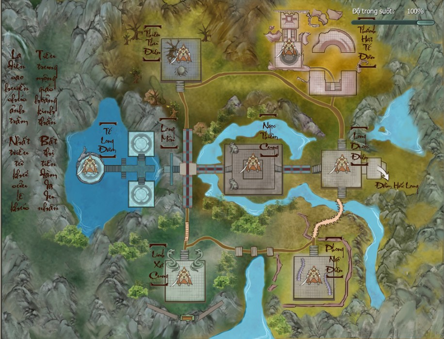
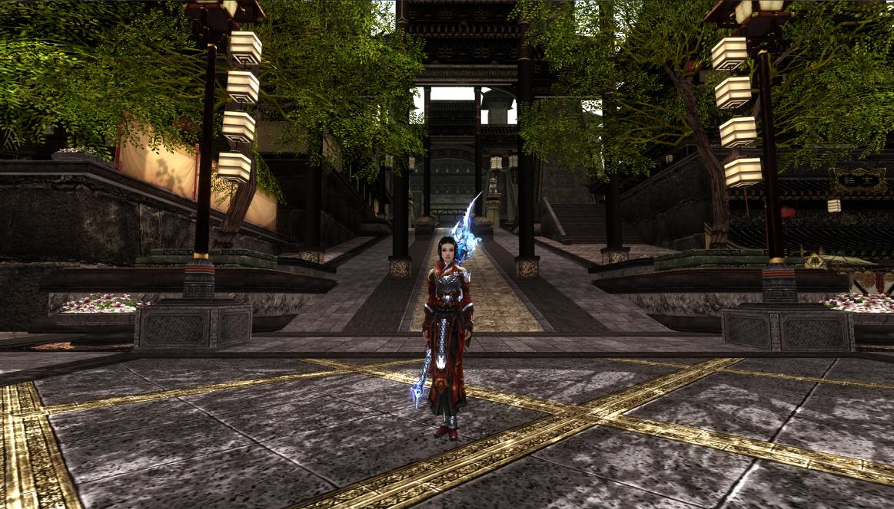
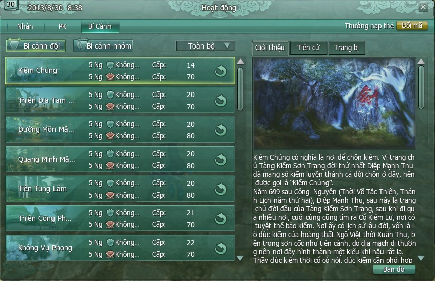
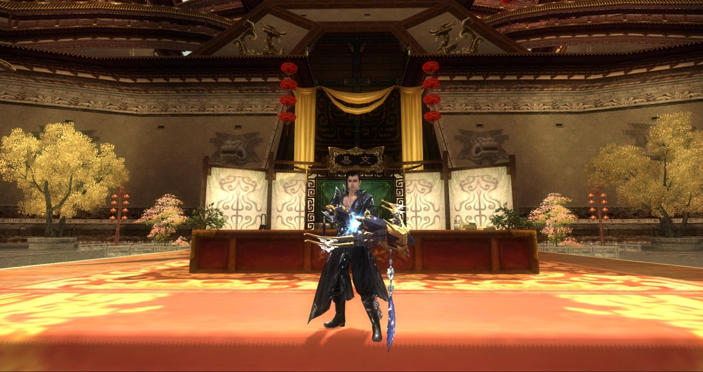
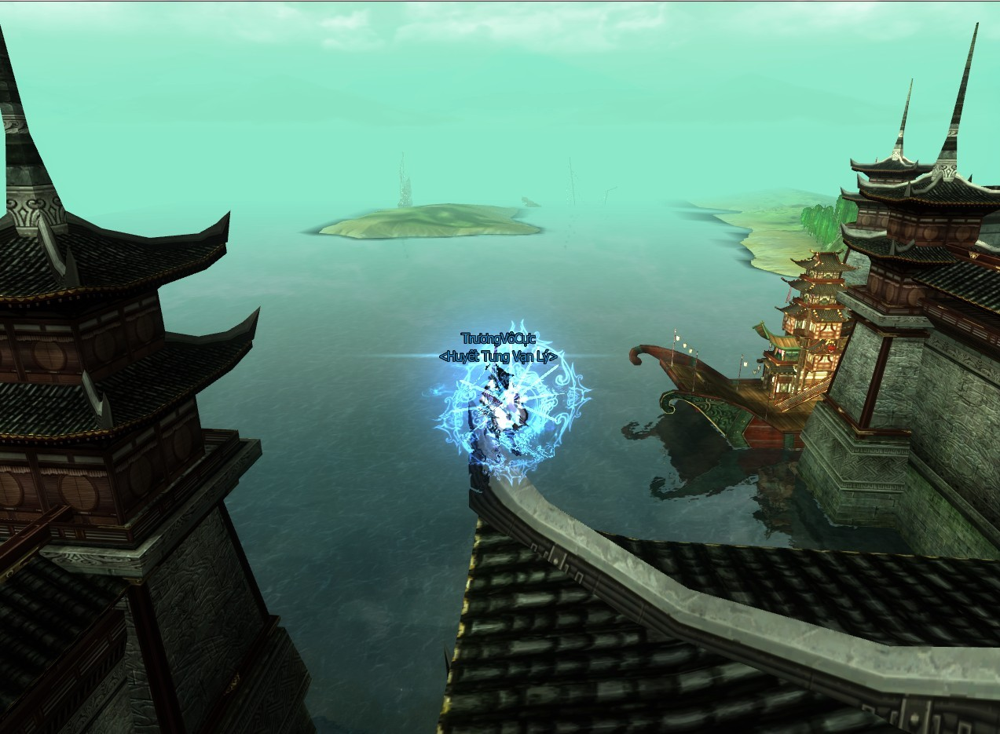
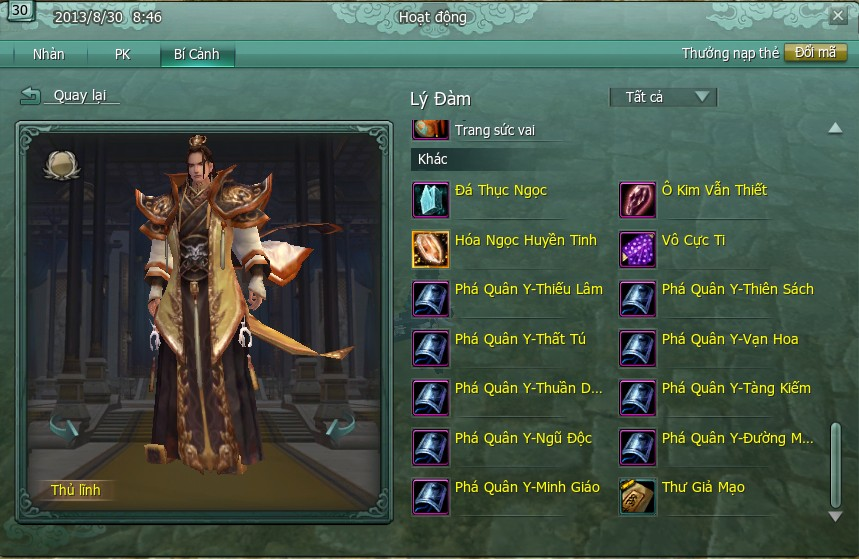
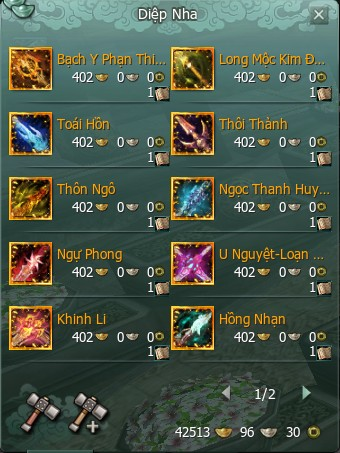

**Phó Bản** (hay còn gọi là bí cảnh) trong Võ Lâm 3 là 1 khu vực riêng biệt dành cho tổ đội (5 ngươi) hay nhóm (10 - 25 người) với mục đích thử thách các anh thư hào kiệt trên mọi phương diện: Tinh thần đồng đội, khả năng lãnh đạo (leader), sự đoàn kết, trí tuệ, can đảm đối mặt thử thách… và cùng nhau đạt được đích đến cuối cùng của Phó Bản là "Thần Binh" - những vũ khí tối thượng, uy lực vô song từng được sử dụng bởi những cao thủ võ lâm truyền thuyết.

   
 ***Phó bản - Nơi thử thách tinh thần đồng đội và khả năng lãnh đạo***.

Đối với các Phó Bản cao cấp thì sức mạnh không phải là yếu tố chính dẫn đến thành công khi mà sát thương từ Boss có thể khiến những tanker (nhận sát thương chính) "hạng nặng" như [Thiếu Lâm](../mon-phai/thieu-lam.md) Tẩy Tủy Kinh, [Thiên Sách](../mon-phai/thien-sach.md) Thiết Lao Luật, [Minh Giáo](../mon-phai/minh-giao.md) Minh Tôn Lưu Ly với chỉ số khí huyết lên đến 100.000 cũng có thể "về thành dưỡng sức" trong tích tắc. Điều cốt yếu chính là sự điều quân của người lãnh đạo và sự phối hợp ăn ý giữa các thành viên, nếu không dù mạnh đến đâu cũng chỉ là "hư vô".

   
 ***Sức mạnh cá nhân cũng chỉ là "hư vô" tại Phó Bản cao cấp...***

Được chia thành 2 loại là **Phó Bản đội** (tổ đội tối đa 5 người) và **Phó Bản nhóm** (nhóm tối đa 25 người), tương ứng với mỗi loại có 2 mức độ là Phó Bản Thường và Phó Bản Anh Hùng, sẽ là những thử thách thật sự đối với những nhân sĩ nào muốn sở hữu những trang bị "khủng" để có thể đạt đến cảnh giới võ học:

| Phân loại Phó Bản | Mức độ Phó Bản |
| --- | --- |
| [Phó Bản 5 người](./pho-ban-5-nguoi.md) | Phó Bản Thường |
| Phó Bản Anh Hùng |  |
| [Phó Bản 25 người](./pho-ban-25-nguoi.md) | Phó Bản Thường |
| Phó Bản Anh Hùng |  |

## Điều kiện tham gia Phó Bản

Điều kiện tiên quyết khi tham gia Phó Bản là cấp độ phải bằng hoặc lớn hơn cấp độ yêu cầu của Phó Bản, một nhân vật cấp độ thấp hơn cấp độ yêu cầu sẽ không thể tham gia.

   
 ***Phải đạt đến một cấp độ nhất định mới có thể tham gia Phó Bản phù hợp.***

Các điều kiện phụ như: Số lượng người càng gần giới hạn càng tốt và có đầy đủ các vai trò như **"buff"** (hỗ trợ), **"tanker"** (chịu sát thương chính) và **"damage dealer"** (sát thương chủ lực) sẽ chính là những tính toán chiến thuật cần thiết để một tổ đội/nhóm có thể vượt Phó Bản:

| Vai trò | Ghi chú |
| --- | --- |
| Buff (hỗ trợ) | Đóng vai trò hồi phục khí huyết cho đồng đội, hồi sinh nhân vật trọng thương, số lượng cần đủ để phục hồi sinh lực cho tất cả đồng đội và tanker. |
| Tanker (chịu sát thương chính) | Rất quan trọng khi vượt Phó Bản, chịu tất cả sát thương từ thủ lĩnh Phó Bản (Boss), không cần nhiều nhưng chắc chắn phải có. |
| Damage dealer (sát thương chủ lực) | Những nhân vật có sát thương cao, chịu trách nhiệm hạ khí huyết của thủ lĩnh bí cảnh một cách nhanh nhất, số lượng càng nhiều càng tốt. |

  
 ***[Đường Môn](../mon-phai/duong-mon.md) với lực sát thương nội và ngoại...***  

   
 ***...cùng [Thuần Dương](../mon-phai/thuan-duong.md) chính là một trong những "Damage dealer" đáng gờm!***

## Phần thưởng đạt được

Phần thưởng từ Phó Bản chủ yếu là các trang bị đánh quái, các loại trang bị này chính là tiền đề giúp nhân vật chinh phục các Phó Bản khó cao cấp về sau. Ngoài ra, những nguyên liệu chế tạo cao cấp chỉ có thể có từ Phó Bản mà không có từ bất cứ nguồn nào khác (ví dụ: Trang sức vai và lưng từ các Boss cao cấp trong các Phó Bản anh hùng đội nhóm).

   
 ***Nguyên liệu cao cấp chỉ có thể có trong Phó Bản***.

Đặc biệt, đỉnh cao của trang bị và cũng là cái đích mà ai cũng mong muốn chính là cực phẩm "Thần Binh", vũ khí tối thượng trong Võ Lâm 3. Để có vũ khí hoàng kim và nâng cấp nó đến mức hoàn mỹ thì vượt các Phó Bản nhóm anh hùng là cách duy nhất để thu thập đủ nguyên liệu.

   
 ***Thần Binh - Vũ khí tối thượng chốn võ lâm***.

Hệ thống Phó Bản phong phú và đặc sắc của Võ Lâm 3 vẫn đang rộng mở đón chờ các anh hùng hào kiệt khắp chốn chinh phục. Quý nhân sĩ hãy tham gia ngay hôm nay để không bỏ lỡ cơ hội trở thành một nhân vật truyền kỳ chốn võ lâm.

## Các phó bản

- [Phó bản 5 người](./pho-ban-5-nguoi.md)
- [Phó bản 10 người](./pho-ban-10-nguoi.md)
- [Phó bản 25 người](./pho-ban-25-nguoi.md)
- [Hoàng Cung Nam Chiếu](./hoang-cung-nam-chieu.md)

Nguồn: VNG (bài viết và hình ảnh)
