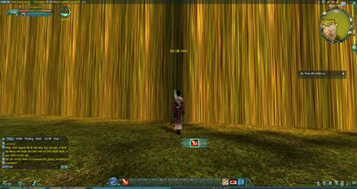
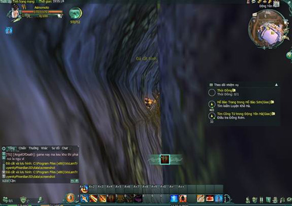
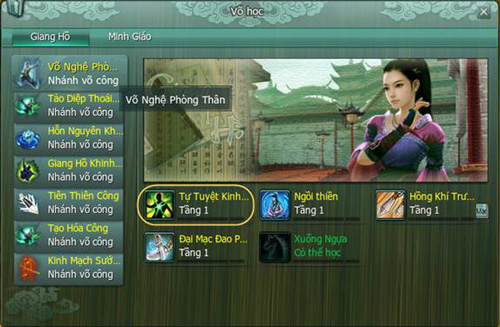
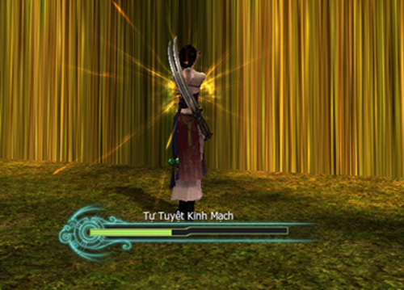
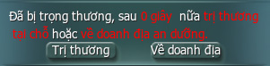

Khi tham gia bôn tẩu, hành hiệp tại Võ Lâm 3, ít nhiều quý nhân sĩ gặp phải tình trạng như khinh công ra khỏi phạm vi bản đồ, dẫn đến việc không thể leo ngược trở lại hoặc bị kẹt giữa khe núi và không thể thoát ra (xem hình minh họa).

Khi đó, quý nhân sĩ chỉ cần **nhấn phím P**, **mở giao diện chiêu thứ**c, nhánh **Võ Nghệ Phòng Thân**, **chọn Tự Tuyệt [Kinh Mạch](../he-thong/kinh-mach.md)**, thi triển nó, bị trọng thương ngã xuống, nhân sĩ nhấp vào “về doanh địa” để quay trở lại vị trí hồi sinh gần nhất (xem hình minh họa).

***Tình trạng không leo ngược trở lại được***

***Hoặc bị kẹt trong khe núi***

***Nhanh chóng nhấn phím P mở giao diện chiêu thức, chọn Tự Tuyệt Kinh Mạch***

***Thi triển chiêu thức Tự Tuyệt Kinh Mạch***

***Bị trọng thương, chọn về doanh địa sẽ trở lại vị trí hồi sinh gần nhất.***

Nguồn: VNG (bài viết và hình ảnh)
