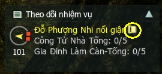
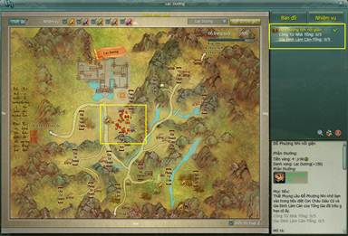

Tìm được quái và vật phẩm để hoàn thành nhiệm vụ là một trong những niềm vui khi tham gia bôn tẩu tại thế giới Võ Lâm 3. Vậy làm sao để có thể nhanh chóng tìm ra các mục tiêu đó? Sau đây là một số hướng dẫn cần thiết cho quý nhân sĩ:

- Chọn vào trục cuốn màu vàng trên bảng theo dõi nhiệm vụ để tìm hiểu.

- Hệ thống xuất hiện bản đồ đang làm nhiệm vụ, hiển thị thông qua “Số” và các “Chấm đỏ”.  **Số**: Thể hiện **khu vực làm nhiệm vụ** (Số 1: Khu vực nhiệm vụ số 1. Số 2: Khu vực nhiệm vụ số 2. Số 3: Khu vực nhiệm vụ số 3. **Chấm đỏ**: Thể hiện **vị trí của quái (vật phẩm)** trên khu vực nhiệm vụ.

- **Lưu ý**:   Nếu chỉ thẩy số mà không thấy chấm đỏ thì ta có thể nhấp vào số thì chấm đỏ sẽ xuất hiện. Nếu nhấp vào số vẫn không xuất hiện chấm đỏ, có nghĩa là vị trí quái (vật phẩm) nằm ngay vị trí đó.

Nguồn: VNG (bài viết và hình ảnh)
