## Hướng dẫn

### Hướng dẫn tân thủ từ cấp 01-15

Khởi sự hành tẩu tại Võ Lâm 3 chắc hẳn sẽ còn nhiều ngỡ ngàng đối với các tân thủ lần đầu tham gia. Và để giúp cho các nhân sĩ đang bôn tẩu Võ Lâm 3 thuận lợi hơn trong quá trình thăng cấp và tham gia **tính năng phù hợp với cấp độ từ 1 - 15**, Võ Lâm 3 xin gửi đến quý nhân sĩ một số thông tin hữu ích liên quan:

- Bản đồ phù hợp

- Các bước thao tác

- Kỹ năng có thể học

- Trang bị

#### Bản đồ phù hợp

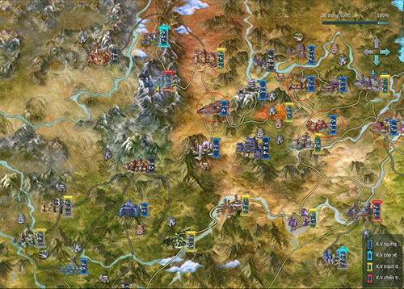  
 ***Khu vực khoanh vùng đỏ**(tên bản đồ xem bảng dưới)*

| **Bản đồ** | **Cấp** |
| --- | --- |
| Đạo Hương Thôn | Cấp nhiệm vụ: 2 - 10 Cấp quái: 0 - 8 |
| Trường An ([Đường Môn](../mon-phai/duong-mon.md), [Minh Giáo](../mon-phai/minh-giao.md), [Vạn Hoa](../mon-phai/van-hoa.md), [Thuần Dương](../mon-phai/thuan-duong.md)) | Cấp nhiệm vụ: 10 - 15, 25 - 27 Cấp quái: 11 - 15, 27 - 30 |
| Dương Châu ([Thất Tú](../mon-phai/that-tu.md), [Tàng Kiếm](../mon-phai/tang-kiem.md), [Ngũ Độc](../mon-phai/ngu-doc.md)) | Cấp nhiệm vụ: 10 - 15, 25 - 30 Cấp quái: 11 - 15, 26 - 30 |
| Lạc Dương ([Thiếu Lâm](../mon-phai/thieu-lam.md), [Thiên Sách](../mon-phai/thien-sach.md)) | Cấp nhiệm vụ: 10 - 15, 25 - 30 Cấp quái: 11 - 13, 26 - 29 |

#### Các bước thao tác ban đầu

| **Thao tác** | **Phim hướng dẫn** |
| --- | --- |
| Di chuyển | [Xem](http://www.youtube.com/watch?v=EIs6PE_ANo0) |
| Khinh công | [Xem](http://www.youtube.com/watch?v=4Ta4Gf5kBwY) |
| Nói chuyện | [Xem](http://www.youtube.com/watch?v=U4o4a8gLn7A) |
| Làm nhiệm vụ | [Xem](http://www.youtube.com/watch?v=np3r2gSzJ4s) |
| Chiến đấu | Xem |
| Nhặt đồ, sửa đồ | [Xem](http://www.youtube.com/watch?v=6naoSo1xXOo) |
| Hảo hữu | [Xem](http://www.youtube.com/watch?v=kqOA-5w1CTk) |
| Tổ đội | [Xem](http://www.youtube.com/watch?v=uI7roDaVQmo) |

#### Kỹ năng có thể học

##### Chiêu thức

- Khi bắt đầu hành tẩu giang hồ, nhân sĩ sẽ được trang bị 1 trong các kỹ năng dưới đây (phù hợp với môn phái của chính mình).

- Khi đạt đến cấp (level) **10 - 12**, nhân sĩ phải di chuyển qua các bản đồ thành thị tương ứng để có thế tiếp tục làm các nhiệm vụ khác. Tại đây, nhân sĩ còn có thể gặp "Người tiếp dẫn môn phái" để học thêm các kỹ năng khác của phái mình như:

- Ngoài ra nhân sĩ còn có thể học thêm các kỹ năng giang hồ từ thầy dạy võ:

##### Kinh mạch

- Ở cấp độ hiện tại nhân vật có thể tùy theo môn phái và hướng đi sau này mà có thể nâng 1 hoặc nhiều mạch cùng lúc.

| Tên mạch | Chức năng | Tên mạch | Chức năng |
| --- | --- | --- | --- |
| ** Nhâm Mạch** | Hỗ trợ các kỹ năng Trị Thương, tăng các thuộc tính cơ bản. | **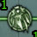 Nhâm Mạch - Tử Cung** | Kháng sát thương khi bị té ngã. |
| **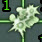 Nhâm Mạch - Kiện Lý** | Giảm nội lực tiêu hao khi sử dụng nội công. | **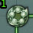 Nhâm Mạch - Tuyền Cơ** | Tăng điểm lực đạo. |
| ** Nhâm Mạch - Ngọc Dương** | Tăng thời gian lặn. | **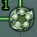 Nhâm Mạch - Thiên Đột** | Tăng điểm Nguyên Khí. |
| ** Nhâm Mạch - Hoa Cái** | Tăng điểm căn cốt. | ** Đốc Mạch** | Tăng kháng, giảm sát thương, phòng thủ,… |
| **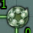 Nhâm Mạch - Liêm Tuyền** | Tăng điểm thân pháp. | **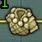 Đốc Mạch - Mệnh Môn** | Giảm sát thương nội. |
| **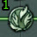 Nhâm Mạch - Quan Nguyên** | Giảm điểm uy hiếp của sát thương. | **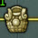 Đốc Mạch - Thân Chủ** | Tăng cấp phòng ngoại. |
| **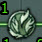 Nhâm Mạch - Âm Giao** | Giảm điệm uy hiếp trị thương. | **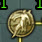 Đốc Mạch - Tích Trung** | Tăng điểm né tránh. |
| **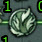 Nhâm Mạch - Thạch Môn** | Tăng điểm uy hiếp chiêu thức. | ** Đốc Mạch - Trường Cường** | Phục hồi khí lực. |
| **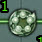 Nhâm Mạch - Thừa Tương** | Tăng điểm thể chất. | ** Đới Mạch** | Tăng máu, hổ trợ các phái ngoại công. |
| ** Nhâm Mạch - Thủy Câu** | Giảm thời gian điều chỉnh khinh công Phi cảnh. | ** Xung Mạch** | Hỗ trợ các phái nội công. |

#### Trang bị nhận được

- Cấp độ hiện tại có thể nhận được trang bị xanh và trắng với phẩm chất như sau:  **Bản đồ Đạo Hương Thôn:** Trang bị trắng (phẩm chất 1 – 5). **Bản đồ Trường An, Lạc Dương, Dương Châu:** Trang bị xanh (phẩm chất 10 – 15).

## Giải đáp thắc mắc

### Giải đáp thắc mắc từ cấp 01-15

Trong quá trình sơ nhập giang hồ tại Võ Lâm 3, đôi lúc quý nhân sĩ sẽ có những thắc mắc liên quan không biết tỏ cùng ai. Khi đó, quý nhân sĩ có thể tham khảo bản **hướng dẫn các thắc mắc thường gặp** dưới đây để thuận đường bôn tẩu.

- Tùy chỉnh cấu hình

- Lỗi cài đặt ngôn ngữ

- Thiếu Directx 9.0c

- Lỗi đăng nhập

- Chọn nhanh mục tiêu

- Rời khỏi Đạo Hương

#### Tùy chỉnh cấu hình & âm thanh

##### Cấu hình

| Hình ảnh | Ghi chú |
| --- | --- |
| 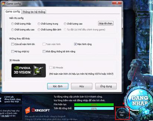 | **Cách 1**: Chọn thiết lập tại giao diện cập nhật trò chơi (launcher). |
| 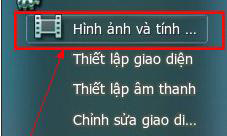 | **Cách 2**: Vào trò chơi, bấm phím "**ESC**", chọn mục Thiết lập **hình ảnh và tính năng**. |
| 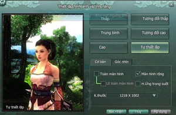 | Có thể tùy chọn cấu hình phù hợp với máy tính và sở thích. |

##### Âm thanh & phím tắt

| Hình ảnh | Ghi chú |
| --- | --- |
| 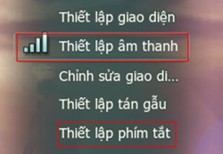 | Bấm phím **ESC** để mở giao diện hệ thống để **thiết lập âm thanh** hoặc **phím tắt**. |
| 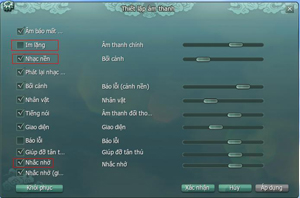 | Im lặng: Tắt/bật toàn bộ âm thanh. Nhạc nền: Tắt/bật nhạc nền trong trò chơi. Nhắc nhở: - để tắt/bật hướng dẫn, nhắc nhở. |
| 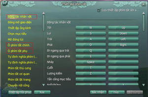 | Có thể thiết lập các phím tắt trong di chuyển, chiến đấu. |

#### Lỗi bộ cài đặt ngôn ngữ

Hệ thống sẽ tự động cài đặt bộ ngôn ngữ tương thích với máy tính của nhân sĩ trong quá trình cài đặt trò chơi Võ Lâm 3 (hình 1).

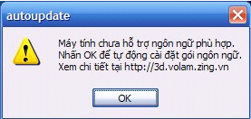

Tuy nhiên, nếu vì lý do nào đó mà máy tính không thể cài đặt bộ ngôn ngữ thì sẽ không thể đăng nhập vào trò chơi. Khi đó, quý nhân sĩ vui lòng thực hiện các thao tác như sau:

- Chuẩn bị 1 đĩa cài đặt Windows (đúng phiên bản với hệ điều hành hiện tại).

- Vào Start chọn **Control Panel** > chọn**Regional and Language Options**.

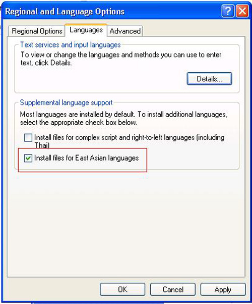

- Cài đặt xong máy yêu cầu khởi động lại, quá trình cài đặt hoàn tất.

Lưu ý

Khi cài đặt Font nếu nhân sĩ không có ổ đĩa CD-DVD có thể tìm kiếm và download trên internet về máy tính. Khi cài đặt làm tương tự bước đối với máy tính có ổ đĩa CD –DVD, **nhưng khi tới bước 3 nhân sĩ thực hiện như sau:**

- Trong quá trình cài đặt máy tính sẽ yêu cầu cho đĩa cài đặt, nhân sĩ Browse tới thư mục**I386** đã download về.

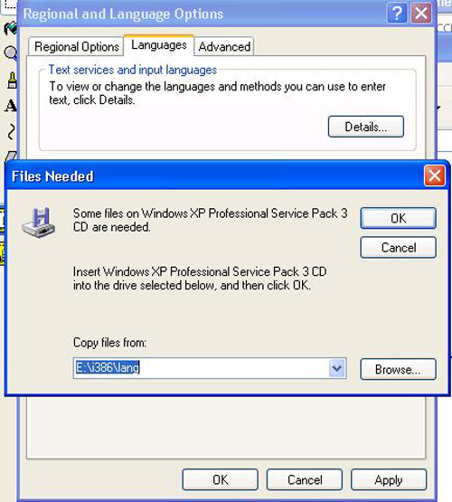

- Khởi động lại máy, quá trình cài đặt hoàn tất.

#### Lỗi thiếu Directx 9.0c

Ngoài ra, trong quá trình cài đặt Võ Lâm 3, hệ thống sẽ yêu cầu nhân sĩ cài đặt **Directx 9.0c**, lúc đó nhân sĩ chỉ cần nhấn **Next** để bắt đầu cài đặt:

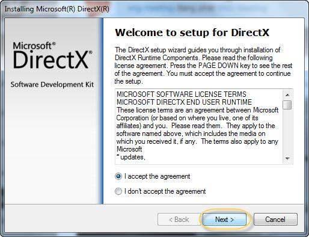

- Phần mềm sẽ được tự động cài đặt vào máy tính:

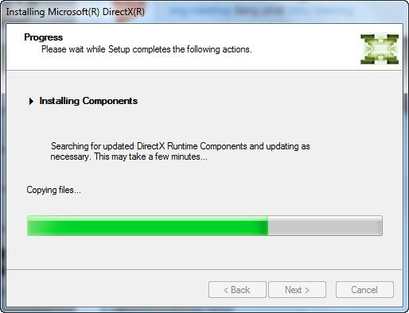

- Hoàn tất cài đặt, nhân sĩ có thể nhấp vào **Finish** và bắt đầu đăng nhập vào trò chơi bình thường:

Tuy nhiên cũng có một số trường hợp hệ thống không tự động cài đặt, khi đó đồng đạo cần thực hiện cài đặt thủ công với các thao tác như sau:

- Vào thư mục **Data** trong thư mục cài đặt trò chơi:

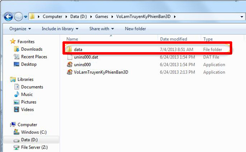

- Sau đó vào thư mục **3rdparty**:

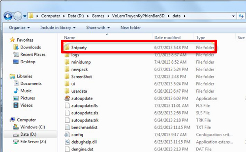

- Khi đó nhân sĩ sẽ thấy thư mục **Dx9_43**, vào thư mục này và tìm tập tin **Dxsetup**:

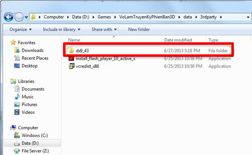

- Nhấp chọn hai lần vào tập tin **Dxsetup**, hệ thống sẽ tự động cài đặt **DirectX**:

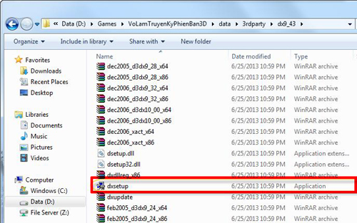

- Quá trình cài đặt hoàn tất, đồng đạo có thể đăng nhập vào trò chơi bình thường.

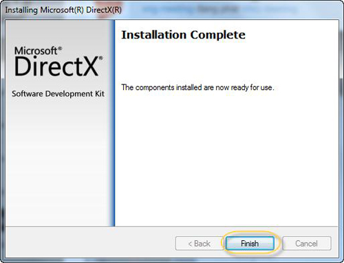

#### Lỗi đăng nhập

***Lúc đăng nhập vào trò chơi, màn hình máy tính của tôi bị đen?***

Có thể do cấu hình máy tính của nhân sĩ không phù hợp. Nhân sĩ có thể kiểm tra mức độ phù hợp của cấu hình máy tính tại:

- Cấu hình yêu cầu: Xem tại đây.

- Đánh giá card màn hình: Xem tại đây.

***Sau khi đăng nhập và màn hình hiện ra giao diện chờ (loading) đến 40% thì tự động thoát*?**

- Có thể máy tính của nhân sĩ chưa cập nhật Directx và Vcredist phù hợp.

- 02 phần mềm này đã được tích hợp sẵn trong thư mục 3rdparty. Nhân sĩ có thể vào thư mục này và cài đặt phần mềm tương ứng.

#### Chọn mục tiêu nhanh & di chuyển bằng chuột

##### Chọn nhanh mục tiêu

- Khi đang đứng trong khu vực có quái hoặc NPC, để có thể chọn nhanh mục tiêu trong khu vực đó mà không cần click chuột lên từng quái hoặc NPC, nhân sĩ có thể sử dụng **Phím Tab.**

- Mặc định khi ấn Phím Tab sẽ tự động chọn mục tiêu là **quái gần nhất**hoặc **NPC gần nhất**. Nếu tiếp tục nhấn sẽ được thay đổi đến mục tiêu gần đó.

- **Chú ý**: Chọn nhanh bằng Phím Tab sẽ **không thể** chọn các mục tiêu đang **đứng sau lưng người chơi.**

##### Di chuyển bằng chuột

Các nhân sĩ không quen với cách di chuyển mặc định là sử dụng các phím **W, A, S, D để di chuyển** và **chuột phải để điều hướng** có thể thiết lập cách di chuyển bằng chuột theo cách truyền thống như sau:

| Hình ảnh | Ghi chú |
| --- | --- |
| 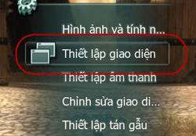 | Bấm phím **ESC** để mở giao diện hệ thống chọn **thiết lập giao diện**. |
| 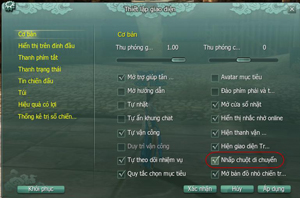 | Trong mục thiết lập giao diện đánh dấu chọn vào phần **nhấp chuột di chuyển**. |
| 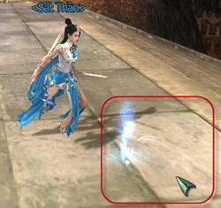 | Chọn áp dụng và xác nhận, sau đó nhân sĩ có thể sử dụng chuột để di chuyển bình thường. |

#### Rời khỏi Đạo Hương Thôn

- Sau khi đã hoàn thành các bước đầu tiên để bôn tẩu giang hồ, nhân sĩ có thể làm theo hướng dẫn sau để di chuyển đến các thành thị:

| Hình ảnh | Ghi chú |
| --- | --- |
| 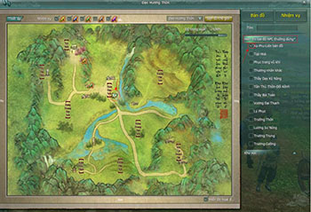 | Bấm phím "M" để mở bản đồ. Nhấp vào ô "Xa phu - liên bản đồ" để hiện ra vị trí của NPC. |
|  | Xác định được vị trí đứng của NPC và di chuyển lại đó. Chọn nơi đến theo yêu cầu. |

Nguồn: VNG (bài viết và hình ảnh)
