## Hướng dẫn

### Hướng dẫn tân thủ từ cấp 16-25

Sau khi [gia nhập môn phái](./huong-dan-gia-nhap-mon-phai-khi-dat-cap-16.md) khi đạt đẳng cấp 15, từ **đẳng cấp 16 - 25**, nhân sĩ sẽ chính thức bước vào con đường hành hiệp của mình dưới sự dẫn dắt và hỗ trợ lẫn nhau từ các môn đệ đồng môn. Với các bí cảnh phù hợp như [Quang Minh Mật Đạo](../pho-ban/pho-ban-5-nguoi.md#quang-minh-mật-đạo), [Đường Môn Mật Thất](../pho-ban/pho-ban-5-nguoi.md#đường-môn-mật-thất), Không Vụ Không...các nhân sĩ sẽ bắt đầu được trải nghiệm những thử thách thật sự tại Võ Lâm 3.

- Bản đồ phù hợp

- Bí cảnh phù hợp

- Kỹ năng có thể học

- Trang bị

#### Bản đồ phù hợp

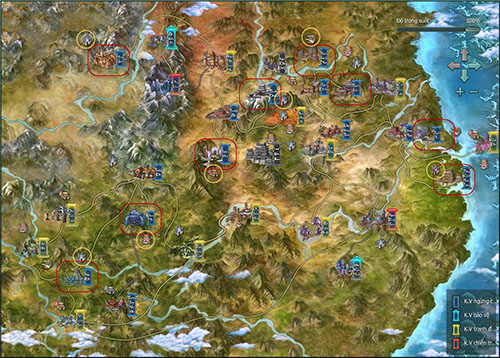  
 ***Khu vực khoanh vùng đỏ và vàng**(tên bản đồ xem bảng dưới)*

| **Bản đồ** | **Cấp** |
| --- | --- |
| [Minh Giáo](../mon-phai/minh-giao.md) | Cấp nhiệm vụ: 15 - 25 Cấp quái: 15 - 25 |
| [Đường Môn](../mon-phai/duong-mon.md) | Cấp nhiệm vụ: 15 - 25 Cấp quái: 15 - 25 |
| [Ngũ Độc](../mon-phai/ngu-doc.md) | Cấp nhiệm vụ: 15 - 25 Cấp quái: 15 - 25 |
| [Tàng Kiếm](../mon-phai/tang-kiem.md) Sơn Trang | Cấp nhiệm vụ: 15 - 25 Cấp quái: 15 - 25 |
| [Thuần Dương](../mon-phai/thuan-duong.md) Phái | Cấp nhiệm vụ: 15 - 25 Cấp quái: 15 - 25 |
| [Thiên Sách](../mon-phai/thien-sach.md) Phủ | Cấp nhiệm vụ: 15 - 25 Cấp quái: 15 - 25 |
| [Thất Tú](../mon-phai/that-tu.md) | Cấp nhiệm vụ: 15 - 25 Cấp quái: 15 - 25 |
| [Vạn Hoa](../mon-phai/van-hoa.md) Cốc | Cấp nhiệm vụ: 15 - 25 Cấp quái: 15 - 25 |
| [Thiếu Lâm](../mon-phai/thieu-lam.md) | Cấp nhiệm vụ: 15 - 25 Cấp quái: 15 - 25 |

#### Bí cảnh phù hợp

| **Bí cảnh** | **Ghi chú** |
| --- | --- |
| Quang Minh Mật Đạo thường | Vị trí: Minh Giáo Đẳng cấp tối thiểu: 20 |
| Đường Môn Mật Thất thường | Vị trí: Đường Môn Đẳng cấp tối thiểu: 20 |
| [Tiên Tung Lâm](../pho-ban/pho-ban-5-nguoi.md#tiên-tung-lâm) thường | Vị trí: Ngũ Độc Đẳng cấp tối thiểu: 20 |
| [Kiếm Chủng](../pho-ban/pho-ban-5-nguoi.md#kiếm-chủng) thường | Vị trí: Tàng Kiếm Sơn Trang Đẳng cấp tối thiểu: 14 |
| Không Vụ Không thường | Vị trí: Thuần Dương phái Đẳng cấp tối thiểu: 22 |
| [Thiên Địa Tam Tài Trận](../pho-ban/pho-ban-5-nguoi.md#thiên-địa-tam-tài-trận) thường | Vị trí: Thiên Sách phủ Đẳng cấp tối thiểu: 20 |
| [Thiên Công Phường](../pho-ban/pho-ban-5-nguoi.md#thiên-công-phường) thường | Vị trí: Vạn Hoa Cốc Đẳng cấp tối thiểu: 21 |

#### Kỹ năng có thể học

##### Chiêu thức

- **Minh Giáo:**

- **Đường Môn:**

- **Ngũ Độc:**

- **Tàng Kiếm:**

- **Thiên Sách:**

- **Thuần Dương:**

- **Vạn Hoa:**

- **Thất Tú:**

- **Thiếu Lâm**

##### Hệ nội công thứ 2

| Môn phái | Hệ nội công | Môn phái | Hệ nội công |
| --- | --- | --- | --- |
| **Minh Giáo** |  Minh Tôn Lưu Ly Thể | **Thiên Sách** | 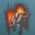 Thiết Lao Luật |
| **Đường Môn** |  Thiên La Ngụy Đạo | **Thuần Dương** |  Thái Hư Kiếm Ý |
| **Ngũ Độc** | 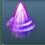 Bổ Thiên Quyết | **Vạn Hoa** | 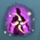 Ly Kinh Dịch Đạo |
| **Tàng Kiếm** |  Sơn Cư Kiếm Ý | **Thất Tú** |  Vân Thường Tâm Kinh |
| - | - | **Thiếu Lâm** |  Tẩy Tủy Kinh |

##### Trận Pháp

| Môn phái | Trận pháp | Môn phái | Trận pháp |
| --- | --- | --- | --- |
| **Minh Giáo** | 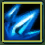 Viêm Uy Phá Ma Trận | **Vạn Hoa** | 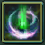 Lạc Tinh Kinh Hồng Trận |
| 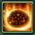 Vô Lượng Quang Minh Trận |  Thất Tuyệt Tiêu Dao Trận |  |  |
| **Đường Môn** | 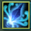 Lưu Tinh Cản Nguyệt Trận | **Thất Tú** |  Nguyệt Hoa Lăng Hồn Trận |
| 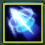 Thiên Cơ Bách Biến Trận |  Cửu Âm Kinh Huyền Trận |  |  |
| **Ngũ Độc** |  Vạn Cổ Phệ Tâm Trận | **Thiếu Lâm** | 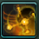 Kim Cang Phục Ma Trận |
| 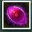 Diệu Thủ Chức Thiên Trận | 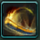 Thiên Cổ Lôi Âm Trận |  |  |
| **Thiên Sách** | 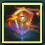 Cửu Tương Địa Huyền Trận | **Thuần Dương** |  Cửu Cung Bát Quái Trận |
| 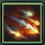 Vệ Công Chiết Xung Trận | 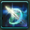 Bắc Đẩu Thất Tinh Trận |  |  |
| **Tàng Kiếm** | 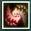 Y Sơn Quán Lan Trận | - | - |

##### Kinh mạch

Ở cấp độ hiện tại nhân vật có thể tùy theo môn phái và hướng đi sau này mà có thể nâng 1 hoặc nhiều mạch cùng lúc:

| Đẳng cấp | Tên | Đẳng cấp | Tên |
| --- | --- | --- | --- |
| 20 | 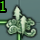 Nhâm Mạch - Đoái Đoan | 20 | 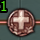 Đới Mạch - Thiên Xung |
| 20 |  Nhâm Mạch - Ngân Giao | 20 | 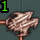 Đới Mạch - Duy Đạo |
| 25 | 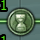 Nhâm Mạch - Thần Đình | 25 | 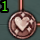 Đới Mạch - Mục Xuyên |
| 25 |  Nhâm Mạch - Thượng Tinh | 25 | 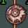 Đới Mạch - Phù Bạch |
| 25 |  Nhâm Mạch - Sách Liêu | 25 | 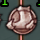 Đới Mạch - Hoàn Cốt |
| 20 |  Nhâm Mạch - Địa Hợp | 25 | 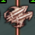 Đới Mạch - Bán Thần |
| 20 | 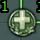 Nhâm Mạch - Lượng Nước | 25 | 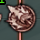 Đới Mạch - Dương Bạch |
| 25 | 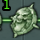 Nhâm Mạch - Trung Cực | 20 | 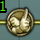 Đốc Mạch - Chí Dương |
| 20 | 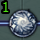 Xung Mạch - Đại Hách | 25 | 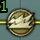 Đốc Mạch - Cân Thúc |
| 25 |  Xung Mạch - Thương Khúc | 20 | 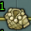 Đốc Mạch - Đào Đạo |
| 20 | 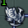 Xung Mạch - Hoành Cốt | 20 |  Đốc Mạch - Tín Hội |
| 25 | 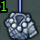 Xung Mạch - Manh Du | 20 |  Đốc Mạch - Cường Gian |
| 25 | 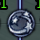 Xung Mạch - Trung Chú | 20 |  Đốc Mạch - Tiền Đỉnh |
| 25 | 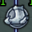 Xung Mạch - Tứ Mãn | 25 | 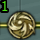 Đốc Mạch - Thần Đạo |
| 25 | 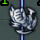 Xung Mạch - Khí Huyệt | 20 |  Đốc Mạch - Linh Đài |
| - | - | 25 |  Đốc Mạch - Đại Chùy |

#### Trang bị nhận được

- **Trang bị nhận được từ nhiệm vụ tại bản đồ môn phái:** Phẩm chất trắng, xanh lá, xanh dương và vũ khí tím phẩm chất 15 - 22.

- **Trang bị nhận được từ phó bản:**Trang bị xanh dương phẩm chất 30-35.

## Giải đáp thắc mắc

### Giải đáp thắc mắc từ cấp 16-25

Trên chặng đường hành tẩu, sẽ có lúc quý nhân sĩ nhận được những nhiệm vụ không có la bàn hướng dẫn hoặc không tìm thấy NPC liên quan, không biết cách thực hiện nhiệm vụ... Quý nhân sĩ đừng vội từ bỏ mà hãy cùng tham khảo bản **hướng dẫn những thắc mắc về các nhiệm vụ đặc biệt** sau đây để có thể dễ dàng thực hiện nhiệm vụ, gia tăng uy vọng giang hồ.

- Gia nhập môn phái

- Nhiệm vụ quán trà

- Không thấy NPC

- Sử dụng vật phẩm

- Theo dõi NPC

- Không có la bàn

- Tháo vũ khí

- Động tác biểu cảm

- Bản đồ nhiệm vụ & bí cảnh thích hợp

#### Gia nhập môn phái

##### Trường An

##### Dương Châu

##### Lạc Dương

##### Phim hướng dẫn

- **Minh Giáo**

- **Đường Môn**

- **Ngũ Độc**

- **Tàng Kiếm**

- **Thiên Sách**

- **Vạn Hoa**

- **Thất Tú**

- **Thuần Dương**

- **Thiếu Lâm**

#### Nhiệm vụ Quán Trà

##### Thu thập trà từ Thương Nhân

| Hình ảnh | Ghi chú |
| --- | --- |
| 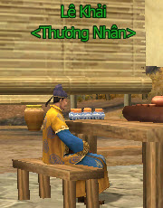 | Mua trà tại NPC **Lê Khải** Thương Nhân trong quán trà. |
| 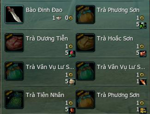 | Giao dịch trà với Thương Nhân sẽ cần các nguyên liệu tương ứng. |

| **Tên trà** | **Yêu cầu** | **[Kỹ nghệ](../he-thong/ky-nang-song.md) thu thập** |
| --- | --- | --- |
| Phương Sơn | 5 Cam Thảo | Thần Nông |
| Dương Tiễn | 5 Đại Hoàng | Thần Nông |
| Hoắc Sơn | 5 Thịt Bằm | Bào Đinh |
| Vân Vụ Lư Sơn | 5 Vải Bố | Hạ gục NPC hình người |
| Tiên Nhân | 5 Đồng Đỏ | Đào Vàng |

- Phim hướng dẫn học nghề Thần Nông xem [tại đây](http://www.youtube.com/watch?v=24cOKKRmL_k).

- Phim hướng dẫn học nghề Đào Vàng xem [tại đây](http://www.youtube.com/watch?v=WuQ_Hqf8hBk).

- Phim hướng dẫn học nghề Bào Đinh xem [tại đây](http://www.youtube.com/watch?v=_6NjrYp-ZgU).

##### Nhiệm vụ pha trà

| Hình ảnh | Ghi chú |
| --- | --- |
| 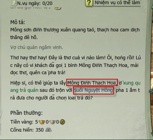 | Nhiệm vụ yêu cầu nhân sĩ phải tự pha trà bằng nguyên liệu để giao cho NPC theo yêu cầu. |
| 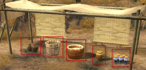 | Thu thập nguyên liệu nước pha trà tương ứng ở phía sau quán trà. |
| 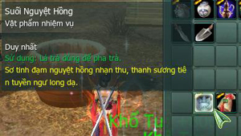 | Nhấp chuột phải vào nguyên liệu thứ nhất, đưa chuột vào nguyên liệu thứ hai và nhấp chuột trái để pha trà. |
| 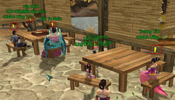 | Trong quán trà có những NPC có biểu tượng "**!**" trên đầu là những thực khách muốn uống trà. |
| 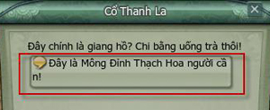 | Nhấp chuột phải vào NPC để xem loại trà yêu cầu của họ. Tìm được NPC yêu cầu loại trà phù hợp có thể giao trà để hoàn thành nhiệm vụ. |

#### Không tìm thấy NPC nhiệm vụ

| Hình ảnh | Ghi chú |
| --- | --- |
| 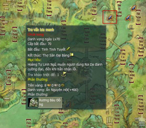 | Mở bản đồ để kiểm tra vị trí nhận nhiệm vụ (biểu tượng quyển trục màu xanh). |
| 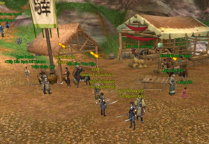 | Tuy nhiên khi đến nơi lại không tìm thấy NPC nhận nhiệm vụ. |
| 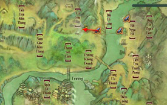 | Khi đó nhân sĩ có thể di chuyển trong khu vực xung quanh vị trí chỉ định. |
| 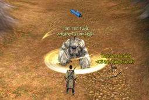 | Tìm được NPC Tinh Tinh Tuyết để nhận nhiệm vụ. |

**Ghi chú**: Một số NPC khác như **Mộ Dung Truy Phong** ở Lạc Đạo hoặc **Vi Hạo Nguyệt** ở Ác Nhân Cốc cũng có khả năng di chuyển xung quanh khu vực chỉ định.

#### Nhiệm vụ sử dụng vật phẩm

| Hình ảnh | Ghi chú |
| --- | --- |
| 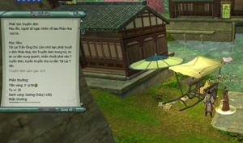 | Nhận nhiệm vụ Phát Tán Truyền Đơn ở Dương Châu. |
| 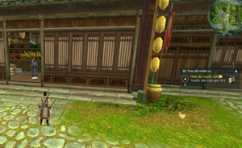 | Di chuyển đến vị trí chỉ định (hiển thị trên la bàn của hệ thống theo dõi nhiệm vụ). |
|  | Nhấp chọn các NPC xung quanh và sử dụng vật phẩm chỉ định để thực hiện nhiệm vụ. |
|  | Hoàn thành có thể quay lại NPC Ông Chủ Lâm để trả nhiệm vụ và nhận phần thưởng. |

**Ghi chú**: Một số nhiệm vụ sẽ yêu cầu nhân sĩ **sử dụng kết hợp các loại vật phẩm** như Pha Trà trong chuỗi nhiệm vụ hoạt động Quán Trà Thành Chính ở các thành thị lớn.

#### Nhiệm vụ hộ tống/theo dõi NPC

Khi gặp những nhiệm vụ yêu cầu hộ tống/theo dõi NPC, nhân sĩ cần **đi theo NPC đến nơi chỉ định** để hoàn thành nhiệm vụ.

| Hình ảnh | Ghi chú |
| --- | --- |
|  | Nhiệm vụ Bí Mật Đánh Lén trong chuỗi hoạt động Quán Trà Thành Chính. |
|  | Đối thoại với bà chủ quán trà Triệu Vân Duệ và chọn dòng "Đã sẵn sàng bám theo Lương Tiểu Đường". |
|  | NPC Lương Tiểu Đường sẽ xuất hiện. |
|  | Theo sau Lương Tiểu Đường và giữ khoảng cách nhất định, đến vị trí chỉ định sẽ hoàn thành nhiệm vụ. |

#### Nhiệm vụ không hiển thị la bàn

Trong quá trình hành tẩu giang hồ có thể gặp một số nhiệm vụ không hiển thị la bàn hướng dẫn. Nhân sĩ cần**đối thoại cùng các NPC liên quan** để thực hiện nhiệm vụ.

| Hình ảnh | Ghi chú |
| --- | --- |
|  | Nhiệm vụ không hiển thị la bàn hướng dẫn. |
|  | Nhân sĩ có thể đối thoại cùng các NPC xung quanh nơi nhận nhiệm vụ. |
|  | Hoàn thành nhiệm vụ. |

#### Nhiệm vụ yêu cầu tháo vũ khí

Một số nhiệm vụ yêu cầu **nhân vật phải tháo vũ khí** để thực hiện nhiệm vụ. Ví dụ: Nhiệm vụ **Tiếng Hươu** tại Vạn Hoa cốc.

| Hình ảnh | Ghi chú |
| --- | --- |
|  | Sau khi nhận nhiệm vụ, nhân vật phải tháo trang bị vũ khí xuống. |
|  | Nhấp chuột phải tấn công để hươu rừng di chuyển về phía trước. |
|  | Đẩy hươu rừng tiến về đỉnh đồi trước mặt sẽ hoàn thành nhiệm vụ. |

#### Nhiệm vụ động tác biểu cảm

Một số nhiệm vụ yêu cầu nhân vật **phải thực hiện động tác biểu cảm** với nhân sĩ khác hoặc một đối tượng chỉ định. Ví dụ: Nhiệm vụ **Cổ Linh Tinh Quái** (Quán Trà Thành Chính) và nhiệm vụ **Bái Kiến Minh Tôn**.

##### Cổ Linh Tinh Quái

| Hình ảnh | Ghi chú |
| --- | --- |
|  | Nhận tại NPC Bà Chủ Quán Trà và quan sát yêu cầu nhiệm vụ. |
|  | Sử dụng vật phẩm nhiệm vụ để biết được động tác biểu cảm cần thực hiện. |
|  | Tìm hảo hữu hoặc người cùng Bang gần đó để thực hiện động tác biểu cảm. |
|   | Trên thanh đối thoại (chat) nhấp vào biểu tượng mặt cười để mở bảng biểu cảm. Chọn động tác biểu cảm tương ứng với yêu cầu nhiệm vụ. |
|  | Chọn đối tượng cần thao tác biểu cảm và thực hiện động tác tương ứng sẽ hoàn thành nhiệm vụ. |

##### Bái Kiến Minh Tôn

| Hình ảnh | Ghi chú |
| --- | --- |
|  | Nhận nhiệm vụ tại Minh Giáo phái và kiểm tra thông tin nhiệm vụ. |
|  | Di chuyển đến trước tượng Minh Tôn. |
|  | Mở bảng biểu cảm, chọn động tác tương ứng yêu cầu và hoàn thành nhiệm vụ. |

#### Bản đồ nhiệm vụ & Bí cảnh theo đẳng cấp

##### Nhiệm vụ

| Đẳng cấp | Giai đoạn | Bản đồ nhiệm vụ | Bí cảnh thích hợp |
| --- | --- | --- | --- |
| **1 - 10** | Tân Thủ | Đạo Hương Thôn | - |
| **11 - 16** | Trước khi gia nhập môn phái | Lạc Dương | - |
| Trường An |  |  |  |
| Dương Châu |  |  |  |
| **14 - 28** | Gia nhập môn phái | Minh Giáo | Quang Minh Mật Đạo - Thường Đường Môn Mật Thất - Thường Tiên Tung Lâm - Thường Mộ Kiếm - Thường Tam Tài Trận - Thường [Không Vụ Phong](../pho-ban/pho-ban-5-nguoi.md#không-vụ-phong) - Thường Thiên Công Phường - Thường |
| Đường Môn |  |  |  |
| Ngũ Độc |  |  |  |
| Tàng Kiếm |  |  |  |
| Thiên Sách |  |  |  |
| Thuần Dương |  |  |  |
| Vạn Hoa |  |  |  |
| Thất Tú |  |  |  |
| Thiếu Lâm |  |  |  |
| **26 - 30** | Nhiệm vụ ở các bản đồ ngoại thành | Lạc Dương | [Linh Tiêu Hiệp](../pho-ban/pho-ban-5-nguoi.md#linh-tiêu-hiệp) - Thường |
| Trường An |  |  |  |
| Dương Châu |  |  |  |
| **30 - 47** | Phong Hoa Cốc | [Đảo Vô Diêm](../pho-ban/pho-ban-5-nguoi.md#đảo-vô-diêm) [Địch Hoa Cung Tiền Sơn](../pho-ban/pho-ban-5-nguoi.md#địch-hoa-cung-tiền-sơn) - Thường [Nhật Luân Sơn Thành](../pho-ban/pho-ban-5-nguoi.md#nhật-luân-sơn-thành) - Thường |  |
| Lạc Đạo |  |  |  |
| Khấu Đảo |  |  |  |
| Kim Thủy Trấn |  |  |  |
| **48 - 50** | Quay về môn phái làm nhiệm vụ lấy mật tịch | Minh Giáo | [Phong Vũ Đạo Hương Thôn](../pho-ban/pho-ban-5-nguoi.md#phong-vũ-đạo-hương-thôn) - Thường |
| Đường Môn |  |  |  |
| Ngũ Độc |  |  |  |
| Tàng Kiếm |  |  |  |
| Thiên Sách |  |  |  |
| Thuần Dương |  |  |  |
| Vạn Hoa |  |  |  |
| Thất Tú |  |  |  |
| Thiếu Lâm |  |  |  |
| **50 - 58** | Trước khi gia nhập phe phái | Hoang Mạc Long Môn | [Thiên Tử Phong](../pho-ban/pho-ban-5-nguoi.md#thiên-tử-phong) - Thường |
| Ba Lăng Huyện |  |  |  |
| **58 - 65** | Côn Lôn |  |  |
| [Nam Bình Sơn](../he-thong/tran-doanh.md#loạn-chiến-nam-bình-sơn) |  |  |  |
| **66 - 70** | Gia nhập phe | Ác Nhân Cốc |  |
| Hạo Khí Minh |  |  |  |
| Cù Đường Hiệp |  |  |  |
| Côn Lôn |  |  |  |
| **71 - 74** | Cấp độ tối đa | Vô Lượng Sơn | Tất cả các bí cảnh tổ đội còn lại |
| Bạch Long Khấu |  |  |  |
| Ngũ Độc |  |  |  |
| **75 - 80** | Dung Thiên Lĩnh |  |  |
| Đầm Hắc Long |  |  |  |
| Thương Sơn Nhĩ Hãi |  |  |  |

Nguồn: VNG (bài viết và hình ảnh)
