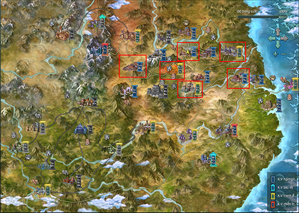
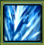
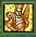
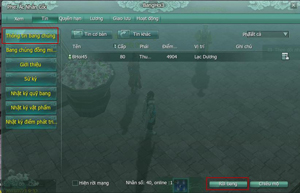
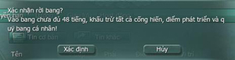
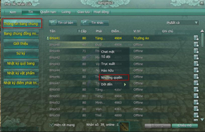
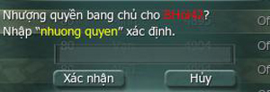
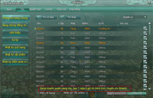

## Hướng dẫn

### Hướng dẫn tân thủ từ cấp 26-30

Hành tẩu trên giang hồ không thể thiếu sự trợ giúp từ các hảo hữu, chính vì thế [Bang hội](../he-thong/bang-hoi.md) thật sự luôn là chỗ dựa vững chắc cho các nhân sĩ có thể hành sự giúp đời. Với **đẳng cấp từ 26 - 30**, ngoài việc có thể tiến hành **lập Bang hội**, nhân sĩ cũng có thể tham gia các bí cảnh phù hợp để có thể nhận được nhiều phần thưởng hấp dẫn như trang bị, tu vi...

- Bản đồ phù hợp

- Bí cảnh phù hợp

- Kỹ năng có thể học

- Trang bị

#### Bản đồ phù hợp

  
 ***Khu vực khoanh vùng đỏ và vàng**(tên bản đồ xem bảng dưới)*

| **Bản đồ** | **Cấp** |
| --- | --- |
| Trường An | Cấp nhiệm vụ: 10 - 15, 25 - 27 Cấp quái: 11 - 15, 27 - 30 |
| Dương Châu | Cấp nhiệm vụ: 10 - 15, 25 - 30 Cấp quái: 11 - 15, 26 - 30 |
| Lạc Dương | Cấp nhiệm vụ: 10 - 15, 25 - 30 Cấp quái: 11 - 13, 26 - 29 |
| Lạc Đạo | Cấp nhiệm vụ: 30 - 45 Cấp quái: 29 - 45 |
| Phong Hoa Cốc | Cấp nhiệm vụ: 30 - 32, 39 - 45 Cấp quái: 30 - 32, 39 - 46 |
| Kim Thủy Trấn | Cấp nhiệm vụ: 30 - 36, 45 - 46 Cấp quái: 30 - 36, 45 - 47 |

#### Bí cảnh phù hợp

| **Bí cảnh** |
| --- |
| [Linh Tiêu Hiệp](../pho-ban/pho-ban-5-nguoi.md#linh-tiêu-hiệp) |

#### Kỹ năng có thể học

##### Chiêu thức

| **Môn phái** | **Chiêu thức** | **Môn phái** | Chiêu thức |
| --- | --- | --- | --- |
| **[Đường Môn](../mon-phai/duong-mon.md)** |  Xuyên Tâm Nỏ | **[Tàng Kiếm](../mon-phai/tang-kiem.md)** |  Kinh Đào |
|  Thiên Cơ Biến |  Oanh Minh Liễu |  |  |
|  Toàn Tâm Thích Cốt |  Phong Tháp Vân Cảnh |  |  |
| **[Vạn Hoa](../mon-phai/van-hoa.md)** |  Lan Thôi Ngọc Chiết | **[Ngũ Độc](../mon-phai/ngu-doc.md)** |  Thánh Hạt Dẫn |
|  Trường Châm |  Nữ Oa Vá Trời |  |  |
|  Bỉ Châm |  Thiềm Khiếu |  |  |
| **[Thất Tú](../mon-phai/that-tu.md)** |  Vũ Lâm Linh | **[Thuần Dương](../mon-phai/thuan-duong.md)** |  Cửu Chuyển Quy Nhất |
|  Giáng Long Châu Tụ |  Thiên Địa Vô Cực |  |  |
|  Đề Tham Long Tường |  Lăng Thái Hư |  |  |
|  Phong Tụ Đê Ngan |  Phá Khung Thương |  |  |
| **[Thiếu Lâm](../mon-phai/thieu-lam.md)** |  Nã Vân Thức | **[Minh Giáo](../mon-phai/minh-giao.md)** |  Giới Hỏa Trảm |
|  Kim Cương Nộ Mục |  Hàn Nguyệt Diệu |  |  |
| **[Thiên Sách](../mon-phai/thien-sach.md)** |  Từ Như Lâm | - | - |
|  Đột | - |  |  |

##### Kinh mạch

Ở cấp độ hiện tại nhân vật có thể tùy theo môn phái và hướng đi sau này mà có thể nâng 1 hoặc nhiều mạch cùng lúc:

| Tên mạch | Chức năng | Hình ảnh |
| --- | --- | --- |
| Đốc Mạch - Nha Môn | Tăng Ngự Kình |  |
| Đốc Mạch - Trung Xung | Khi bị đánh ngã phòng thủ nội, ngoại tăng 5% duy trì 6s. Hiệu quả 30 giây thi triển 1 lần |  |
| Đới Mạch - Thừa Linh | Cấp phá ngoại phòng +6 |  |
| Đới Mạch - Chính doanh | Tấn công ngoại + 50 |  |
| Xung Mạch - Âm Đô | Cấp phá nội phòng + 6 |  |
| Xung Mạch - Thạch Quan | Tấn công nội +100 |  |
| Nhâm Mạch - Tiền Đình | Thời gian điều chỉnh Nhiếp Vân Truy Nguyệt giảm |  |
| Nhâm Mạch - Trung Đình | Thi triển chiêu thức có 1% giúp người chơi này hồi phục 2% khí huyết trong 6 giây |  |

#### Trang bị nhận được

- Trang bị có thể nhận: Trắng, lục, lam, tím phẩm chất 40 - 50.

## Giải đáp thắc mắc

### Giải đáp thắc mắc từ cấp 26-30

Tham gia bí cảnh là một trong những hoạt động hấp dẫn và đặc sắc tại Võ Lâm 3. Nếu muốn vượt qua bí cảnh, chư vị sẽ phải đạt đủ đẳng cấp yêu cầu và có những người bằng hữu phối hợp ăn ý. Để hiểu rõ hơn về hoạt động thú vị này, thân mời quý nhân sĩ cùng tham khảo **những thông tin về bí cảnh** như sau:

- Lập Bang hội

- Tham gia bí cảnh

- Thoát khỏi bí cảnh

- Tái lập bí cảnh

- Rời khỏi Bang hội

#### Hướng dẫn lập Bang hội

- **Điều kiện:**  Đạt đẳng cấp 30. Cần 30 Vàng.

- Hướng dẫn lập Bang hội:  Bấm phím "M" để mở bản đồ. Chọn ô Bang hội để hiện vị trí NPC. Tìm **NPC Huyền Tự Nhị Nhất** để lập Bang hội.

#### Tham gia bí cảnh

##### Các loại bí cảnh

- Nhấp vào biểu tượng quyển lịch ở góc phải màn hình để mở bảng bí cảnh.

- Mỗi bí cảnh sẽ có các yêu cầu về cấp độ khác nhau, nhân sĩ có thể lựa chọn bí cảnh phù hợp với đẳng cấp của mình hoặc tham khảo tại đây.

##### Di chuyển từ bản đồ

- Bấm phím **M** mở bản đồ để quan sát vị trí bí cảnh.

- Các loại bí cảnh đều có biểu tượng hình quyển sách đang mở và tên bí cảnh bên cạnh.

##### Di chuyển bằng Thần Hành Thiên Lý

- Sử dụng kỹ năng Thần Hành Thiên Lý để mở bản đồ khu vực di chuyển.

- Có thể chọn trực tiếp đến cổng bí cảnh trên bản đồ thế giới. Các bí cảnh có màu là các bí cảnh có thể di chuyển, bí cảnh màu đen ẩn đi là những bí cảnh chưa đủ đẳng cấp.

- Có thể kéo chuột trên bản đồ để xem thông tin yêu cầu và tên bí cảnh.

##### Cổng vào bí cảnh

- Vào bằng **cổng ánh sáng**:  Đến vị trí bí cảnh có thể quan sát xung quanh tìm một hang động đang phát sáng.  Đi vào sẽ xuất hiện bảng thông tin tiến vào bí cảnh. 

- Vào bằng **NPC tương ứng**:  Một số bí cảnh sẽ có NPC để di chuyển đến bản đồ bí cảnh. Ví dụ: **[Đảo Vô Diêm](../pho-ban/pho-ban-5-nguoi.md#đảo-vô-diêm)**.  Đối thoại với NPC sẽ xuất hiện bảng thông tin tiến vào bí cảnh. 

#### Thoát khỏi bí cảnh

Trong quá trình tham gia bí cảnh, nếu nhân sĩ muốn thoát ra khỏi bí cảnh hiện tại có thể thử các cách như sau:

| Hình ảnh | Ghi chú |
| --- | --- |
|  | **Cách 1**: Đối thoại cùng NPC trong bí cảnh. |
|  | **Cách 2**: Di chuyển vào quần sáng để ra ngoài. |
|  | **Cách 3**: Rời khỏi tổ đội hiện tại. |
|  | **Cách 4**: Sử dụng kỹ năng Tự Tuyệt [Kinh Mạch](../he-thong/kinh-mach.md) để trở về đầu bí cảnh. |
|  | **Cách 4**: Sử dụng kỹ năng Thần Hành Thiên Lý để di chuyển đến một bản đồ bất kỳ. |

#### Tái lập bí cảnh

- Sau khi hoàn thành bí cảnh, nhân sĩ cần phải tái lập lại bí cảnh đó để có thể tiếp tục tham gia, nếu không các NPC trong bí cảnh sẽ không xuất hiện.

- **Lưu ý:** Thành viên chưa tái lập bí cảnh trong tổ đội sẽ xuất hiện ở một bản đồ khác so với các thành viên đã tái lập.

| Hình ảnh | Ghi chú |
| --- | --- |
|  | Nhấp vào biểu tượng quyển lịch phía trên bản đồ nhỏ. |
|  | Vào mục Bí Cảnh và kéo thanh trượt để chọn bí cảnh, nhấp vào nút mũi tên bên phải để tái lập. |
|  | Tái lập bí cảnh sẽ tiêu hao thể lực. |
|  | Bí cảnh đã tái lập sẽ có tiến độ là 0 và không thể tiến hành tái lập nếu chưa hoàn thành. |

#### Rời khỏi Bang hội

##### Thành viên

| Hình ảnh | Ghi chú |
| --- | --- |
|  | Mở giao diện Bang hội, chọn mục thông tin Bang chúng. |
|  | Bấm chọn **"Rời bang"**để ra khỏi Bang hội, một thông báo sẽ hiển thị yêu cầu nhân sĩ xác nhận. |

**Lưu ý**: Nếu nhân sĩ gia nhập Bang chưa đủ 48 tiếng mà rời khỏi sẽ bị trừ tất cả cống hiến, điểm phát triển và quỹ bang cá nhân.

##### Bang chủ

| Hình ảnh | Ghi chú |
| --- | --- |
|  | Bang chủ muốn rời khỏi Bang hội thì trước tiên phải nhượng quyền lại cho thành viên khác. |
|  | Xác nhận bằng cách nhập "**nhuong quyen**" vào ô thông báo. |
|  | Sau khi nhượng quyền cần phải đợi 07 ngày để hoàn toàn chuyển quyền Bang chủ cho người khác. |

Nguồn: VNG (bài viết và hình ảnh)
