## Hướng dẫn

### Hướng dẫn tân thủ từ cấp 31-47

Lãnh hội các chiêu thức tuyệt kỹ từ môn phái luôn là niềm ao ước của rất nhiều nhân sĩ võ lâm, và với **đẳng cấp từ 31 - 47**, các nhân sĩ sẽ được lĩnh ngộ rất nhiều chiêu thức đẹp và đầy "sát khí" từ thầy dạy võ của [cửu đại môn phái](../mon-phai/cuu-dai-mon-phai.md), đó chính là những hành trang không thể thiếu để các anh hùng hào kiệt có thể thế thiên hành đạo, diệt gian trừ ác.

- Bản đồ phù hợp

- Bí cảnh phù hợp

- Kỹ năng có thể học

- Trang bị

#### Bản đồ phù hợp

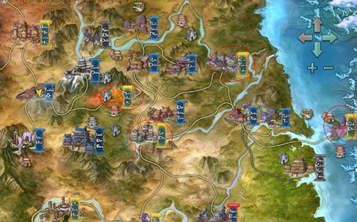  
 ***Khu vực khoanh vùng đỏ**(tên bản đồ xem bảng dưới)*

| **Bản đồ** | **Cấp** |
| --- | --- |
| Phong Hoa Cốc | Cấp nhiệm vụ: 30 - 32, 39 - 45. Cấp quái: 30 - 32, 39 - 46. |
| Lạc Đạo | Cấp nhiệm vụ: 30 - 45. Cấp quái: 29 - 45. |
| Kim Thủy Trấn | Cấp nhiệm vụ: 30 - 37, 45 - 46. Cấp quái: 30 -36, 45 - 47. |
| Khấu Đảo | Cấp nhiệm vụ: 32 - 34, 46 - 48. Cấp quái: 32 - 33, 47 - 48 |

#### Bí cảnh phù hợp

| **Bí cảnh** | **Ghi chú** |
| --- | --- |
| [Linh Tiêu Hiệp](../pho-ban/pho-ban-5-nguoi.md#linh-tiêu-hiệp) | Vị trí: [Thiếu Lâm](../mon-phai/thieu-lam.md). Cấp tối thiểu: 28. |
| [Đảo Vô Diêm](../pho-ban/pho-ban-5-nguoi.md#đảo-vô-diêm) | Vị trí: [Thất Tú](../mon-phai/that-tu.md). Cấp tối thiểu: 36. |
| [Địch Hoa Cung Tiền Sơn](../pho-ban/pho-ban-5-nguoi.md#địch-hoa-cung-tiền-sơn) | Vị trí: Phong Hoa Cốc. Cấp tối thiểu: 44. |
| [Nhật Luân Sơn Thành](../pho-ban/pho-ban-5-nguoi.md#nhật-luân-sơn-thành) | Vị trí: Khấu Đảo. Cấp tối thiểu: 44. |

#### Kỹ năng có thể học

##### Chiêu thức

- **[Ngũ Độc](../mon-phai/ngu-doc.md)**

- **[Minh Giáo](../mon-phai/minh-giao.md)**

- **Thất Tú**

- **[Vạn Hoa](../mon-phai/van-hoa.md)**

- **[Thuần Dương](../mon-phai/thuan-duong.md)**

- **[Tàng Kiếm](../mon-phai/tang-kiem.md)**

- **[Thiên Sách](../mon-phai/thien-sach.md)**

- **[Đường Môn](../mon-phai/duong-mon.md)**

- **Thiếu Lâm**

##### Kinh mạch

Ở cấp độ hiện tại, nhân sĩ có thể nâng tiếp tục các [kinh mạch](../he-thong/kinh-mach.md) sau:

| Đẳng cấp | Hình ảnh |
| --- | --- |
| 35 | 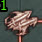 Đới Mạch - Não Không |
| 35 | 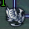 Xung Mạch - Thâm Cốc |
| 35 | 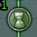 Nhâm Mạch - Yến Khẩu |

#### Trang bị nhận được

- **Trang bị từ nhiệm vụ**: Vật phẩm xanh lá, xanh dương phẩm chất 30 - 47.

- **Trang bị từ bí cảnh**: Vật phẩm xanh dương phẩm chất 40 - 60.

## Giải đáp thắc mắc

### Giải đáp thắc mắc từ cấp 31-47

Tham gia bí cảnh là một trong những hoạt động hấp dẫn và đặc sắc tại Võ Lâm 3. Nếu muốn vượt qua bí cảnh, chư vị sẽ phải đạt đủ đẳng cấp yêu cầu và có những người bằng hữu phối hợp ăn ý. Để hiểu rõ hơn về hoạt động thú vị này, thân mời quý nhân sĩ cùng tham khảo **những thông tin về bí cảnh** như sau:

#### Tham gia bí cảnh

##### Các loại bí cảnh

- Nhấp vào biểu tượng quyển lịch ở góc phải màn hình để mở bảng bí cảnh.

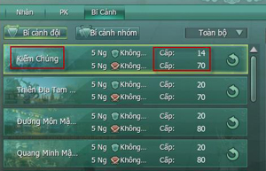

- Mỗi bí cảnh sẽ có các yêu cầu về cấp độ khác nhau, nhân sĩ có thể lựa chọn bí cảnh phù hợp với đẳng cấp của mình hoặc tham khảo tại đây.

##### Di chuyển từ bản đồ

- Bấm phím **M** mở bản đồ để quan sát vị trí bí cảnh.

- Các loại bí cảnh đều có biểu tượng hình quyển sách đang mở và tên bí cảnh bên cạnh.

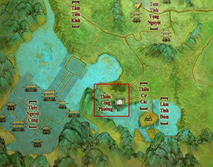

##### Di chuyển bằng Thần Hành Thiên Lý

- Sử dụng kỹ năng Thần Hành Thiên Lý để mở bản đồ khu vực di chuyển.

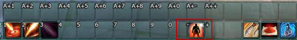

- Có thể chọn trực tiếp đến cổng bí cảnh trên bản đồ thế giới. Các bí cảnh có màu là các bí cảnh có thể di chuyển, bí cảnh màu đen ẩn đi là những bí cảnh chưa đủ đẳng cấp.

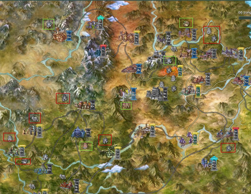

- Có thể kéo chuột trên bản đồ để xem thông tin yêu cầu và tên bí cảnh.

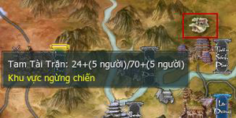

##### Cổng vào bí cảnh

- Vào bằng **cổng ánh sáng**:  Đến vị trí bí cảnh có thể quan sát xung quanh tìm một hang động đang phát sáng. 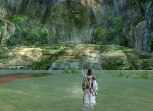 Đi vào sẽ xuất hiện bảng thông tin tiến vào bí cảnh. 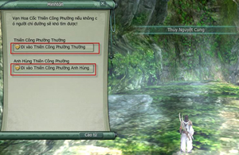

- Vào bằng **NPC tương ứng**:  Một số bí cảnh sẽ có NPC để di chuyển đến bản đồ bí cảnh. Ví dụ: **Đảo Vô Diêm**. 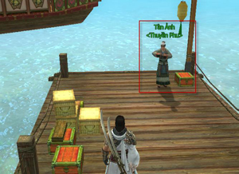 Đối thoại với NPC sẽ xuất hiện bảng thông tin tiến vào bí cảnh. 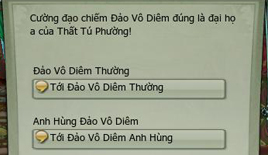

#### Thoát khỏi bí cảnh

Trong quá trình tham gia bí cảnh, nếu nhân sĩ muốn thoát ra khỏi bí cảnh hiện tại có thể thử các cách như sau:

| Hình ảnh | Ghi chú |
| --- | --- |
| 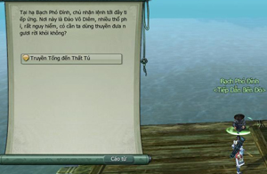 | **Cách 1**: Đối thoại cùng NPC trong bí cảnh. |
| 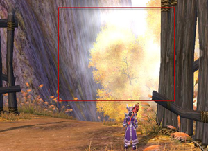 | **Cách 2**: Di chuyển vào quần sáng để ra ngoài. |
| 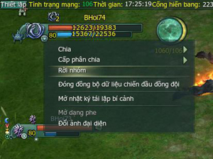 | **Cách 3**: Rời khỏi tổ đội hiện tại. |
| 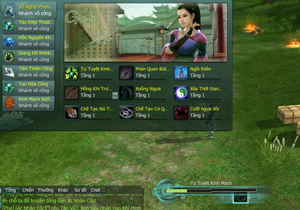 | **Cách 4**: Sử dụng kỹ năng Tự Tuyệt Kinh Mạch để trở về đầu bí cảnh. |
| 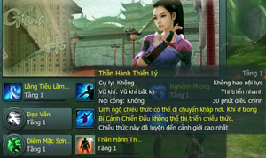 | **Cách 4**: Sử dụng kỹ năng Thần Hành Thiên Lý để di chuyển đến một bản đồ bất kỳ. |

#### Tái lập bí cảnh

- Sau khi hoàn thành bí cảnh, nhân sĩ cần phải tái lập lại bí cảnh đó để có thể tiếp tục tham gia, nếu không các NPC trong bí cảnh sẽ không xuất hiện.

- **Lưu ý:** Thành viên chưa tái lập bí cảnh trong tổ đội sẽ xuất hiện ở một bản đồ khác so với các thành viên đã tái lập.

| Hình ảnh | Ghi chú |
| --- | --- |
| 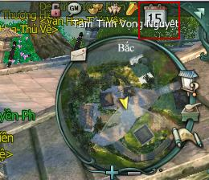 | Nhấp vào biểu tượng quyển lịch phía trên bản đồ nhỏ. |
| 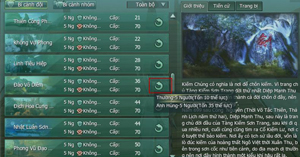 | Vào mục Bí Cảnh và kéo thanh trượt để chọn bí cảnh, nhấp vào nút mũi tên bên phải để tái lập. |
| 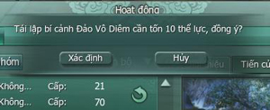 | Tái lập bí cảnh sẽ tiêu hao thể lực. |
| 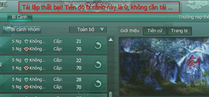 | Bí cảnh đã tái lập sẽ có tiến độ là 0 và không thể tiến hành tái lập nếu chưa hoàn thành. |

Nguồn: VNG (bài viết và hình ảnh)
