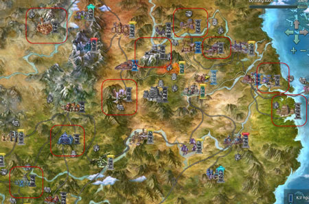
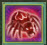
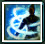
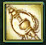
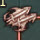
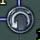
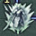

## Hướng dẫn

### Hướng dẫn tân thủ từ cấp 48-50

Cũng như các chiêu thức nhận được từ [cửu đại môn phái](../mon-phai/cuu-dai-mon-phai.md), từ xưa [kinh mạch](../he-thong/kinh-mach.md) luôn là một phần không thể thiếu đối với các bậc tiền nhân khi bôn tẩu giang hồ, kinh mạch càng cao thì cơ thể càng phát huy khả năng lĩnh ngộ võ học.

Với**cấp độ từ 48 - 50**, nhân sĩ có thể nhận được rất nhiều sức mạnh tiềm ẩn từ kinh mạch như: Đới Mạch – Quang Minh, Xung Mạch – U Môn, Đốc Mạch – Bách Hội...

- Bản đồ phù hợp

- Bí cảnh phù hợp

- Kỹ năng có thể học

- Trang bị

- Hoạt động tham gia

#### Bản đồ phù hợp

  
 ***Khu vực khoanh vùng đỏ**(tên bản đồ xem bảng dưới)*

| **Bản đồ** | **Cấp** |
| --- | --- |
| [Minh Giáo](../mon-phai/minh-giao.md) | Cấp nhiệm vụ: 49 - 50. Cấp quái: 49 - 50. |
| [Đường Môn](../mon-phai/duong-mon.md) | Cấp nhiệm vụ: 49 - 50. Cấp quái: 49 - 50. |
| [Ngũ Độc](../mon-phai/ngu-doc.md) | Cấp nhiệm vụ: 49 - 50. Cấp quái: 49 - 50. |
| [Tàng Kiếm](../mon-phai/tang-kiem.md) Sơn Trang | Cấp nhiệm vụ: 48 - 50. Cấp quái: 15 - 25. |
| [Thuần Dương](../mon-phai/thuan-duong.md) Phái | Cấp nhiệm vụ: 48 - 50. Cấp quái: 47 - 48. |
| [Thiên Sách](../mon-phai/thien-sach.md) Phủ | Cấp nhiệm vụ: 48 - 50. Cấp quái: 48 - 50. |
| [Thất Tú](../mon-phai/that-tu.md) | Cấp nhiệm vụ: 48 - 50. Cấp quái: 48 - 49. |
| [Vạn Hoa](../mon-phai/van-hoa.md) Cốc | Cấp nhiệm vụ: 48 - 50. Cấp quái: 48 - 49. |
| [Thiếu Lâm](../mon-phai/thieu-lam.md) | Cấp nhiệm vụ: 48 - 50. Cấp quái: 48 - 50. |

#### Bí cảnh phù hợp

| **Bí cảnh** | **Ghi chú** |
| --- | --- |
| [Phong Vũ Đạo Hương Thôn](../pho-ban/pho-ban-5-nguoi.md#phong-vũ-đạo-hương-thôn) | Vị trí: Lạc Dương. Cấp tối thiểu: 50. Thông tin chi tiết tại đây. |

#### Kỹ năng có thể học

##### Chiêu thức môn phái

| Môn phái | Chiêu thức | Môn phái | Chiêu thức |
| --- | --- | --- | --- |
| **Minh Giáo** |  Bố Úy Ám Hình | **Thất Tú** |  Nguyệt Hoa Khuynh Tà |
|  Vô Minh Hồn |  Lân Ly Khúc |  |  |
| **Đường Môn** |  Đoạn Hồn Sa | **Vạn Hoa** |  Bích Thủy Thao Thiên |
|  Phi Tinh Độn |  Phù Hoa Lãng Nhụy |  |  |
| **Ngũ Độc** |  Thiên Thù Dẫn | **Thiên Sách** |  Thủ Như Sơn |
| **Thuần Dương** |  Thao Quang | **Thiếu Lâm** |  Hằng Hà Kiếp Sa |
|  Trấn Sơn Hà |  Cầm Long Quyết |  |  |
|  Chuyển Càn Khôn | - | - |  |

##### Chiêu thức kinh mạch

Ở cấp độ hiện tại, nhân sĩ có thể nâng tiếp tục các kinh mạch sau:

| Tên mạch | Chức năng | Chiêu thức tương ứng |
| --- | --- | --- |
|  Đới Mạch – Quang Minh | Lĩnh hội chiêu thức có thể thiết lập lại thời gian điều tức Thiên Sách Thủ Như Sơn, Thuần Dương Thao Quang Dưỡng Hối, Tàng Kiếm Phong Lai Ngô Sơn, Đường Môn Kinh Hồng Du Long |  |
|  Đới Mạch – Huyền Chung | Lĩnh hội chiêu thức giúp tối đa 05 mục tiêu trong 6 thước không thể vận công, duy trì 04 giây |  |
|  Đới Mạch – Ngoại Khưu | Lĩnh hội chiêu thức, trong vòng 05 giây giúp bản thân chiêu thức ngoại công tiếp theo nhất định chí mạng |  |
|  Xung Mạch – U Môn | Lĩnh ngộ chiêu thức, có thể thiết lập lại thời gian điều tức của Thuần Dương Trấn Sơn Hà, Thất Tú Mãn Đường Thế, Vạn Hoa Thủy Nguyệt Vô Gian, Thiếu Lâm Đoàn Cốt Quyết, Ngũ Độc triệu hồi thú cưng, Đường Môn Tập Trung, Minh Giáo Quang Minh Tương |  |
|  Xung Mạch – Thái Ất | Lĩnh ngộ chiêu thức, khiến tối đa 05 mục tiêu phạm vi 6 thước tốc độ di chuyển -50%, duy trì 08 giây |  |
|  Xung Mạch – Quan Môn | Lĩnh ngộ chiêu thức, trong 06 giây giúp bản that chiêu thức nội công tiếp theo nhất định chí mạng |  |
|  Đốc Mạch – Nảo Hộ | Lĩnh hội chiêu thức giúp bản thân cấp phòng thủ ngoại +10%, khí huyết tối đa +10%, duy trì 15 phút |  |
|  Đốc Mạch – Hậu Đỉnh | Lĩnh hội chiêu thức giúp bản thân hóa giải sát thương 1.000 điểm, duy trì 10 giây |  |
|  Đốc Mạch – Phong Phù | Lĩnh hội chiêu thức giúp bản thân không giới hạn di chuyển, duy trì 10 giây |  |
|  Đốc Mạch – Bách Hội | Lĩnh hội chiêu thức, trong 06 giây mỗi giây phục hồi tối đa 05% khí huyết |  |
|  Nhâm Mạch – Thần Khuyết | Lĩnh ngộ chiêu thức có thể thiết lập thời gian điều tức Vạn Hoa Bích Thủy Thao Thiên, Thất Tú Phong Tụ Đê Ngang, Ngũ Độc Thiên Điệp Thổ Nhụy |  |

#### Hoạt động có thể tham gia

- **Hoạt động quán trà thành chính**: Chi tiết tại đây.

- **[Khoa cử](../he-thong/khoa-cu.md)**: Chi tiết tại đây.

- **Nhà ăn [Bang hội](../he-thong/bang-hoi.md)**: Chi tiết tại đây.

- **Chăm chỉ luyện tập**: Chi tiết tại đây.

- **Nhiệm vụ ngẫu nhiên môn phái**: Chi tiết tại đây.

#### Trang bị nhận được

- **Phong Vũ Đạo Hương Thôn**:  Vũ khí xanh lam phẩm chất 58. Trang bị xanh lam phẩm chất 58. Vũ khí tím phẩm chất 64.

- **Nhiệm vụ**: Trang bị trắng và xanh lá phẩm chất 40 - 60.

Nguồn: VNG (bài viết và hình ảnh)
