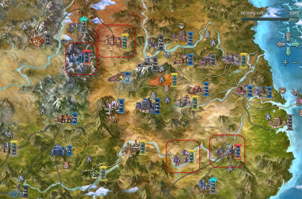
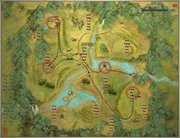
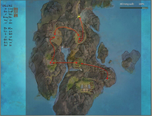

## Hướng dẫn

### Hướng dẫn tân thủ từ cấp 51-66

Bí cảnh [Phong Vũ Đạo Hương Thôn](../pho-ban/pho-ban-5-nguoi.md#phong-vũ-đạo-hương-thôn) và [Thiên Tử Phong](../pho-ban/pho-ban-5-nguoi.md#thiên-tử-phong) chính là những thử thách thật sự với các nhân sĩ khi đạt **đẳng cấp 51 - 66**, nếu không có sự đồng lòng cùng những trang bị tốt sẽ rất khó để các nhân sĩ có thể chinh phục. Ngoài những bí cảnh trên, quý nhân sĩ cũng có thể tiếp tục rèn luyện kỹ năng của mình tại các bản đồ phù hợp và nhiệm vụ hàng ngày như **chăm chỉ luyện tập**, **nhiệm vụ quán trà...**

- Bản đồ phù hợp

- Bí cảnh phù hợp

- Trang bị

- Hoạt động tham gia

#### Bản đồ phù hợp

  
 ***Khu vực khoanh vùng đỏ**(tên bản đồ Chi tiết bảng dưới)*

| **Bản đồ** | **Cấp** |
| --- | --- |
| Ba Lăng Huyện | Cấp nhiệm vụ: 50 - 55, 58 - 60 Cấp quái: 50 - 55, 58 - 60 |
| Hoang Mạc Long Môn | Cấp nhiệm vụ: 50 - 58 Cấp quái: 50 - 58 |
| Côn Lôn | Cấp nhiệm vụ: 60 - 66, 68 - 70 Cấp quái: 58 - 65 |
| [Nam Bình Sơn](../he-thong/tran-doanh.md#loạn-chiến-nam-bình-sơn) | Cấp nhiệm vụ: 66 - 67 Cấp quái: 59 - 65, 70 |

#### Bí cảnh phù hợp

| **Bí cảnh** | **Ghi chú** |
| --- | --- |
|  **Phong Vũ Đạo Hương Thôn - Thường** | Vị trí: Lạc Dương Đẳng cấp yêu cầu: 50 Thông tin chi tiết |
|  **Thiên Tử Phong - Thường** | Vị trí: Nam Bình Sơn Đẳng cấp yêu cầu: 54 Thông tin chi tiết |

#### Hoạt động có thể tham gia

| **Hoạt động** | **Hướng dẫn** |
| --- | --- |
| Quán trà thành chính | Chi tiết |
| [Khoa cử](../he-thong/khoa-cu.md) | Chi tiết |
| Nhà ăn [Bang hội](../he-thong/bang-hoi.md) | Chi tiết |
| Chăm chỉ luyện tập | Chi tiết |
| Nhiệm vụ ngẫu nhiên môn phái | Chi tiết |
| Ngao du Cù Đường hái Tiên Thảo | Chi tiết |

#### Trang bị nhận được

- **Bí cảnh Phong Vũ Đạo Hương Thôn**:  Vũ khí và trang bị xanh lam (phẩm chất 58). Vũ khí tím (phẩm chất 64).

- **Bí cảnh Thiên Tử Phong**:  Vũ khí và trang bị xanh lam (phẩm chất 77). Trang bị tím (phẩm chất 77).

- **Nhiệm vụ**: Trang bị trắng và xanh lá, xanh lam (phẩm chất 50 - 65).

Nguồn: VNG (bài viết và hình ảnh)
