## Hướng dẫn

### Hướng dẫn tân thủ từ cấp 67-70

Nhằm giúp cho các nhân sĩ đang bôn tẩu Võ Lâm 3 thuận lợi hơn trong quá trình thăng cấp và tham gia **tính năng phù hợp với cấp độ từ 67 - 70**, Võ Lâm 3 xin gửi đến quý nhân sĩ một số thông tin hữu ích liên quan:

- Bản đồ phù hợp

- Bí cảnh phù hợp

- Trang bị

- Hoạt động tham gia

- Kỹ năng

#### Bản đồ phù hợp

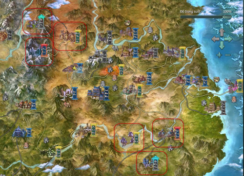  
 ***Khu vực khoanh vùng đỏ**(tên bản đồ Chi tiết bảng dưới)*

| **Bản đồ** | **Cấp** |
| --- | --- |
| Côn Lôn | Cấp nhiệm vụ: 60 - 66, 68 - 70 Cấp quái: 58 - 65 |
| [Nam Bình Sơn](../he-thong/tran-doanh.md#loạn-chiến-nam-bình-sơn) | Cấp nhiệm vụ: 66 - 67 Cấp quái: 59 - 65, 70 |
| Hạo Khí Minh | Cấp nhiệm vụ: 66 - 70 Cấp quái: 66 - 69 |
| Ác Nhân Cốc | Cấp nhiệm vụ: 66 - 70 Cấp quái: 66 - 69 |
| Cù Đường Hiệp | Cấp nhiệm vụ: 67 - 68 Cấp quái: 67 - 70 |

#### Bí cảnh phù hợp

| **Bí cảnh** | **Ghi chú** |
| --- | --- |
| **[Vô Lượng Cung](../pho-ban/pho-ban-5-nguoi.md#vô-lượng-cung) - Thường** | Vị trí: Vô Lượng Sơn Đẳng cấp yêu cầu: 70 |
| **[Hang Pháp Vương](../pho-ban/pho-ban-5-nguoi.md#hang-pháp-vương) - Thường** | Vị trí: Bạch Long Khẩu Đẳng cấp yêu cầu: 70 |
| **[Kiếm Chủng](../pho-ban/pho-ban-5-nguoi.md#kiếm-chủng) - Anh Hùng** | Vị trí: [Tàng Kiếm](../mon-phai/tang-kiem.md) Sơn Trang Đẳng cấp yêu cầu: 70 |
| **[Thiên Địa Tam Tài Trận](../pho-ban/pho-ban-5-nguoi.md#thiên-địa-tam-tài-trận) - Anh Hùng** | Vị trí: [Thiên Sách](../mon-phai/thien-sach.md) Phủ Đẳng cấp yêu cầu: 70 |
| **[Không Vụ Phong](../pho-ban/pho-ban-5-nguoi.md#không-vụ-phong) - Anh Hùng** | Vị trí: [Thuần Dương](../mon-phai/thuan-duong.md) Đẳng cấp yêu cầu: 70 |
| **[Thiên Công Phường](../pho-ban/pho-ban-5-nguoi.md#thiên-công-phường) - Anh Hùng** | Vị trí: [Vạn Hoa](../mon-phai/van-hoa.md) Cốc Đẳng cấp yêu cầu: 70 |
| **[Linh Tiêu Hiệp](../pho-ban/pho-ban-5-nguoi.md#linh-tiêu-hiệp) - Anh Hùng** | Vị trí: [Thiếu Lâm](../mon-phai/thieu-lam.md) Đẳng cấp yêu cầu: 70 |
| **[Đảo Vô Diêm](../pho-ban/pho-ban-5-nguoi.md#đảo-vô-diêm) - Anh Hùng** | Vị trí: [Thất Tú](../mon-phai/that-tu.md) Đẳng cấp yêu cầu: 70 |
| **[Địch Hoa Cung Tiền Sơn](../pho-ban/pho-ban-5-nguoi.md#địch-hoa-cung-tiền-sơn) - Anh Hùng** | Vị trí: Phong Hoa Cốc Đẳng cấp yêu cầu: 70 |
| **[Nhật Luân Sơn Thành](../pho-ban/pho-ban-5-nguoi.md#nhật-luân-sơn-thành) - Anh Hùng** | Vị trí: Khấu Đảo Đẳng cấp yêu cầu: 70 |
| **[Phong Vũ Đạo Hương Thôn](../pho-ban/pho-ban-5-nguoi.md#phong-vũ-đạo-hương-thôn) - Anh Hùng** | Vị trí: Hoang Mạc Long Môn Đẳng cấp yêu cầu: 70 |
| **[Thiên Tử Phong](../pho-ban/pho-ban-5-nguoi.md#thiên-tử-phong) - Anh Hùng** | Vị trí: Nam Bình Sơn Đẳng cấp yêu cầu: 70 |

#### Kỹ năng học được

| **Hình ảnh** | **Tên mạch** |
| --- | --- |
| 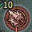 | **Đới Mạch - Long Huyền** |
| 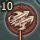 | **Đới Mạch - Khúc Tuyền** |
| 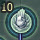 | **Xung Mạch - Hợp Dương** |
| 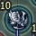 | **Xung Mạch - Cực Tuyền** |
| 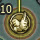 | **Đốc Mạch - Tinh Trung** |
| 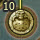 | **Đốc Mạch - Đài Kiên** |
| 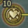 | **Đốc Mạch - Yêu Nhãn** |
| 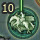 | **Nhâm Mạch - Khí Đoan** |
| 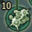 | **Nhâm Mạch - Sùng Cốt** |
| 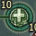 | **Nhâm Mạch - Thập Tuyên** |

#### Hoạt động có thể tham gia

| **Hoạt động** | **Hướng dẫn** |
| --- | --- |
| Quán trà thành chính | Chi tiết |
| [Khoa cử](../he-thong/khoa-cu.md) | Chi tiết |
| Nhà ăn [Bang hội](../he-thong/bang-hoi.md) | Chi tiết |
| Chăm chỉ luyện tập | Chi tiết |
| Nhiệm vụ ngẫu nhiên môn phái | Chi tiết |
| Ngao du Cù Đường hái Tiên Thảo | Chi tiết |

#### Trang bị nhận được

| Nguồn gốc | Trang bị |
| --- | --- |
| **Vô Lượng Cung - Thường** | Trang bị tím (phẩm chất 150) |
| **Hang Pháp Vương - Thường** | Trang bị tím (phẩm chất 155) |
| **Kiếm Chủng - Anh Hùng** | Trang bị tím (phẩm chất 130) |
| **Thiên Địa Tam Tài Trận - Anh Hùng** | Trang bị xanh (phẩm chất 100) |
| **Không Vụ Phong - Anh Hùng** |  |
| **Thiên Công Phường - Anh Hùng** |  |
| **Linh Tiêu Hiệp - Anh Hùng** |  |
| **Đảo Vô Diêm - Anh Hùng** |  |
| **Địch Hoa Cung Tiền Sơn - Anh Hùng** | Vũ khí tím (phẩm chất 120) Trang bị xanh (phẩm chất 115) |
| **Nhật Luân Sơn Thành - Anh Hùng** |  |
| **Phong Vũ Đạo Hương Thôn - Anh Hùng** |  |
| **Thiên Tử Phong - Anh Hùng** |  |
| **Nhiệm vụ** | Trang bị trắng & xanh lá, xanh lam (phẩm chất 60 - 80) |

## Giải đáp thắc mắc

### Giải đáp thắc mắc từ cấp 67-70

Trong thế giới Võ Lâm 3, bên cạnh việc kết giao bằng hữu, xây dựng Bang hội, quý nhân sĩ còn được lựa chọn tham gia một thế lực lớn trên giang hồ: Hạo Khí Minh hoặc Ác Nhân Cốc. Để hiểu thêm về **hệ thống phe và Bang hội**, quý nhân sĩ có thể tham khảo thông tin sau đây:

#### Rời khỏi Bang hội

##### Thành viên

| Hình ảnh | Ghi chú |
| --- | --- |
|  | Mở giao diện Bang hội, chọn mục thông tin Bang chúng. |
|  | Bấm chọn **"Rời bang"**để ra khỏi Bang hội, một thông báo sẽ hiển thị yêu cầu nhân sĩ xác nhận. |

**Lưu ý**: Nếu nhân sĩ gia nhập Bang chưa đủ 48 tiếng mà rời khỏi sẽ bị trừ tất cả cống hiến, điểm phát triển và quỹ bang cá nhân.

##### Bang chủ

| Hình ảnh | Ghi chú |
| --- | --- |
|  | Bang chủ muốn rời khỏi Bang hội thì trước tiên phải nhượng quyền lại cho thành viên khác. |
|  | Xác nhận bằng cách nhập "**nhuong quyen**" vào ô thông báo. |
|  | Sau khi nhượng quyền cần phải đợi 07 ngày để hoàn toàn chuyển quyền Bang chủ cho người khác. |

#### Gia nhập phe phái

##### Hạo Khí Minh

| Hình ảnh | Ghi chú |
| --- | --- |
| 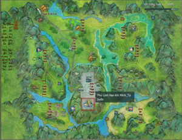 | Người chơi đạt **cấp 67** có thể đến bản đồ **Hạo Khí Minh** để gia nhập phe này. |
| 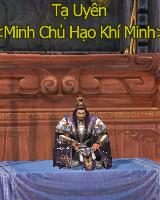 | Đối thoại cùng **NPC Tạ Uyên** để xin gia nhập phe. |

##### Ác Nhân Cốc

| Hình ảnh | Ghi chú |
| --- | --- |
| 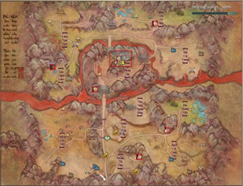 | Người chơi đạt đẳng **cấp 67** có thể đến bản đồ **Ác Nhân Cốc** để gia nhập phe này. |
| 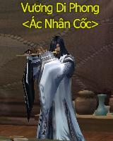 | Đối thoại cùng **NPC Vương Di Phong** để xin gia nhập phe. |

#### Cách bật/tắt PK phe phái

- Sau khi gia nhập phe, khi đến các bản đồ chiến đấu nhân sĩ có thể mở PK dạng phe để tiến hành chiến đấu cùng các nhân sĩ phe đối địch.

- Nhân sĩ có thể về lại các thành thị, hệ thống sẽ tự động chuyển về dạng bình thường sau thời gian nhất định.

| Hình ảnh | Ghi chú |
| --- | --- |
| 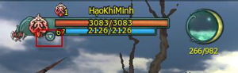 | Nhấp vào biểu tượng mũi tên tam giác dưới thanh trạng thái nhân vật. |
| 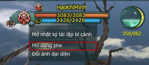 | Chọn Mở dạng phe để kích hoạt chức năng PK phe. |
| 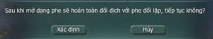 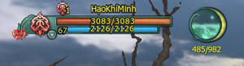 | Xác nhận mở chiến đấu dạng phe, biểu tượng phe sẽ đổi màu đỏ. |

Nguồn: VNG (bài viết và hình ảnh)
