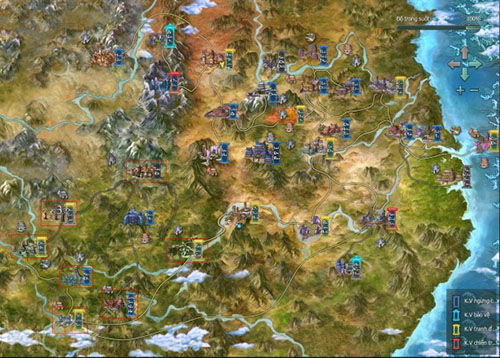
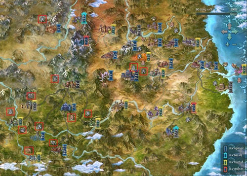

## Hướng dẫn

### Hướng dẫn tân thủ từ cấp 71-80

Nhằm giúp cho các nhân sĩ đang bôn tẩu Võ Lâm 3 thuận lợi hơn trong quá trình thăng cấp và tham gia **tính năng phù hợp với cấp độ từ 71 - 80**.

Sau đây, Võ Lâm 3 xin gửi đến quý nhân sĩ một số thông tin hữu ích liên quan đến các **bản đồ**, **bí cảnh**, **hoạt động hàng ngày**, **hoạt động khác** cùng các trang bị nhận được như **trang bị danh vọng**, trang bị [chiến trường](../he-thong/chien-truong.md), **trang bị nhiệm vụ**, trang bị danh kiếm, **trang bị Hoàng Kim**...

- Bản đồ phù hợp

- Bí cảnh phù hợp

- Trang bị

- Hoạt động tham gia

#### Bản đồ phù hợp

  
 ***Khu vực khoanh vùng đỏ**(tên bản đồ xem bảng dưới)*

| **Bản đồ** | **Cấp** |
| --- | --- |
| Vô Lượng Sơn | Cấp nhiệm vụ: 71 - 73 Cấp quái: 71 - 73 |
| Bạch Long Khấu | Cấp nhiệm vụ: 71 - 73 Cấp quái: 71 - 73 |
| [Ngũ Độc](../mon-phai/ngu-doc.md) | Cấp nhiệm vụ: 73 - 74 Cấp quái: 73 - 74 |
| Thành Đô | Cấp nhiệm vụ: 73 - 75 Cấp quái: 73 - 75 |
| Đầm Hắc Long | Cấp nhiệm vụ: 74 - 77 Cấp quái: 75 - 78 |
| Dung Thiêu Lĩnh | Cấp nhiệm vụ: 75 - 78 Cấp quái: 75 - 78 |
| Thương Sơn Nhĩ Hải | Cấp nhiệm vụ: 80 Cấp quái: 80 |

#### Bí cảnh phù hợp

  
 ***Khu vực khoanh vùng đỏ*** *(tên bí cảnh xem bảng dưới)*

| **Bí cảnh** | **Cấp** |
| --- | --- |
| [Tiên Tung Lâm](../pho-ban/pho-ban-5-nguoi.md#tiên-tung-lâm) | Thường: 72 Anh Hùng: 80 |
| [Tịch Diệt Sảnh](../pho-ban/pho-ban-5-nguoi.md#tịch-diệt-sảnh) | Thường: 75 Anh Hùng: 80 |
| [Độc Thần Điện](../pho-ban/pho-ban-5-nguoi.md#độc-thần-điện) | Thường: 76 Anh Hùng: 80 |
| [Đường Môn Mật Thất](../pho-ban/pho-ban-5-nguoi.md#đường-môn-mật-thất) | Anh Hùng: 80 |
| [Quang Minh Mật Đạo](../pho-ban/pho-ban-5-nguoi.md#quang-minh-mật-đạo) | Anh Hùng: 80 |
| Vô Lương Cung | Anh Hùng: 80 |
| [Hang Pháp Vương](../pho-ban/pho-ban-5-nguoi.md#hang-pháp-vương) | Anh Hùng: 80 |
| Địch Hoa Thánh Điện | Anh Hùng: 80 |
| [Long Uyên Trạch](../pho-ban/pho-ban-10-nguoi.md#long-uyên-trạch) | Anh Hùng: 80 |
| Động Địch Hoa | Anh Hùng: 80 |
| [Hồi Ức Trì Quốc Thiên Vương](../pho-ban/pho-ban-10-nguoi.md#hồi-ức-trì-quốc-thiên-vương) | Anh Hùng: 80 |
| [Chúc Long Điện](../pho-ban/pho-ban-10-nguoi.md#chúc-long-điện) | Anh Hùng: 80 |
| Hội Chiến [Đường Môn](../mon-phai/duong-mon.md) | Anh Hùng: 80 |
| [Hoàng Cung Nam Chiếu](../pho-ban/hoang-cung-nam-chieu.md) | Anh Hùng: 80 |

#### Hoạt động có thể tham gia

##### Hoạt động hàng ngày

| **Nội dung** |  |
| --- | --- |
| [Nơi Thí Luyện](../nhiem-vu/hoat-dong-hang-ngay.md#nơi-thí-luyện) | Đua ngựa - thi đấu |
| [Mỹ Nhân Đồ](../nhiem-vu/hoat-dong-hang-ngay.md#hoạt-động-mỹ-nhân-đồ) | Mỹ Nhân Đồ - [Tiềm Hành](../nhiem-vu/hoat-dong-hang-ngay.md#hoạt-động-tiềm-hành) |
| Bí cảnh ngày | Nhiệm vụ chung mỗi ngày |
| [Lệnh truy nã Ẩn Nguyên](../nhiem-vu/hoat-dong-hang-ngay.md#lệnh-truy-nã-ẩn-nguyên) Hội | Danh vọng - Vô Lượng Sơn |
| Danh vọng - Thương Sơn Nhĩ Hải | [Nhĩ Hải Đoạt Mã](../nhiem-vu/hoat-dong-hang-ngay.md#nhĩ-hải-đoạt-mã) |

##### Hoạt động khác

| **Nội dung** |  |
| --- | --- |
| Uy danh ngày | [Công Phòng Phe](../he-thong/tran-doanh.md#công-phòng-phe) |
| Thủ lĩnh nơi luyện cấp | [Lôi Đài](../he-thong/loi-dai.md) [Bang Hội](../he-thong/bang-hoi.md) |
| Chiến trường - Con đường tơ lụa | Chiến trường - Cổ Tam Quốc |
| Chiến trường - [Cửu Cung Kỳ Cốc](../he-thong/chien-truong.md#cửu-cung-kỳ-cốc) | Chiến trường - Thần Nông Nhân |
| Chiến trường - Vân Hồ Tiên Trì |  |

#### Trang bị nhận được

- **Trang bị nhiệm vụ**: Cấp 70 - 80, phẩm chất 170 - 280.

- **Trang bị danh vọng**:  Chúc Dung Điện: Cấp 72 - 80, phẩm chất 155 - 215. Tháp Nạp: Cấp 78-80, phẩm chất 170 - 215. Đại Lý Cung: Cấp 78 - 80, phẩm chất 170 - 215. Tàng Kinh Các: Cấp 80, phẩm chất 215. Bá Đao: Cấp 80, phẩm chất 215. Hiên Viên Xã: Cấp 72 - 80, phẩm chất 165 - 260. Bái Hỏa Giáo: Cấp 80, phẩm chất 210 - 265. Vương Gia Thiên Nam: Cấp 80, phẩm chất 210 - 265. Tháp Nạp Ly Hận: Cấp 80, phẩm chất 260 - 300. Đoàn Thị Sơn Thành: Cấp 80, phẩm chất 285 - 330.

- **Trang bị chiến trường**:  Hạo Khí Minh: Cấp 80, phẩm chất 255 - 280 - 310. Ác Nhân Cốc: Cấp 80, phẩm chất 255 - 280 -310.

- **Trang bị danh kiếm**:  Hạo Khí Minh: Cấp 80, phẩm chất 295 - 352. Ác Nhân Cốc: Cấp 80, phẩm chất 295 - 352. Trung lập: Cấp 80, phẩm chất 295 - 352.

- **Trang bị Hoàng Kim**: Cấp 80, phẩm chất 150 - 280.

Nguồn: VNG (bài viết và hình ảnh)
