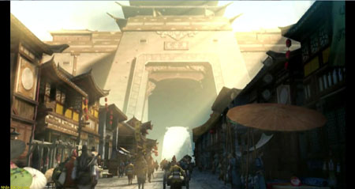

Tương truyền, Tần Thủy Hoàng – nhờ huyền cơ của viên Định Quốc Long Châu đã thâu tóm được giang sơn Tần quốc, trở thành Hoàng Đế đầu tiên trong lịch sử Trung Hoa. Nhưng không được bao lâu, bảo ngọc nơi mật thất Cung A Phòng bỗng dưng biến mất cùng viên thị vệ thân tín nhất của vua Tần. Kết cục, Tần Vương bị Tây Sở Bá Vương Hạng Vũ lật đổ. Long Châu vì thế mà lưu lạc nhân gian… Và đây cũng chính là nguyên nhân mở đầu cho một cuộc đại chiến về sau.

800 năm sau… Năm Thiên Bảo thứ 14, Trung Hoa phồn thịnh dưới sự cai trị của Đường Huyền Tông. Nhưng nội tình hỗn nguyên bất ổn, bắt nguồn từ dã tâm đánh chiếm Trường An của Tiết Độ Sứ An Lộc Sơn. Trong khi đó, trên giang hồ thế lực thực sự nắm giữ vận mệnh thiên hạ lại có Nhất giáo, Nhị minh, Tam ma, Tứ gia, Ngũ kiếm và Cửu phái.

Bấy giờ, đám sơn tặc núp bóng Ác Nhân Cốc đã gây nên biết bao tội ác. Do đó, Lục đại môn phái dẫn đầu là Tung Sơn [Thiếu Lâm](../mon-phai/thieu-lam.md) liên kết Hạo Khí Minh phát động Trường Không Lệnh thề xóa sổ Ác Nhân Cốc. Sự đối lập chính tà giữa 2 thế lực Nhị minh là Hạo Khí Minh và Ác Nhân Cốc ngày một gay gắt hơn. Nhất giáo - Hồng Y Giáo, Tứ gia - Tứ Đại Thế Gia cũng nhân đó mà không ngừng phô trương thanh thế, xưng danh giang hồ. Thiên hạ dần rơi vào thế cuộc loạn lạc phong ba.

Ở một nơi xa xôi - Đạo Hương Thôn Bắc Sơn, hậu duệ của người thị vệ vua Tần năm xưa đã quyết định đem viên Định Quốc Long Châu đến Tung Sơn giao cho thủ lĩnh Hạo Khí Minh nhằm mục đích bình định thiên hạ. Trên đường đi, họ bất ngờ bị bọn sơn tặc Ác Nhân Cốc truy đuổi. Người thiếu phụ cùng đứa trẻ được một hiệp khách cứu giúp nên thoát chết, nhưng viên Long Châu lại rơi xuống nơi vực thẳm hun hút. Một lần nữa, bí ẩn về viên Long Châu vẫn chưa được khai sáng.

Nhận được tin dữ, Hạo Khí Minh cùng [Cửu đại môn phái](../mon-phai/cuu-dai-mon-phai.md) liên tục phái người tìm kiếm Long Châu. Hồng Y Giáo, Ác Nhân Cốc, Tứ Đại Thế Gia cũng vào cuộc. Từ chốn thâm sơn cùng cốc, Tam Ma bất ngờ trở về Trung Nguyên với mưu đồ bí ẩn. Giang hồ vốn đã hỗn loạn, thị phi, nay lại thêm phần kinh động.

  
 *Đại Đường phồn thịnh nhưng dậy sóng tứ phương*  Vậy sức mạnh ẩn chứa trong viên Định Quốc Long Châu là gì? Và ai mới thật sự là người có cơ duyên để nắm giữ báu vật hiệu triệu thiên hạ? Một cuộc chiến mới lại bắt đầu …

Nguồn: VNG (bài viết và hình ảnh)
