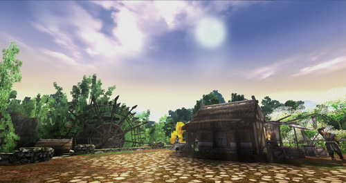
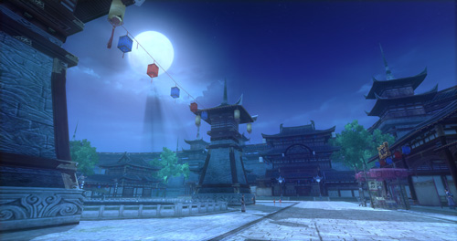
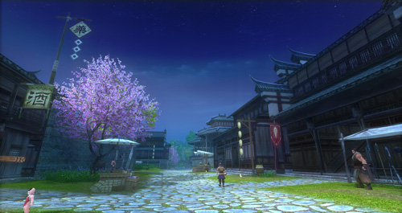
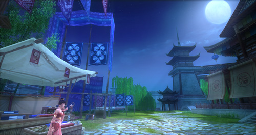
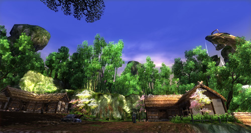

Võ Lâm 3 được đánh giá là một siêu phẩm trong hệ thống trò chơi nhập vai trực tuyến dòng 3D nói chung và dòng sản phẩm kiếm hiệp tình duyên (được biết đến qua các sản phẩm Võ Lâm Truyền Kỳ, Võ Lâm Truyền Kỳ II, Kiếm Thế) nói riêng. Chất lượng đồ họa trau chuốt, bối cảnh chi tiết cùng những góc xoay 360 độ hoàn hảo sẽ mang đến một phong cách chơi mới lạ, đặc sắc trong thể loại trò chơi kiếm hiệp. Khi tham gia trò chơi này, đồng đạo sẽ có dịp tìm hiểu thêm về thời kỳ Đường thịnh và thả mình cùng những cảnh sắc tuyệt vời của thế giới võ lâm rộng lớn.

 ***Thanh bình - thân thuộc đời thường*** Sự sáng tạo sắc nét nhưng không kém phần linh hoạt, uyển chuyển của các nhân vật đem đến cho người chơi những trải nghiệm hết sức sống động. Ngoài ra, sự đa dạng, phong phú về các chiêu thức võ công đã thể hiện được những nét tinh túy, độc đáo của hệ thống võ học chính tông.     Bên cạnh đó, việc tham gia hành tẩu giang hồ cùng các nhiệm vụ đậm chất kiếm hiệp cũng sẽ giúp cho đồng đạo có một cái nhìn khái quát về thời kỳ hào hùng của các cao thủ trong thế giới hiệp khách. Tinh thần nghĩa hiệp, đoàn kết, giúp đỡ lẫn nhau cũng được đề cao tối đa trong thế giới Võ Lâm 3. Cùng với kết cấu game hợp lý, đảm bảo sự cân bằng cho người chơi, Võ Lâm 3 hứa hẹn sẽ mang đến những trải nghiệm đặc biệt, hấp dẫn dành cho hiệp khách toàn coi võ lâm...

Nguồn: VNG (bài viết và hình ảnh)
