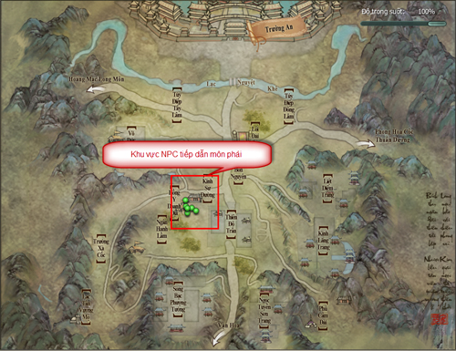
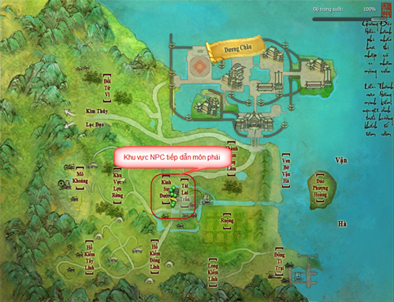
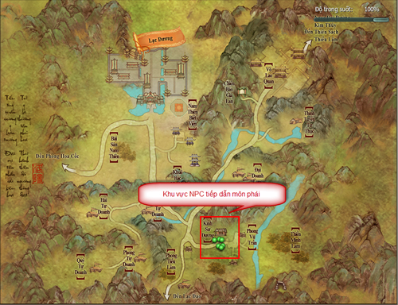

Khi sơ nhập giang hồ, chắc hẳn quý nhân sĩ sẽ không tránh khỏi những bỡ ngỡ ban đầu trước hệ thống nhiệm vụ đa dạng và phong phú của Võ Lâm 3, dẫn đến việc bỏ qua cơ hội gia nhập môn phái trong thời điểm thích hợp nhất.

Trong thế giới Võ Lâm 3, **khi đạt cấp 16 trở lên, quý nhân sĩ đã đủ yêu cầu gia nhập môn phái**. Khi đó, chư vị có thể lựa chọn tiếp tục thực hiện nhiệm vụ tại thành thị hoặc trực tiếp gia nhập môn phái mình yêu thích qua **NPC tiếp dẫn môn phái**tại các vị trí như sau:

*Xem lại hướng dẫn tân thủ bằng clip tại đây*.

- [Minh Giáo](../mon-phai/minh-giao.md)

- [Đường Môn](../mon-phai/duong-mon.md)

- [Ngũ Độc](../mon-phai/ngu-doc.md)

- [Tàng Kiếm](../mon-phai/tang-kiem.md)

- [Thiên Sách](../mon-phai/thien-sach.md)

- [Vạn Hoa](../mon-phai/van-hoa.md)

- [Thất Tú](../mon-phai/that-tu.md)

- [Thuần Dương](../mon-phai/thuan-duong.md)

- [Thiếu Lâm](../mon-phai/thieu-lam.md)

### Vị trí NPC tiếp dẫn môn phái

#### Trường An

#### Dương Châu

#### Lạc Dương

### Phim hướng dẫn

#### Minh Giáo

[Video](http://www.youtube.com/embed/PWLEBZKZzlg)

#### Đường Môn

[Video](http://www.youtube.com/embed/nWDRAOfxQn8)

#### Ngũ Độc

[Video](http://www.youtube.com/embed/_VCtafGAod8)

#### Tàng Kiếm

[Video](http://www.youtube.com/embed/dqb-bLQ-w1I)

#### Thiên Sách

[Video](http://www.youtube.com/embed/1Xj4PkikhuY)

#### Vạn Hoa

[Video](http://www.youtube.com/embed/cBuIHl5LFrw)

#### Thất Tú

[Video](http://www.youtube.com/embed/6q3UtZLreUY)

#### Thuần Dương

[Video](http://www.youtube.com/embed/S259zENGYqg)

#### Thiếu Lâm

[Video](http://www.youtube.com/embed/TSvzzaijIUo)

Hy vọng những thông tin này sẽ giúp chư vị có thể gia nhập môn phái yêu thích dễ dàng hơn, bắt đầu hành trình chinh phục thế giới kiếm hiệp tình duyên rộng lớn tại Võ Lâm 3.

Nguồn: VNG (bài viết và hình ảnh)
