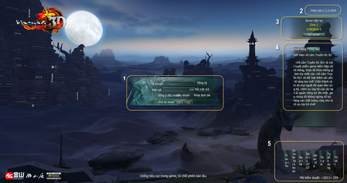
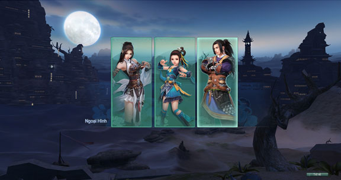
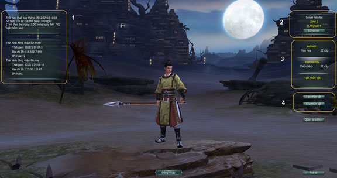
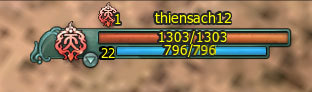
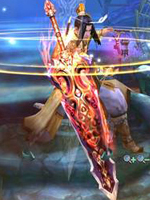
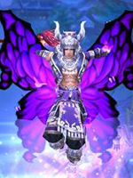
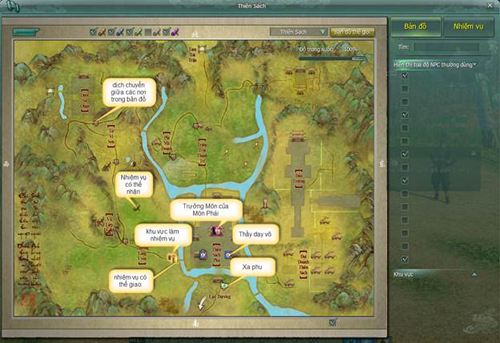
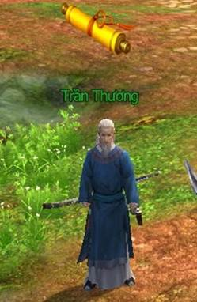
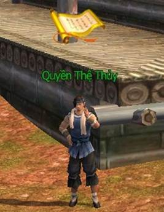
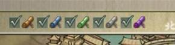

Hành trình tại những vùng đất mới luôn gặp nhiều khó khăn, bỡ ngỡ, những hướng dẫn tổng quát dưới đây sẽ giúp các quý nhân sĩ tham gia phiên bản Võ Lâm 3 sẽ dễ dàng hơn trong hành trình bôn tẩu giang hồ.

- Đăng nhập

- Nhân vật

- Môn phái

- Nhập phái

- Nhiệm vụ

- Bản đồ

### Giao diện đăng nhập

Chú thích

- (**1**) **Nhập tài khoản, mật khẩu**: Để tăng cường bảo mật, đồng đạo có thể mở bàn phím ảo để nhập mật khẩu. Chọn “Ghi nhớ tài khoản” để ghi nhớ tên đăng nhập và máy chủ thành công cuối cùng, nếu đồng đạo truy cập tại địa điểm internet công cộng thì tốt nhất không nên dùng chức năng này.

- (**2**) **Hiển thị phiên bản hiện tại**: Nếu phiên bản quá thấp thì đồng đạo cần nâng cấp mới có thể tham gia trò chơi, đồng đạo có thể chọn cập nhật tự động hoặc tải từ trang chủ.

- (**3**) **Xem xét các máy chủ hiện tại**: Có thể theo dõi tình hình các máy chủ hiện tại.

- (**4**) **Thông báo từ máy chủ đang bôn tẩu**: Hiển thị những thông báo từ máy chủ mà đồng đạo đang bôn tẩu.

- (**5**) **Các đường dẫn liên kết đến**: Trang chủ chính thức, xem các hình ảnh động, thoát khỏi trò chơi.

### Chọn nhân vật

- Có 3 kiểu hình nhân vật để nhân sĩ lựa chọn: **Anh Hùng, Kiều Nữ, Mộng Ly**.

Chú thích

- (**1**) **Thời gian còn lại** của tài khoản và thông tin lần đăng nhập cuối cùng.

- (**2**) **Chọn máy chủ**: Nếu muốn sát cánh hành tẩu cùng hảo bằng hữu thì đồng đạo nên xác định máy chủ trước khi vào trò chơi. Sẽ không thể nào gặp mặt nhau nếu như mọi người không cùng chung một máy chủ. Đồng đạo có thể tự do lựa chọn máy chủ nào mình thích để gia nhập.

- (**3**) **Cửa sổ chọn nhân vật**: Hiển thị nhân vật mà đồng đạo đã tạo trong máy chủ này trước đây, bao gồm thông tin tên, cấp độ, vị trí bản đồ. Trong trò chơi, mỗi tài khoản cho phép thiết lập 03 nhân vật.

- (**4**)**Nhấp chọn “Tạo nhân vật”** là có thể tiến vào giao diện tạo thêm nhân vật mới, ngoài ra tại giao diện này còn có thể tiến hành xóa bỏ nhân vật hoặc plugin (phần mềm hỗ trợ kèm).

#### Thuộc tính nhân vật

*Hình ảnh minh họa thanh năng lực nhân vật ([thuộc tính nhân vật](./thuoc-tinh-nhan-vat.md))*

- **Máu**: Giá trị máu phản ánh trực tiếp khả năng tồn tại của nhân vật. Nâng cao cấp độ, tăng thể chất, cộng trang bị, nội công, trận pháp đều có thể làm tăng thêm những trị số này.

- **Nội lực**: Nội lực của nhân vật đều đạt đến một giới hạn nhất định của cấp độ nhân vật. Phần lớn chiêu thức nhân vật thi triển đều cần tiêu hao một lượng nội lực nhất định. Nâng cao cấp độ, cộng trang bị, nội công, [kinh mạch](../he-thong/kinh-mach.md), trận pháp đều có thể làm tăng thêm trị số này.

- **Giao diện thuộc tính nhân vật**: Đồng đạo có thể nhấn phím C để mở giao diện thuộc tính nhân vật, kiểm tra xem điểm thuộc tính hiện thời của nhân vật, nhấn mũi tên chọn thuộc tính để hiển thị những thông tin thuộc tính của nhân vật như thuộc tính cơ bản, ngoại công công kích, nội công công kích, phòng ngự, phá phòng …

### Chọn môn phái

|  [Vạn Hoa](../mon-phai/van-hoa.md) |  [Thuần Dương](../mon-phai/thuan-duong.md) |  [Thiếu Lâm](../mon-phai/thieu-lam.md) |
| --- | --- | --- |
|  [Thất Tú](../mon-phai/that-tu.md) |  [Thiên Sách](../mon-phai/thien-sach.md) |  [Tàng Kiếm](../mon-phai/tang-kiem.md) |
|  [Ngũ Độc](../mon-phai/ngu-doc.md) |  [Đường Môn](../mon-phai/duong-mon.md) |  [Minh Giáo](../mon-phai/minh-giao.md) |

- Sau khi chọn môn phái nhân sĩ có thể tùy ý chọn hình tượng và đặt tên cho nhân vật.

Chú thích

- (**1**) **Chọn ngoại hình**: Đồng đạo có thể tự do chọn lựa nhiều kiểu tóc, hình dáng, mặt mũi và ngoại trang tân thủ. Đẩy cuộn trục chuột có thể kéo gần hoặc đẩy xa để xem rõ ngoại hình nhân vật hơn. Nếu như không quan trọng ngoại hình của nhân vật nhiều lắm, đồng đạo vẫn có thể chọn nút ấn "Ngẫu nhiên" để hệ thống giúp đồng đạo phối ngẫu nhiên cho nhân vật.

- (**2**) **Nhập tên nhân vật** hoặc đồng đạo cũng có thể chọn một tên ngẫu nhiên bằng cách nhấn vào ô “Ngẫu nhiên” bên cạnh.

- (**3**) **Các máy chủ hiện tại**: Tại đây đồng đạo có thể chuyển sang máy chủ khác để bôn tẩu mà không cần đăng nhập lại bằng cách nhấn vào ô “Đổi máy chủ”.

- (**4**) **Chọn thôn tân thủ**: Nhằm giúp đồng đạo trải nghiệm Võ Lâm 3 một cách thoải mái và thuận lợi, tân thủ thôn của trò chơi sử dụng cơ chế nhiều kênh máy chủ phụ, đồng đạo có thể chọn thôn tân thủ chỉ định hoặc để hệ thống sẽ tự động chọn giúp kênh thôn tân thủ thuận lợi nhất. Điều này có thể tránh được tình trạng quá đông tân thủ tham gia trò chơi làm ùn tắc giao thông và chen lấn nhiệm vụ.Một khi rời khỏi thôn tân thủ là chính thức bắt đầu cuộc phiêu lưu đầy thử thách, các nhân vật bôn tẩu cùng một máy chủ đều có thể gặp được nhau trên đường hành tẩu.

### Bản đồ trò chơi

| Bản đồ | Ghi chú |
| --- | --- |
|  | Nhân vật sử dụng phím tắt **M** để mở giao diện bản đồ đang đứng. Chọn vào các ô bên phải bản đồ để xuất hiện các biểu tượng chú thích trong bản đồ. |

### Nhận nhiệm vụ

| Bản đồ | Ghi chú |
| --- | --- |
|  | Chuột phải nhận nhiệm vụ. Nhân vật có thể nhận nhiệm vụ bằng cách xem trên bản đồ có các biểu tượng sách. |
|  | Chuột phải giao/hoàn thành nhiệm vụ. |
|  | Mở bản đồ và chọn vào các biểu tượng bên để nhiệm vụ sẽ xuất hiện trong bản đồ. **Màu vàng**: Nhiệm vụ thích hợp hiện tại. **Màu xanh dương**: Nhiệm vụ hằng ngày. **Màu xanh lá**: Nhiệm vụ cấp thấp. **Màu xám**: Đã vượt cấp so với nhiệm vụ đó. **Màu tím**: Nhiệm vụ hoạt động. |

### Gia nhập môn phái

- Sau khi nhân vật **đạt cấp độ 10 ở bản đồ Tân Thủ Thôn** sẽ nhận được nhiệm vụ **Nỗi Buồn Xa Xứ**.

- Nhân vật đến Xa Phu ở bản đồ Tân Thủ Thôn để di chuyển sang bản đồ khác khác.

- Tùy vào môn phái của nhân vật, xa phu sẽ đưa nhân vật đến 1 trong 3 thành chính: Dương Châu, Lạc Dương, Trường An.

- Khi nhân vật đạt đến **cấp độ 15** tại các thành chính thì có thể đối thoại với NPC Tiếp Dần Môn Phái để di chuyển đến môn phái.

- Đến môn phái nhân vật tiếp tục nhận nhiệm vụ sơ nhập môn phái để tiến hành bái sư và học kỹ năng môn phái.

Nguồn: VNG (bài viết và hình ảnh)
