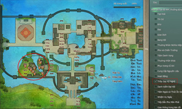
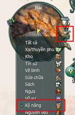
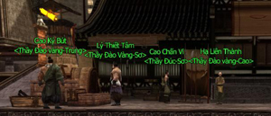
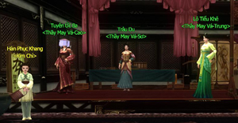
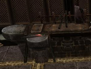
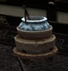

## Nâng cao kỹ nghệ

Hệ thống [kỹ nghệ](../he-thong/ky-nang-song.md) trong Võ Lâm 3 được phân bố đồng đều và đa dạng xoay quanh hai nhánh chính là chế tạo và thu thập. Nhất nghệ tinh - nhất thân vinh, chỉ cần đạt đến cấp độ đại sư của một kỹ nghệ bất kỳ, quý nhân sĩ sẽ trở thành những nhân vật phú quý vô song được vạn người ngưỡng mộ.

Sau đây là những **thông tin hướng dẫn về hệ thống kỹ nghệ**:

### Học kỹ nghệ

| Hình ảnh | Ghi chú |
| --- | --- |
|  | Bấm phím **M**và chọn vào khung Thầy Dạy Kỹ Nghệ sẽ xuất hiện khu vực NPC trong các thành thị lớn. |
|  | Ngoài ra có thể chọn vào biểu tượng la bàn trên bản đồ nhỏ để tìm NPC dạy kỹ năng trong bản đồ hiện tại. |
|    | Hình ảnh các thầy kỹ nghệ tại Lạc Dương. Hình 1: Rèn Đúc & Đào Vàng. Hình 2: Kỹ nghệ May Vá. Hình 3: Y Thuật và Thần Nông |

### Thu thập nguyên liệu

- Nhấp vào biểu tượng **Tìm** trên bản đồ nhỏ chọn loại nguyên liệu cần tìm.

- Các dụng cụ cần để thu thập nguyên liệu (có thể mua tại NPC Tạp Hóa):  Đào Vàng: Cuốc. Thần Nông: Xẻng. Bào Đinh: Dao.

- **Hình ảnh nguyên liệu**:

- Bào Đinh thuật chỉ sử dụng trên xác động vật.

- **Lưu ý**: Một số loại nguyên liệu quý hiếm chỉ rơi từ Bí Cảnh hoặc mở các loại rương bảo vật.

### Chế tạo

- Các kỹ nghệ chế tạo phải sử dụng ở những khu vực đặc biệt:  Rèn Đúc phải ở gần Bệ Đúc. Y Thuật phải đến gần Cối Thuốc. Nấu Nướng phải đến gần Bếp Lò.

| Rèn Đúc | Y Thuật | Nấu Nướng |
| --- | --- | --- |
|  |  |  |

- Bệ Đúc, Cối Thuốc, Bếp Lò thường ở gần các NPC Dạy Kỹ Nghệ - Sơ.

- Kỹ nghệ May Vá có thể chế tạo ở địa điểm bất kỳ.

- **Tinh lực & Thể lực**:  Chế tạo sẽ tiêu hao tinh lực. Thu thập sẽ tiêu hao thể lực.

### Nâng cấp & xóa bỏ kỹ nghệ

- Khi các kỹ năng thu thập/chế tạo đạt đẳng cấp yêu cầu có thể nâng cấp:  Kỹ nghệ Trung: Yêu cầu thu thập đạt cấp 25, học tại NPC Thầy Dạy Kỹ Nghệ - Trung. Kỹ nghệ Cao: Yêu cầu thu thập đạt cấp 45, học tại NPC Thầy Dạy Kỹ Nghệ - Cao. Kỹ nghệ Đại Sư: Yêu cầu thu thập đạt cấp 70, học tại NPC Thầy Dạy Kỹ Nghệ - Cao.

- **Lưu ý**: Tối đa 01 kỹ nghệ đạt cấp Đại Sư .

- **Xóa bỏ kỹ nghệ**: Có thể xóa bỏ kỹ nghệ đã học tại NPC Điền Thành Bại.

Nguồn: VNG (bài viết và hình ảnh)
