Thế giới Võ Lâm 3 rộng lớn luôn chứa đựng những điều thú vị và bất ngờ. Là những nhân vật đầu tiên được các hiệp khách diện kiến, hệ thống NPC ở các thôn và thành thị luôn hỗ trợ và đồng hành cùng quý hiệp khách trong suốt hành trình ngao du sơn thủy. Các NPC có vai trò cụ thể như sau:

| Biểu tượng NPC | Chức năng |
| --- | --- |
|  Nhận nhiệm vụ | Hiệp khách đối thoại với NPC này có thể nhận được 1 hoặc nhiều nhiệm vụ. |
|  Trả nhiệm vụ | Sau khi hoàn thành nhiệm vụ, hiệp khách đối thoại với NPC này để trao trả và nhận được phần thưởng từ nhiệm vụ. |
| 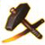 Cửa hàng vũ khí | Hiệp khách có thể mua bán, tu sửa trang bị hoặc mua 1 số vật phẩm chỉ định. |
| 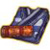 Cửa hàng trang phục | Hiệp khách có thể mua bán, tu sửa trang phục hoặc mua 1 số vật phẩm chỉ định. |
| 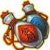 Lang trung | Nơi cung cấp dược phẩm trị liệu hoặc thuốc nội lực phục hồi cho nhân vật. |
| 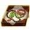 Cửa hàng trang sức | Nơi bán trang sức cao cấp, phối phương và đồ trang sức đeo trên người nhân vật. |
| 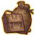 Cửa hàng túi đeo | Nơi bán các loại túi đeo tăng thêm sức chứa của hành trang nhân vật. |
| 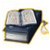 Dạy học tiên sinh | Nơi bán các loại văn phòng phẩm dùng cho việc ghi chép sách vở. Người ham đọc sách cũng có thể tìm đến để mua các loại tài liệu sử sách và bí kíp. |
| 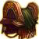 Mã thương | Nơi bán các thần câu và dụng cụ dùng trên ngựa. |
| 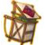 Tạp hóa | Nơi chuyên thu mua và bán các vật phẩm đạo cụ chuyên dùng trong [kỹ năng sống](../he-thong/ky-nang-song.md) của nhân vật. |
| 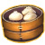 Quán ăn nhẹ | Nơi chuyên các món ăn đặc sản của vùng miền, có thể tăng 1 vài [thuộc tính nhân vật](./thuoc-tinh-nhan-vat.md) trong thời gian ngắn, thậm chí có bán cả bí quyết thực phổ. |
|  Thương nhân đặc thù | Chuyên bán những thư phẩm, sách phối chế cao cấp. |
| 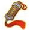 Danh vọng thương nhân | Là nơi chuyên bán các loại trang bị dụng cụ danh vọng cao cấp như trang bị tím, sách quý, phối phương ... |
| 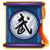 Võ sư | Được chia thành Võ Sư Giang Hồ và Võ Sư Môn Phái, các vị võ sư sẽ là người dẫn dắt và hướng dẫn các kỹ năng giang hồ và kỹ năng môn phái qua từng cấp độ tu luyện. |
| 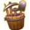 Cửa hàng kỹ năng sống | Là nơi chứa các loại kỹ năng sống. Mỗi loại kỹ năng sống đều có huấn luyện sư riêng biệt, muốn học kỹ năng sống nào phải tìm đúng vị sư phụ. |
| 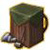 Cửa hàng nguyên liệu | Nơi cung cấp các loại nguyên vật liệu dùng trong rèn chế, hoặc nấu nướng như than hồng, búa rèn, khuôn đúc, tương dầu, rau cải … |
| 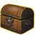 Tổng quản kho | Dịch vụ dây chuyền trên lục địa Đại Đường, bảo quản tài sản và tiền bạc của hiệp khách hoàn toàn miễn phí. |
| 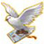 Tín sứ | Bưu chính Đại Đường, nhanh và chính xác, một lá thư chỉ nhận phí 30 đồng. |
| 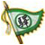 Xa phu/Thuyền phu | Công cụ giao thông đơn giản và thân thiện với môi trường. |
| 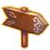 Thủ vệ | NPC có trách nhiệm bảo vệ và giải đáp thắc mắc, chỉ đường đến những nơi nhân vật cần tìm. |

hãy tìm hiểu về chức năng NPC thông dụng để tham gia trò chơi một cách thuận tiện nhất.

Nguồn: VNG (bài viết và hình ảnh)
