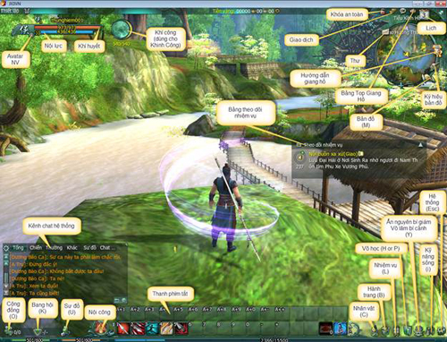
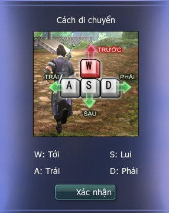
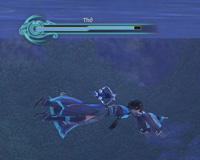
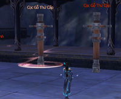
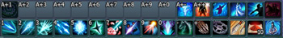

Khi lần đầu đăng nhập vào trò chơi Võ Lâm 3, chắc hẳn đồng đạo sẽ có nhiều bỡ ngỡ trong quá trình thao tác nhân vật. Do đó, cần tham khảo các hướng dẫn bên dưới để hiểu rõ hơn về cách thao tác các hoạt động này.

- Cơ bản

- Chiến đấu

- Trọng thương

- Nhiệm vụ

- Giao tiếp

- Phím tắt

### Thao tác cơ bản

| Thao tác | Ghi chú |
| --- | --- |
| **Di chuyển** | Sử dụng W, S, A, D để di chuyển sang trái, phải, tới lui hoặc các phím mũi tên trên bàn phím. Sử dụng Q, E để di chuyển ngang sang trái, phải. Khi di chuyển, có thể dùng chuột phải để chuyển hướng. Nếu muốn nhân vật tự động di chuyển về phía trước có thể nhấn phím G.  |
| **Nhảy** | Nhấn phím Space để nhảy, trong không trung có thể nhấn Space một lần nữa để tung mình cao hơn. |
| **Chuyển tầm nhìn** | Nhấn giữ và kéo phím chuột trái để thay đổi góc quay nhưng không làm nhân vật xoay theo hướng đó. Nhấn giữ và kéo phím chuột phải để thay đổi hướng nhân vật cùng với góc quay. Ngoài ra, để phóng to hoặc thu nhỏ góc quay, đồng đạo có thể cuộn trục chuột. Nhấn End có thể nhanh chóng đổi góc nhìn thẳng vào nhân vật, tiện lợi cho các nhân sĩ không quen thao thác chuyển hướng có thể dễ dàng quan sát sau lưng nhân vật. Nếu muốn quay lại góc nhìn bình thường thì đồng đạo nhấn phím Home. |
| **Đi bộ** | Mặc định nhân vật sẽ ở trạng thái chạy. Nhấn phím có ký tự "／" nhân vật sẽ chuyển sang trạng thái đi bộ. |
| **Cưỡi ngựa** | Khi luyện đến cấp 20 và hoàn thành nhiệm vụ chỉ định, đồng đạo có thể học được thuật cưỡi ngựa. Sau đó có thể tìm mua bảo mã lương câu tại các vị NPC Mã Thương. Phím T là phím tắt để lên xuống ngựa. Giá trị của ngựa khác nhau thì tốc độ phi cũng không giống nhau gồm 03 loại tốc độ: 60%, 80% và 100%.  |
| **Bơi** | Khi đang ở khu vực nước sâu, nhân vật sẽ chuyển sang trạng thái bơi，trạng thái cưỡi ngựa sẽ tự động được hủy bỏ. Nếu bạn muốn lặn xuống nước，chỉ cần để góc quay nghiêng 1 hướng nhất định sau đó di chuyển về trước. Nếu lặn quá lâu (mặc định là 60 giây）nhân vật sẽ bị ngộp thở và bị thương. Do đó, cần chú ý thanh trượt để canh thời gian đang lặn hợp lý. Có thể dùng phím space để nhảy trên nước, một số võ công môn phái có thể thi triển trên mặt nước.  |
| **Tương tác** | Nhấp chuột trái để chọn vật phẩm hoặc NPC chỉ định, nhấp chuột phải có thể đối thoại với NPC hoặc kích hoạt một đối tượng nào đó. Con trỏ chuột sẽ thay đổi khác nhau đối với từng loại mục tiêu khác nhau. Nếu con trỏ chuột thay đổi thì nhấp chuột phải sẽ tạo ra 1 sự tương tác với NPC. Ví dụ: thanh gươm đại diện cho tấn công, bong bóng đại diện cho đối thoại. |

### Tổng hợp các Phím tắt

|  | Chức năng | Phím tắt |
| --- | --- | --- |
| Di chuyển | Tiến lên phía trước | W hoặc mũi tên lên hoặc nhấn giữ Chuột trái và phải |
| Lùi lại phía sau | S hoặc mũi tên xuống |  |
| Quay trái | A hoặc mũi tên trái |  |
| Quay phải | D hoặc mũi tên phải |  |
| Đi ngang qua trái | Q |  |
| Đi ngang qua phải | E |  |
| Nhảy lên | Khoảng trắng |  |
| Cưỡi ngựa | T |  |
| Xuất vũ khí | Z |  |
| Đứng/Ngồi | V hoặc X |  |
| Chạy/Đi bộ | / |  |
| Tự động di chuyển lên phía trước | Num Lock (***check lại G hoặc nhấn giữ Chuột trái và phải***) |  |
| Kích hoạt khu vực tán gẫu | Enter |  |
| Trả lời nhanh | R |  |
| Giao diện | Giao diện hệ thống | Esc |
| [Thuộc tính nhân vật](./thuoc-tinh-nhan-vat.md) | C |  |
| Hảo hữu | O |  |
| [Bang hội](../he-thong/bang-hoi.md) | K |  |
| Nhiệm vụ | L |  |
| Kỹ năng | P |  |
| Giao diện [kinh mạch](../he-thong/kinh-mach.md) | N |  |
| Giao diện [kỹ năng sống](../he-thong/ky-nang-song.md) | I |  |
| Giao diện kỹ năng đọc sách | J |  |
| Mở túi vật phẩm | B |  |
| Bản đồ | M |  |
| Hiển thị tốc độ hình | Ctrl+F |  |
| Hình trong hình | Ctrl+F1 |  |
| Ẩn/Hiện hình ảnh trong game | Ctrl+F2 |  |
| Ẩn/Hiện các cửa sổ giao diện | Ctrl+U |  |
| Thiết lập Camera | Kéo gần góc nhìn | MouseWheelUp |
| Đẩy xa góc nhìn | MouseWheelDown |  |
| Di chuyển góc nhìn | Chuột trái |  |
| Chuyển góc nhìn và nhân vật | Chuột phải |  |
| Chụp hình | Print Scrn |  |
| Quay phim | Ctrl+Shift+K |  |
| Góc nhìn sau lưng nhân vật | Home |  |
| Góc nhìn phía trước nhân vật | End |  |
| Chọn mục tiêu | Tự chọn bản thân | F1 |
| Chọn đồng đội 1 | F2 |  |
| Chọn đồng đội 2 | F3 |  |
| Chọn đồng đội 3 | F4 |  |
| Chọn đồng đội 4 | F5 |  |
| Chọn kẻ thù | Tab |  |
| Thanh phím tắt | Thanh thứ nhất | Shift+1 |
| Thanh thứ hai | Shift+2 |  |
| Thanh thứ ba | Shift+3 |  |
| Chuyển thanh phím tắt lên | PageUp |  |
| Chuyển thanh phím tắt xuống | PageDown |  |

### Thao tác chiến đấu

| Thao tác | Ghi chú |
| --- | --- |
| **Chọn mục tiêu** | Trong một phạm vi giới hạn nhất định có 3 cách để chọn mục tiêu： Dùng phím trái chuột. Dùng phím Tab để chọn mục tiêu gần nhất. Khi bị tấn công, hệ thống sẽ chọn mục tiêu đang tấn công.  |
| **Chiêu thức & di chuyển** | Nhấn phím P để mở giao diện võ công, nhấn chuột trái vào biểu tượng võ công đã học được để thi triển di chuyển. Dùng chuột trái để kéo biểu tượng vào thanh phím tắt bên dưới màn hình để sử dụng bằng phím tắt.  |
| **Nhặt vật phẩm** | Sau khi tiêu diệt quái, nhấp chuột phải vào quái để nhặt vật phẩm. Có thể sử dụng Shift + Chuột phải để nhặt tất cả vật phẩm. |
| **Hành trang và sử dụng vật phẩm** | Nhấn phím B để mở hành trang, nhấp chuột phải để sử dụng các vật phẩm trong hành trang hoặc kéo vào thanh phím tắt để sử dụng bằng phím tắt. |
| **Thiền** | Trong lúc chiến đấu, các giá trị máu và nội lực sẽ bị giảm và không thể tự hồi phục. Đồng đạo có thể nhấn phím V để chuyển sang trạng thái thiền để hồi phục máu & nội lực. Nếu bị tấn công hoặc thực hiện các hành động khác đều làm gián đoạn quá trình thiền. Thời gian để phục hồi toàn bộ máu & nội lực mất khoảng 30 giây. |

### Thao tác khi trọng thương

Trong quá trình hành tẩu giang hồ, có thể đồng đạo sẽ gặp một đối thủ mạnh hơn và nhân vật của đồng đạo bị trọng thương. Khi đó ngoài việc trò chuyện và quan sát xung quanh với sự hạn chế hướng nhìn thì đồng đạo sẽ không thể làm bất cứ gì khác.

- Có 02 cách để tiếp tục chiến đấu sau khi bị thương:

- **Sự bảo vệ sau khi phục hồi phục chấn thương**: Sau mỗi lần phục hồi chấn thương, đồng đạo sẽ có 6 giây trong trạng thái tàng hình để thoát khỏi vòng vây kẻ thù.

- **Độ bền thiết b**ị: Sau mỗi chấn thương, độ bền thiết bị sẽ giảm 10% nếu phục hồi tại chỗ. Nếu trở về trại hoặc được sự giúp đỡ của nhân vật khác thì độ bền thiết bị sẽ giảm ít hơn 5%.

- **Hồi phục chấn thương trong phó bản**: Chỉ có thể chọn cách quay lại cổng phó bản và sau đó đi lại nơi chiến đấu trước đó.

- **Tự đoạn kinh mạch**: Có thể mở giao diện võ công và sử dụng chiêu Tự đoạn kinh mạch trong võ công giang hồ để trở về trại gần nhất. Giãn cách xuất chiêu là 2 giờ và giảm độ bền của thiết bị. Đây không phải là cách tốt nhất để trở về trại, do đó nên hạn chế sử dụng.

### Thao tác nhận nhiệm vụ

| Thao tác | Nội dung |
| --- | --- |
| **Nhận và trả nhiệm vụ** | **Nhận nhiệm vụ**: Nếu ký hiệu màu xanh dương là nhiệm vụ tuần hoàn. Nếu ký hiệu màu xanh lá cây là nhiệm vụ cấp thấp hơn cấp của nhân vật. Nếu hoàn thành nhiệm vụ đó thì đồng đạo sẽ không được tăng kinh nghiệm mà còn suy giảm một mức nhất định. Nếu ký hiệu màu xám là nhân vật chưa đủ cấp để nhận nhiệm vụ. |
| **Trả nhiệm vụ**: Khi trả nhiệm vụ, phần thưởng nhận được là kinh nghiệm, vàng, bạc, vật phẩm,.. Khi mở bản đồ, đồng đạo sẽ thấy một ký hiệu nhỏ như cuộn giấy, chỉ dẫn nơi trả nhiệm vụ. |  |
| **Theo dõi nhiệm vụ** | Hệ thống sẽ theo dõi các nhiệm vụ đã nhận gần đây và tiến độ thực hiện. Đồng thời hiển thị trên giao diện chính. Đồng đạo có thể xem nhiệm vụ được giao, các tác vụ hiện hành và khoảng cách đến nơi làm nhiệm vụ. |
| **Kỷ lục nhiệm vụ** | Các nhiệm vụ sẽ liên tục xuất hiện trong hồ sơ của nhân vật. Đồng đạo có thể nhấn phím L mở giao diện nhiệm vụ để xem các nhiệm vụ hiện có và mô tả chi tiết của từng loại. |
| **Giảm kinh nghiệm nhiệm vụ** | Khi hoàn thành nhiệm vụ có cấp độ cao hơn nhiệm vụ 4 cấp, thì phần thưởng chỉ có thể nhận được 85% kinh nghiệm, nhiệm vụ cấp thấp hơn phần thưởng cũng sẽ giảm dần theo. |

### Giao tiếp

| Thao tác | Ghi chú |
| --- | --- |
| Gửi tin nhắn | Nhấp chuột trái hoặc nhấn phím Enter để kích hoạt hộp thoại trò chuyện. Nhập nội dung chat và nhấn Enter để gửi tin nhắn. |
| Kênh trò chuyện | Bằng cách gõ lệnh chat: /s, /y, /w, /p để chuyển đổi giữa các kêng tương ứng: kênh lân cận, kênh nhóm, kênh bản đồ, kênh tổng hợp. |
| Tùy chỉnh hệ thống trò chuyện | Nhấp chuột phải vào các nút trên kênh tán gẫu sẽ hiện ra 1 giao diện có thể tùy chỉnh những thuộc tính sau: Khóa, tạo mới, đổi tên một cửa sổ tán gẫu. Chỉnh kích thước và font chữ của hộp thoại tán gẫu. Điểu chỉnh màu nền và độ trong suốt. Chọn hiển thị các kênh trò chuyện,… |
| Các thao tác nhanh trên kênh tán gẫu | Nhấp chuột trái vào tên người chơi trong kênh chat, có thể trò chuyện riêng với người đó. Nhấp chuột phải chọn tên người chơi trong kênh chat có thể chọn trò chuyện riêng, tổ đội, thêm hảo hữu, chặn chức năng trò chuyện đối với người chơi này. Khi chặn chức năng trò chuyện của một nhân vật nào đó, đồng đạo sẽ không thấy được thông tin liên quan của người đó. Để mở lại, đồng đạo nhấn phím tắt O mở giao diện cộng đồng và bỏ chặn chức năng trò chuyện. |
| Biểu tượng cảm xúc | Ngoài việc trao đổi bằng các ký tự, đồng đạo có thể nhập các lệnh vào cửa sổ tán gẫu để thể hiện các hành động khác nhau của nhân vật. Việc bổ sung hành động và biểu tượng cảm xúc làm cho cuộc trò chuyện trở nên thú vị hơn. |

Nguồn: VNG (bài viết và hình ảnh)
